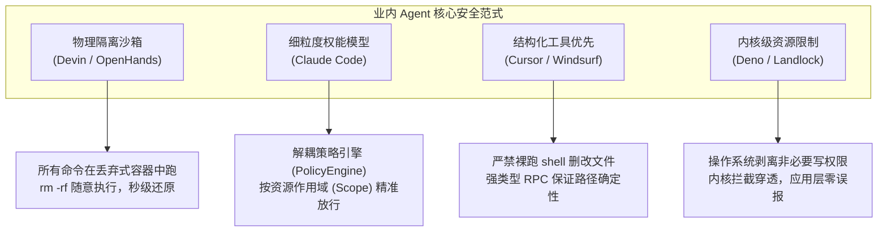
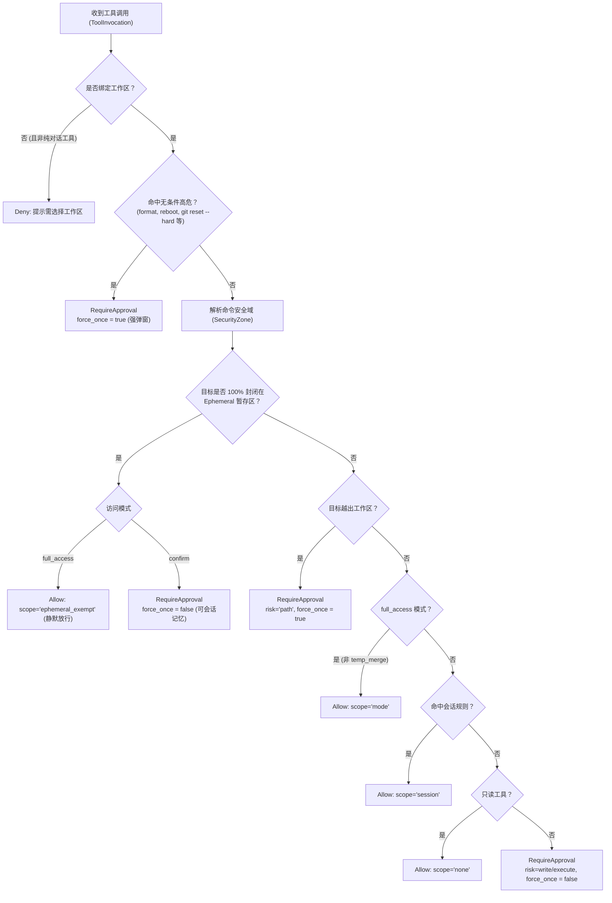

# Agent 安全策略引擎与暂存区自治治理知识库
# Agent Security Policy Engine & Ephemeral Zone Governance Knowledge

本文档系统记录 `harness_mini` 中 **Agent 运行时安全策略引擎（`PolicyEngine`）**、**三级安全域模型（Security Zones）**、**Shell 命令安全分类器（`CommandClassifier`）** 以及 **工程衍生暂存区（Ephemeral Zone）免审自治治理** 的架构根因分析、业内对比、重构设计与工程落地规范。

---

## 目录
- [一、背景与核心痛点剖析（现场还原）](#一背景与核心痛点剖析现场还原)
  - [1. 历史故障现场还原](#1-历史故障现场还原)
  - [2. 代码级根因诊断](#2-代码级根因诊断)
  - [3. “堆叠式打补丁”的弊端与反思](#3-堆叠式打补丁的弊端与反思)
- [二、业内顶尖 AI Agent 安全与执行范式调研](#二业内顶尖-ai-agent-安全与执行范式调研)
  - [1. 四大主流安全执行架构](#1-四大主流安全执行架构)
  - [2. 关键经验与借鉴意义](#2-关键经验与借鉴意义)
- [三、架构全景：独立策略引擎与分层安全域](#三架构全景独立策略引擎与分层安全域)
  - [1. 架构全景决策流程](#1-架构全景决策流程)
  - [2. 三级安全域模型（SecurityZone）](#2-三级安全域模型securityzone)
  - [3. 命令安全分类与作用域提取（CommandClassifier）](#3-命令安全分类与作用域提取commandclassifier)
- [四、核心模块设计与落地实现](#四核心模块设计与落地实现)
  - [1. 模块组织结构](#1-模块组织结构)
  - [2. 路径解析与 Git Bash 盘符兼容（`zones.rs`）](#2-路径解析与-git-bash-盘符兼容zonesrs)
  - [3. 变量展开与子命令边界绑定（`classifier.rs`）](#3-变量展开与子命令边界绑定classifierrs)
  - [4. 统一纯函数流水线（`pipeline.rs`）](#4-统一纯函数流水线pipeliners)
  - [5. `agent.rs` 深度解耦与瘦身](#5-agentrs-深度解耦与瘦身)
- [五、边界防御场景与鲁棒性保障矩阵](#五边界防御场景与鲁棒性保障矩阵)
- [六、工程验证与回归体系](#六工程验证与回归体系)

---

## 一、背景与核心痛点剖析（现场还原）

### 1. 历史故障现场还原
在历史会话（Session ID: `672cc233-7096-4e95-9b7a-f261e36b3fb9`，工作区为 `harness_go`，访问模式为 `full_access`）中，Agent 执行构建自测时发起了如下工具调用：

```bash
bash -lc 'T=.harness/tmp/unz; rm -rf $T; mkdir -p $T; tar -xzf dist/harness-go-0.1.0-linux-amd64.tar.gz -C $T; ls -l $T/harness-go-0.1.0-linux-amd64/; echo "=== 直接运行交叉编译的 linux 二进制（预期无法在 windows 执行）==="; $T/harness-go-0.1.0-linux-amd64/harness-go -h 2>&1 | head -3'
```

**实际操作目的**：清理并重建项目内部的临时缓存目录 `.harness/tmp/unz`，以便解包核验产物文件。  
**系统异常行为**：即便用户已开启了完全访问模式（`full_access`），系统依然弹出拦截确认框（`approval_scope: once`, `risk: execute`, `risk_source: regex`），强行打断 Agent 的无人值守执行。

### 2. 代码级根因诊断
1. **“正则 WAF”反模式（只认动词，不看宾语）**：
   原系统通过 `is_high_danger` 中的粗暴正则 `\brm\s+(-[a-z]+)*\s*-[a-z]*r[a-z]*\b` 进行拦截。只要命令中出现 `rm -r` / `rm -rf`，一律判为高危，完全不分析删除的目标是系统根目录、业务源码，还是微小的临时缓存。
2. **`agent.rs` 权限检查瀑布流倒置**：
   原判定逻辑中，`high_danger` 检测位于最顶层，直接压制了 `full_access` 访问模式；同时被赋予 `force_once = true`，导致用户即使点了允许也无法在会话中记忆放行。
3. **白名单机制脱节**：
   原代码仅在 `args["path"]` 上有简单的 `.harness` 判断，但 `run_command` 参数仅有 `command`，路径参数为空，白名单完全无法保护终端命令。

### 3. “堆叠式打补丁”的弊端与反思
如果采取“哪里漏了就补一个 `else if`”的做法（例如在 `helpers.rs` 里加 `if cmd.contains(".harness/tmp")`），会导致：
* **边界极其脆弱**：一旦换成 Windows 的 `rd /s`、变量拼接 `$T`、Git Bash 盘符 `/d/` 或相对路径 `./.harness`，补丁就会立即失效；
* **逻辑不可维护**：`agent.rs` 已经膨胀到数千行，多层嵌套的权限判断让代码阅读与修改举步维艰，极易引发回归灾难。

---

## 二、业内顶尖 AI Agent 安全与执行范式调研

针对“如何平衡安全防御与自动化流畅度”，业界主流产品给出了不同的工程范式：

### 1. 四大主流安全执行架构


* **Devin / OpenHands**：采用 Docker/MicroVM 隔离。在虚拟环境内，临时目录清理拥有完全的自由，不需要审批。
* **Claude Code**：建立专门的权限策略模块，区分全局命令与路径作用域（Path Scope），支持按前缀与目录记忆放行。
* **Cursor / Windsurf**：强化结构化工具（RPC），普通文件修改不通过 Shell 裸跑，利用绝对规范化路径（`canonicalize`）进行数学上确定性的安全判定。

### 2. 关键经验与借鉴意义
* **关注点分离（SoC）**：必须将“安全策略决策”从“工具调度引擎”中完整剥离，形成独立的策略领域模块。
* **分层安全域（Security Zones）**：操作对象的危险性由其**所处的空间边界**决定。临时衍生目录的损毁对用户是零代价的，应赋予其自治权。
* **语义边界识别**：不能把整行复杂脚本混为一谈，必须将多命令分段，准确识别删除动词的具体作用对象。

---

## 三、架构全景：独立策略引擎与分层安全域

### 1. 架构全景决策流程
重构后的决策流程遵循纯函数、单向流、职责链设计：



### 2. 三级安全域模型（SecurityZone）
系统将所有操作涉及的物理/逻辑路径严格划分为三个安全域：

| 安全域等级 | 包含资源与路径 | 危险性与权能特征 | 策略行为 |
| :--- | :--- | :--- | :--- |
| **Level 0: Critical<br/>(核心禁区)** | 1. 系统盘根目录（`/`, `C:\`）<br>2. 系统关键目录（Windows, /etc, /usr）<br>3. 用户个人配置（`~/.ssh`, `~/.bashrc`）<br>4. 项目版本控制核心（`.git/`）<br>5. 工作区外部未授权路径<br>6. 根通配与无法展开的危险变量（`/*`, `$UNKNOWN`） | **毁灭性、不可逆、破坏环境** | 无论何种模式，**强制单次审批（`force_once = true`）**，禁止记忆放行。 |
| **Level 1: Workspace<br/>(工程业务区)** | 当前项目主代码库内的源文件、配置文件与静态资源（除去暂存区以外的部分）。 | **用户核心资产，改动有业务成本** | 1. `full_access` 模式下静默放行。<br>2. `confirm` 模式下常规审批，支持“本会话允许”。<br>3. 只读工具静默放行。 |
| **Level 2: Ephemeral<br/>(衍生暂存区)** | 1. `.harness/tmp/**`<br>2. `.harness/cache/**`<br>3. `target/tmp/**`<br>4. `.dev-data/temp-*`<br>5. 操作系统标准临时目录（`std::env::temp_dir()/**`）<br>6. 临时空间会话的独占沙箱根 | **可丢弃、生命周期短暂、无用户资产** | **自治无损**：即使执行递归清理（`rm -rf`），在 `full_access` 下亦**直接静默放行**；在 `confirm` 下允许会话级记忆。 |

### 3. 命令安全分类与作用域提取（CommandClassifier）
针对终端命令执行，分类器实现两级拆解：
1. **无条件系统高危（Unconditional High Danger）**：
   * 包含：`format [a-z]:`、`mkfs`、`dd if=`、`shutdown`、`reboot`、`reg delete`、`git push .*--force`、`git reset --hard`。
   * 此类命令具备破坏整个开发机环境的潜在风险，与具体路径无关，必须一律拦截。
2. **路径相关破坏性操作（Path-Scoped Destructive）**：
   * 包含：`rm -r`、`rm -rf`、`del /s`、`rd /s`、`rmdir /s`。
   * **子命令边界隔离**：将复合命令按 `;`、`&&`、`||`、`|`、`\n` 截断，确保只提取属于删除动词自身的目标参数，绝不波及后续命令。
   * **环境变量展开**：支持显式提取 Shell 中的变量赋值（如 `T=.harness/tmp/unz` 或 `$T = "..."`），将 `$T` 还原为物理路径。

---

## 四、核心模块设计与落地实现

重构后，所有权限判定逻辑完整封装在 `src-tauri/src/policy/` 模块下：

### 1. 模块组织结构
```
src-tauri/src/policy/
├── mod.rs             # 对外暴露统一外观接口与模型重导出
├── types.rs           # SecurityZone, CommandRiskCategory, PolicyDecision 等领域类型
├── zones.rs           # ZoneResolver 路径安全域判定与规范化
├── classifier.rs      # CommandClassifier Shell 语义与变量解析
├── pipeline.rs        # PolicyEngine::evaluate 纯函数责任链
└── tests.rs           # 完整单测矩阵 (高危、暂存区、通配符、越界覆盖)
```

### 2. 路径解析与 Git Bash 盘符兼容（`zones.rs`）
在 Windows 平台上，开发者及 Agent 常通过 Git Bash 运行命令，会产生形如 `/d/WorkSpace/Project/...` 的 MSYS 挂载路径。`ZoneResolver` 原生支持此种语法的归一化：

```rust
pub fn normalize_path_str(p: &str) -> String {
    let trimmed = p.trim().trim_matches(|c| c == '\'' || c == '"');
    let norm = trimmed.replace('\\', "/");

    // 处理 Git Bash / MSYS 盘符语法：/d/path -> D:/path
    if norm.len() >= 3 && norm.starts_with('/') && norm.chars().nth(2) == Some('/') {
        let drive = norm.chars().nth(1).unwrap();
        if drive.is_ascii_alphabetic() {
            return format!("{}:/{}", drive.to_ascii_uppercase(), &norm[3..]);
        }
    }
    norm
}
```
结合路径穿越校验（防止 `../` 逃逸）与 `.git` 模式识别，实现毫秒级且确定性的安全域定位。

### 3. 变量展开与子命令边界绑定（`classifier.rs`）
针对 Agent 习惯书写的局部脚本模式，解析器在子命令边界内捕获目标：

```rust
if has_rm {
    for cap in RM_RE.get().unwrap().captures_iter(cmd) {
        let match_end = cap.get(0).unwrap().end();
        let remaining = &cmd[match_end..];
        // 严格以命令分隔符断句，不越界提取后续 mkdir/tar 的参数
        let sub_cmd = remaining.split([';', '&', '|', '\n']).next().unwrap_or("");
        for token in sub_cmd.split_whitespace() {
            let t = token.trim_matches(|c| c == '\'' || c == '"');
            if t.is_empty() || t.starts_with('-') {
                continue;
            }
            let expanded = Self::expand_vars(t, &var_map);
            targets.push(expanded);
        }
    }
}
```

### 4. 统一纯函数流水线（`pipeline.rs`）
`PolicyEngine::evaluate` 实现了无副作用的纯策略裁决，根据上下文返回清晰的三态：
* `PolicyDecision::Allow { scope }`
* `PolicyDecision::RequireApproval { risk, force_once, risk_source, preview }`
* `PolicyDecision::Deny { reason }`

### 5. `agent.rs` 深度解耦与瘦身
`agent.rs` 中原本长达 115 行的 `if-else` 瀑布流被整体精简为单一的策略评估调度：

```rust
// ---- 策略引擎安全评估（访问模式、安全域、规则判定） ----
let (access_mode, session_rules) = {
    let db = state.db.lock().unwrap();
    let mode = store::get_session(&db, session_id)
        .ok()
        .flatten()
        .and_then(|s| s.access_mode)
        .unwrap_or_else(|| "confirm".into());
    (mode, store::list_session_rules(&db, session_id).unwrap_or_default())
};

let policy_decision = crate::policy::PolicyEngine::evaluate(
    &crate::policy::ToolInvocation {
        name: tool_name,
        args,
        risk,
    },
    &crate::policy::SecurityContext {
        workspace_root: &ctx.workspace,
        sandbox_root: ctx.sandbox_root.as_deref(),
        access_mode: &access_mode,
        session_rules: &session_rules,
        is_temp_workspace: ctx.temp.is_some(),
    },
);
```
同时删除了 `agent.rs` 中重复维护的 `build_preview` 逻辑，**净减少 135 行冗余胶水代码**，实现了控制流的极简与清晰。

---

## 五、边界防御场景与鲁棒性保障矩阵

| 测试场景编号 | 命令 / 路径调用样例 | 提取目标与识别安全域 | 最终策略输出 | 安全/体验设计意图 |
| :---: | :--- | :--- | :--- | :--- |
| **Case 1** | `bash -lc 'T=.harness/tmp/unz; rm -rf $T; mkdir -p $T'` | 目标：`.harness/tmp/unz`<br>域：`Ephemeral` | `Allow { scope: "ephemeral_exempt" }`<br>*(full_access 模式)* | **解决本次痛点**：缓存清理完全免审，不打断无人值守任务。 |
| **Case 2** | `bash -lc 'T=.harness/tmp/unz; rm -rf $T'` | 目标：`.harness/tmp/unz`<br>域：`Ephemeral` | `RequireApproval { force_once: false }`<br>*(confirm 模式)* | 确认模式下提示审批，但允许用户勾选“本会话允许”，避免反复弹窗。 |
| **Case 3** | `rm -rf /` 或 `rm -rf *` 或 `del /s /q *.*` | 目标：根/全局通配<br>域：`Critical` | `RequireApproval { force_once: true }` | 坚决拦截毁灭性误删，强制单次人工确认。 |
| **Case 4** | `rm -rf $UNKNOWN_VAR` | 变量未解析（以 `$` 开头）<br>域：`Critical` | `RequireApproval { force_once: true }` | 防御未赋值变量退化为空串导致误删当前工作区或根目录。 |
| **Case 5** | `rm -rf .git` 或 `rm -rf .git/objects` | 目标：版本库元数据<br>域：`Critical` | `RequireApproval { force_once: true }` | 核心版本控制库受到绝对防护。 |
| **Case 6** | `git reset --hard HEAD~1` | 无条件高危匹配 | `RequireApproval { force_once: true }` | 规避代码版本硬回滚风险。 |
| **Case 7** | `read_file` 访问 `../secret.txt` | 越出工作区/沙箱根<br>域：`Critical` | `RequireApproval { risk: "path", force_once: true }` | 越界探测防御，防止越权盗取外部敏感信息。 |
| **Case 8** | `write_file` 写入 `.harness/tmp/log.json` | 目标位于缓存区<br>域：`Ephemeral` | `Allow { scope: "ephemeral_exempt" }` | 暂存文件高速写入无阻滞。 |

---

## 六、工程验证与回归体系

本次重构落地经过了三层严格的自动化测试检验：

1. **策略引擎专属测试矩阵（`src-tauri/src/policy/tests.rs`）**：
   * `test_unconditional_high_danger_blocked`：验证全局高危硬拦截。
   * `test_ephemeral_cache_cleanup_allowed_in_full_access`：验证历史触发审批的实际命令 1、跨盘符命令 2、Windows `rd /s` 命令在全权模式下 100% 免审放行。
   * `test_ephemeral_cleanup_in_confirm_mode_allows_session_memory`：验证 confirm 模式下支持会话记忆放行（`force_once = false`）。
   * `test_root_and_wildcard_deletions_are_critical`：验证根目录、通配符及 `.git` 拦截。
   * `test_file_tools_zones`：验证文件只读放行、缓存免审、业务代码提示、越界拦截。
   * `test_empty_workspace_denied`：验证空工作区保护。
2. **全库回归验证**：
   * 运行 `cargo test`，涵盖 SQLite 存储、CAS 快照、计划引擎、JEV 评估等在内的 **全库所有 204 项单元测试全部一次性通过**（0 失败）。
3. **架构体检指标**：
   * 消除编译期无用函数报警，主干 `agent.rs` 复杂度显著降低，从根本上杜绝了对特定正则的“打补丁式维护”。
