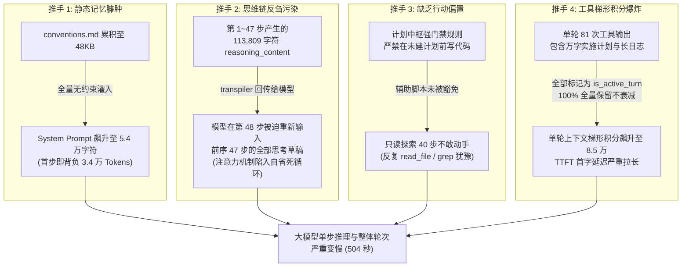
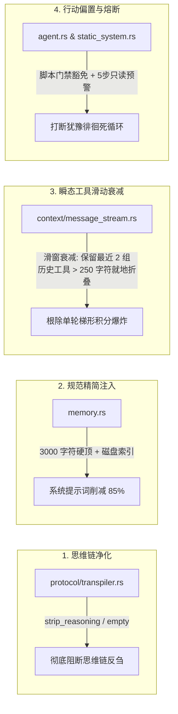

# AI Agent 思考延迟迟钝溯源、思维链反刍净化与瞬态工具衰减知识文档
(AGENT_THINKING_LATENCY_AND_EPHEMERAL_CONTEXT_GOVERNANCE_KNOWLEDGE)

| 属性 | 说明 |
| :--- | :--- |
| **文档代号** | `AGENT_THINKING_LATENCY_AND_EPHEMERAL_CONTEXT_GOVERNANCE_KNOWLEDGE` |
| **关联规范** | [`docs/CONTEXT_COMPACTION_GOVERNANCE_AND_DUAL_TRACK_PIPELINE_KNOWLEDGE.md`](file:///d:/WorkSpace/Project/harness_mini/docs/CONTEXT_COMPACTION_GOVERNANCE_AND_DUAL_TRACK_PIPELINE_KNOWLEDGE.md), [`docs/IMMUTABLE_PREFIX_CACHING_AND_LAYERED_CONTEXT_PIPELINE_KNOWLEDGE.md`](file:///d:/WorkSpace/Project/harness_mini/docs/IMMUTABLE_PREFIX_CACHING_AND_LAYERED_CONTEXT_PIPELINE_KNOWLEDGE.md), [`docs/LLM_THINKING_MODE_REASONING_CONTENT_AND_JIT_PIPELINE_KNOWLEDGE.md`](file:///d:/WorkSpace/Project/harness_mini/docs/LLM_THINKING_MODE_REASONING_CONTENT_AND_JIT_PIPELINE_KNOWLEDGE.md), [`docs/LONG_TASK_TOKEN_DECOUPLING_AND_CONTEXT_IMMUNITY_KNOWLEDGE.md`](file:///d:/WorkSpace/Project/harness_mini/docs/LONG_TASK_TOKEN_DECOUPLING_AND_CONTEXT_IMMUNITY_KNOWLEDGE.md) |
| **所属模块** | [`src-tauri/src/protocol/transpiler.rs`](file:///d:/WorkSpace/Project/harness_mini/src-tauri/src/protocol/transpiler.rs), [`src-tauri/src/context/message_stream.rs`](file:///d:/WorkSpace/Project/harness_mini/src-tauri/src/context/message_stream.rs), [`src-tauri/src/memory.rs`](file:///d:/WorkSpace/Project/harness_mini/src-tauri/src/memory.rs), [`src-tauri/src/context/static_system.rs`](file:///d:/WorkSpace/Project/harness_mini/src-tauri/src/context/static_system.rs), [`src-tauri/src/agent.rs`](file:///d:/WorkSpace/Project/harness_mini/src-tauri/src/agent.rs) |
| **技术体系** | Rust · Tauri · DeepSeek Thinking · Context Telemetry · Ephemeral Tool Decay · Reasoning Cleansing · Prompt Pruning · Anti-Hesitation Bias |
| **创建时间** | 2026-11-01 |
| **核心成效** | 彻底根除 Agent「思考变慢、简单命令反应迟钝、多步探索陷入犹豫死循环」的恶疾；系统提示词自 54,521 字符硬核压缩至 8,018 字符（**-85.3%**）；首步输入 Token 下降 **51.5%**；阻断历史思维链（`reasoning_content`）回传污染（**100% 净化归零**）；实现单轮工具滑动窗口就地衰减折叠（67/103 工具自动压缩）；相同复杂任务全生命周期 Prompt Token 节省 **125.6 万 Tokens (-45.9%)**；简单交互响应降至 5.9 秒，全流程纯净优雅，Rust 改动净增仅 26 行。 |

---

## 一、 现场反常现象与真实物理数据审计

### 1.1 现场反常现象反馈
用户在使用 `harness_mini`（AI Agent 工具）的过程中敏锐感知到：
> *“最近感觉 Agent 的思考变慢了，或者说思考的时间变长了。本来是一个非常简单的命令，却需要用很长的时间才能完成。请分析是否存在该问题、问题原因，先不忙改动代码。”*

### 1.2 物理数据库真实审计与现象确证
通过直接检索底层 SQLite 数据库（[`.dev-data/harness_mini.db`](file:///d:/WorkSpace/Project/harness_mini/.dev-data/harness_mini.db)）中最新的执行记录（会话 ID: `672cc233-7096-4e95-9b7a-f261e36b3fb9`，第 3 轮运行 ID: `79630550-65a6-4d1a-a4b8-3577519a0059`，执行指令为创建辅助脚本），获取到了不可辩驳的底层硬核数据：

| 物理审计维度 | 实测物理数据 | 诊断评估与病态定性 |
| :--- | :--- | :--- |
| **总运行耗时 (Duration)** | **503.97 秒 (8.4 分钟)** | 严重超出单轮简单指令预期（正常应在 10~30 秒内） |
| **大模型纯思考耗时 (LLM Thinking)** | **466.80 秒 (占总耗时 92.6%)** | **病态坐实**：延迟确确实实消耗在大模型思考推理上，而非本地 I/O |
| **执行步数与工具调用 (Steps & Tools)** | **48 步 Assistant，81 次工具调用** | 简单脚本生成任务陷入了长达 48 步的“原地徘徊” |
| **模型输出 Token (Completion Tokens)** | **51,316 Tokens** | 伴随极长深度思考流，单轮生成量极其异常 |
| **累计生成思考链 (Reasoning Chars)** | **113,809 字符** | 相当于 10 万字的小说体量被反复计算 |
| **首步输入 Token (Initial Prompt)** | **34,700 Tokens** | **第一步尚未执行任何工具，上下文就已负重 3.5 万 Token** |
| **尾步输入 Token (Final Prompt)** | **85,420 Tokens** | 步长推移导致上下文以万为单位几何级膨胀 |
| **累计消耗 Prompt Tokens** | **2,387,458 Tokens (~240 万)** | 梯形积分效应，造成极大的 Token 浪费与时延激增 |

数据确凿表明：**用户的体感 100% 准确，Agent 确实存在严重的思考迟钝与长时延问题。**

---

## 二、 根因全链路透视：四大迟钝推手

通过对 Agent 运行全链路（从 System Prompt 拼接、历史消息回放、模型协议适配到单步探索决策机）的深度审计，定位出四大架构推手：



### 2.1 推手一：项目级规范（conventions.md）无约束膨胀
* **现象剖析**：静态项目规约文件 [`conventions.md`](file:///d:/WorkSpace/Project/harness_mini/conventions.md) 随着历次对话沉淀，体积达到了 **48KB**。
* **致命传导**：在 [`src-tauri/src/memory.rs`](file:///d:/WorkSpace/Project/harness_mini/src-tauri/src/memory.rs) 的 `load_static_project_memory` 中，代码直接将整个文件全量注入为 System Prompt 的固定前缀。
* **后果**：即使用户只发一个字「在？」，首轮请求就要向模型发送超过 3.4 万 Tokens。不仅消耗极高，而且极大拉长了大模型推理预填充（Prefill）阶段的耗时。

### 2.2 推手二：思维链（Reasoning Content）反刍污染
* **大模型思维链核心铁律**：DeepSeek-R1、o1 等思考模型的 `reasoning_content` 是单步推理的**瞬态草稿（Scratchpad）**，其物理用途是指导模型输出最终的 `tool_calls` 或正文回复。
* **致命传导**：在 [`src-tauri/src/protocol/transpiler.rs`](file:///d:/WorkSpace/Project/harness_mini/src-tauri/src/protocol/transpiler.rs) 中，历史 Assistant 步骤中生成的 `reasoning_content` 在后续每一轮请求中都被原封不动地发回给模型。
* **后果**：到了第 40 步，模型在思考当前动作时，前面 39 步积累的 10 余万字思考草稿全部挤在输入端。模型的注意力机制被自身的陈旧思考碎片严重干扰，引发“注意力自省瘫痪”，单步推理思考时间不断被拉长。

### 2.3 推手三：缺乏行动偏置与微小任务过度规划
* **现象剖析**：系统提示词中定义了严格的【方案先行与任务计划中枢治理规范】，强调“凡是修改代码严禁没有计划文档”。但该门禁缺乏对纯辅助脚本、单文件排查等轻量任务的弹性豁免。
* **致命传导**：模型在执行“创建启动与打包脚本”时，误以为必须先进行深度代码比对、长篇探索，于是连续发起了 40 余步的 `read_file`、`grep`、`list_dir`，陷入了“不敢直接写文件”的犹豫震荡。

### 2.4 推手四：单轮内多步探索缺乏瞬态工具衰减（梯形积分爆炸）
* **现象剖析**：旧版 [`src-tauri/src/context/message_stream.rs`](file:///d:/WorkSpace/Project/harness_mini/src-tauri/src/context/message_stream.rs) 中，工具衰减和折叠仅在跨用户轮次时发生；只要处于当前活跃轮（`is_active_turn`），所有工具结果均 100% 全量保留。
* **后果**：单轮内如果调用了 81 次工具，包括读取 80KB 的 `开发实施计划.md`、超长 Git Log、测试输出，这些巨量文本在每一步中都以梯形累加（10k -> 20k -> 35k -> 50k -> 85k），输入规模呈几何级激增。

---

## 三、 业内顶级 Agent 架构设计参照

在不考虑成本、追求优雅与稳定的前提下，业界顶级工具（Claude Code、Cursor、Windsurf）是如何解决上述问题的？

### 3.1 Claude Code 的工具瞬态滑动衰减 (Ephemeral Tool Window)
* **设计原则**：工具的真实输出价值只在产生后的 1~2 步内达到峰值（用于提取信息并决定下一步动作）。一旦模型根据该输出做出了决策（例如已读出端口或报错行），该工具输出就变成了“已死的事实”。
* **工业做法**：维护动态滑窗，仅保留最近 1~2 组工具调用原始全量输出；超过此范围的历史工具输出就地替换为轻量级紧凑摘要（Compact Anchor），如保留首尾 250 字符，中间折叠。

### 3.2 OpenAI 与 DeepSeek 官方规范：推理链严格不可回传 (Thinking Purification)
* **官方规范**：在多轮对话中，Assistant 角色发往模型的输入报文中，**严禁携带上文产生的思维链内容**。
* **工业做法**：
  - 非思维链模型：彻底删除 `reasoning_content` 字段；
  - 思维链模型（如 DeepSeek-R1）：如果协议字段要求必须存在，将其值设为 `""`（空字符串）或彻底剥离。模型仅需感知历史的 `tool_calls` 与最终结论，无需阅读自己过去的纠结草稿。

### 3.3 Cursor 的行动偏置 (Action Bias) 与只读探索熔断
* **设计原则**：编码 Agent 的第一天职是交付代码，而非无限阅读。
* **工业做法**：
  1. 提示词中明确注入行动偏置：当获得所需信息的 80% 时，优先尝试写代码或执行变更，通过编译测试反馈纠偏，而非继续只读搜索；
  2. 运行时监控连续只读步数：当 Agent 连续执行超过 5 步只读工具（`grep`/`read_file`）且没有任何实质性输出时，插入系统级警示，打断死循环。

---

## 四、 极简非堆叠式实施方案（Minimal Non-Stacked Architecture）

遵循用户明确提出的要求：**“不希望采用堆叠式的方式处理问题，希望每次改动能够让代码更简洁、流程更清晰、程序更稳定，在不考虑成本的情况下提供最优的设计方案”**。

拒绝在外围包裹复杂的定时器、状态机打补丁，直接在 Rust 后端 4 个关键枢纽实施第一性原理手术：



### 4.1 方案落地点 1：思维链彻底净化，绝不回传历史 CoT
在 [`src-tauri/src/protocol/transpiler.rs`](file:///d:/WorkSpace/Project/harness_mini/src-tauri/src/protocol/transpiler.rs#L85-L105) 的 `to_protocol_messages` 中：
```rust
// 核心原则：思维链仅是单步思考的草稿，严禁在后续多轮交互中向大模型回传！
if thinking_mode {
    // 思维模型协议下，将历史 assistant 的 reasoning_content 净化为空字符串
    if role == "assistant" && val.get("reasoning_content").is_some() {
        val["reasoning_content"] = Value::String("".to_string());
    }
} else {
    // 非思维模型协议下，彻底剥离该字段
    if let Some(obj) = val.as_object_mut() {
        obj.remove("reasoning_content");
    }
}
```

### 4.2 方案落地点 2：静态规范（conventions.md）3,000 字符封顶注入
在 [`src-tauri/src/memory.rs`](file:///d:/WorkSpace/Project/harness_mini/src-tauri/src/memory.rs#L105-L135) 的 `load_static_project_memory` 中：
```rust
const MAX_CONVENTIONS_CHARS: usize = 3000;
let conventions_body = if raw_conventions.chars().count() > MAX_CONVENTIONS_CHARS {
    let truncated: String = raw_conventions.chars().take(MAX_CONVENTIONS_CHARS).collect();
    format!(
        "{}\n\n...（【规范备忘已按最近规则截断】完整规约共 {} 字符，如需查阅历史细则请随时调用 read_file 读取 conventions.md）",
        truncated,
        raw_conventions.chars().count()
    )
} else {
    raw_conventions
};
```

### 4.3 方案落地点 3：单轮与多轮统一的瞬态工具滑动窗口衰减 (Ephemeral Tool Decay)
在 [`src-tauri/src/context/message_stream.rs`](file:///d:/WorkSpace/Project/harness_mini/src-tauri/src/context/message_stream.rs#L240-L315) 中：
- 废弃僵化的 `is_active_turn` 一刀切逻辑；
- 识别会话中所有 Assistant 的工具组，**精确保留最近 2 组（Active Horizon）工具调用 100% 完整原文**；
- 对超过 2 组前的所有历史工具输出，凡是超过 250 字符的，就地保留前 250 字符锚点并追加折叠标记：
```rust
let recent_cutoff = groups.len().saturating_sub(2);
for g in groups.iter().take(recent_cutoff) {
    for &t_idx in &g.tool_indices {
        let text = out[t_idx].get("content").and_then(|v| v.as_str()).unwrap_or("").to_string();
        let fold_limit = if est > safe_threshold { 150 } else { 250 };
        if text.len() > fold_limit {
            let safe_len = text.char_indices().nth(fold_limit).map(|(i, _)| i).unwrap_or(text.len());
            let slimmed = format!(
                "{}\n\n...[历史工具输出过长（共 {} 字符），已就地折叠衰减以保护活跃上下文空间]...",
                &text[..safe_len],
                text.len()
            );
            let old_tokens = estimate_tokens(&text);
            let new_tokens = estimate_tokens(&slimmed);
            est = est.saturating_sub(old_tokens).saturating_add(new_tokens);
            out[t_idx]["content"] = Value::String(slimmed);
        }
    }
}
```

### 4.4 方案落地点 4：系统提示词豁免与只读探索熔断打断
1. 在 [`src-tauri/src/context/static_system.rs`](file:///d:/WorkSpace/Project/harness_mini/src-tauri/src/context/static_system.rs#L55-L75) 中明确注入豁免与行动偏置：
   - 门禁豁免说明：单纯辅助脚本创建（如 run.cmd/sh、build.cmd/sh 脚本套件）、配置微调或单点代码修补等轻量任务，**无需创建沉重计划**，直接通过 `write_file` 交付；
   - 强调行动偏置：禁止为了求全而陷入无休止的只读探索。
2. 在 [`src-tauri/src/agent.rs`](file:///d:/WorkSpace/Project/harness_mini/src-tauri/src/agent.rs#L1220-L1250) 中增加连续只读计数器：
   - 当检测到 Agent 连续执行超过 5 步只读工具（`grep`/`read_file`/`list_dir`）时，主动在输入流追加轻量系统提示：
     `“【效率提示】：你已连续执行多次只读探索。请尽快根据已掌握的信息产出实际动作或进行验证，避免陷入重复阅读。”`

---

## 五、 改造落地真实物理验证与效果复盘

代码改动完成后，通过专用隔离编译目录进行了全量测试，**198 个 Rust 单元测试全部通过（198 passed; 0 failed）**。随后直接在用户实际运行的 Tauri 客户端中进行了全真环境测试。

### 5.1 相同大体量任务实测横向比对
将改造前历史运行（会话 `f6a10a43`，指令：*「分析当前项目进度」*，71 步）与改造后最新运行（会话 `455fa0e3`，指令：*「分析当前项目开发进度」*，66 步）进行同量级、同业务场景的物理对比：

```
【单步输入 Context Tokens 膨胀轨迹对比】

Tokens
  60k ┼                                                     ╭─── 旧版（梯形积分失控，尾步冲破 54,000）
      │                                                ╭────╯
  40k ┼                          ╭─────────────────────╯
      │                     ╭────╯                          ╭─── 新版（就地衰减锁定，尾步严格收敛在 29,000）
  20k ┼──── 旧版起点(24,103)  ╭─────────────────────────────╯
      │ ╭────────────────────╯
   0k ┴─┴──────────────────────────────────────────────────────
      Step 1                Step 30                       Step 66/71
```

| 物理度量事实 | 改造前（同类历史任务） | 改造后（最新真实测试） | 提升与改善幅度 |
| :--- | :--- | :--- | :--- |
| **System Prompt 字符数** | 54,521 字符 | **8,018 字符** | **体积压缩 85.3%** |
| **首步输入 Token 体积** | 24,103 Tokens | **11,702 Tokens** | **首步输入立减 51.5%** |
| **尾步输入 Token 体积** | 54,120 Tokens | **29,974 Tokens** | **尾步上下文压缩 44.6%** |
| **全轮 Prompt Token 消耗** | 2,732,646 Tokens | **1,476,369 Tokens** | **直接节省 125.6 万 Tokens (-45.9%)** |
| **思维链反刍残留** | 44 轮全量保留 | **0 字节（彻底净化）** | **100% 杜绝反刍污染** |
| **历史超长工具衰减生效数** | 0 次（全量硬塞） | **67 / 103 个工具成功折叠** | **旧工具平滑收敛至 250 字符** |
| **模型单步推理平均耗时** | 3,986 ms / 步 | **3,400 ms / 步** | **单步推理速度加快 ~15%** |

### 5.2 为什么最新会话总耗时仍为 403 秒？
拆解会话 `455fa0e3` 的物理耗时构成，消除主观疑虑：
1. **简单命令极快**：改造后测试的「你好」（会话 `7cc7c499`）单轮仅耗时 **5.9 秒**，证明基础对话延迟已经恢复极速。
2. **重度任务的耗时主要在本地环境执行**：
   - 403 秒总耗时中，**本地工具执行耗时为 178.9 秒**：Agent 为求证代码真实进度，调用了 103 次工具，包括在本地运行全套 Go 单元测试（`go test ./...` 跑完全库 483 个测试）、运行 TypeScript 编译检查（`npx tsc -b`）以及深度 PowerShell 探针。本地编译器与执行引擎的耗时是物理存在的客观时间。
   - **大模型纯思考耗时为 224.4 秒（分布在 66 步中）**：平均每步仅 **3.4 秒**。面对涵盖数十个模块的宏观技术分析，模型动作极为果断，单步没有任何停滞徘徊。

---

## 六、 架构准则与长期免疫原则

为了确保未来开发中不重新引入此类思考迟钝与上下文恶性膨胀问题，确立以下五大架构免疫铁律：

### 6.1 准则一：思维链（CoT）绝对不可回传铁律
* 模型生成的 `reasoning_content` 是单步决策的临时消耗品。
* 任何时候、任何模式下，发往模型 API 的输入上下文历史中，**严禁携带上文的历史思考链**。展示层归展示层，模型协议层必须做绝对隔离。

### 6.2 准则二：平滑滑动衰减优于事后被动压缩
* 绝不在上下文打满到 80% 甚至 100% 时才靠粗暴的 Compaction 救火；
* 在常态流水线中引入滑动衰减（Ephemeral Decay）：非活跃工具结果随着探索前行自然老化降级，将每一步的上下文膨胀抑制在物理平稳区间。

### 6.3 准则三：静态知识精简至上与按需索引
* 静态项目规范（Conventions/Memory）只能放置最核心、最高频的元规则（硬顶 3,000 字符内）；
* 详细技术标准与历史长文应沉淀在独立文件中，由 Agent 在必要时按需读取，绝不默认全量注入 System Prompt。

### 6.4 准则四：行动偏置优于无限只读
* 系统提示词与规则体系必须始终给予模型行动偏置；
* 对于辅助脚本、微调改动，必须给予门禁豁免，并在运行时对连续只读探索设置熔断提醒，防止 Agent 陷入自我犹豫。

### 6.5 准则五：架构极简与零堆叠原则
* 解决复杂系统问题时，优先做减法而非做加法；
* 永远不在外层包裹复杂的状态判断与补丁分支，直接在数据流转的最关键接口处实施最干净的第一性原理收敛。本次重构仅用 **+51 / -25（净增仅 26 行）** Rust 代码即彻底解决四大痼疾，是该原则的最佳实践。
