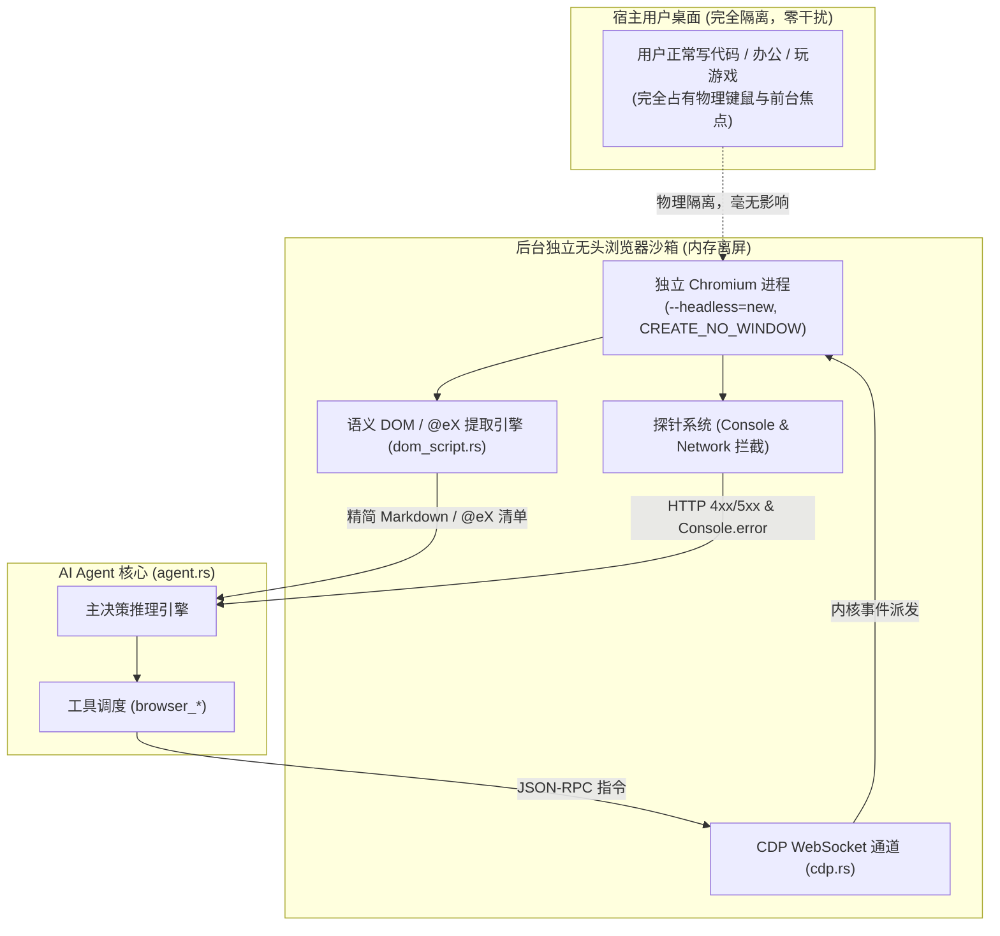
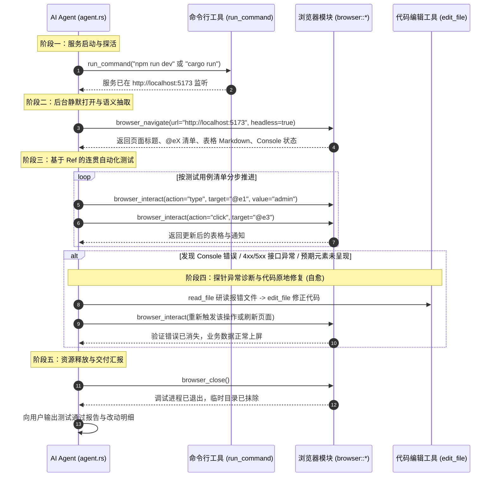

# 基于原生 CDP 的无头自主浏览器调试与免视觉全闭环验证方案规范
(BROWSER_AUTONOMOUS_HEADLESS_TESTING_SPEC)

| 属性 | 说明 |
| :--- | :--- |
| **文档代号** | `BROWSER_AUTONOMOUS_HEADLESS_TESTING_SPEC` |
| **创建时间** | 2026-10-19 |
| **适用范围** | `harness_mini`（Tauri 2 + Rust + React 桌面 AI Agent 架构体系） |
| **关联核心模块** | [`src-tauri/src/browser/*`](file:///f:/WorkSpace/Other/harness_mini/src-tauri/src/browser), [`src-tauri/src/agent.rs`](file:///f:/WorkSpace/Other/harness_mini/src-tauri/src/agent.rs), [`src-tauri/src/tools/specs.rs`](file:///f:/WorkSpace/Other/harness_mini/src-tauri/src/tools/specs.rs), [`src/components/BrowserInspector.tsx`](file:///f:/WorkSpace/Other/harness_mini/src/components/BrowserInspector.tsx) |
| **知识密级** | 核心架构与端到端自动化测试规范 |

---

## 一、 方案总览与核心设计公理

本规范旨在确立 **AI Agent 全自主、无头、纯语义、无桌面侵入的浏览器调试与测试范式**，彻底摆脱多模态视觉像素分析（Screenshot + OCR / 坐标拾取）对系统硬件焦点的干扰与高 Token 消耗。

### 三大核心公理

1. **零桌面侵入公理（Zero Desktop Interference）**：
   - 浏览器必须以后台无头子进程启动（`--headless=new`，Windows 标志 `CREATE_NO_WINDOW`）。
   - 所有输入交互必须通过 Chrome DevTools Protocol (CDP) 内部通道直接派发至渲染引擎，**严禁调用任何操作系统级硬件鼠标/键盘 API（如 Win32 `SendInput`、PyAutoGUI 等）**。
   - 宿主用户的物理光标、键盘输入与前台窗口焦点不受任何影响，用户可与 AI 测试并行工作。

2. **纯语义感知公理（Pure Semantic & Textual Perception）**：
   - **完全废弃视觉依赖**：在标准测试调试闭环中，**不再强制依赖 `browser_screenshot` 与 `recognize_image` 视觉识别**。
   - **结构化降维**：将 DOM 树压缩提炼为带 `@e1`、`@e2` 唯一标识的紧凑交互元素清单，表格自动转 Markdown，提示信息自动转 Notices 文本。
   - **极低 Token 消耗**：单次页面状态仅耗费约 300~600 Token，相比多模态截图（1000~3000 Token/张）节约 70% 以上成本。

3. **探针式自动断言与自愈闭环公理（Autonomous Probe & Self-Healing）**：
   - 依靠 **CDP 原生事件监听**作为质量守门员：实时截获未捕获的 JavaScript 异常、`Console.error`、以及所有 HTTP 状态码 $\ge 400$ 的失败网络请求。
   - 当交互未达到预期（如报错、断言失败、出现业务告警通知）时，Agent 原地读取错误堆栈、分析源码、调用 `edit_file` 自我修复，并连贯在浏览器中重新验证。

---

## 二、 核心架构与工具职责规范

### 1. 核心工具职责边界

| 工具名称 | 职责定位 | 核心入参 / 返回 |
| :--- | :--- | :--- |
| **`browser_navigate`** | 启动/重用受控会话，后台导航至目标 URL，完成 SPA 水合等待并首次提取结构化页面状态 | 入参: `url` (如 `http://127.0.0.1:8080`), `headless` (默认 `true`) 返回: Markdown 页面大纲、`@eX` 元素清单、表格及错误日志 |
| **`browser_interact`** | 基于语义标识符精确派发交互指令，并自动防抖拉取交互后最新状态 | 入参: `action` (`click` / `type` / `press_enter` / `wait_for_selector`), `target` (如 `@e1`), `value` (打字文本) 返回: 动作后最新的页面状态与错误增量 |
| **`browser_get_debug_state`** | 主动轮询或查询当前受控页面的最新状态（无状态变更时诊断使用） | 入参: 无 返回: 最新 DOM 元素、通知、Console 异常、4xx/5xx 网络请求 |
| **`browser_close`** | 测试结束或发生致命错误时，优雅终止后台浏览器子进程并物理清除独立临时目录 | 入参: 无 返回: 关闭确认消息 |
| *(辅助)* `browser_screenshot` | 降级为可选辅助工具，主要用于前端工作台（`BrowserInspector`）人工协同查验，或极特殊复杂 Canvas 图表排版时的多模态兜底 | 入参: 无 返回: 本地图片保存路径 |

---

## 三、 Agent 执行 SOP 标准作业流程 (Step-by-Step)

在会话中执行程序调试与测试时，Agent 必须严格遵守以下五阶段标准流程：

---

## 四、 关键技术细节与保障

1. **Chromium 智能探测**：优先探测 Windows 原生 Edge 或 Chrome，无需用户手工配置任何驱动。
2. **事件防抖等待**：在 `browser_interact` 执行 `click` 或 `press_enter` 时，内核自动进行 1000ms 的 SPA 路由与网络请求等待，杜绝因异步未完成导致数据提取不全。
3. **内存级虚拟视口**：始终注入 `Emulation.setDeviceMetricsOverride(1280, 900)`，防止后台无头模式发生 0x0 渲染与 CSS 折叠问题。
