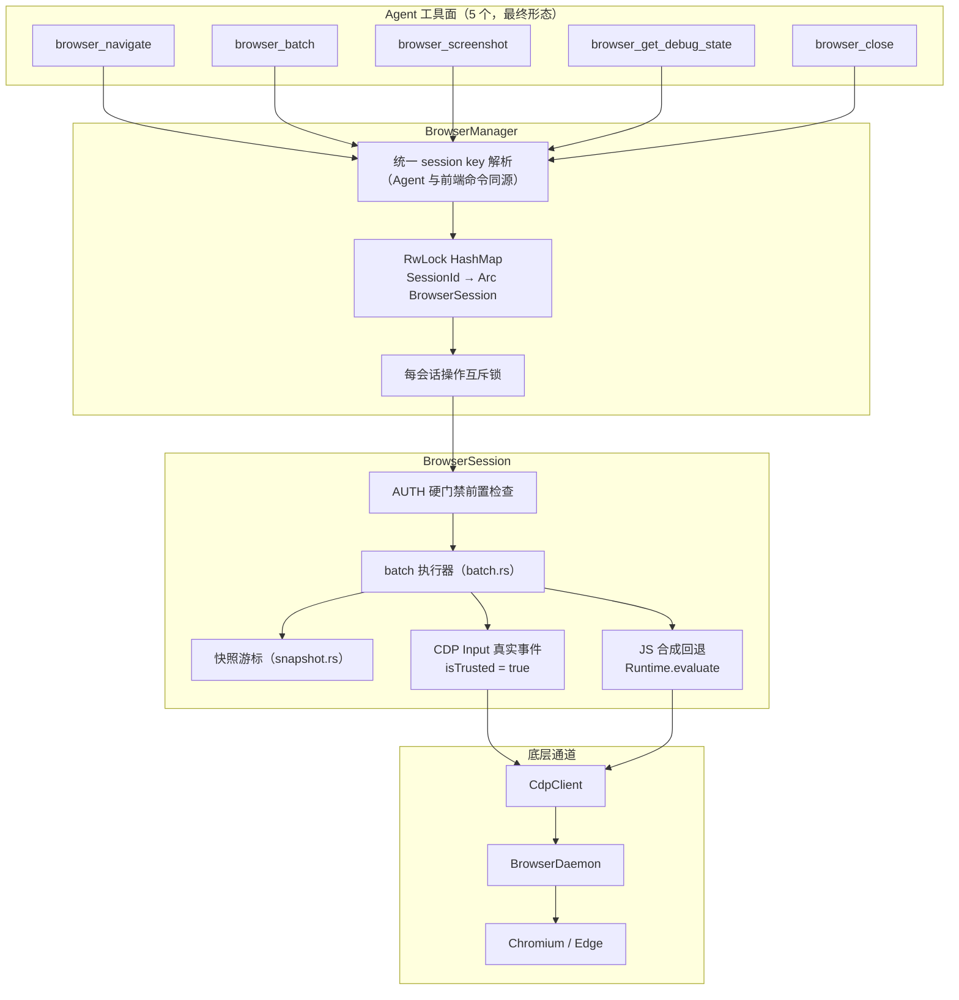
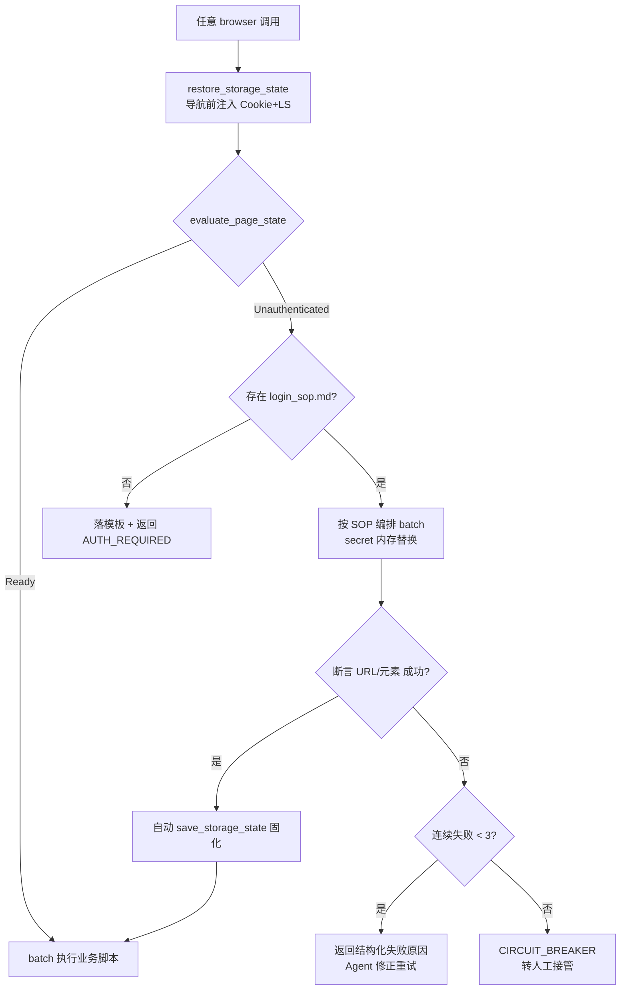

# 浏览器批量执行与快照增量规范 (BROWSER_BATCH_AND_SNAPSHOT_DIFF_SPEC)

| 项目 | 内容 |
| --- | --- |
| 文档名称 | 浏览器批量执行与快照增量规范 |
| 英文代号 | `BROWSER_BATCH_AND_SNAPSHOT_DIFF_SPEC` |
| 文档版本 | v2.0（阶段 D 定案：删除 `browser_interact` / `browser_scroll` 独立入口） |
| 状态 | 施工蓝图（先文档后动码，作为本轮改造的最高权威依据） |
| 关联计划 | `.harness/plans/20261124-浏览器调试模块精简重构与批量执行改造计划.md` |
| 关联模块 | `src-tauri/src/browser/`（`mod.rs` / `session.rs` / `dom_script.rs` / `snapshot.rs` / `batch.rs` / `credential.rs` / `evaluator.rs` / `storage.rs`）、`src-tauri/src/tools/`（`specs.rs` / `mod.rs`）、`src-tauri/src/context/static_system.rs`、`src/components/BrowserInspector.tsx` |
| 运行位置 | `F:\WorkSpace\Other\harness_mini` |

---

## 一、决策记录与背景

### 1.1 三个用户痛点

| 编号 | 现象 | 机制级根因（逐行勘察确认） |
| --- | --- | --- |
| P1 | 登录易错，即便给出明确流程与账号密码 | 项目**实际没有登录自动化**：`auth.rs` / `pipeline.rs` / `synthesizer.rs` 三文件从未在 `mod.rs` 声明、`cargo` 完全不编译，全靠 Agent 逐步 `click`/`type` 手工拼；且叠加固定 `sleep`、React 受控组件填值失效、`@eN` 编号漂移三重错误源 |
| P2 | 无头浏览器人工介入麻烦 | 人工通道与 Agent 通道作用于同一 CDP target 但坐标未做 DPR/视口换算；且 session key 双轨（`mod.rs:106` vs `commands.rs:4762`）可能导致「人看 A、Agent 操作 B」 |
| P3 | 无法连续操作，每动一下都要重调 tool | 一次工具调用 = 一次原子操作 + **必定全量返回整页状态**；`cdp.rs` 日志缓冲只截断不清空，`to_markdown` 每次固定回吐陈旧错误 |

### 1.2 三条设计原则（用户明确要求）

1. **极简不冗余**：删除全部未编译死代码与死常量；工具面从 6 个精简到 5 个；不保留语义重复的双入口。
2. **连续操作**：新增 `browser_batch`，让「输账号密码点登录 → 选第一个机构」只需 **1 次工具往返**。
3. **省 token**：返回值 diff 化，只回传与上次快照的增量与新增错误，不再重复 dump 全页。

### 1.3 明确不做（负向范围）

- 不做验证码自动识别：图形验证码转截图识别或人工输入；短信/邮箱验证码必须人工暂停。
- 不恢复脚本录制：`INJECT_RECORDER_SCRIPT` / `EXTRACT_RECORDED_STEPS_SCRIPT` 直接删除。
- 不引入 Playwright / Puppeteer 等外部依赖，沿用自建 CDP daemon。
- 不做无人值守定时登录（Agent 不在场时不触发登录流程）。

---

## 二、目标架构



---

## 三、工具面定案：6 → 5

| 工具 | 职责 | 变更 |
| --- | --- | --- |
| `browser_navigate` | 打开/跳转 URL | 保留 |
| `browser_batch` | **唯一操作入口** | **新增** |
| `browser_screenshot` | 截图 | 保留 |
| `browser_get_debug_state` | 只看不动（排查用） | 保留 |
| `browser_close` | 关闭会话 | 保留 |
| ~~`browser_interact`~~ | 单步交互 | **删除**，收归 batch 单步特例 |
| ~~`browser_scroll`~~ | 滚动 | **删除**，收归 batch 的 `scroll` op |

**删除依据**：`interact` / `scroll` 在语义上完全是 `batch` 的单步退化形态。保留双入口会导致 Agent 选错工具、schema 白占 token，违背「简单清晰、无冗余」原则（阶段 D 用户已拍板采用本推荐方案）。

**兼容性说明**：删除后，任何旧提示词/技能若仍写 `browser_interact(...)`，将被工具调度器判定为未知工具并返回明确错误。旧会话中已固化的 prompt 需在迁移时改为 `browser_batch` 单步写法（见 §11.2 迁移映射）。

---

## 四、`browser_batch` 完整规范

### 4.1 入参 Schema

```jsonc
{
  "type": "object",
  "required": ["steps"],
  "properties": {
    "steps": {
      "type": "array",
      "minItems": 1,
      "maxItems": 50,
      "description": "按顺序执行的原子动作序列，一次调用完成原本需要多次往返的连续操作",
      "items": {
        "type": "object",
        "required": ["op"],
        "properties": {
          "op": {
            "type": "string",
            "enum": [
              "click", "fill", "type", "press_key", "press_enter", "scroll",
              "wait_for_selector", "wait_for_url", "wait_for_function", "wait_for_network_idle",
              "pick_first", "pick_by_index", "pick_by_text",
              "assert_text", "assert_url", "pause"
            ]
          },
          "target":  { "type": "string", "description": "稳定 ref (@eXXXXXXXX)、CSS 选择器，或 :has-text('登录') 语义选择器" },
          "value":   { "type": "string", "description": "填入文本 / 按键名 / 断言期望值；支持 ${secret:KEY} 占位符" },
          "pattern": { "type": "string", "description": "wait_for_url / assert_url 的正则" },
          "index":   { "type": "integer", "description": "pick_by_index 的从 1 开始的序号" },
          "timeout_ms": { "type": "integer", "default": 10000 },
          "optional":   { "type": "boolean", "default": false, "description": "true 时该步失败或超时不中断流程（用于「机构弹窗可能不出现」等可选步骤）" },
          "desc":       { "type": "string", "description": "该步的人类可读说明，失败时回显便于定位" },
          "detail": {
            "type": "string",
            "enum": ["diff", "summary", "full"],
            "default": "diff",
            "description": "该步执行后返回的页面状态粒度"
          }
        }
      }
    },
    "stop_on_error": { "type": "boolean", "default": true, "description": "遇错立即中断后续步骤" },
    "detail":        { "type": "string", "enum": ["diff", "summary", "full"], "default": "diff", "description": "批次最终返回的页面状态粒度（覆盖各步默认值）" }
  }
}
```

### 4.2 ops 语义表

| op | 参数 | 行为 | 失败判定 |
| --- | --- | --- | --- |
| `click` | `target` | 优先解析元素坐标 → `Input.dispatchMouseEvent`（mousePressed + mouseReleased，`isTrusted=true`）；拿不到坐标才回退 `el.click()` | 元素不存在 / 不可见 / 被遮挡 |
| `fill` | `target`, `value` | 聚焦 → 清空 → `nativeInputValueSetter` 赋值 → 派发 `input`/`change`/`blur` | 元素不存在 / readonly / disabled |
| `type` | `target`, `value` | 同 `fill`，但逐字符追加（等价 `Input.insertText`） | 同上 |
| `press_key` | `value`（如 `Enter`/`Tab`/`Escape`） | `Input.dispatchKeyEvent`（rawKeyDown + keyUp） | 焦点元素不存在 |
| `press_enter` | `target`（可选） | 等价 `press_key{value:"Enter"}`；指定 target 时先聚焦 | 同上 |
| `scroll` | `target`（可选）, `value`（像素，缺省一屏） | 有 target 则滚该元素容器，否则滚窗口 | 容器不可滚动 |
| `wait_for_selector` | `target`, `timeout_ms` | 轮询至元素出现且可见（`getBoundingClientRect` 非零 + 非 hidden） | 超时 |
| `wait_for_url` | `pattern`, `timeout_ms` | 轮询 `location.href` 匹配正则 | 超时 |
| `wait_for_function` | `value`（JS 表达式） | 轮询表达式返回真值 | 超时 / 语法错误 |
| `wait_for_network_idle` | `timeout_ms` | 轮询 CDP `Network` 域在途请求数归零，连续 300ms 静默视为空闲 | 超时 |
| `pick_first` | `target`（容器选择器） | 点击容器内**第一个**可见候选项（文字非空、尺寸非零） | 无候选项 |
| `pick_by_index` | `target`, `index` | 点击容器内第 N 个候选（从 1 开始） | 序号越界 |
| `pick_by_text` | `target`, `value` | 点击容器内文字包含 `value` 的最短匹配项 | 无匹配 |
| `assert_text` | `target`, `value` | 断言元素文本包含 `value` | 不含 / 元素不存在 |
| `assert_url` | `pattern` | 断言当前 URL 匹配正则 | 不匹配 |
| `pause` | `value`（原因）, `desc`（给人工的提示） | 立即中断批次，返回 `intervention_required` 状态 | —（非失败） |

### 4.3 返回契约

```jsonc
{
  "ok": true,
  "total": 8, "executed": 8, "skipped": 0,
  "action_ms": 3421,
  "page": {
    "detail": "summary",
    "url": "http://localhost:8080/#/dashboard",
    "title": "工作台",
    "changed": true,
    "added": 12, "removed": 3, "modified": 1,
    "new_console_errors": [],
    "new_network_errors": []
  },
  "steps": [
    { "i": 1, "op": "wait_for_selector", "ok": true, "ms": 820 },
    { "i": 2, "op": "fill", "target": "input[name=username]", "ok": true, "ms": 65, "echo": "admin" },
    { "i": 3, "op": "fill", "target": "input[type=password]", "ok": true, "ms": 61, "echo": "***" }
  ]
}
```

失败时：

```jsonc
{
  "ok": false,
  "failed_at": 5,
  "code": "ELEMENT_NOT_FOUND",
  "message": "未找到目标元素: [role=dialog] .org-item",
  "step": { "i": 5, "op": "pick_first", "target": "[role=dialog] .org-item", "desc": "选择第一个机构" },
  "candidates": ["div.el-dialog li:first", "div.el-dialog .org-list"],
  "hint": "机构弹窗可能未出现。若该账号仅有一个机构，可给此步加 optional:true 跳过。",
  "screenshot_hint": "可调用 browser_screenshot 查看当前画面",
  "executed_before_failure": [ /* 前 4 步结果 */ ]
}
```

**错误码字典**

| 错误码 | 含义 | Agent 应如何处置 |
| --- | --- | --- |
| `ELEMENT_NOT_FOUND` | 选择器无匹配 | 依据 `candidates` 修正 target |
| `ELEMENT_NOT_VISIBLE` | 存在但不可见/尺寸为零 | 先 `scroll` 或 `wait_for_selector` |
| `TIMEOUT` | 等待类 op 超时 | 加长 `timeout_ms` 或改断言条件 |
| `AUTH_REQUIRED` | 页面处于未登录态 | 读取 `.harness/login_sop.md` 编排登录 batch |
| `ASSERT_FAILED` | 断言不成立 | 检查实际操作是否生效 |
| `SECRET_MISSING` | `${secret:KEY}` 解析失败 | 提示用户录入凭据 |
| `CIRCUIT_BREAKER` | 连续失败达阈值熔断 | 停止重试，转人工 |
| `STEP_UNSUPPORTED` | 未知 op | 修正 op 名称 |
| `CHANNEL_CLOSED` | CDP 通道断开 | 会话已被摘除，下次调用自动重建 |

### 4.4 `${secret:KEY}` 占位符

- 语法：`${secret:KEY}`，仅允许出现在 `value` 字段。
- 解析时机：**执行前**在进程内存中从加密凭据库解密替换，明文不出进程、不落日志、不进返回值。
- 回显规则：该步 `echo` 一律为 `***`；错误信息中若含明文，需二次脱敏。
- 凭据库：`.harness/browser_secrets.json`（AES-256-GCM，复用 `src-tauri/src/secrets.rs`，密文带 `v1:` 前缀），并自动写入 `.gitignore`。
- 未命中：返回 `SECRET_MISSING` 并提示可用命令录入，**绝不回退为明文尝试**。

### 4.5 熔断与人工暂停

- 同一会话内 `browser_batch` 连续失败 **3 次** → 返回 `CIRCUIT_BREAKER`，要求人工介入（防止账号被锁、避免 LLM 无限重试）。
- `pause` op 用于显式声明无法自动化的环节（图形验证码/短信验证码），返回 `intervention_required`，前端高亮提示。

---

## 五、稳定 ref 指纹算法（修 P3 的机制级根因）

### 5.1 现状缺陷

`dom_script.rs:21-34` 每次提取都从 1 重新编号，且跳过隐藏元素后才 `count++`：

```js
if (style.display==='none' || visibility==='hidden' || opacity==='0') continue;
const rect = el.getBoundingClientRect();
if (rect.width===0 && rect.height===0) continue;
count++;
el.setAttribute('data-harness-ref', `@e${count}`);
```

**任一前置元素隐藏/显示，其后所有 `@eN` 全部重编号。** Agent 先拿到 `@e5 = 登录按钮`，中间任何 DOM 波动后 `click @e5` 会点到完全不同的元素 —— 这是「无法连续操作」的真正机制级根因（比往返次数更致命，因为它让连续操作**错了**而非**慢了**）。

### 5.2 指纹生成优先级

```
1. data-testid / data-test / data-cy          （显式测试锚点，最稳）
2. id（排除动态特征：含 >6 位连续数字 / uuid / : 分隔的框架前缀）
3. name
4. aria-label
5. tag + type + placeholder + 归一化文本(≤40 字)
6. 结构路径（nth-child 链），仅作兜底
```

指纹 = `xxhash64(拼接串)` 取前 8 位十六进制，ref 形如 `@e3f8a1c2`。

- 同一次提取内若哈希碰撞，追加 `_2`、`_3` 后缀。
- 保留 `@e` 前缀以兼容现有解析逻辑与提示词习惯。

### 5.3 反查映射（解决 DOM 重渲染后属性丢失）

元素被框架重建后 `data-harness-ref` 属性会消失。因此每次提取同时写入：

```js
window.__harness_ref_map = {
  "@e3f8a1c2": { tag:"button", name:"", placeholder:"", text:"登录", path:"body>div>form>button:nth-child(3)" }
};
```

`findTarget(ref)` 解析顺序：`[data-harness-ref="ref"]` → 按 `__harness_ref_map` 重新定位 → 结构化错误。

### 5.4 验收

两次 `get_debug_state` 之间插入一次元素隐藏操作，业务元素的 ref **必须保持不变**。

---

## 六、快照增量机制（修 P3 的 token 浪费）

### 6.1 现状缺陷

- `cdp.rs` 日志缓冲**只截断不清空**：`console_logs` 上限 100（第 104/156 行）、`network_errors` 上限 50（第 221/256 行）、`structured_network_errors` 上限 50（第 227/262 行）。
- `to_markdown`（`session.rs:171-187`）**每次调用固定取 console 末 5 条 + network 末 8 条**。

→ 无论本次操作发生了什么，都反复回吐同一批陈旧错误，纯浪费 token 且**误导 Agent 归因**。

### 6.2 数据结构

```rust
// snapshot.rs
pub struct ElementFingerprint {
    pub ref_id: String,
    pub tag: String,
    pub role: Option<String>,
    pub name: Option<String>,
    pub placeholder: Option<String>,
    pub text: Option<String>,
    pub value: Option<String>,
    pub visible: bool,
}

pub struct PageSnapshot {
    pub url: String,
    pub title: String,
    pub elements: BTreeMap<String, ElementFingerprint>, // key = ref
    pub notices: BTreeSet<String>,
    pub overlays: BTreeSet<String>,
    pub tables_hash: u64,
    pub tables: Vec<String>,
    pub viewport: ViewportInfo,
    pub console_cursor: usize,
    pub network_cursor: usize,
}

pub struct SnapshotDiff {
    pub url_changed: Option<(String, String)>,
    pub title_changed: Option<(String, String)>,
    pub added: Vec<ElementFingerprint>,
    pub removed: Vec<String>,
    pub modified: Vec<(String, Vec<(String, String, String)>)>, // (ref, [(字段, 旧值, 新值)])
    pub notices_added: Vec<String>,
    pub overlays_added: Vec<String>,
    pub tables_changed: bool,
    pub console_new: Vec<String>,
    pub network_new: Vec<String>,
    pub viewport_changed: bool,
}
```

### 6.3 游标推进规则

- 会话内保存 `last_snapshot: BattleMutex<Option<PageSnapshot>>`（沿用 `parking_lot` / `tokio::sync::Mutex`，遵守 `CONCURRENCY_AND_LOCK_ORDER_SPEC.md`）。
- console/network 取 `logs[cursor..]` 作为「新增」，随后把 `cursor` 推进到当前长度；若缓冲因截断而长度回落（`len < cursor`），游标重置为 0 并标记「缓冲已滚动」。
- 表格用内容哈希比对，未变则输出一行「表格结构未变化」，不再重复输出 3×10 行。

### 6.4 三级 detail

| detail | 输出内容 | 典型用途 | 相对 full 的 token |
| --- | --- | --- | --- |
| `full` | 现有 `to_markdown` 完整形态 | 首次 navigate、重建页面地图 | 100% |
| `diff` | 变化项 + 动作结果 + 新增错误 | batch 中间步、日常调试 | 约 15–30% |
| `summary` | URL/标题/变化计数/新增错误 | batch 末步 | 约 5% |

**预期**：一次 8 步登录 batch 从「5 次全量」变为「1 次 full + 7 次 summary」，token 下降 80%+。

### 6.5 输出硬预算

`to_markdown` 增加总字符上限（建议 12000 字符），超限时按优先级截断并追加一行 `> (已截断，可用 detail=full 或 browser_scroll 获取更多)`。

---

## 七、真等待原语（替换固定 sleep）

### 7.1 现状缺陷

- `session.rs:578-583` `interact` 硬编码 `sleep(1000)`（click）/ `sleep(300)`（其他）。
- `dom_script.rs:378-384` 的 `wait_for_selector` **只检查一次**，无轮询语义。

两者叠加 → 慢的时候 1 秒硬等仍不够，快的时候无谓浪费 1 秒。

### 7.2 实现规范

| 原语 | 轮询间隔 | 默认超时 | 判定 |
| --- | --- | --- | --- |
| `wait_for_selector` | 100ms | 10000ms | 存在 + `rect.width>0 && rect.height>0` + 非 hidden |
| `wait_for_url` | 100ms | 15000ms | `location.href` 正则匹配 |
| `wait_for_function` | 100ms | 10000ms | 表达式返回真值 |
| `wait_for_network_idle` | 100ms | 15000ms | 在途请求归零且持续静默 300ms |

轮询在 Rust 侧驱动（避免单条 JS 长驻），每次 `Runtime.evaluate` 做一次轻量判定。超时返回 `TIMEOUT` 并附最后一次判定结果与当前 URL。

---

## 八、安全填值与真实事件

### 8.1 React 受控组件填值失效（P1 直接技术原因）

`dom_script.rs:357-359` 当前实现：

```js
el.value = "xxx";
el.dispatchEvent(new Event('input', { bubbles: true }));
```

React 通过劫持 `value` setter 维护 `_valueTracker`。**直接赋 `el.value` 会同步更新 tracker，导致随后派发的 `input` 事件被判定为「值未变」而丢弃**，于是 `onChange` 不触发 → 提交空值 → 后端报「用户名或密码不能为空」。Vue `v-model` 配 `el-input` 的某些版本同样受影响。

**修法**：

```js
const desc = Object.getOwnPropertyDescriptor(HTMLInputElement.prototype, 'value');
desc.set.call(el, val);                     // 绕过 tracker
el.dispatchEvent(new Event('input',  { bubbles: true, composed: true }));
el.dispatchEvent(new Event('change', { bubbles: true, composed: true }));
el.dispatchEvent(new Event('blur',   { bubbles: true, composed: true })); // 触发 Element UI 校验
```

### 8.2 合成事件 `isTrusted=false` 劣于真实事件

| 通道 | 实现 | `isTrusted` |
| --- | --- | --- |
| Agent 现状 | `Runtime.evaluate` 派发 `el.click()` / `new KeyboardEvent(...)` | **false** |
| 人工通道 | CDP `Input.dispatchMouseEvent` / `Input.insertText`（`session.rs:798/878`） | **true** |

很多风控与表单校验库会直接忽略不可信事件 —— 这解释了「人工点能过、Agent 点不过」。

**定案**：`click` / `type` / `press_key` **默认走 CDP Input 域真实事件**，仅在拿不到元素坐标（如 hidden 或脱离文档）时回退 JS 合成，并在返回中标注 `fallback: "js_synthetic"` 以便排查。

---

## 九、登录 SOP 协议（文档驱动，不硬编码 Rust）

### 9.1 门禁：软提示 → 硬门禁

现状 `Unauthenticated` 只是 markdown 里一行 ⚠️（`session.rs:100`），LLM 可能忽略并继续点击业务按钮。

**改为**：`browser_batch` / `browser_navigate` 前置检查 `PageHealthState`，命中 `Unauthenticated` 立即返回结构化错误：

```jsonc
{
  "ok": false,
  "code": "AUTH_REQUIRED",
  "reason": "login_form_detected",
  "current_url": "http://localhost:8080/#/login",
  "sop_path": ".harness/login_sop.md",
  "hint": "请读取 sop_path 获取本系统登录流程，然后用 browser_batch 一次性完成登录。"
}
```

例外：当批次自身的 `steps` 明确包含登录动作（首个 op 为 `fill`/`wait_for_selector` 且目标位于登录表单）时，不触发门禁，避免自锁。

### 9.2 `.harness/login_sop.md` 格式

首次触发 `AUTH_REQUIRED` 时自动落模板（若不存在）：

```markdown
# 登录流程 SOP

> 本文件由 harness_mini 自动生成模板。请补全后保存，Agent 将按此流程自动登录。
> 密码请使用 ${secret:KEY} 占位符，**严禁写入明文**。

## 目标系统
- 登录入口：http://localhost:8080/#/login
- 凭据：
  - 用户名：admin
  - 密码：${secret:login_pwd}      （录入命令见文件末尾）

## 流程
1. 输入账号密码，点击「登录」
2. 弹出机构选择弹窗，选择**第一个**机构并确认
   - 注意：部分账号只有单一机构，弹窗**可能不出现**，此步应标记 optional
3. 断言：URL 进入 /dashboard 或出现侧边栏菜单

## 验证码场景（如有）
- 图形验证码：插入 {"op":"pause","value":"captcha_required"}
- 短信验证码：必须人工，插入 pause 并提示用户

## 凭据录入
在对话中告知 Agent「更新 login_pwd 为 xxx」，或由前端凭据面板填写。
```

### 9.3 登录闭环



### 9.4 登录态保持的三层保障

| 层 | 机制 | 现状 |
| --- | --- | --- |
| 1 | `storage_state.json` 导航前注入（`session.rs:500-504`） | 已实现，保留 |
| 2 | 持久 profile `.harness/browser_profile` 作为 user-data-dir | **需接线**：`session.rs:256` 现用 `harness_browser_gui_{uuid}` 临时目录，每次全新空 profile，登录态必丢 |
| 3 | 登录成功后自动 `save_storage_state` | **需新增**（现在需人工点按钮） |

---

## 十、会话一致性

### 10.1 统一 session key（修「人看 A、Agent 操作 B」）

| 路径 | 现状 key |
| --- | --- |
| Agent 工具 | `ctx.host.session_id`，缺省 `"default_browser_session"`（`mod.rs:106-111`） |
| 前端 `browser_navigate_url` | 传入的 `session_id`（`commands.rs:4762`） |

两者不等时 `get_or_create` 各自新建实例。**定案**：抽出单一 `resolve_session_key(...)` 供两侧共用。

### 10.2 去掉「回退到任意存活实例」

`mod.rs:87-92` 在未命中时遍历返回任意 alive 会话 → A 会话的 Agent 可能操作到 B 会话的浏览器。

**定案**：删除该回退。未命中直接返回 `NO_ACTIVE_SESSION` 结构化错误。多会话场景下绝不允许串台。

### 10.3 每会话操作互斥锁

`BrowserSession` 内部无操作锁，Agent 并发 batch 或人工与 Agent 同时操作会交错在同一 CDP target。

**定案**：`BrowserSession` 增加 `op_lock: tokio::sync::Mutex<()>`，所有 `batch` / `navigate` / `screenshot` 执行体持锁串行；人工输入通道（`user_click`/`user_type_text`）同样持锁，并设置获取超时（如 5s）避免长批次饿死人工操作。

---

## 十一、精简清单与迁移

### 11.1 删除项

| 对象 | 体积/位置 | 状态 |
| --- | --- | --- |
| `src-tauri/src/browser/auth.rs` | 8.5 KB | **未编译**（`mod.rs` 无 `pub mod auth;`），全项目零引用 |
| `src-tauri/src/browser/pipeline.rs` | 13 KB | **未编译**，`execute_auth_pipeline` 零调用 |
| `src-tauri/src/browser/synthesizer.rs` | 14 KB | **未编译**，零引用 |
| `dom_script.rs` `INJECT_RECORDER_SCRIPT` | 第 213–300 行 | 只有定义、零调用 |
| `dom_script.rs` `EXTRACT_RECORDED_STEPS_SCRIPT` | 第 302–306 行 | 只有定义、零调用 |
| `browser_interact` / `browser_scroll` | `specs.rs` / `tools/mod.rs` / `browser/mod.rs` | 本轮回炉删除 |

**合计删除约 36 KB 从未参与编译的死代码 + 2 个语义重复工具。**

### 11.2 迁移映射（旧调用 → 新写法）

| 旧写法 | 新写法 |
| --- | --- |
| `browser_interact(action:"click", target:"@e5")` | `browser_batch(steps:[{op:"click", target:"@e5"}])` |
| `browser_interact(action:"type", target:"@e2", value:"admin")` | `browser_batch(steps:[{op:"fill", target:"@e2", value:"admin"}])` |
| `browser_interact(action:"press_enter", target:"@e3")` | `browser_batch(steps:[{op:"press_enter", target:"@e3"}])` |
| `browser_interact(action:"wait_for_selector", target:".x")` | `browser_batch(steps:[{op:"wait_for_selector", target:".x"}])` |
| `browser_scroll(direction:"down")` | `browser_batch(steps:[{op:"scroll", value:"900"}])` |
| `browser_scroll(target:"#list", direction:"bottom")` | `browser_batch(steps:[{op:"scroll", target:"#list", value:"99999"}])` |

---

## 十二、分阶段实施与验收

| 阶段 | 步骤 | 涉及文件 | 验收标准 |
| --- | --- | --- | --- |
| **A 清理** | 删 3 文件 + 2 常量 | `browser/{auth,pipeline,synthesizer}.rs`、`dom_script.rs` | `cargo check` 通过；`grep` 零残留 |
| **B 修错误源** | 稳定 ref / 真轮询 / 安全填值 / 真实事件 | `dom_script.rs`、`session.rs` | 连续两次提取 ref 不变；React 表单能填入；`isTrusted=true` |
| **C 省 token** | snapshot diff + batch 执行器 | `snapshot.rs`[NEW]、`batch.rs`[NEW] | 同流程返回值字符数下降 ≥70% |
| **D 一致性** | 工具面 6→5 / key 统一 / 去回退 / 操作锁 | `mod.rs`、`specs.rs`、`tools/mod.rs` | 工具清单恰为 5 个；多会话不串台 |
| **E 登录闭环** | profile 接线 / 自动固化 / AUTH 门禁 / SOP | `session.rs`、`storage.rs`、`evaluator.rs`、`credential.rs`[NEW] | 未登录时 batch 被拦截；登录成功后重启免登 |
| **F 收尾** | 前端精简 / 回归 | `BrowserInspector.tsx`、`static_system.rs`、`tools/tests.rs` | `cargo test` 全绿（基线 221 passed） |

### 关键量化验收

1. **往返次数**：一次「账号密码 → 登录 → 选第一个机构」实测 LLM 工具调用 **= 1 次**（改造前 5 次）。
2. **token 下降**：同一流程返回值总字符数 **下降 ≥70%**（1 次 full + N 次 summary）。
3. **ref 稳定性**：两次提取之间插入一次元素隐藏操作，业务元素 ref 不变。
4. **门禁生效**：未登录态直接 batch 点业务按钮 → 返回 `AUTH_REQUIRED` 而非静默执行。
5. **登录态**：登录后关闭会话再 navigate 同系统，无需重登；有头模式重启后 profile 保留。
6. **无串台**：两个会话各自 navigate 不同 URL，互不影响。

---

## 十三、取代关系声明

本规范**取代**以下历史文档中的浏览器工具面与登录自动化章节：

| 被取代文档 | 取代范围 |
| --- | --- |
| `BROWSER_AUTONOMOUS_HEADLESS_TESTING_SPEC.md` | 第四章 `browser_interact` 工具定义与调用示例 |
| `BROWSER_VIEWPORT_SCROLL_AND_NATIVE_DEBUGGING_SPEC.md` | 第四章 4.4 节 `browser_scroll` 工具注册与 4.3 节滚动建议文案 |
| `BROWSER_LOGIN_RECORDING_AND_AUTO_REPLAY_KNOWLEDGE.md` | 全篇录制/重放机制（相关代码已确认未编译，本规范删除） |
| `BROWSER_SMART_RECORDING_AND_LLM_AUTH_CONTRACT_KNOWLEDGE.md` | 全篇智能录制与 AuthContract 提炼（同上） |
| `BROWSER_SMART_RECORDING_AND_LLM_DISTILLATION_AUTH_SPEC.md` | 全篇契约提炼链路（同上） |
| `BROWSER_PERSISTENT_CONTEXT_AND_AUTH_GATEWAY_SPEC.md` | 登录网关中的 pipeline 自动填充章节，改为 SOP 文档驱动 |
| `BROWSER_DEBUGGING_ENGINE_AND_CDP_RESILIENCE_SPEC.md` | 仅工具清单部分（`browser_interact` → `browser_batch`），CDP 韧性机制仍然有效 |

**仍然有效、不被本规范取代**：

- `CONCURRENCY_AND_LOCK_ORDER_SPEC.md`（锁类型与锁序，本规范新增锁必须遵守）
- `BROWSER_STORAGE_STATE_WORKFLOW_AND_TESTING_SPEC.md`（storage_state 机制，本规范沿用并接线）
- `BROWSER_DEBUGGING_ENGINE_AND_CDP_RESILIENCE_SPEC.md` 中除工具清单外的全部内容
- `BROWSER_CONTEXT_SANDBOX_AND_FRONTEND_DIAGNOSTICS_KNOWLEDGE.md`（前端诊断总线）
