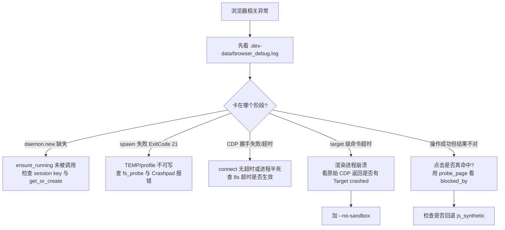

# 浏览器批量自动化可用性攻坚与语义感知加固知识文档 (BROWSER_BATCH_RELIABILITY_AND_SEMANTIC_PROBE_KNOWLEDGE)

| 项目 | 内容 |
| --- | --- |
| 文档名称 | 浏览器批量自动化可用性攻坚与语义感知加固知识文档 |
| 英文代号 | `BROWSER_BATCH_RELIABILITY_AND_SEMANTIC_PROBE_KNOWLEDGE` |
| 文档版本 | v1.0 |
| 状态 | 前四轮已落地并验证；第五轮待办已归档待启动 |
| 创建时间 | 2026-11-24 |
| 关联规范 | [`BROWSER_BATCH_AND_SNAPSHOT_DIFF_SPEC.md`](BROWSER_BATCH_AND_SNAPSHOT_DIFF_SPEC.md)（工具契约的权威定义） |
| 关联规范 | [`DIRECTORY_INTEGRITY_LABEL_LOW_IL_ROOT_CAUSE_AND_REMEDIATION_SPEC.md`](DIRECTORY_INTEGRITY_LABEL_LOW_IL_ROOT_CAUSE_AND_REMEDIATION_SPEC.md)（本文「低完整性导致 TEMP 不可写 / `os error 5`」的**统一根因与根治方案**，2026-11-25 定案；该根因已修复，兜底代码保留即可） |
| 关联计划 | `.harness/plans/20261124-浏览器模块改造进度存档与剩余问题修复计划.md` |
| 关联模块 | `src-tauri/src/browser/`（`mod.rs` / `session.rs` / `daemon.rs` / `cdp.rs` / `dom_script.rs` / `batch.rs` / `snapshot.rs` / `credential.rs` / `login_sop.rs` / `fs_probe.rs` / `diag.rs`）、`src-tauri/src/tools/`、`src-tauri/src/context/static_system.rs` |
| 文档性质 | **实战复盘型知识文档**：记录根因、误判过程、修复手法与可复用排查路径，而非接口说明书 |
| 运行位置 | `F:\WorkSpace\Other\harness_mini` |

---

## 一、为什么需要这份文档

本次改造跨越四轮、历经多次「看似修好又复现」的反复，过程中出现过 **三次错误归因**。这些弯路比最终代码更有复用价值：

| 曾经的错误判断 | 实际情况 | 教训 |
| --- | --- | --- |
| 「登录易错」→ 以为是 pipeline 逻辑问题 | 所谓登录自动化代码 `auth.rs` / `pipeline.rs` / `synthesizer.rs` **从未被 `cargo` 编译**（`mod.rs` 无 `mod` 声明），是孤儿文件 | 分析前先确认代码是否真的在运行 |
| 「浏览器卡启动中」→ 归因于低完整性级别写不了 TEMP + connect 无超时 | 这两条确实是真缺陷，但**不是最后一环**；真正的断点是 Chromium **渲染进程崩溃**（`Target crashed`） | 分层验证：浏览器级命令 vs target 级命令 |
| 「截图太多」→ 以为是 Agent 偏好视觉 | Agent 拿不到语义信息（空态不可表达、元素提取过窄），**只能**退化为截图 | 工具能力缺失会被表现成模型行为问题 |

**核心结论：Agent 的「笨」往往源于工具没有把事实讲清楚，而非模型不会用。**

---

## 二、用户三大原始痛点与最终解法对照

| 痛点 | 原始描述 | 根因（逐层下钻） | 最终解法 |
| --- | --- | --- | --- |
| **P1 登录易错** | 给了明确流程与账号密码，登录仍出错 | ① 登录自动化代码从未编译；② `sleep` 固定等待替代真实就绪；③ React 受控组件填值被 `_valueTracker` 丢弃；④ 合成事件 `isTrusted=false` 被组件忽略 | 文档驱动 SOP + 真实 CDP 输入 + 原生 value setter + AUTH 硬门禁 |
| **P2 人工介入难** | 无头浏览器无法在界面直接输入，但静默操作要保留 | 人工通道坐标未做 DPR/视口换算；session key 双轨导致「人看 A、Agent 操作 B」 | 统一 `resolve_session_key`、删除任意存活回退、会话级操作互斥锁 |
| **P3 无法连续操作**（主要问题） | 每动一下都要重调 tool，浪费 token 且慢 | 一次工具调用 = 一次原子操作 + **必定全量返回整页状态**；日志缓冲永不清空导致反复回吐陈旧错误 | `browser_batch` 批量执行 + 快照游标 diff + 三级 detail |

---

## 三、四轮改造全记录

### 第 1 轮：精简重构与批量执行（工具面 6 → 5）

**触发**：用户明确要求「不希望增加其他冗余功能，整个浏览器操作要简单清晰，之前没用的脚本录制希望取消」。

**关键发现**：所谓「登录自动化」三件套是死代码——

```
src-tauri/src/browser/mod.rs 的模块声明只有 7 个：
  cdp / daemon / detector / dom_script / evaluator / session / storage
目录下却存在 auth.rs(8.5K) / pipeline.rs(13K) / synthesizer.rs(14K)
→ 未被 cargo 编译，全项目零引用
```

同理 `INJECT_RECORDER_SCRIPT` / `EXTRACT_RECORDED_STEPS_SCRIPT` 两个录制器常量只有定义、零调用。

**交付**：

| 动作 | 对象 |
| --- | --- |
| 删除 | `auth.rs` / `pipeline.rs` / `synthesizer.rs` / 2 个录制器常量（合计约 36 KB 从未参与编译的代码） |
| 删除工具 | `browser_interact` / `browser_scroll`（语义上是 batch 的单步退化形态，保留双入口会让 Agent 选错工具） |
| 新增工具 | `browser_batch`（唯一操作入口） |
| 新增模块 | `snapshot.rs`（快照 diff）、`credential.rs`（凭据保管箱）、`login_sop.rs`（SOP 模板与 AUTH_REQUIRED） |

**最终工具面（5 个）**：`browser_navigate` / `browser_batch` / `browser_screenshot` / `browser_get_debug_state` / `browser_close`

---

### 第 2 轮：浏览器「一直显示启动中」的根因攻坚

这是最曲折的一轮，前后经历三次归因修正。

#### 2.1 第一次归因（部分正确）：TEMP 不可写

诊断日志（`browser_debug.log`）显示 Chromium 启动失败：

```
CreateFile ...\Microsoft\Edge\User Data\Crashpad\throttle_store.dat: 拒绝访问。(0x5)
Lock file can not be created! Error code: 5
Failed to create a ProcessSingleton for your profile directory.
→ ExitCode 21
```

`Error code: 5` = ACCESS_DENIED。**低完整性级别（Low IL）进程无法写 `%LOCALAPPDATA%\Temp`**。

**修法**：新增 `fs_probe.rs`，不硬编码 `temp_dir()`，而是**实际写探针文件**验证可写性：

```rust
pub fn is_writable(dir: &Path) -> bool {
    let probe = dir.join(format!(".harness_write_probe_{}", uuid));
    match std::fs::write(&probe, b"ok") {
        Ok(()) => { let _ = std::fs::remove_file(&probe); true }
        Err(_) => false,
    }
}

// 候选顺序：显式传入 → TEMP → cwd/.harness/tmp → USERPROFILE/.harness/tmp
pub fn resolve_writable_dir(preferred: Option<PathBuf>, sub: &str) -> PathBuf
```

#### 2.2 第二次归因（找到放大器）：connect 无超时

`cdp.rs` 的 `connect_async` 是整条启动链路上**唯一没有超时保护**的 `await`（`send()` 有 timeout、`Page.navigate` 30s、`try_spawn_daemon` 12s，只有它裸奔）。当 Chromium 半启动（已写出 DevToolsActivePort 但握手不完成）时，会永久挂起。

**修法**：`connect_async` 包 8s 超时；`ensure_running` 外包 30s 全链路超时。

同时发现并修复一个隐藏死锁点：`send()` 里 `pending.lock().await` **在 `timeout` 之外**，锁被长期占用时会永久阻塞且 timeout 根本不触发（表现为「连超时都不报」）。

#### 2.3 第三次归因（真凶）：渲染进程崩溃

上两步修完后仍然失败。改用**裸 WebSocket 逐帧打印 CDP 原始返回**，拿到决定性证据：

```json
{"id":2,"error":{"code":-32000,"message":"Target crashed"},"sessionId":"..."}
```

**分层验证方法（可直接复用）**：

| 命令层级 | 结果 | 结论 |
| --- | --- | --- |
| 浏览器级 `Target.*` | 正常（18–31ms） | browser 主进程存活 |
| target 级 `Page.enable` / `Runtime.evaluate` | 全部失败 | **renderer 进程已崩溃** |

**修法**（`daemon.rs` 的 Chromium 启动参数）：

```
--no-sandbox                      ← 关键：受限权限下渲染进程沙箱无法初始化
--disable-setuid-sandbox
--disable-breakpad                ← 崩溃上报在低权限下初始化失败
--disable-crash-reporter
--crash-dumps-dir=<profile>/crash-dumps
--disable-renderer-backgrounding
--disable-features=RendererCodeIntegrity
```

**验证对比**：

| 命令 | 修复前 | 修复后 |
| --- | --- | --- |
| `Page.enable` | 5s 超时 | 143ms OK |
| `Runtime.enable` | 5s 超时 | 5.6ms OK |
| `Network.enable` | 5s 超时 | 0.5ms OK |
| `Runtime.evaluate` | 超时 | 2.2ms OK |

#### 2.4 诊断基础设施（保留至今）

新增 `diag.rs`：轻量落盘日志，写 `<数据目录>/browser_debug.log`（2MB 轮转），埋点在 `browser_navigate_url` / `daemon.new` / `ensure_running` / `session.launch`。**这是后续所有排查的起点，比猜测快一个数量级。**

---

### 第 3 轮：语义感知补强（空态可读性）

**触发**：用户质问「明明已经有浏览器交互了，为什么还会有这么多视觉交互？」

**关键洞察：不是 Agent 偏好截图，而是它拿不到语义信息。**

实测证据 —— Agent 用 `wait_for_selector(".el-select-dropdown__item")` 超时后，只得到一句话：

```
等待超时（8000ms）：未找到目标元素
```

这句话无法区分三种完全不同的事实：

| 真实情况 | Agent 看到的 |
| --- | --- |
| 下拉没展开 | 「未找到目标元素」 |
| 下拉展开了但接口返回空 | 「未找到目标元素」 |
| 选择器写错了 | 「未找到目标元素」 |

三者反馈完全一样 → **只能截图**。

#### 四个叠加缺陷与修法

| # | 缺陷 | 证据 | 修法 |
| --- | --- | --- | --- |
| 1 | 空态不可表达 | 上述超时信息无信息量 | 新增 `probe_options`：一次调用返回「未展开/加载中/空数据/有 N 项」 |
| 2 | 空态类名漏配 | 「暂无数据」用的是 `.el-table__empty-text`，不在清单 | `noticeSelectors` 补全并**区分 `[空数据]` 与 `[加载中]`** |
| 3 | 元素提取过窄 | 机构页 4 个卡片全不可见，整页只提取到 1 个搜索框 | 广谱查询 + `looksInteractive()` 可点击性判定 + 叶子去重 + **表单控件优先配额** |
| 4 | 弹窗选择器过时 | Agent 猜 `.el-dialog__wrapper`（EP2.x 已删），白等 10s | 超时后诊断分级，列出页面实际存在的疑似容器 |

#### 两个至关重要的设计决策

**决策一：「空」返回 `Ok` 而不是错误。**

```rust
// probe_result_to_step_ok：无论有数据还是空，都返回 Ok
// 理由：空是业务事实，不是错误。把它表达成明确事实，Agent 才不会去截图求证。
let summary = if loading { "⏳ 下拉加载中..." }
    else if count > 0 { "选项 N 项：..." }
    else if !popup_open { "尚未展开..." }
    else if !empty_hint.is_empty() { "下拉已展开但无选项，页面提示「暂无数据」→ 属业务空数据，不是选择器问题" }
    else { "下拉已展开但选项数为 0 → 属业务空数据，不是选择器问题" };
```

**决策二：`ok && skipped > 0` 必须降级为「部分完成」。**

实测中 Agent 看到 `### ✅ 批量操作完成` 就认为全流程成功，而实际结尾的 `wait_for_url` 断言已被跳过（页面还停在机构选择页）。现改为：

```
### ⚠️ 批量操作部分完成（N 步被跳过，结论不可全信）
> ⚠️ 注意：以下步骤被跳过，其对应的验证目标未得到确认，请勿据此判定流程成功：
> - [3] `wait_for_url` ...
> 建议：用 browser_get_debug_state 或 assert_url 单独确认当前真实状态后再继续。
```

同时新增 `critical: true` 参数，让结尾断言即使标了 `optional` 也不会被掩盖。

---

### 第 4 轮：真实点击可靠性重构与界面探针

**触发**：用户实测「验证安全行为记录新增功能」耗时 6 分钟仍未成功，并明确指出「**实际上是保存按钮并没有点击成功，多次尝试都点不到**」。

#### 4.1 铁证与根因

日志中两次保存都是：

```
✅ [1] `click` target=`.yh-dialog button:has-text('保存')` [回退:js_synthetic] 1013ms
✅ [1] `click` target=`.yh-dialog button:has-text('保存')` [回退:js_synthetic] 1022ms
```

`[回退:js_synthetic]` 意味着 **CDP 真实点击失败，降级成了 JS 合成点击**（`isTrusted=false`），自研 `yh-*` 组件忽略了它。**但返回码却标了 ✅。**

三个叠加根因：

| # | 根因 | 说明 |
| --- | --- | --- |
| ① | 真实点击无命中校验 | 取 `getBoundingClientRect` 中心坐标直接发事件，**从不检查该坐标实际命中了谁**。弹窗动画中/遮罩覆盖时点击落在遮罩上，元素收不到事件却静默返回 Ok |
| ② | 事件序列不完整 | 缺 `buttons` 位掩码；`mouseReleased` 缺 `clickCount`，部分 Chromium 版本因此不合成 `click` 事件 |
| ③ | 静默降级为合成点击 | 失败后回退 JS 合成（同样无效），但只标一行 fallback，Agent 完全不知情 |

#### 4.2 真实点击重写

```
命中检测(elementFromPoint) → 三次重试 → 完整事件序列 → 点击后复核
```

**命中检测核心**：

```js
const hit = document.elementFromPoint(x, y);
const hitSelf = !!(hit && (hit === el || el.contains(hit)));
// hitSelf === false 说明坐标被别的元素（遮罩/动画层）挡住了
```

**三次重试策略**（覆盖三类场景）：

| 尝试 | 参数 | 应对场景 |
| --- | --- | --- |
| 1 | `(0ms, 中心点)` | 正常情况 |
| 2 | `(300ms, 中心点)` | 弹窗动画未结束 |
| 3 | `(200ms, 偏移点 left+6, top+6)` | 中心被遮挡 |

**完整事件序列**：

```
mouseMoved    { x, y, button:"none", buttons:0 }
mousePressed  { x, y, button:"left", buttons:1, clickCount:1 }
sleep 30ms
mouseReleased { x, y, button:"left", buttons:0, clickCount:1 }   ← 必须带 clickCount
```

三次仍被遮挡 → 返回 `CLICK_BLOCKED: 元素被遮挡无法真实点击（坐标仍命中的是 div.loading-mask）`，**绝不静默成功**。

#### 4.3 回退策略分流

| 错误类型 | 新行为 |
| --- | --- |
| `CLICK_BLOCKED` / `disabled` / `不可见` | **直接报错，不降级**（这些情况下合成点击同样无效） |
| CDP 通道短抖等其他情况 | 允许一次合成兜底，但渲染为 `⚠️[合成点击-可能未生效]` 醒目警告 |

#### 4.4 新增 probe_page（解决更底层的问题）

Agent 真正缺的是**「先看清楚当前界面有什么」**的能力。它在用 `wait_for_function` 写探针脚本（`window.__probe = [...document.querySelectorAll('.yh-dialog')]...`），这本身就是工具缺失的证据。

`probe_page` 一次调用返回：

```jsonc
{
  "overlays": [{"selector":"div.yh-dialog","size":"800x600","title":"新增"}],
  "forms": [{"tag":"input","label":"事件性质","clickable":true,"blocked_by":null}],
  "buttons": [
    {"text":"保存","disabled":false,"clickable":false,"blocked_by":"div.loading-mask"},
    {"text":"取消","disabled":false,"clickable":true}
  ],
  "notices": ["[空数据] 暂无数据"]
}
```

**关键设计：全部用 `[class*="dialog"]` 这类通用 class 匹配，不绑定 `el-` / `ant-` / `yh-` 任一前缀。** 这个项目用的是自研 `yh-*`，若硬编码前缀换任何 UI 库都会失效。

#### 4.5 顺带修掉的两个真实缺陷

**`wait_for_function` 字段误用**：Agent 常把 JS 表达式写进 `target`，而代码只读 `value` → 生成 `!!()` 语法错误 → **每次空转 3~10 秒**（实测烧掉 18 秒并导致登录流程误判失败）。现兼容两个字段，并加 `new Function(expr)` 语法预检，非法立即报错不进入轮询。

**`assert_text(body)` 必然失败**：body 含整页导航文本，拿它比对「新增成功」几乎不可能命中。现当 target 为 `body`/`html` 时自动收窄到 `message`/`alert`/`toast` 容器，无提示容器时直接报错而非白跑。

---

## 四、关键设计原则（可复用到其他工具）

这四条是本次改造最重要的沉淀，超出浏览器模块本身：

### 原则 1：点击必须验证命中，不能只看坐标

```js
// 错误做法：取坐标 → 发事件 → 报成功
// 正确做法：取坐标 → elementFromPoint 验证命中 → 发事件
```

坐标存在不代表元素能收到事件。遮罩、动画层、`pointer-events:none` 都会让点击"穿透"或"落空"。

### 原则 2：静默降级比报错更危险

合成点击失败却报成功，会让 Agent 基于错误结论继续推进——这比直接报错危害大得多。**任何"降级兜底"都必须显式警告。**

### 原则 3：「空」必须是一等公民

Agent 拿不到「确定为空」的事实，就只能去截图求证。`option_count: 0` + `empty: true` + `hint` 三件套，比任何截图都高效。

### 原则 4：UI 库前缀不可硬编码

用 `[class*="dialog"]` 而非 `.el-dialog`。适配任意 UI 库，也避免「换一套组件库就全失效」。

---

## 五、可复用的排查路径

遇到类似问题按此顺序排查，可大幅缩短定位时间：



### 裸 WebSocket 逐帧诊断（定位 CDP 层问题的最强手段）

```rust
let (ws, _) = connect_async(&ws_url).await?;
let (mut wr, mut rd) = ws.split();

wr.send(Message::Text(json!({"id":1,"method":"Target.attachToTarget",
    "params":{"targetId":tid,"flatten":true}}).to_string())).await?;
// 拿到 sessionId 后：
wr.send(Message::Text(json!({"id":2,"method":"Page.enable",
    "sessionId":sid}).to_string())).await?;

// 逐帧打印，不要只匹配 id —— 错误信息（如 Target crashed）藏在 error 字段里
while let Some(Ok(Message::Text(t))) = rd.next().await {
    println!("帧: {}", t);
}
```

---

## 六、第五轮待办：5 个已定位的剩余问题

来自会话 `c8d2eec6`（09:34–09:41，6 分钟未验证成功）的实测，**已定位到具体代码缺陷，尚未修复**。

| 优先级 | 问题 | 实测证据 | 根因 | 修法 |
| --- | --- | --- | --- | --- |
| **P0** | 弹窗可见性误判 | `wait_for_selector('div.yh-dialog')` 报「元素存在但不可见」，但弹窗实际可见 | `querySelector` 只取第一个匹配，可能命中历史残留的隐藏实例；外层容器自身尺寸可能为零 | 多实例择优：遍历所有匹配，选「可见且面积最大」者；全不可见时报「所有 N 个实例均不可见」 |
| **P0** | `wait_for_network_idle` 虚假成功 | `✅ wait_for_network_idle 0ms`，紧接着断言就失败 | 当前实现是 `document.readyState === 'complete'`，SPA 中本就是 complete，与在途请求无关；且 `cdp.rs` 的 `requests_map` **只插入不删除**（缺 `Network.loadingFinished` 处理） | 补 `loadingFinished`/`loadingFailed` 移除逻辑；改为轮询在途请求数归零 + 连续 300ms 静默 |
| **P1** | 诊断文案误导 | 「可能被折叠/隐藏，需先触发展开或滚动」——对弹窗场景是错的 | 未区分「全部实例隐藏」与「命中了隐藏实例但存在可见实例」 | 增加 `multiple_instances_some_visible` 分支，返回可见实例数/总数 |
| **P1** | 弹窗内外元素难区分 | `@e544ad44e` / `_2` / `_3` 三个同指纹 input 并存，分不清在弹窗内还是页面上 | 元素无 `inDialog` 标记 | `EXTRACT_TREE_SCRIPT` 增加 `inDialog` 标记，markdown 分「弹窗内/页面」两组 |
| **P2** | 提示文案靠猜 | 猜「新增成功」断言失败，实际文案未知 | 未引导 Agent 先探查 | `probe_page` 的 `notices` 已返回真实文案，需在工具描述中引导「先 probe 再断言」 |

> 备注：P0 两项即使不修，`probe_page`（第 4 轮已上线）也能缓解——Agent 可用它直接看到「当前有哪些弹窗、按钮点不点得动」。但根本解法仍应修 P0，否则 Agent 每次都要先撞一次墙再回头探查。

---

## 七、验证基线与回归要求

后续任何改动都必须保持：

| 检查 | 基线 |
| --- | --- |
| `cargo check --manifest-path src-tauri/Cargo.toml --all-targets` | 零错误 |
| `cargo test --manifest-path src-tauri/Cargo.toml --lib browser::` | **45 passed / 0 failed** |
| `npx tsc --noEmit` | 通过 |

### 写测试的硬性约束

**禁止使用 `std::env::temp_dir()`。** 本项目在低完整性级别下运行，TEMP 不可写（`os error 5`）。测试临时目录一律用：

```rust
let base = std::env::current_dir().unwrap().join("target").join("xxx_test_tmp");
```

这一约束同样适用于 `credential.rs` / `login_sop.rs` / `storage.rs` 的测试。

---

## 八、工具面最终形态

| 工具 | 职责 |
| --- | --- |
| `browser_navigate` | 打开/跳转 URL，返回稳定 ref（形如 `@e3f8a1c2`） |
| `browser_batch` | **唯一操作入口**。18 种 op，含 `probe_page` / `probe_options` 探针 |
| `browser_screenshot` | 截图（仅用于排查 CSS/渲染瑕疵，不作为常规感知手段） |
| `browser_get_debug_state` | 只看不动的状态查询 |
| `browser_close` | 关闭会话 |

### `browser_batch` op 一览

```
click / fill / type / press_key / press_enter / scroll
wait_for_selector / wait_for_url / wait_for_function / wait_for_network_idle
pick_first / pick_by_index / pick_by_text
probe_options / probe_page
assert_text / assert_url
pause
```

### 稳定 ref 指纹算法

ref 不再是 `@e1/@e2` 序号（任一前置元素隐藏就会导致其后全部重编号，Agent 缓存的 `@e5` 会漂移到别的元素）。改为元素特征指纹哈希：

```
优先级：data-testid > 非动态 id > name > aria-label
        > tag+type+placeholder+归一化文本 > 结构路径兜底
指纹 = FNV-1a 双通道哈希 → 8 位十六进制 → @e3f8a1c2
```

同时写入 `window.__harness_ref_map`，供 DOM 重渲染后（`data-harness-ref` 属性丢失）反查定位。

---

## 九、一页速查

```
症状：浏览器一直显示启动中
  → 看 .dev-data/browser_debug.log 定位阶段
  → ExitCode 21 / Crashpad 拒绝访问 → 检查 profile 目录可写性
  → target 级命令超时 → 裸 WS 看是否 Target crashed → 加 --no-sandbox

症状：点了没反应 / 报成功但结果不对
  → 查是否 [回退:js_synthetic]（合成点击，isTrusted=false）
  → 用 probe_page 看按钮的 clickable / blocked_by
  → 看是否被遮罩挡住

症状：频繁截图
  → 说明语义层有盲区
  → 用 probe_page 看界面结构，probe_options 看下拉是否为空
  → 检查 noticeSelectors 是否覆盖了该 UI 库的空态类名

症状：wait_for_* 空转很久才超时
  → 检查表达式是否写错字段（wait_for_function 兼容 target/value）
  → 检查是否语法非法（应被预检拦下）

写测试
  → 禁用 std::env::temp_dir()，用 current_dir()/target/
```

---

## 十、文档关系与取代说明

| 关系 | 文档 |
| --- | --- |
| 本文档描述**为什么这么改、怎么排查** | 本文 |
| 工具契约（schema / 返回契约 / 错误码）以规范为准 | [`BROWSER_BATCH_AND_SNAPSHOT_DIFF_SPEC.md`](BROWSER_BATCH_AND_SNAPSHOT_DIFF_SPEC.md) |
| 已被取代的历史文档（顶部已加弃用标注） | `BROWSER_LOGIN_RECORDING_AND_AUTO_REPLAY_KNOWLEDGE.md`、`BROWSER_SMART_RECORDING_AND_LLM_AUTH_CONTRACT_KNOWLEDGE.md`、`BROWSER_SMART_RECORDING_AND_LLM_DISTILLATION_AUTH_SPEC.md`（全篇，其描述机制从未编译生效） |
| 部分被取代 | `BROWSER_AUTONOMOUS_HEADLESS_TESTING_SPEC.md`（第四章工具定义）、`BROWSER_VIEWPORT_SCROLL_AND_NATIVE_DEBUGGING_SPEC.md`（4.4 节 browser_scroll）、`BROWSER_DEBUGGING_ENGINE_AND_CDP_RESILIENCE_SPEC.md`（工具清单）、`BROWSER_PERSISTENT_CONTEXT_AND_AUTH_GATEWAY_SPEC.md`（pipeline 自动填充章节） |
| 仍然有效 | `CONCURRENCY_AND_LOCK_ORDER_SPEC.md`（锁类型与锁序）、`BROWSER_STORAGE_STATE_WORKFLOW_AND_TESTING_SPEC.md`（storage_state 机制） |
