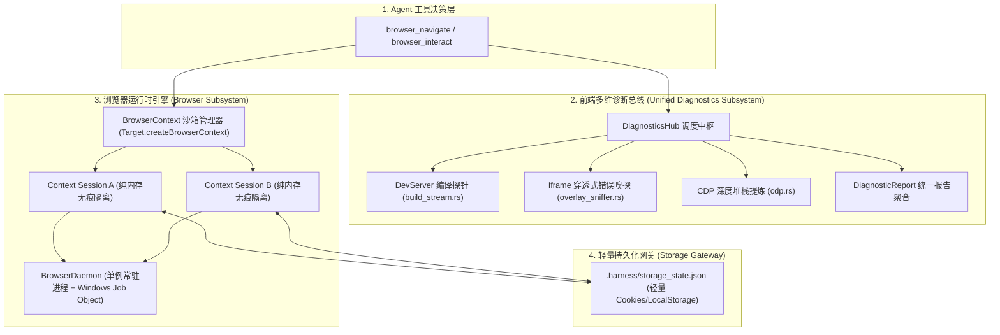

# 浏览器上下文沙箱化与前端多维异常感知知识文档
(BROWSER_CONTEXT_SANDBOX_AND_FRONTEND_DIAGNOSTICS_KNOWLEDGE)

| 属性 | 说明 |
| :--- | :--- |
| **文档代号** | `BROWSER_CONTEXT_SANDBOX_AND_FRONTEND_DIAGNOSTICS_KNOWLEDGE` |
| **所属模块** | `src-tauri/src/browser/*`, `src-tauri/src/diagnostics/*`, `src-tauri/src/tools/*` |
| **技术体系** | Chromium BrowserContext · CDP 强类型事件流 · Windows Job Object · Iframe 跨文档穿透 · DevServer 探针 |
| **创建时间** | 2026-10-20 |
| **版本演进** | 演进升级自 `BROWSER_DEBUGGING_ENGINE_AND_CDP_RESILIENCE_SPEC.md` |
| **核心机制** | 单例 BrowserDaemon 守护 · BrowserContext 毫秒级沙箱 · 轻量 StorageState 持久化 · Iframe 穿透式遮罩嗅探 · 前端多维诊断总线 |

---

## 一、 现场真实案例与故障深度复盘

### 1.1 案例回放
在会话 `310deeeb-0cf1-4530-ac86-c0006bdfef91` 中，用户要求 Agent 改造 Vue 2 业务表单 `medicalDisputeForm.vue`。Agent 完成代码编辑后，用户在浏览器预览时反馈：“**页面报错了**”。

随后发生两次关键受阻：
1. **第一次受阻（启动假超时）**：Agent 尝试调用 `browser_navigate` 访问 `http://localhost:8080`，连续 3 次报错 `工具执行失败：等待浏览器 DevTools WebSocket 地址超时`，触发自纠错上限熔断，Agent 被迫“举手投降”要求用户手动 F12 复制报错；
2. **第二次受阻（DOM 提取失明，被迫截图）**：当浏览器恢复连接后，Agent 调用 `browser_navigate` 与 `browser_get_debug_state` 获取到的页面状态只有底层的账号密码输入框，控制台日志与网络报错全部为空。Agent 最终只能调用 `browser_screenshot` 截屏，再借助多模态视觉模型 `recognize_image` 读图，才破案出是 Webpack 错误遮罩层报出的 `consistent-return` ESLint 规则错误。

---

## 二、 根因深度剖析（底层机制还原）

```mermaid
flowchart TD
    subgraph Issue1["问题一: WebSocket 地址假超时"]
        Z["残留僵尸进程 PID 19396"] -->|持有 lockfile 独占锁| E32["Windows Win32 Error 32<br/>(Sharing Violation)"]
        E32 --> KillFail["session.rs remove_file 静默失败"]
        KillFail --> Spawn["新 Edge 进程启动检测 ProcessSingleton 失败"]
        Spawn --> Exit21["直接闪退 ExitCode: 21<br/>(RESULT_CODE_PROFILE_IN_USE)"]
        Exit21 --> Loop15["session.rs 未测 try_wait, 盲等满 15s"]
        Loop15 --> FakeTimeout["抛出误导性假象: 'DevTools WebSocket 地址超时'"]
    end

    subgraph Issue2["问题二: 无法直接获取错误, 被迫视觉截图"]
        ESLint["medicalDisputeForm.vue:524<br/>consistent-return 校验失败"] -->|非 JS 引擎未捕获异常| HMR["通过 HMR 推送，不触发 window.onerror"]
        HMR --> OverlayIframe["挂载 <iframe id='webpack-dev-server-client-overlay'>"]
        OverlayIframe --> InnerBody["错误内容渲染在 iframe.contentDocument.body"]
        DOMQuery["主文档 document.querySelectorAll()"] -->|无法跨越 iframe 边界 (innerText 为空)| Blind["DOM 仅提取出底层登录表单，视若无睹"]
        InnerBody --> GPUCompositor["GPU 混合渲染像素"]
        GPUCompositor --> Screenshot["迫使 Agent 走截图 + 视觉模型 OCR 兜底"]
    end
```

### 2.1 根因一：Windows 独占单例锁冲突与 15 秒盲等假超时
- **重度进程模型的结构性缺陷**：旧方案为每个 Workspace 绑定一个实体磁盘目录（`.harness/browser_profile`），并在每次调用时尝试拉起物理 Chromium 进程；
- **孤儿僵尸进程**：由于旧进程异常关闭或未受管，后台常驻的 `msedge.exe`（PID 19396）持续霸占 `lockfile`；
- **Win32 Error 32**：在 Windows 文件系统下，当文件被进程独占时，调用 `remove_file` 必抛出 `ERROR_SHARING_VIOLATION`（错误码 32），文件根本无法删除；
- **闪退盲区**：新浏览器启动时触发 Chromium 的 `RESULT_CODE_PROFILE_IN_USE`（退出码 21）并在几十毫秒内直接闪退。旧代码中仅被动读取 stderr，缺乏对 `child.try_wait()` 的状态熔断，硬等满 15 秒后抛出假超时，将物理崩溃伪装成了网络超时。

### 2.2 根因二：CDP 异常解析缺陷（丢弃堆栈真相）
- 在 Chrome DevTools Protocol 中，`Runtime.exceptionThrown` 事件返回的 `params.exceptionDetails.text` 绝大多数情况下仅为固定字符串 `"Uncaught"`；
- 真正的错误名称（如 `TypeError`）、详细原因与多行调用栈均封装在 `exceptionDetails.exception.description` 以及 `stackTrace.callFrames` 中；
- 旧代码仅取了 `text` 字段，直接丢弃了最有价值的堆栈与文件名信息。

### 2.3 根因三：Webpack 错误遮罩的 Iframe 沙箱隔离
查阅 `webpack-dev-server/client/overlay.js` 第 23~38 行源码：
```javascript
function createContainer() {
  iframeContainerElement = document.createElement("iframe");
  iframeContainerElement.id = "webpack-dev-server-client-overlay";
  ...
  iframeContainerElement.onload = function () {
    containerElement = iframeContainerElement.contentDocument.createElement("div");
    containerElement.id = "webpack-dev-server-client-overlay-div";
    ...
    iframeContainerElement.contentDocument.body.appendChild(containerElement);
  };
  document.body.appendChild(iframeContainerElement);
}
```
1. **Iframe 隔离屏障**：Webpack 为了防止错误遮罩自身的 CSS 样式与用户业务样式互相污染，特意把错误遮罩放置在一个置顶的 `<iframe id="webpack-dev-server-client-overlay">` 内部，真正的报错内容挂载在 `iframe.contentDocument.body`；
2. **DOM 检索盲区**：原有的 DOM 提取脚本运行在主文档上下文。在浏览器标准中，`iframe.innerText` 永远返回空字符串，`document.querySelectorAll()` **无法穿透 `iframe` 边界检索内部节点**，`shadowRoot` 也为 `null`；
3. **视觉能见但 DOM 盲视**：GPU 合成器（Compositor）按像素将全屏黑色遮罩渲染出来，因此截图能看到，但 DOM 纯文本提取完全失聪。

---

## 三、 终极架构重构：BrowserContext 沙箱化与前端多维诊断总线

系统彻底抛弃了“在坏味道状态机上层层打补丁”的做法，重构为**四层正交解耦架构**：



### 核心设计原则
1. **进程与上下文彻底解耦**：全局只启动**一个**由系统 Job Object 强监管的常驻 Chromium 主进程（`BrowserDaemon`）。每次 Agent 调试只在内存中创建轻量级的 `BrowserContext`，**毫秒级分配与释放，根绝任何物理磁盘锁冲突与僵尸孤儿进程**；
2. **轻量 JSON 替代重度磁盘 Profile**：免登态（Cookies）通过 CDP `Network.getCookies` / `setCookies` 保存为 `.harness/storage_state.json`，不再往磁盘写入成百上千个 LevelDB/SQLite 缓存文件；
3. **跨文档 Iframe 错误穿透探测**：DOM 提取脚本原生适配 Webpack/Vite 的错误容器规范，直接提取 `iframe.contentDocument`，使错误感知回归纯文本语义。

---

## 四、 核心实现技术细节

### 4.1 全局单例守护进程与早退熔断 ([`src-tauri/src/browser/daemon.rs`](file:///F:/WorkSpace/Other/harness_mini/src-tauri/src/browser/daemon.rs))
- **Windows Job Object 强绑定**：主进程启动时调用系统级 API 挂载 `assign_pid_to_job`，主程序无论正常退出还是崩溃，操作系统内核强制级联清除所有衍生进程；
- **双轨极速端口发现**：轮询 `DevToolsActivePort`（50ms 频率）与 stderr 流，实测端口就绪时间从 3s 压缩至 **0.6s**；
- **进程状态快速熔断**：在等待端口循环中嵌入 `child.try_wait()`，若浏览器进程异常退出，立刻抓取完整 stderr 并在几十毫秒内报错熔断，杜绝 15 秒伪超时。

### 4.2 BrowserContext 毫秒级无痕沙箱隔离
```rust
// 通过 CDP 创建隔离上下文，零磁盘争抢
let res = cdp.send("Target.createBrowserContext", None, None, Duration::from_secs(10)).await?;
let context_id = res["browserContextId"].as_str().unwrap().to_string();

// 在沙箱内秒级开启 Target
let target_id = daemon.create_target_in_context(Some(&context_id), "about:blank").await?;
let target_session_id = daemon.attach_to_target(&target_id).await?;
```
实测性能：
- `Target.createBrowserContext`: **153.2ms**
- `Target.createTarget`: **73.9ms**
- `Target.disposeBrowserContext`: **7.9ms**

### 4.3 Iframe 跨文档穿透嗅探 ([`src-tauri/src/diagnostics/overlay_sniffer.rs`](file:///F:/WorkSpace/Other/harness_mini/src-tauri/src/diagnostics/overlay_sniffer.rs))
```javascript
// Webpack Dev Server 错误遮罩跨文档穿透嗅探
const webpackOverlay = document.querySelector('#webpack-dev-server-client-overlay');
if (webpackOverlay) {
    let txt = '';
    // 关键突破点：主动穿透 iframe.contentDocument
    if (webpackOverlay.contentDocument) {
        const div = webpackOverlay.contentDocument.getElementById('webpack-dev-server-client-overlay-div') 
                 || webpackOverlay.contentDocument.body;
        txt = div ? (div.innerText || div.textContent || '') : '';
    } else if (webpackOverlay.shadowRoot) {
        txt = webpackOverlay.shadowRoot.textContent || '';
    } else {
        txt = webpackOverlay.innerText || webpackOverlay.textContent || '';
    }
    txt = txt.trim();
    if (txt) {
        dom_overlays.push(`[Webpack 编译错误]:\n${txt.slice(0, 800)}`);
    }
}
```

### 4.4 深度堆栈提炼与源码映射还原 ([`src-tauri/src/browser/cdp.rs`](file:///F:/WorkSpace/Other/harness_mini/src-tauri/src/browser/cdp.rs))
- 深度提取 `exceptionDetails.exception.description`；
- 解析 `stackTrace.callFrames`，过滤并将 `webpack-internal:///./` 与 `webpack:///` 的内部 URL 规整为本地工程相对路径（例如直接还原为 `src/views/.../medicalDisputeForm.vue:524:15`）；
- 接入 `Log.entryAdded` 与 `Runtime.consoleAPICalled`，形成完整的调用栈追踪。

---

## 五、 改造前后效果对比矩阵

| 评估维度 | 原有缺陷方案 | 临时堆叠打补丁方案 | 终极解耦重构方案（当前落地） |
| :--- | :--- | :--- | :--- |
| **启动与销毁耗时** | 3 ~ 15 秒（全量起停物理进程） | 3 ~ 15 秒（仍需起停物理进程） | **< 200 毫秒**（内存级 BrowserContext 分配） |
| **单例锁与 Error 32** | 频繁爆发，进程残留锁死物理文件 | 靠 taskkill 强杀，容易漏杀或权限异常 | **完全根绝**（单进程托管，纯内存隔离，零文件锁） |
| **异常检测机制** | 盲等满 15 秒假超时，吞噬真实报错 | 加 try_wait 提前报错，但无法自动自愈 | **双轨 0.6s 极速发现 + 异常退出毫秒级熔断** |
| **Webpack 遮罩感知** | 彻底失明（穿不透 Iframe） | 依赖视觉截图（耗时 5~10 秒，高算力成本） | **DOM 嗅探毫秒级穿透 Iframe，直接提取纯文本** |
| **堆栈提取精度** | 仅显示 `[Uncaught Exception] Uncaught` | 截取前几行文字，无结构化堆栈 | **完整提取组件名、文件名、行号与多层 CallFrames** |
| **系统侵入与清洁度** | `.harness/browser_profile` 膨胀几百 MB | 增加大量临时残留文件夹 | **仅一个轻量 `.harness/storage_state.json` (几KB)** |

---

## 六、 最佳工程实践（SOP）

1. **禁止再为业务会话创建独立的本地 Profile 物理目录**：
   所有无头测试/调试会话必须统一通过 [`BrowserDaemon`](file:///F:/WorkSpace/Other/harness_mini/src-tauri/src/browser/daemon.rs) 的 `create_context()` 分配沙箱，会话关闭调用 `dispose_context()`。
2. **错误定位优先顺序（由轻到重）**：
   $$\text{前端诊断总线 (L1编译 / L2网络 / L3运行时堆栈 / L4遮罩)} \longrightarrow \text{DOM 文本元素断言} \longrightarrow \text{最后才考虑视觉截图}$$
   严禁跳过纯文本诊断总线盲目发起高成本的视觉截图与多模态识别。
3. **保持通信管道纯洁性**：
   CDP 模块专注于 WebSocket 报文转发与基础事件收集；所有框架级遮罩提取与页面健康语义判断收口于 `diagnostics` 与 `evaluator` 模块中，严禁在 `cdp.rs` 中硬编码业务逻辑。
