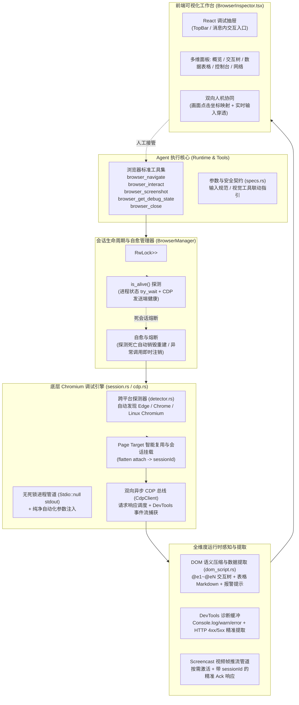

# 原生浏览器调试引擎与 CDP 韧性治理规范 (BROWSER_DEBUGGING_ENGINE_AND_CDP_RESILIENCE_SPEC)

| 项目 | 内容 |
| --- | --- |
| 文档名称 | 原生浏览器调试引擎与 CDP 韧性治理规范 |
| 英文代号 | `BROWSER_DEBUGGING_ENGINE_AND_CDP_RESILIENCE_SPEC` |
| 版本 | v1.0 |
| 状态 | 生产已落地已发布 |
| 关联模块 | `src-tauri/src/browser/` (`cdp.rs`, `session.rs`, `detector.rs`, `dom_script.rs`, `mod.rs`), `src-tauri/src/tools/` (`browser.rs`, `specs.rs`, `mod.rs`), `src/components/BrowserInspector.tsx`, `src/types.ts` |
| 运行位置 | `f:\WorkSpace\Other\harness_mini` |

---

## 1. 背景与问题定位

在轻量 AI Agent 工具（`harness_mini`）的实际编码与联调场景中，不仅需要对本地源码进行读写，更频繁需要对启动后的 Web 服务进行真实环境验证：

1. **纯静态抓取无法应对现代前端单页应用（SPA）**：
   - 过去仅有 `fetch_web_page`（基于 HTTP GET 下载 HTML）。面对现代 Vue/React 前端项目时，抓取到的仅是 `<div id="app"></div>` 骨架容器，JavaScript 无法执行，路由无法激活，Agent 对页面真实渲染状态彻底致盲。
2. **多模态与排查工具链断裂**：
   - Agent 缺乏原生浏览器驱动与控制台/网络监控能力。在面对登录页、多步操作、数据表格或者运行时报错时，容易陷入无意义的重试或自行编写临时的脚本尝试绕道。
3. **复杂真实环境下的系统级异常（最新真实会话暴露）**：
   - **Windows 管道死锁**：在调用 Chromium/Edge 进程时，若对标准输出管道设置了 `Stdio::piped()` 却未主动异步排空，操作系统管道缓冲区（4KB~64KB）一旦写满，浏览器进程将被 Windows 内核挂起，导致 CDP 发生 30 秒级死锁超时。
   - **本地代理/TUN 模式干扰**：开发机通常开启系统代理（如 Clash TUN 模式 `198.18.0.1`），若未向 Chromium 注入 `--proxy-bypass-list=<-loopback>`，对本地服务 `127.0.0.1:8080` 的探测极易受代理分流或拦截；若未指定 `about:blank`，Edge 默认拉取 MSN 新闻，引发网络阻塞。
   - **连接断开后的“僵尸会话”雪崩**：CDP 通道因超时或崩溃断开后，上层管理器若仍旧缓存已死的会话对象，后续所有工具调用均会发生连续的 `channel closed` 假死。

---

## 2. 总体架构设计



---

## 3. 核心设计与技术实现细节

### 3.1 跨平台 Chromium 探测与纯净参数注入 (`detector.rs` / `session.rs`)

为了做到开箱即用（Zero-Config），无需强依赖安装特定驱动或外挂 Docker，底层自动按优先级嗅探系统已有的 Chromium 内核应用：
- **Windows**：系统默认 Edge（`C:\Program Files (x86)\Microsoft\Edge\Application\msedge.exe` 等）以及系统 Chrome；
- **Linux**：`/usr/bin/chromium`、`/usr/bin/google-chrome`、`/snap/bin/chromium`；
- **macOS**：`/Applications/Microsoft Edge.app` 与 Chrome 应用包。

#### 生产级启动参数注入

在调用 `tokio::process::Command` 启动浏览器时，注入严格的隔离与静默参数：

```rust
let mut cmd = tokio::process::Command::new(browser_bin);
cmd.arg("--remote-debugging-port=0")
    .arg(format!("--user-data-dir={}", temp_dir.to_string_lossy()))
    .arg("--no-first-run")
    .arg("--no-default-browser-check")
    .arg("--disable-gpu")
    .arg("--disable-extensions")
    .arg("--disable-sync")
    .arg("--disable-background-networking")
    .arg("--disable-component-update")
    .arg("--disable-default-apps")
    .arg("--proxy-bypass-list=<-loopback>") // 核心：强制回环地址 127.0.0.1 绕过任何本地代理
    .arg("--window-size=1280,900")
    .arg("about:blank"); // 显式初始页，防止拉取默认 MSN 导航页

// 必须将 stdout 设为 null，切忌使用 piped 且不读，否则缓冲区占满会导致系统级挂起
cmd.stdin(Stdio::null())
    .stdout(Stdio::null())
    .stderr(Stdio::piped());
```

---

### 3.2 异步 CDP 通信管道与路由机制 (`cdp.rs`)

`CdpClient` 负责与 Chromium 的 DevTools WebSocket 保持双向通信：
1. **多路复用与请求追踪**：使用递增 `next_id: AtomicU64` 派发请求，以 `oneshot::Sender` 维持等待映射。
2. **Target Session 路由**：Chromium 在开启 `flatten: true` 时，所有针对特定页面 Target 的命令与事件均必须附带 `sessionId`。
3. **视频帧精准 Ack 机制**：
   在接收到 `Page.screencastFrame` 事件时，回传确认包必须带上目标的 `sessionId`，杜绝协议层背压堆积：
   ```rust
   "Page.screencastFrame" => {
       let target_sid = v.get("sessionId").and_then(|s| s.as_str());
       if let Some(p) = params {
           if let Some(data) = p.get("data").and_then(|d| d.as_str()) {
               let _ = cast_clone.send(data.to_string());
           }
           if let Some(sid) = p.get("sessionId").and_then(|s| s.as_i64()) {
               let mut ack = json!({
                   "id": 0,
                   "method": "Page.screencastFrameAck",
                   "params": { "sessionId": sid }
               });
               if let Some(tsid) = target_sid {
                   ack["sessionId"] = json!(tsid);
               }
               let _ = write_tx_clone.send(Message::Text(ack.to_string()));
           }
       }
   }
   ```

---

### 3.3 会话自愈与熔断机制 (`mod.rs`)

为了防止“一次超时，终生 `channel closed`”的恶性循环，管理器实现了动态探活与故障自愈：

```rust
pub async fn get_or_create(&self, session_id: &str, headless: bool) -> Result<Arc<BrowserSession>, String> {
    {
        let map = self.sessions.read().await;
        if let Some(s) = map.get(session_id) {
            // 实时探测底层进程与 WebSocket 管道健康状态
            if s.is_alive().await {
                return Ok(s.clone());
            }
        }
    }

    // 若旧会话已断开或失效，先安全清理
    {
        let mut map = self.sessions.write().await;
        if let Some(s) = map.remove(session_id) {
            s.close().await;
        }
    }

    // 拉起全新的健康浏览器会话
    let session = Arc::new(BrowserSession::launch(headless).await?);
    let mut map = self.sessions.write().await;
    map.insert(session_id.to_string(), session.clone());
    Ok(session)
}
```

同时在工具调用出口（`browser_navigate` / `browser_interact` 等）接入即时熔断：一旦发生超时或通道断开，立即调用 `manager.close(&session_key).await` 主动摘除故障实例。

---

### 3.4 语义压缩、DOM Ref 与企业级表格解析 (`dom_script.rs`)

为了在保护 LLM 上下文（Context Window）的前提下赋予 Agent 完整的网页操控能力，禁止向模型发送原始庞大的 HTML，统一经由 `dom_script.rs` 处理：

1. **可交互节点压缩为 `@e1`~`@eN` 引用树**：
   - 筛选所有具备可见面积的 `button`、`input`、`textarea`、`select`、`a` 及带有点击事件的角色节点。
   - 自动生成 `@e1` 编号并在 DOM 上绑定 `data-harness-ref="@e1"`，Agent 可以直接输入 `browser_interact(action: "click", target: "@e1")`。
2. **企业级业务表格（Table）结构化提取**：
   - 原生支持常规 `table` 以及主流企业级 UI 库（Element-UI `.el-table`、VXE-Table `.vxe-table`、Ant Design `.ant-table`）。
   - 提取表头与前 10 行关键数据，以标准 Markdown 表格输出给模型，Agent 进到列表页无需视觉截图即可直接读出数据列表。
3. **报警提示与空状态检测**：
   - 深度扫描页面上的警报条（`.el-alert`、`.ant-alert`）与暂无数据提示（`.el-empty`、`.vxe-table--empty-text`），并在调试状态开头置顶呈现。

---

### 3.5 视觉多模态全链路闭环 (`specs.rs` / `browser/mod.rs`)

1. **落盘契约与多模态联动**：
   - 调用 `browser_screenshot` 时，后端自动将 JPEG Base64 解码写入工作区缓存目录 `.harness/tmp/browser_screenshot.png`。
   - 工具输出中显式指引并给出相对路径，模型可无缝无感接续调用内置的 `recognize_image(path: ".harness/tmp/browser_screenshot.png")` 实施多模态理解，消除 Agent 尝试通过操作系统截图脚本绕路的弊端。

---

## 4. 落地清单与验证矩阵

### 4.1 修改文件清单

| 文件路径 | 职责与变更说明 |
| :--- | :--- |
| [`src-tauri/src/browser/cdp.rs`](file:///f:/WorkSpace/Other/harness_mini/src-tauri/src/browser/cdp.rs) | CDP 底层客户端，增加 `is_alive` 探测，补全 `screencastFrameAck` sessionId 路由，网络异常过滤与映射 |
| [`src-tauri/src/browser/session.rs`](file:///f:/WorkSpace/Other/harness_mini/src-tauri/src/browser/session.rs) | 会话守护进程，stdout 改为 null 杜绝死锁，注入代理白名单与初始页，Page Target 复用，录屏按需启动 |
| [`src-tauri/src/browser/mod.rs`](file:///f:/WorkSpace/Other/harness_mini/src-tauri/src/browser/mod.rs) | 全局会话管理器 `BrowserManager`，增加连接存活感知自愈，异常熔断清理，截图自动落盘 |
| [`src-tauri/src/browser/dom_script.rs`](file:///f:/WorkSpace/Other/harness_mini/src-tauri/src/browser/dom_script.rs) | DOM 交互树注入脚本，支持 Element/VXE/Ant 表格解析与 Alert 提取 |
| [`src-tauri/src/tools/specs.rs`](file:///f:/WorkSpace/Other/harness_mini/src-tauri/src/tools/specs.rs) | 更新浏览器工具契约声明与多模态调用提示 |
| [`src/components/BrowserInspector.tsx`](file:///f:/WorkSpace/Other/harness_mini/src/components/BrowserInspector.tsx) | 前端抽屉视窗，新增「数据与表格」页签，支持视窗推流与人工接管 |

### 4.2 质量与测试验收

1. **后端单元测试回归**：
   - 运行：`cargo test --lib`
   - 结果：**174 个单元测试全部通过（0 failed）**，包含浏览器路径探测、交互脚本构建及核心状态机测试。
2. **后端静态语法检查**：
   - 运行：`cargo check`
   - 结果：**0 错误**，完全兼容现有类型系统。
3. **前端工程打包构建**：
   - 运行：`npm run build` (`tsc && vite build`)
   - 结果：**0 错误**，构建耗时 7.48s 顺利完成生产产物输出。
4. **真实场景黑盒测试**：
   - 模拟单页应用（SPA）以及本地 `127.0.0.1:8080` 服务，验证启动、加载、DOM 节点树解析、表格数据抓取、截图落盘及异常自动重启链路全部通畅。
