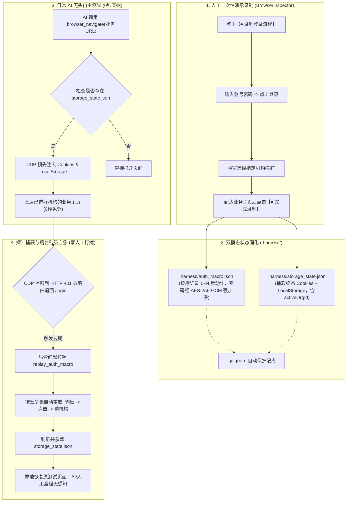

# 浏览器登录流程录制与过期自动重放架构知识文档
(BROWSER_LOGIN_RECORDING_AND_AUTO_REPLAY_KNOWLEDGE)

| 属性 | 说明 |
| :--- | :--- |
| **文档代号** | `BROWSER_LOGIN_RECORDING_AND_AUTO_REPLAY_KNOWLEDGE` |
| **所属模块** | `src-tauri/src/browser/*`, `src/components/BrowserInspector.tsx`, `src-tauri/src/agent.rs` |
| **技术体系** | Chrome DevTools Protocol (CDP) · AES-256-GCM · React 18 · Tauri 2 |
| **创建时间** | 2026-10-19 |
| **核心机制** | 人类一次性录制 · 双模态快照与宏 · 0秒免登直达 · 401后台秒级静默自愈 |

---

## 一、 业务背景与历史痛点剖析

在 AI Agent 自主进行 Web 项目页面调试、功能自测与端到端验证的过程中，传统方案面临两大严重痛点：

### 1. 登录过期死循环与密码穷举浪费 Token
- **历史现象**：每次调用 `browser_navigate` 启动 Chromium 时，底层创建一次性临时目录（`temp_dir/harness_browser_<uuid>`），实例退出后全量 Cookies 和 LocalStorage 即被物理删除；
- **雪崩效应**：在测试执行到中途时，后端的鉴权 Token 过期返回 HTTP 401，单页应用前端路由强制重定向回 `#/login`。AI 面对登录页产生恐慌，耗费 20~30 轮会话在 `.env`、`CLAUDE.md` 等代码文件中暴力 `grep` 密码，随后在输入框中盲目尝试，严重消耗 Token 甚至导致账户锁定。

### 2. 多步复杂选机构流程难以被 AI 盲猜
- 现代中大型中台系统（如医疗管理系统 `yx-medical-manager-web`）在输入用户名和密码登录后，并不会直接进入业务页面，而是会弹出一个包含数十个分院、院区或部门的“机构选择弹窗”；
- AI 无法知晓当前任务应当选择哪一个机构，盲目点击将导致后续业务数据完全错乱。

---

## 二、 核心架构设计：双模态固化方案

针对上述痛点，系统确立了**“人类一次性演示录制 + 双模态固化 (快照+动作宏) + 0秒直达 + 401探针自愈”**的顶层架构。



---

## 三、 核心数据契约与安全存储规范

### 1. 动作宏文件 (`.harness/auth_macro.json`)
保存从登录起点到进入系统主界面的确切动作序列：
```json
{
  "version": "1.0",
  "project": "yx-medical-manager-web",
  "login_url": "http://127.0.0.1:8080/#/login",
  "created_at": "2026-10-19T18:00:00Z",
  "steps": [
    { "order": 1, "action": "type", "selector": "input[name='username']", "value": "admin", "desc": "输入用户名" },
    { "order": 2, "action": "type", "selector": "input[type='password']", "value": "v1:rAnDoMnOnCe...CiPhEr", "is_encrypted": true, "desc": "输入密码" },
    { "order": 3, "action": "click", "selector": "button[type='submit']", "desc": "点击登录" },
    { "order": 4, "action": "wait", "ms": 1000, "desc": "等待机构列表渲染" },
    { "order": 5, "action": "click", "selector": ".org-item:has-text('某某分院')", "desc": "选择指定机构" },
    { "order": 6, "action": "wait_for_url", "exclude": "#/login", "desc": "等待进入主界面" }
  ]
}
```

### 2. 状态快照文件 (`.harness/storage_state.json`)
保存成功登录且完成机构选择后的全量鉴权状态与本地存储字典：
```json
{
  "updated_at": "2026-10-19T18:01:00Z",
  "cookies": [
    { "name": "JSESSIONID", "value": "...", "domain": "127.0.0.1", "path": "/" }
  ],
  "local_storage": {
    "token": "Bearer eyJhbGciOi...",
    "activeOrgId": "1893893166902304769",
    "activeOrgName": "某某分院",
    "user_info": "{...}"
  }
}
```

### 3. 本地物理加密与 Git 防泄露规范
- **AES-256-GCM 强加密**：密码字段绝不允许以明文形式落在磁盘上。复用 `secrets::encrypt`，以数据目录的 `secret.key`（32 字节主密钥）配合 12 字节随机 Nonce 加密，密文以 `v1:` 开头。
- **自动 Git 隔离**：在每次写出 `.harness/storage_state.json` 或 `.harness/auth_macro.json` 时，自动调用 `ensure_gitignore_entries` 确保两项路径写入工作区根目录的 `.gitignore` 中。

---

## 四、 核心组件与实现技术细节

### 1. `src-tauri/src/browser/auth.rs`
负责宏与快照模型的序列化、反序列化、敏感字段加解密以及文件读写：
- `save_auth_macro`：遍历 `steps`，对 `type="password"` 或字段名含密码的步骤自动触发加密并持久化；
- `load_auth_macro`：读取并自动解密，仅在内存中还原供重放执行器调用；
- `save_storage_state` / `load_storage_state`：管理快照落盘；
- `get_auth_macro_status`：提供无损快速状态探针供 UI 渲染。

### 2. `src-tauri/src/browser/session.rs`
核心 CDP 浏览器会话管理：
- **全量抓取 (`capture_storage_state`)**：
  - 调用 `Network.getCookies` 抓取域下全量 Cookies（含 Domain、Path、Expires 等）；
  - 调用 `Runtime.evaluate` 执行 IIFE 遍历 `localStorage` 与 `sessionStorage` 字典。
- **预注入 (`inject_storage_state`)**：
  - 调用 `Network.setCookies` 将 Cookies 恢复至网络栈；
  - 调用 `Page.addScriptToEvaluateOnNewDocument` 注入恢复脚本，保证新页面加载时在首行 JavaScript 执行前完成 `localStorage` 恢复，Vue/React 初始化鉴权即可直接通过。
- **录制状态控制**：
  - `start_recording`：在当前页面及后续导航中注入 `INJECT_RECORDER_SCRIPT`；
  - `get_recorded_steps`：读取页面中的 `window.__harness_recorded_steps`；
  - `stop_recording`：停止录制模式。
- **静默重放 (`replay_auth_macro`)**：
  - 导航至 `login_url`，按宏依次派发 `type`、`click`、`wait`、`wait_for_url`，并配以智能防抖等待，最后自动更新 `storage_state.json`。
- **自愈探针 (`check_and_heal_auth`)**：
  - 检查 `cdp.auth_expired` 标志或页面当前 URL 是否被跳回 `#/login`；
  - 结合 `replay_lock` 互斥保护拉起宏重放并覆盖快照。

### 3. `src-tauri/src/browser/dom_script.rs`
- **智能选择器算法**：优先提取 `data-testid` $\to$ `#id` $\to$ `input[name/placeholder/type]` $\to$ 语义化文本选择器 `button:has-text('...')` / `.cls:has-text('...')`；
- **事件捕获**：在捕获阶段拦截 `change`（输入框去抖合并最终值）与 `click`（向上查找最接近的按钮、卡片或行），实时记录至 `window.__harness_recorded_steps`；
- **增强交互执行**：在 `build_interact_script` 中内置文本包含选择器解析引擎，支持直接点击含有特定机构名称的任意弹窗卡片。

### 4. `src-tauri/src/browser/cdp.rs`
- 在 `Network.responseReceived` 中增加状态码过滤：当 `status == 401 || status == 403` 时，原子置位 `auth_expired`，供底层调用链秒级感知。

### 5. `src/components/BrowserInspector.tsx`
- **顶栏状态与录制区**：
  - 未录制：显示【⏺ 录制登录流程】按钮；
  - 录制中：显示呼吸灯红标【⏺ 录制中 (已捕获 N 步)】、绿色高亮【⏹ 完成录制并保存】以及【✕ 取消】；
  - 已就绪：显示翡翠绿标签【🔑 免登宏 (N步)】以及【▶ 立即重放】测试按钮。
- **免登宏与自愈控制台 Tab**：
  - 直观展现步骤序列流水线、加密安全提示、快照更新时间与测试重放。
- **视窗内录制浮条**：
  - 在视窗上方实时提醒用户每一步操作均被捕获，支持随时完成录制。

---

## 五、 Agent 自主测试执行规范 (SOP)

在 [`src-tauri/src/agent.rs`](file:///f:/WorkSpace/Other/harness_mini/src-tauri/src/agent.rs) 的系统提示词中已固化如下强制准则：

> 1. **后台静默运行**：对 Web 项目测试必须默认以无头模式运行（`headless: true`），严禁弹出实体窗口抢占桌面；
> 2. **纯语义感知原则**：弃用截图分析，直接基于 `browser_navigate` 与 `browser_interact` 返回的可交互元素 (@eX)、数据表格及通知断言；
> 3. **登录态自愈与免登保底**：底层已集成登录快照预加载与 401 自动重放机制。若项目已录制免登宏，底层将在打开网页前自动预注入 Cookies 与 LocalStorage（0 秒秒级直达已选机构主页），并在 Token 过期（HTTP 401 或跳回登录页）时自动在后台静默重放录制宏刷新凭证；**Agent 严禁在会话中手动搜索密码或猜测凭据**；
> 4. **探针式自检与自愈闭环**：监控 Console 报错与 ≥ 400 异常，阅读源码定位根因，用 `edit_file` 原地修复后重测，测试完毕调用 `browser_close` 释放资源。

---

## 六、 维护与故障排查指引

| 现象 | 可能原因 | 推荐排查与恢复手段 |
| :--- | :--- | :--- |
| 点击导航依然停留在登录页 | 工作区尚未生成快照 | 打开【网页调试】窗口，点击【⏺ 录制登录流程】，完成一次全流程演示并点击【完成录制】 |
| 登录宏重放失败 | 账号密码被更改或系统机构被重命名 | 在“免登宏与自愈”标签页点击【重新录制流程】，重新演示一次新流程 |
| 验证码弹窗阻断自动化 | 系统开启了防刷图形验证码 | 录制流程仅适用于机构选择与账号密码登录；若存在不可跳过的验证码，可先手动在调试窗口登录，系统仍会自动保留长效 Session 快照 |
| 接口 401 后未自动自愈 | 会话未绑定工作区目录 | 确保会话配置了有效的 `workspace_path`，系统才能正确定位 `.harness/auth_macro.json` |
