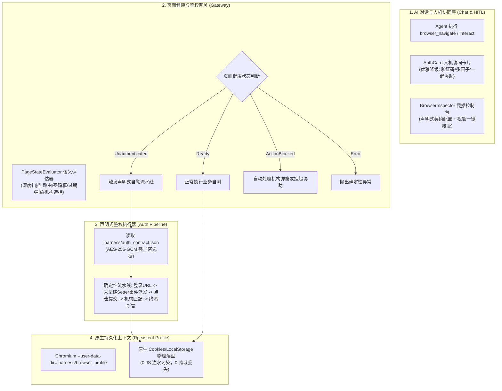

# 浏览器原生持久化上下文与声明式鉴权网关知识文档
(BROWSER_PERSISTENT_CONTEXT_AND_AUTH_GATEWAY_KNOWLEDGE)

| 属性 | 说明 |
| :--- | :--- |
| **文档代号** | `BROWSER_PERSISTENT_CONTEXT_AND_AUTH_GATEWAY_KNOWLEDGE` |
| **所属模块** | `src-tauri/src/browser/*`, `src/components/BrowserInspector.tsx`, `src/components/AuthCard.tsx`, `src/components/ToolCard.tsx` |
| **技术体系** | Chromium Native Persistent Context · CDP · AES-256-GCM · Tokio · React 18 · Tauri 2 |
| **创建时间** | 2026-10-20 |
| **版本演进** | 升级并替代 `BROWSER_LOGIN_RECORDING_AND_AUTO_REPLAY_KNOWLEDGE.md` |
| **核心机制** | Chromium 原生状态持久化 · 纯语义页面健康状态机 · 声明式凭据契约与表单流水线 · 对话流 HITL 人机协同降级 |

---

## 一、 现场案例与根因深度复盘

### 1.1 案例回放
在 2026-10-20 的医疗纠纷业务模块自主测试中，AI Agent 发起 `browser_navigate` 访问 `http://127.0.0.1:8080/#/medicalAffairManage/medical-dispute`。因后台 Token 自然失效，旧版免登机制未能自动触发，最终用户不得不手动打开原生调试工作台重新登录。

### 1.2 现有旧方案（事件录制 + 注水补丁）的三大本质缺陷

```
【旧方案调用链脆弱点】
  browser_navigate
         │
         ▼
[底层 cdp.rs 状态码监听] ──盲区──> [业务系统返回 200 OK + {code: 401}] ──> 探针完全失聪
         │
         ▼
[about:blank 外部 JS 注水] ──失败──> [SOP 同源策略拦截 / SPA Hash 路由重置] ──> 注水失效
         │
         ▼
[旧 DOM 事件录制重放] ──崩溃──> [把业务终态首页误当登录起点 URL] ──> 找不到输入框崩溃
```

1. **CDP 越权与判定盲区**：
   旧方案在底层 WebSocket 调度器 [`src-tauri/src/browser/cdp.rs`](file:///f:/WorkSpace/Other/harness_mini/src-tauri/src/browser/cdp.rs) 中硬编码 `status == 401 || status == 403`。但现代企业级系统（如 Vue/Spring Boot）在 Token 失效时，HTTP 响应码通常依然为 `200 OK`（仅在 JSON body 携带 `{ code: 401 }` 或前端弹窗提示），底层 CDP 探针完全失聪。
2. **违背原生沙箱生命周期（JS 强制注水失效）**：
   鉴权 Token 保存在 `sessionStorage`，旧方案试图在 `about:blank` 状态下通过 `Page.addScriptToEvaluateOnNewDocument` 和 `localStorage/sessionStorage.setItem` 进行外部“注水”，受到同源策略（SOP）与 SPA Hash 路由切换的双重限制，频发注入失效。
3. **黑盒录制的非确定性**：
   依赖监听全局 `click/change` 事件自动猜测选择器（如提取 `div.login-tips`、`button:has-text('登录')`）。用户登录完成跳转至 `#/index` 后点击保存，导致系统将**终态首页**误当做**登录起点 URL**，重放第一步即因找不到元素而崩溃。

---

## 二、 顶层架构重构与三大基本原则

系统废弃了“堆叠式打补丁”思路，重构为**基于浏览器原生能力、职责清晰单一**的现代化鉴权网关架构：



### 三大架构原则
1. **把属于浏览器的归还浏览器（Zero-Injection 原则）**：废除所有手写序列化和向页面强制注水 JS 的代码，全面采用 Chromium 原生持久化上下文（Persistent User Data Dir）。
2. **底层协议纯净化（Layer Separation 原则）**：CDP 模块恢复纯粹的通讯管道属性，所有业务鉴权判定上浮至语义状态机（[`PageStateEvaluator`](file:///f:/WorkSpace/Other/harness_mini/src-tauri/src/browser/evaluator.rs)）。
3. **确定性声明替代黑盒录制（Declarative Contract 原则）**：用结构化凭据契约与表单流水线替换脆弱的 DOM 事件黑盒录制，辅以人机协同（HITL）优雅降级。

---

## 三、 四大核心模块技术规格与实现剖析

### 3.1 模块 1：Chromium 原生持久化上下文（Storage Layer）

#### 物理存储布局
```
<WorkspaceRoot>/
└── .harness/
    ├── browser_profile/          # Chromium 原生 User Data Dir (包含 Cookies, LocalStorage, IndexedDB)
    │   ├── Default/
    │   │   ├── Network/Cookies   # 原生 SQLite Cookies 数据库
    │   │   ├── Local Storage/    # 原生 LevelDB 本地存储
    │   │   └── Session Storage/  # 原生持久化标签页会话
    │   └── SingletonLock         # 进程单例锁文件
    └── auth_contract.json        # 声明式登录凭据契约 (密码加密)
```

#### 启动参数与进程生命周期
在 [`src-tauri/src/browser/session.rs`](file:///f:/WorkSpace/Other/harness_mini/src-tauri/src/browser/session.rs) 中：
- 启动时为每次会话接入工作区 `.harness/browser_profile`：
  ```rust
  let profile_dir = workspace.join(".harness").join("browser_profile");
  cmd.arg(format!("--user-data-dir={}", profile_dir.display()))
     .arg("--no-first-run")
     .arg("--no-default-browser-check")
     .arg("--disable-background-networking");
  ```
- **SingletonLock 治理**：当浏览器由于 SIGKILL 或异常退出残留孤儿锁文件时，启动前检测持有该锁的 PID 是否依然存活；若已消亡，先行清理孤儿锁，杜绝 Chromium 启动僵死。
- **自动防泄露**：在 [`src-tauri/src/browser/auth.rs`](file:///f:/WorkSpace/Other/harness_mini/src-tauri/src/browser/auth.rs) 中自动为工作区 `.gitignore` 登记 `.harness/browser_profile/` 与 `auth_contract.json`。

---

### 3.2 模块 2：语义页面健康与鉴权评估器（State Awareness Layer）

在 [`src-tauri/src/browser/evaluator.rs`](file:///f:/WorkSpace/Other/harness_mini/src-tauri/src/browser/evaluator.rs) 中实现纯语义状态机：

```rust
#[derive(Debug, Clone, Serialize, Deserialize, PartialEq)]
#[serde(tag = "type", content = "payload")]
pub enum PageHealthState {
    /// 页面处于正常业务态，目标元素或数据表格可访问
    Ready,
    /// 页面处于未鉴权态（例如重定向到登录页、或页面弹出“登录超时”遮罩）
    Unauthenticated {
        current_url: String,
        reason: String, // "url_redirect" | "login_form_detected" | "auth_modal_detected"
    },
    /// 页面存在阻断性全局弹窗（如“请选择所属机构”、“系统维护公告”）
    ActionBlocked {
        title: String,
        description: String,
    },
    /// 页面发生不可逆错误（HTTP 500、404、网络断开）
    Error {
        code: Option<u16>,
        message: String,
    },
}
```

#### 纯客户端语义扫描规则（`EVALUATE_PAGE_STATE_SCRIPT`）
1. **URL 语义扫描**：判断当前路径是否重定向至 `/login` 或 `#/login`；
2. **表单语义扫描**：判断可见视口内是否存在活跃的 `input[type="password"]`；
3. **遮罩弹窗语义扫描**：遍历 `.el-message-box`, `.el-dialog`, `.ant-modal`, `[role="dialog"]`，匹配 `['登录已过期', '请重新登录', 'Token已失效', '登录超时', '未授权']`；
4. **阻断弹窗扫描**：检测是否存在包含 `选择机构`、`切换科室`、`组织选择` 的前置阻断弹窗（返回 `ActionBlocked` 状态，触发后置选机构或人机协助）。

---

### 3.3 模块 3：声明式鉴权契约与自愈流水线（Declarative Pipeline）

#### 契约文件结构（`.harness/auth_contract.json`）
```json
{
  "version": "2.0",
  "login_url": "http://127.0.0.1:8080/#/login",
  "credentials": {
    "username": "zyt",
    "password_cipher": "v1:ICnQzy0rt224QrhszFuY8PLlr8FG8MgSmBgN4AYo53FF+KpM"
  },
  "post_login": {
    "org_name": "扬州市江都区卫生健康委员会",
    "success_assert_url": "#/index|#/medicalAffairManage"
  },
  "updated_at": "2026-10-20T13:41:00Z"
}
```
- **加密策略**：密码字段基于系统本地 Master Key 派生的 AES-256-GCM 强加密保存，明文仅在向 Chromium 派发事件瞬间解密，绝不直接明文落盘。

#### 确定性自愈流水线实现（[`pipeline.rs`](file:///f:/WorkSpace/Other/harness_mini/src-tauri/src/browser/pipeline.rs)）
流水线按确定性五步标准推进：
1. **精准导航至 `login_url`**：决不把业务页当起点，确保表单 DOM 存在；
2. **原型链 Setter 赋值与原生事件派发**：
   ```javascript
   // 解决 Vue/React 双向数据绑定在脚本直接设置 input.value 时不更新的问题：
   const nativeInputValueSetter = Object.getOwnPropertyDescriptor(
       window.HTMLInputElement.prototype, 'value'
   ).set;
   nativeInputValueSetter.call(inputEl, targetValue);
   inputEl.dispatchEvent(new Event('input', { bubbles: true }));
   inputEl.dispatchEvent(new Event('change', { bubbles: true }));
   ```
3. **确定性提交**：优先点击 `button[type="submit"]` 或 `.el-button--primary`；
4. **后置机构解析（Post-Login Handler）**：若配置了 `org_name`，流水线等待组织列表弹出，基于文本内容精准定位并点击确认；
5. **成功断言与落盘**：轮询直至 URL 包含 `success_assert_url` 且状态机转为 `PageHealthState::Ready`。原生 Profile 自动完成 SQLite/LevelDB 物理落盘。

---

### 3.4 模块 4：前端 HITL 人机协同与工作台交互

#### 1. 对话流人机协助卡片（[`src/components/AuthCard.tsx`](file:///f:/WorkSpace/Other/harness_mini/src/components/AuthCard.tsx)）
当 Agent 执行浏览器工具遇到鉴权失效时，系统不会胡乱猜密码，而是在当前会话消息流中展示受控卡片：
```
┌──────────────────────────────────────────────────────────────┐
│ 🛡️ 浏览器鉴权拦截 (Auth Gateway)           [ 需要登录态 / HITL ] │
│ 页面处于未鉴权态 (检测原因: url_redirect) [http://127.0.0.1:8080] │
├──────────────────────────────────────────────────────────────┤
│ [ ⚡ 一键执行免登流水线 ]  [ 🚀 立即协助登录 ]  [ ⚙️ 配置凭据契约 ]   │
└──────────────────────────────────────────────────────────────┘
```
- **【⚡ 执行免登流水线】**：一键调用 `ipc.executeBrowserAuthPipeline(sessionId)`，后台秒级完成自愈；
- **【🚀 立即协助登录】**：一键唤起工作台视窗，用户直接扫码或手工输入；
- **【⚙️ 配置凭据契约】**：一键切换至凭据契约配置面板。

#### 2. 工作台凭据契约控制台（[`src/components/BrowserInspector.tsx`](file:///f:/WorkSpace/Other/harness_mini/src/components/BrowserInspector.tsx)）
- 视窗 Tab 顶部动态呈现健康告警条；
- “凭据契约与鉴权”控制台提供三大指示卡（原生 Profile 状态、声明式契约状态、语义健康状态）；
- 提供友好的结构化凭据表单，支持账号密码即时保存、加密与即时重放测试。

---

## 四、 关键技术细节与工程避坑指南（Engineering Gotchas）

### 4.1 Vue/React 表单模型双向同步避坑
- **问题**：在 CDP 中直接执行 `input.value = "xxx"` 时，Vue 的 `v-model` 或 React 的 `onChange` 不会触发，点击登录时表单依然视为空。
- **解法**：通过 `Object.getOwnPropertyDescriptor(window.HTMLInputElement.prototype, 'value').set.call(el, val)` 绕过前端框架的属性劫持，并手动触发 `new Event('input', { bubbles: true })` 与 `change` 事件。

### 4.2 Chromium 单例锁冲突避坑
- **问题**：Windows 下 Chromium 异常退出时可能遗留 `SingletonLock` 文件，导致下一次启动静默失败或挂起。
- **解法**：在会话启动前检查 `.harness/browser_profile/SingletonLock`，结合操作系统进程列表探测原持有进程是否存活，已消亡则立即安全清理。

### 4.3 Windows 环境 CRLF 与 UTF-8 换行治理
- **问题**：Windows 系统下部分脚本工具保存文件时会引入 `\r\n`，可能导致严格字符替换工具匹配失败。
- **解法**：统一使用规范的字符集编码，工程内脚本配置为 LF 格式。

---

## 五、 代码改动精简度量（Architecture Cleanliness）

本次重构践行“拒绝代码堆叠、每次改动让架构更清晰”的原则，实现了大幅度净代码精简：

| 调整模块 | 改动性质 | 净变化与核心影响 |
| :--- | :---: | :--- |
| [`src-tauri/src/browser/auth.rs`](file:///f:/WorkSpace/Other/harness_mini/src-tauri/src/browser/auth.rs) | **重构/净精简** | 彻底删除 `StorageState`、`inject_storage_state`、`capture_storage_state` 等手动注水逻辑（-200余行）；新增 `AuthContract` AES-256-GCM 凭据存储。 |
| [`src-tauri/src/browser/cdp.rs`](file:///f:/WorkSpace/Other/harness_mini/src-tauri/src/browser/cdp.rs) | **净化解耦** | 彻底移除 401/403 硬编码逻辑，恢复纯粹的 WebSocket CDP 协议管道定位。 |
| [`src-tauri/src/browser/session.rs`](file:///f:/WorkSpace/Other/harness_mini/src-tauri/src/browser/session.rs) | **原生绑定** | 启动接入 `--user-data-dir`；清理临时目录管理代码；集成 `evaluator`。 |
| [`src-tauri/src/browser/evaluator.rs`](file:///f:/WorkSpace/Other/harness_mini/src-tauri/src/browser/evaluator.rs) | **新模块** | 专职页面语义健康度评估器（约 120 行），提供确定性输入。 |
| [`src-tauri/src/browser/pipeline.rs`](file:///f:/WorkSpace/Other/harness_mini/src-tauri/src/browser/pipeline.rs) | **新模块** | 专职声明式自愈流水线引擎（约 180 行），实现自动填充与机构解析。 |
| [`src/components/BrowserInspector.tsx`](file:///f:/WorkSpace/Other/harness_mini/src/components/BrowserInspector.tsx) | **解耦重构** | 废弃脆弱的全局事件录制侦听循环，改为声明式凭据配置控制台与状态卡片。 |
| [`src/components/AuthCard.tsx`](file:///f:/WorkSpace/Other/harness_mini/src/components/AuthCard.tsx) | **新组件** | 对话流中的人机协同交互卡片（约 110 行）。 |

---

## 六、 运维指引与常见问题排查（Q&A）

### Q1: 如果需要重置当前工作区的浏览器登录态，应如何操作？
- **方法**：关闭当前浏览器调试会话后，直接删除当前项目根目录下的 `.harness/browser_profile/` 文件夹即可。下一次打开浏览器将以全新环境启动。

### Q2: 系统更换了登录账号或密码，如何更新？
- **方法**：在界面右上角点击【网页调试】，切换至【凭据契约与鉴权】Tab，输入新的用户名与密码，点击【保存凭据契约】即可。系统将自动完成本地加密持久化。

### Q3: 为什么不需要再手动执行“完成录制并保存快照”？
- **原理**：由于已采用 Chromium 原生 Persistent Context，用户在页面上所做的任何交互（登录、存 Token、选择科室），Chromium 都会自动写入磁盘数据库，完全无需人工点击快照固化按钮。
