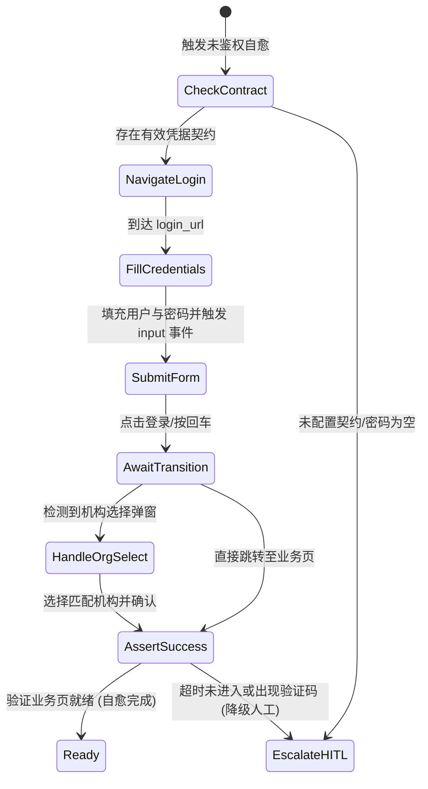

# 浏览器原生持久化上下文与声明式鉴权网关实施方案
(BROWSER_PERSISTENT_CONTEXT_AND_AUTH_GATEWAY_SPEC)

| 属性 | 说明 |
| :--- | :--- |
| **文档代号** | `BROWSER_PERSISTENT_CONTEXT_AND_AUTH_GATEWAY_SPEC` |
| **所属模块** | `src-tauri/src/browser/*`, `src/components/BrowserInspector.tsx`, `src/components/ToolCard.tsx`, `src/store.ts` |
| **技术体系** | Chromium Persistent Context · CDP · Rust Tokio · React 18 · Tauri 2 |
| **创建时间** | 2026-10-20 |
| **前置规范** | 演进自 `BROWSER_LOGIN_RECORDING_AND_AUTO_REPLAY_KNOWLEDGE.md` |
| **架构目标** | 消除堆叠式补丁 · 零 JS 注水污染 · 原生状态持久化 · 语义状态机感知 · 人机协同优雅降级 |

---

## 一、 方案背景与重构动因

### 1.1 现场案例复盘
在 2026-10-20 的医疗纠纷前端模块自主测试中，Agent 发起 `browser_navigate` 访问 `http://127.0.0.1:8080/#/medicalAffairManage/medical-dispute`。因后台 Token 自然失效，免登录机制未能自动触发，最终用户不得不手动打开原生调试工作台重新登录。

### 1.2 现有堆叠式方案（旧规范）的本质缺陷
原有机制（`BROWSER_LOGIN_RECORDING_AND_AUTO_REPLAY_KNOWLEDGE.md`）采用 **“DOM 事件录制 + 磁盘 JSON 序列化 + 底层 CDP 状态码嗅探 + 导航前 JS 强制注水”**：
1. **CDP 越权与判定盲区**：在底层 WebSocket 消息调度器 [`cdp.rs`](file:///f:/WorkSpace/Other/harness_mini/src-tauri/src/browser/cdp.rs) 中硬编码 `status == 401 || status == 403`。但现代企业级系统（如 Vue/Spring Boot）在 Token 失效时，HTTP 状态码通常依然为 `200 OK`（仅在 JSON body 携带 `{ code: 401 }` 或前端弹窗提示），底层 CDP 探针完全失聪。
2. **违背原生沙箱生命周期**：鉴权 Token 保存在 `sessionStorage`，旧方案试图在 `about:blank` 状态下通过 `Page.addScriptToEvaluateOnNewDocument` 和 `localStorage/sessionStorage.setItem` 进行外部“注水”，受到同源策略（SOP）与 SPA Hash 路由切换的双重限制，频发注入失效。
3. **黑盒录制的非确定性**：依赖监听全局 `click/change` 事件自动猜测选择器（如提取 `div.login-tips`、`button:has-text('登录')`）。用户登录完成跳转至 `#/index` 后点击保存，导致系统将**终态首页**误当做**登录起点 URL**，重放第一步即因找不到元素而崩溃。

**核心结论**：继续在现有链路上修补只会导致代码越叠越厚。必须重构为**职责单一、基于浏览器原生能力、解耦清晰**的最优架构。

---

## 二、 顶层架构设计原则

```
┌────────────────────────────────────────────────────────────────────────┐
│                        AI Agent 对话协同层 (ChatView)                   │
└────────────────────────────────────────────────────────────────────────┘
                                    │
                                    ▼ (状态与控制总线)
┌────────────────────────────────────────────────────────────────────────┐
│               页面健康与鉴权网关 (Auth & Page State Gateway)             │
│   - PageStateEvaluator: [ Ready | Unauthenticated | Blocked | Error ]  │
│   - HITL 唤醒总线: 遇到验证码/多因子场景挂起任务并主动呼叫人工协同       │
└────────────────────────────────────────────────────────────────────────┘
                    │                                │
                    ▼                                ▼
┌──────────────────────────────────────┐  ┌──────────────────────────────┐
│  声明式鉴权执行器 (Auth Pipeline)    │  │ 原生持久化上下文 (Persistent)│
│  - 声明式凭据存储 (Credentials)      │  │ - 独立 User-Data-Dir 目录     │
│  - 自适应表单流水线 (Form Pipeline)  │  │ - 原生持久化 Storage/Cookies │
│  - 语义断言与后置检查 (Post-Assert)  │  │ - 0 JS 注入，0 跨域丢失       │
└──────────────────────────────────────┘  └──────────────────────────────┘
```

本实施方案遵循以下三大架构重构原则：
1. **把属于浏览器的归还浏览器（Zero-Injection 原则）**：废除所有手写序列化和向页面强制注水 JS 的代码，全面采用 Chromium 原生持久化上下文（Persistent User Data Dir）。
2. **底层协议纯净化（Layer Separation 原则）**：CDP 模块恢复纯粹的通讯管道属性，所有业务鉴权判定上浮至语义状态机（`PageStateEvaluator`）。
3. **确定性声明替代黑盒录制（Declarative Contract 原则）**：用结构化凭据契约与表单流水线替换脆弱的 DOM 事件黑盒录制，辅以人机协同（HITL）优雅降级。

---

## 三、 四大核心模块技术规格与实施方案

### 模块 1：Chromium 原生持久化上下文（Storage Layer）

#### 1.1 改造要点
彻底废弃临时目录（`temp_dir/harness_browser_<uuid>`）和 `storage_state.json` 序列化/反序列化逻辑。将浏览器启动绑定到当前工作区的物理持久化目录。

#### 1.2 目录与路径规范
```
<WorkspaceRoot>/
└── .harness/
    ├── browser_profile/          # Chromium 原生 User Data Dir (包含 Cookies, LocalStorage, IndexedDB)
    │   ├── Default/
    │   │   ├── Network/Cookies   # 原生 SQLite Cookies 数据库
    │   │   ├── Local Storage/    # 原生 LevelDB 本地存储
    │   │   └── Session Storage/  # 原生持久化标签页会话
    │   └── SingletonLock         # 进程单例锁文件
    └── auth_contract.json        # 声明式登录凭据契约（替代旧的 auth_macro.json）
```

#### 1.3 `session.rs` 启动参数变更
修改 [`src-tauri/src/browser/session.rs`](file:///f:/WorkSpace/Other/harness_mini/src-tauri/src/browser/session.rs)：
```rust
// 原启动逻辑：创建临时目录并在 close 时暴力删除
// 新启动逻辑：绑定工作区持久化 Profile 目录
let profile_dir = workspace
    .join(".harness")
    .join("browser_profile");

tokio::fs::create_dir_all(&profile_dir).await
    .map_err(|e| format!("创建浏览器 Profile 目录失败: {e}"))?;

// 启动参数：
let mut cmd = Command::new(&chrome_path);
cmd.arg(format!("--user-data-dir={}", profile_dir.display()))
   .arg("--no-first-run")
   .arg("--no-default-browser-check")
   .arg("--disable-background-networking")
   .arg("--disable-features=IsolateOrigins,site-per-process")
   .arg(format!("--remote-debugging-port={port}"))
   .arg("about:blank");
```

#### 1.4 进程锁与并发安全治理
- **单例保护**：Chromium 对同一 `user-data-dir` 施加操作系统级独占锁。
- **治理策略**：当启动检测到前序进程意外崩溃留下的孤儿 `SingletonLock` 时，由 `BrowserManager` 先行检测 PID 存活状态；若对应进程已消亡，安全移除锁文件后再行启动，避免实例拉起失败。

---

### 模块 2：语义页面健康与鉴权评估器（State Awareness Layer）

#### 2.1 架构解耦
1. **CDP 纯净化**：移除 [`src-tauri/src/browser/cdp.rs`](file:///f:/WorkSpace/Other/harness_mini/src-tauri/src/browser/cdp.rs) 中的 `auth_expired` 标志位及针对 401/403 的特殊分支，恢复其底座协议网关定位。
2. **独立评估器**：新建 `src-tauri/src/browser/evaluator.rs`，每次页面导航（`navigate`）或交互（`interact`）后，对页面运行语义评估。

#### 2.2 状态机契约
```rust
#[derive(Debug, Clone, Serialize, Deserialize, PartialEq)]
#[serde(tag = "type", content = "payload")]
pub enum PageHealthState {
    /// 页面处于正常业务态，目标元素或数据表格可访问
    Ready,
    /// 页面处于未鉴权态（例如重定向到登录页、或页面弹出“登录超时”遮罩）
    Unauthenticated {
        current_url: String,
        reason: String, // "url_redirect" | "login_form_detected" | "auth_modal_detected"
    },
    /// 页面存在阻断性全局弹窗（如“请选择所属机构”、“系统维护公告”）
    ActionBlocked {
        title: String,
        description: String,
    },
    /// 页面发生不可逆错误（HTTP 500、404、网络断开）
    Error {
        code: Option<u16>,
        message: String,
    },
}
```

#### 2.3 语义评估算法（`EVALUATE_PAGE_STATE_SCRIPT`）
不再依赖脆弱的响应码抓取，而是直接在当前 DOM 树与客户端状态上执行深度语义扫描：
```javascript
(() => {
    const url = window.location.href;
    
    // 1. 检查路由与 URL 语义
    if (url.includes('/login') || url.includes('#/login')) {
        return { type: 'Unauthenticated', payload: { current_url: url, reason: 'url_redirect' } };
    }
    
    // 2. 检查视口内是否存在密码输入框（强特征：未登录表单）
    const pwdInput = document.querySelector('input[type="password"]');
    if (pwdInput && pwdInput.getBoundingClientRect().height > 0) {
        return { type: 'Unauthenticated', payload: { current_url: url, reason: 'login_form_detected' } };
    }
    
    // 3. 检查全局业务错误弹窗或登录过期提示
    const authAlertKeywords = ['登录已过期', '请重新登录', 'Token已失效', '登录超时', '未授权'];
    const modals = document.querySelectorAll('.el-message-box, .el-dialog, .ant-modal, .vxe-modal, [role="dialog"]');
    for (const m of modals) {
        const text = m.innerText || m.textContent || '';
        if (authAlertKeywords.some(kw => text.includes(kw))) {
            return { type: 'Unauthenticated', payload: { current_url: url, reason: 'auth_modal_detected' } };
        }
    }
    
    // 4. 检查是否出现多机构选择弹窗（ActionBlocked 态）
    for (const m of modals) {
        const title = m.querySelector('.el-dialog__title, .ant-modal-title, .vxe-modal--title');
        const titleText = (title?.textContent || '').trim();
        if (titleText.includes('选择机构') || titleText.includes('切换科室') || titleText.includes('组织选择')) {
            return { type: 'ActionBlocked', payload: { title: titleText, description: '检测到机构/组织选择弹窗，需要确认所属机构' } };
        }
    }

    return { type: 'Ready' };
})()
```

---

### 模块 3：声明式鉴权契约与自愈流水线（Declarative Pipeline）

#### 3.1 废弃事件录制，采用声明式凭据契约
废除自动录制的 `AuthMacro`（包含乱序的 click/type 原始动作），在 `.harness/auth_contract.json` 中统一定义结构化契约：

```json
{
  "version": "2.0",
  "login_url": "http://127.0.0.1:8080/#/login",
  "credentials": {
    "username": "zyt",
    "password_cipher": "v1:ICnQzy0rt224QrhszFuY8PLlr8FG8MgSmBgN4AYo53FF+KpM"
  },
  "post_login": {
    "org_name": "扬州市江都区卫生健康委员会",
    "success_assert_url": "#/index|#/medicalAffairManage"
  }
}
```

#### 3.2 确定性自愈状态机（Pipeline Runner）
当 `PageStateEvaluator` 报告 `Unauthenticated` 时，触发自适应认证流水线，按照标准阶段执行：



1. **Step 1: 确定性导航**：直接导航至契约指定的 `login_url`，绝不拿首页当起点；
2. **Step 2: 语义化填充**：寻找 `input[type="text"], input[name*="user"]` 和 `input[type="password"]`，通过原生原型链（`Object.getOwnPropertyDescriptor(HTMLInputElement.prototype, 'value').set`）派发真实值并触发 `input/change` 事件，确保 Vue/React 表单模型双向同步；
3. **Step 3: 确定性提交**：优先触发 `form.submit()` 或点击 `button[type="submit"], .el-button--primary`；
4. **Step 4: 后置机构解析（Post-Login Handler）**：如果配置了 `org_name`，流水线自动等待机构列表弹出并匹配点击目标文本；
5. **Step 5: 成功状态断言**：断言 URL 跳出登录页且状态机转为 `PageHealthState::Ready`。原生 Profile 自动完成物理落盘。

---

### 模块 4：前端人机协同（HITL）交互设计方案

在 AI Agent 运行过程中，鉴权异常必须对用户**“状态可感知、进度透明、降级优雅”**。

#### 4.1 对话流卡片（In-Chat Auth Guard Banner）
当 Agent 在执行 `browser_navigate` 遇到鉴权失效时，系统不会静默挂起或胡乱找元素，而是在当前会话流输出特殊的受控交互组件：

##### 场景 A：后台正在执行声明式自愈
```
┌──────────────────────────────────────────────────────────────┐
│ 🛡️ 正在恢复环境登录态 (Auto-Healing Authentication)         │
│ 目标地址: http://127.0.0.1:8080/#/login                      │
│ 进度: [██████████████░░░░░░] 70% 正在确认所属机构...         │
└──────────────────────────────────────────────────────────────┘
```
自愈成功后，卡片变为绿色的已就绪状态，Agent 无缝恢复自主测试。

##### 场景 B：自愈失败或遇到双因子/验证码（优雅降级给人类）
```
┌──────────────────────────────────────────────────────────────┐
│ ⚠️ 页面需要人工完成登录 (Human-in-the-Loop Required)          │
│ 原因: 检测到系统弹出图形验证码或契约凭据失效                 │
│                                                              │
│ [ 🚀 立即协助登录 (一键打开微型接管窗口) ]  [ 重新尝试自愈 ] │
└──────────────────────────────────────────────────────────────┘
```

#### 4.2 微型授权浮层（Mini Auth Modal）
用户点击【立即协助登录】后，无需打开复杂的包含 DOM 树和控制台的 `BrowserInspector`：
- 弹出轻量级独立窗口（只包含被测页面的实时 Webview / Screencast 视窗）；
- 用户直接在视窗内输入、扫码或选机构；
- 窗口底部带绿色按钮：**【完成登录并记住凭据】**；
- 用户点击后，系统自动捕获最新状态，写入 `auth_contract.json`，Chromium 原生 Profile 自动保存，浮层关闭，通知 Agent 继续执行。

#### 4.3 TopBar 状态指示灯强化
在 [`src/components/TopBar.tsx`](file:///f:/WorkSpace/Other/harness_mini/src/components/TopBar.tsx) 中：
- 🟢 **鉴权有效**：Profile 存在且最近一次访问为 `Ready`；
- 🟡 **自愈中**：Pipeline 正在重放；
- 🔴 **需关注**：状态机为 `Unauthenticated`，悬停显示“点击进行人工登录授权”。

---

## 四、 代码改动范围与“净简化”度量

本重构方案遵循“消除堆叠式代码”原则，核心工作是**大量移除不稳定的补丁逻辑，代之以结构清晰的标准模块**：

| 文件路径 | 调整性质 | 具体操作与代码变化 |
| :--- | :---: | :--- |
| [`src-tauri/src/browser/auth.rs`](file:///f:/WorkSpace/Other/harness_mini/src-tauri/src/browser/auth.rs) | **重构/净减** | 彻底删除 `StorageState`, `CookieData`, `save_storage_state`, `load_storage_state`（-200行）；定义 `AuthContract` 与加密凭证管理。 |
| [`src-tauri/src/browser/cdp.rs`](file:///f:/WorkSpace/Other/harness_mini/src-tauri/src/browser/cdp.rs) | **净化** | 移除 `auth_expired` 字段及其在 `responseReceived` 中的硬编码逻辑（恢复底层纯粹性）。 |
| [`src-tauri/src/browser/session.rs`](file:///f:/WorkSpace/Other/harness_mini/src-tauri/src/browser/session.rs) | **大幅简化** | 引入 `--user-data-dir`；删除 `inject_storage_state`、`capture_storage_state`、`storage_injected` 标志位及启动预注入代码（-250行）；集成 `PageStateEvaluator`。 |
| `src-tauri/src/browser/evaluator.rs` | **新增** | 专职页面健康度、未登录、全局阻断状态的语义评估器（约 120 行）。 |
| `src-tauri/src/browser/pipeline.rs` | **新增** | 声明式表单认证流水线（自适应填充、机构选择、状态断言，约 180 行）。 |
| [`src-tauri/src/commands.rs`](file:///f:/WorkSpace/Other/harness_mini/src-tauri/src/commands.rs) | **精简** | 移除旧录制指令（`start_browser_recording`, `stop_browser_recording_and_save`），新增 `save_auth_contract`, `evaluate_browser_page_state`。 |
| [`src/components/BrowserInspector.tsx`](file:///f:/WorkSpace/Other/harness_mini/src/components/BrowserInspector.tsx) | **解耦/精简** | 移除录制监听循环（-150行），改为“凭据契约配置”与“一键接管”。 |
| `src/components/AuthCard.tsx` | **新增** | 对话流中的 HITL 人机协同交互卡片（约 100 行）。 |

---

## 五、 分阶段实施与验证里程碑

为保证改动稳健可控，实施拆分为四个清晰阶段：

### 阶段一：持久化上下文底座（Persistent Context Foundation）
- [ ] 改造 `session.rs` 启动参数，为每次会话接入工作区 `.harness/browser_profile`；
- [ ] 废弃 `StorageState` 序列化与 `inject_storage_state` 代码；
- [ ] **验证标准**：用户在浏览器中手动登录一次 `http://127.0.0.1:8080` 并退出，Agent 下次启动调用 `browser_navigate`，无需注入代码即可直接展现已登录业务页面。

### 阶段二：语义状态机与 CDP 解耦（Page State Machine）
- [ ] 移除 `cdp.rs` 中的业务监听；
- [ ] 实现 `evaluator.rs`并在 `session.get_debug_state()` 中统一输出 `PageHealthState`；
- [ ] **验证标准**：当把测试服务故意退出登录或进入 `#/login` 时，`evaluator` 准确返回 `PageHealthState::Unauthenticated`，且准确识别是否包含机构弹窗。

### 阶段三：声明式自愈流水线（Declarative Pipeline）
- [ ] 实现 `pipeline.rs`，读取 `.harness/auth_contract.json` 执行自动表单登录与机构选择；
- [ ] 将其接入 `browser_navigate` 与 `browser_interact` 的后置检查；
- [ ] **验证标准**：在已登录状态下人工清除浏览器 Session 触发过期，Agent 下一次操作自动运行自愈流水线，3 秒内完成登录并自动恢复原业务测试。

### 阶段四：前端 HITL 协同卡片与轻量接管（UI & Experience）
- [ ] 实现 `AuthCard.tsx` 并嵌入 `ChatView.tsx` 与 `ToolCard.tsx`；
- [ ] 实现轻量化授权弹窗，支持一键接管与完成确认；
- [ ] 更新 `TopBar.tsx` 状态灯；
- [ ] **验证标准**：未配置密码或遇到验证码时，对话区清晰弹出协助卡片，点击即可在浮窗中操作，完成后 Agent 自动唤醒继续执行。

---

## 六、 风险评估与应急回滚

1. **多工程/多分支 Profile 污染**：
   - *风险*：若工作区切换时残留脏数据，可能导致状态紊乱。
   - *对策*：Profile 强绑定当前工作区路径（`.harness/browser_profile`），并通过 `.gitignore` 自动隔离；同时在界面提供【重置浏览器环境】一键物理清空能力。
2. **Chromium 进程单例死锁**：
   - *风险*：崩溃退出后遗留 `SingletonLock` 文件导致无法重新拉起。
   - *对策*：在 `BrowserSession::launch` 增加前置文件锁检测机制，若锁持有者进程已消亡，启动前自动清理。
3. **回滚方案**：
   - 方案基于结构分层重构，与现有 Git 历史解耦；若需回滚，只需切回上一提交，保留原有 `.harness` 配置文件即可。
