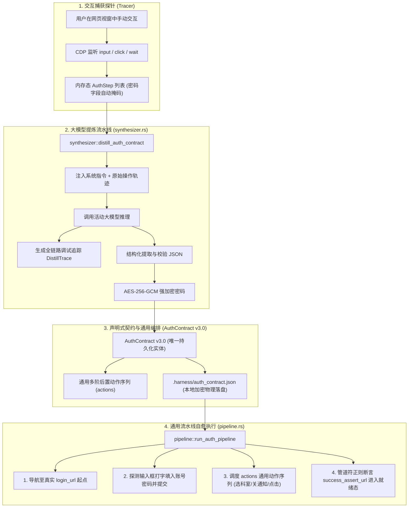

# 浏览器智能录制与大模型自动提炼免登契约知识文档
(BROWSER_SMART_RECORDING_AND_LLM_AUTH_CONTRACT_KNOWLEDGE)

| 属性 | 说明 |
| :--- | :--- |
| **文档代号** | `BROWSER_SMART_RECORDING_AND_LLM_AUTH_CONTRACT_KNOWLEDGE` |
| **所属模块** | `src-tauri/src/browser/*` (`synthesizer.rs`, `pipeline.rs`, `auth.rs`), `src/components/BrowserInspector.tsx`, `src/types.ts` |
| **技术体系** | LLM Intent Distillation · CDP Interaction Tracer · AES-256-GCM · React 18 · Tauri 2 · Rust Tokio |
| **创建时间** | 2026-10-20 |
| **版本演进** | 升级并替代历史旧免登宏体系；承接 `BROWSER_PERSISTENT_CONTEXT_AND_AUTH_GATEWAY_KNOWLEDGE.md` |
| **核心机制** | 交互探针捕获 · 大模型自动提炼 · 通用多阶后置动作序列 · 全链路交互透明度 (`DistillTrace`) · 界面归一化治理 |

---

## 一、 架构演进背景与核心痛点分析

在企业级 B 端与行业特定系统（如医疗 HIS、智慧医务、政务审批、高校管理系统）的自动化与自愈流水线中，系统的鉴权与登录形态呈现高度异构性：
- **场景 A（多级机构）**：账号 + 密码登录 -> 弹出组织/机构选择弹窗 -> 选择目标机构 -> 确认进入系统。
- **场景 B（科室与协议）**：账号 + 密码登录 -> 弹出科室/病区/角色选择弹窗 -> 选中“心内科” -> 弹出“系统更新须知/安全协议” -> 点击“同意/已阅读” -> 最终进入系统首页。
- **场景 C（单点登录与多跳路由）**：访问业务地址 -> 重定向至 CAS/统一认证中心 -> 完成登录 -> 多次 302 跳回业务系统主应用。

### 1.1 历史方案面临的痛点复盘

```
【旧机制矛盾演进】
v1.0 纯黑盒 DOM 事件录制重放 ──脆弱易损──> 前端版本迭代/动态 ID/时间差即断裂崩溃
                          │
                          ▼
v2.0 纯手工声明式契约配置    ──门槛极高──> 用户需懂 F12/DOM 选择器/SPA 路由，配置极难
                          │
                          ▼
v3.0 智能录制 + 大模型提炼   ──融合自愈──> 一次交互走通，大模型提炼为通用契约，零手写选择器
```

1. **手动配置门槛极高**：
   虽然 v2.0 确立了声明式免登契约，但普通用户或测试人员不是前端开发，不知道如何寻找真实的 SPA 登录起点路由（容易错填成终态首页）、不知道如何在多层级弹窗中寻找稳健的选择器。
2. **流程硬编码与扩展性不足**：
   早期契约针对机构选择硬编码了单一字段 `org_name`。面对“先选科室、再关公告、再选角色”等复杂组合时，硬编码字段完全失效。
3. **功能堆叠与概念脱节**：
   系统中一度同时存在“免登录宏”与“声明式免登契约”两套体系，录制按钮散落在顶栏、视窗栏与契约面板各处，造成用户认知割裂与概念冗余。
4. **缺乏透明度与调试抓手**：
   自动化处理若缺乏过程可见性，当大模型提炼偏离预期或弹窗识别不准时，开发者和用户无法得知“录制了什么”与“大模型返回了什么”。

---

## 二、 核心方案权衡：页面交互式登录 vs API 形式登录

在技术方案选型中，经过深度架构评估，团队明确确立了**以页面交互式登录作为首选，结合 CDP 探针与通用契约**的策略，其核心考量如下：

| 评估维度 | API 形式登录 | 页面交互式登录（当前方案） | 选型结论 |
| :--- | :--- | :--- | :--- |
| **逆向分析成本** | 极高。需分析前端复杂的 JS 加密（如 RSA/SM2/国密算法）、动态 Salt、时间戳签名与防重放 Token。每次前端版本构建打包，Webpack/Vite 混淆导致逆向失效。 | **零逆向**。通过浏览器原生 DOM 输入框与原生点击模拟打字，完全由前端页面自身的加密逻辑加密发包。 | **交互式占优** |
| **状态持久化与 Context** | 脆弱。需手动提取 Set-Cookie、Token 并构造 Headers 注入。遇到前端存在 LocalStorage / SessionStorage / IndexedDB 状态依赖时极易遗漏。 | **原生 100% 物理持久化**。基于 Chromium `--user-data-dir` 原生环境，Session/Token/Cookie 自动落盘，零 JS 注水污染。 | **交互式占优** |
| **多阶段弹窗与人机协同** | 极其困难。API 往往只返回鉴权成功，后续科室选择、协议签署、灰度弹窗属于前端页面交互状态流，纯 API 无法驱动。 | **原生感知与执行**。通过页面语义状态机 (`evaluate_page_state`) 实时感知阻塞弹窗，并通过通用动作序列按序消解。 | **交互式占优** |
| **人机协同 (HITL) 接管** | 无法接管。遇到验证码、多因子认证 (MFA) 时纯 API 流水线直接中断。 | **自然降级**。支持调起原生工作台由人工完成验证码输入，完成后继续无缝流转。 | **交互式占优** |

---

## 三、 顶层架构设计与四大核心理念

系统遵循**“单一真实数据源 (Single Source of Truth) 与高稳定性”**原则，彻底清理了历史堆叠代码，整体架构如下：



### 3.1 核心理念一：录制功能定位为“智能交互探针”
- 彻底废除历史独立存在的“免登录宏 (`auth_macro.json`)”与 DOM 重放逻辑。
- 录制仅作为前端向大模型提供上下文的**交互探针 (Interaction Tracer / AI Auto-fill Assistant)**，录制捕获的步骤只保存在内存中，直接服务于 `AuthContract` 表单的自动提炼与填入。

### 3.2 核心理念二：通用多阶后置动作序列 (`post_login.actions`)
为了彻底解决不同系统登录流程固定的问题，将原本硬编码的单一机构字段升级为通用的多阶业务动作序列：

```rust
#[derive(Debug, Clone, Serialize, Deserialize)]
pub struct AuthAction {
    pub step: usize,
    pub desc: Option<String>,
    pub action_type: String, // "select_modal_item" | "dismiss_notice" | "click" | "wait"
    pub dialog_title: Option<String>,
    pub match_text: Option<String>,
    pub selector: Option<String>,
    pub confirm_btn: Option<String>,
}
```

- `select_modal_item`：通用弹窗列表项选择。智能匹配带有特定弹窗标题（如“选择科室”、“切换机构”）或当前激活层中的文本项（如“心内科”），并点击随附的确认按钮。
- `dismiss_notice`：通用阻断解除。自动查找并点击“我知道了”、“已阅读”、“同意”、“确认”等公告提示关闭键。
- `click`：按指定选择器或文本的原生点击。
- `wait`：安全等待页面网络沉降与前端路由渲染。

### 3.3 核心理念三：取消孤立的 `org_name` 配置项
因为科室、机构、院区等选择均已完整由 `actions` 中的 `select_modal_item` 表达并接管，表单彻底下线独立的“指定所属机构 (org_name)”输入项，消除概念重复与割裂。

### 3.4 核心理念四：大模型交互全链路可见性 (`DistillTrace`)
为了保障工业级调试体验，系统引入 `DistillTrace` 结构，将大模型调用的全流程完全向开发者与用户开放：
1. `system_prompt`：发送给模型的完整专家提炼系统指令；
2. `user_prompt`：格式化后送入大模型的原始用户操作步骤；
3. `raw_response`：大模型原样返回的思考内容与原始 JSON 字符串；
4. `elapsed_ms`：端到端推理耗时统计。

---

## 四、 界面治理与统一交互规范 (UI & HITL)

前端界面位于 [`src/components/BrowserInspector.tsx`](file:///f:/WorkSpace/Other/harness_mini/src/components/BrowserInspector.tsx)，本次重构进行了彻底的界面治理：

### 4.1 布局归一与重心聚焦
1. **清理顶栏冗余**：
   - 移除全局 Inspector Header 上的录制按钮，消除顶栏混乱；
   - 修复并消除重复渲染的两个“独立调试窗口”按钮，保留唯一的官方 Chromium DevTools 弹出入口。
2. **Tab 5 卡片置顶与操作紧凑合一**：
   - 彻底删除顶部独立的录制推广 banner，将**声明式免登契约配置 (Auth Contract v3.0)** 表单卡片置于最顶端作为唯一视觉主中心。
   - 卡片 Header 右侧直接集成核心操作：
     - `[ ✨ AI 智能录制填入 ]`：点击后自动切换至网页视窗引导录制，录制完毕自动提炼回填；
     - `[ 📋 捕获轨迹 (N) ]`：随时展开查看捕获的原始操作（带类型徽标、掩码值、毫秒延迟）；
     - `[ 💾 保存契约 ]`：将表单内容保存并触发 AES-256-GCM 强加密持久化；
     - `[ ▶️ 测试流水线 ]`：就地触发完整免登自愈流水线验证。
3. **就地嵌入审阅与调试抽屉**：
   - 提炼完成后，提炼结果和 `[ 🔍 大模型交互详情 (xxx ms) ]` 抽屉直接就地展现在契约卡片上方，支持折叠查看 Prompt 与模型返回，并提供 `[ 确认采用 ]` 和 `[ 忽略 ]`。
4. **可视化动作序列编排器**：
   - 表单中提供对 `actions` 动作序列的直观管理，支持**手动添加动作、行内编辑参数、步骤上移/下移排序、单步删除与一键清空**。
5. **系统健康诊断卡片置底**：
   - 将“原生持久化 Profile”、“声明式登录契约存储”、“页面语义健康度”三大状态指示卡片排列在契约卡片下方，作为系统运行状态的辅助观察窗口。

---

## 五、 数据安全与质量保证

### 5.1 安全机制
1. **密码绝不明文落盘**：
   用户录制输入的密码或表单填写的密码，通过主密钥调用 `secrets::encrypt(master_key, raw_pwd)` 转换为 AES-256-GCM 密文存储于 `.harness/auth_contract.json`。
2. **录制日志掩码**：
   原始录制步骤中的密码值自动标记 `is_encrypted: true`，前端展示与调试输出均呈现为 `•••••••• (已掩码)`，防止录屏与截屏泄密。
3. **版本库防误提**：
   工作区根目录中的 `.harness/auth_contract.json` 自动受到 `.gitignore` 保护，严防凭据提交至公共 Git 仓库。

### 5.2 质量保证验证矩阵
- **TypeScript 强类型校验**：`npx tsc --noEmit` 编译通过（0 错误，0 警告）。
- **Rust 后端单元测试**：`cargo test --lib browser` 6 项测试全部通过：
  - `test_auth_contract_encryption_roundtrip`：AES-256-GCM 加密与解密双向校验；
  - `test_parse_distilled_json`：大模型输出 JSON 解析、通用动作提取与向前兼容测试；
  - `test_build_interact_script`、`test_build_scroll_script`、`test_detect_chromium` 等全部稳定通过。

---

## 六、 最佳实践与操作 SOP

### 6.1 智能录制生成契约推荐流程
1. 在 Inspector 中打开目标业务系统登录网址（如 `http://127.0.0.1:8080/#/login`）。
2. 切换至 **Tab 5（免登契约与自愈）**，点击卡片右上角的 **【✨ AI 智能录制填入】**。
3. 界面自动跳转至视窗并开启录制指示条。在视窗中走一遍完整操作：
   - 点击输入框，正常键入账号；
   - 点击密码框，正常键入密码；
   - 点击登录按钮；
   - 若出现科室/机构/院区选择弹窗，点击目标项（如“心内科”）并点击确认；
   - 若出现更新须知/系统协议弹窗，点击“同意”或“关闭”。
4. 点击视窗顶部的 **【✨ AI 提炼免登契约】**。
5. 系统自动调用大模型提炼，完成后切换回 Tab 5：
   - 可点击 **【🔍 大模型交互详情】** 检查提炼 Prompt 与原始模型输出；
   - 检查表单中已自动填入的系统名称、登录地址、账号与动作序列；
   - 点击 **【确认采用】** 并点击 **【保存契约】**。
6. 点击 **【▶️ 测试流水线】** 进行端到端自愈联调。
