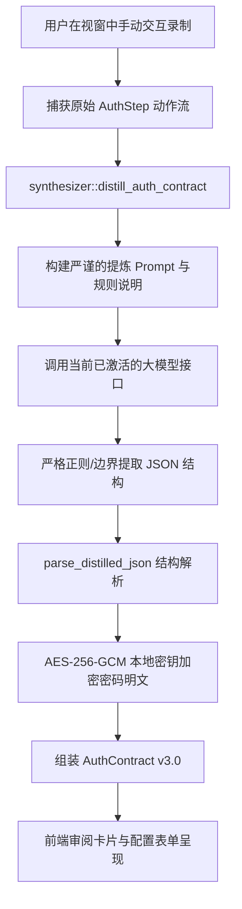

# 浏览器智能录制宏与大模型自动提炼通用免登契约架构规范 (Auth Contract v3.0)

## 1. 架构演进背景与设计目标

在企业级 SPA/B-end 系统（如医院 HIS、医务管理、政企审批系统）中，用户登录往往不仅仅是单次“账号 + 密码 + 登录按钮”，而是呈现高度异构的多阶段流程：
- **系统 A**：账号、密码登录 -> 出现多级组织/机构选择弹窗 -> 选择目标机构 -> 确认进入系统。
- **系统 B**：账号、密码登录 -> 弹出科室/病区/角色选择弹窗 -> 选择“心内科” -> 弹出“系统更新须知/安全协议” -> 点击“同意/已阅读” -> 进入系统。
- **系统 C**：单点登录（SSO）或重定向，中间经历多个过渡路由。

传统的免登方案面临两极分化难题：
1. **纯黑盒 DOM 事件重放宏 (v1.0)**：脆弱易损。前端版本一升级、随机动态 ID、时间差或微小位移都会导致坐标与事件链断裂。
2. **纯手写声明式契约 (v2.0)**：稳定但配置门槛高。用户通常不是前端工程师，不知道如何寻找真实登录 URL（SPA 路由混淆）、不知道在复杂弹窗中抓取合适的选择器，手写 JSON 契约成本过高。

**Auth Contract v3.0 的核心设计目标**：
1. **录制一次交互，大模型自动提炼**：用户仅需启动录制，在视窗中走一遍真实的交互操作（账号、密码、选择科室/机构、关闭提示弹窗），大模型将嘈杂事件序列去噪并结构化提炼为声明式契约。
2. **通用多阶段动作序列 (`post_login.actions`)**：将原硬编码的 `org_name` 抽象为通用的多阶业务动作序列（支持科室、机构、角色、弹窗确认、协议关闭等多种类型）。
3. **视觉化审阅 (HITL Review)**：AI 提炼结果以结构化卡片直观呈现给用户，支持微调、确认采用，凭据本地 AES-256-GCM 强加密持久化。
4. **零堆叠修改与高稳定性**：职责单向解耦，完全向下兼容原有 v2.0 契约与老录制宏，代码结构清晰，零临时拼接代码。

---

## 2. 核心架构与数据契约设计

### 2.1 契约数据结构 (v3.0)

数据契约在 [src-tauri/src/browser/auth.rs](file:///f:/WorkSpace/Other/harness_mini/src-tauri/src/browser/auth.rs) 与前端 [src/types.ts](file:///f:/WorkSpace/Other/harness_mini/src/types.ts) 严格对称对齐：

```rust
#[derive(Debug, Clone, Serialize, Deserialize)]
pub struct AuthAction {
    pub step: usize,
    pub desc: Option<String>,
    pub action_type: String, // "select_modal_item" | "dismiss_notice" | "click" | "wait"
    pub dialog_title: Option<String>,
    pub match_text: Option<String>,
    pub selector: Option<String>,
    pub confirm_btn: Option<String>,
}

#[derive(Debug, Clone, Serialize, Deserialize)]
pub struct AuthContractPostLogin {
    pub org_name: Option<String>,          // 向下兼容 v2.0
    pub actions: Option<Vec<AuthAction>>,  // v3.0 通用后置业务动作序列
    pub success_assert_url: Option<String>,
}

#[derive(Debug, Clone, Serialize, Deserialize)]
pub struct AuthContract {
    pub version: String,                   // "3.0"
    pub system_name: Option<String>,       // 业务系统名称标识
    pub login_url: String,
    pub credentials: AuthContractCredentials,
    pub post_login: Option<AuthContractPostLogin>,
    pub updated_at: String,
}
```

### 2.2 向后兼容与渐进增强保证
- 若契约中存在 `actions` 且非空，自愈流水线优先按序执行通用动作列表。
- 若 `actions` 为空但配置了 `org_name`，平滑回退至经典机构弹窗选择逻辑。
- 提炼模型输出自动将首个选择动作的 `match_text` 回填至 `org_name`，确保老版本代码与新版本契约无缝互通。

---

## 3. 大模型智能提炼流水线 (`synthesizer.rs`)

模块路径：[src-tauri/src/browser/synthesizer.rs](file:///f:/WorkSpace/Other/harness_mini/src-tauri/src/browser/synthesizer.rs)



### 3.1 提炼核心规则
1. **智能识别登录 URL**：过滤重定向与终态首页，锁定表单填写前最初的登录起点（例如 `#/login`、`/cas/login`）。
2. **凭据提取与加密**：准确提取用户名，密码明文直接在 Rust 内存中调用 `secrets::encrypt(master_key, raw_pwd)` 加密为 AES-256-GCM 密文落盘，不在日志或任何持久化宏中残留明文。
3. **识别并泛化后置弹窗**：
   - 过滤无意义的输入失焦、空点击。
   - 识别弹窗标题（如“选择登录科室”、“切换机构”、“重要通知”）。
   - 提取业务目标文本（如“呼吸内科”、“心内科”、“同意”、“确定”）。
4. **自动推导成功断言路由**：分析登录交互完成后的最终 URL（如 `#/medicalAffairManage`），推导正则或管道符断言规则 `#/index|#/medicalAffairManage`。

---

## 4. 通用流水线执行引擎 (`pipeline.rs`)

执行引擎路径：[src-tauri/src/browser/pipeline.rs](file:///f:/WorkSpace/Other/harness_mini/src-tauri/src/browser/pipeline.rs)

通用自愈流水线执行步骤：
1. **导航至 `login_url`**：建立受控会话，重置登录态。
2. **表单自动探测与填入**：智能探测 input `type="password"` 及其临近的用户名输入框，模拟原生聚焦打字与回车/提交点击。
3. **后置动作序列循环调度**：
   - `select_modal_item`：调用 `GENERIC_SELECT_MODAL_ITEM_SCRIPT`，动态匹配带特定标题（或任意激活浮层）内的科室/机构/列表项，并点击随附的确定/选择按钮。
   - `dismiss_notice`：调用 `DISMISS_NOTICE_SCRIPT`，自动点击“我知道了/已阅读/同意/关闭”按钮解除页面阻塞。
   - `click`：按指定选择器或文本匹配点击。
   - `wait`：安全沉降等待。
4. **终态多分支断言**：通过管道符 `|` 分割多个可接受成功路径，验证页面已顺利进入鉴权就绪态。

---

## 5. 前端交互与统一界面规范 (UI & HITL)

组件路径：[src/components/BrowserInspector.tsx](file:///f:/WorkSpace/Other/harness_mini/src/components/BrowserInspector.tsx)

### 5.1 界面收敛与归属原则（Zero Redundancy & Single Source of Truth）
录制功能本质上是契约配置的**智能交互探针（Interaction Tracer / AI Auto-fill Assistant）**，它不应具有独立并列的顶层菜单或冗余顶栏控制：
1. **顶栏控制台净化**：移除全局 Header 上的录制按钮，顶栏完全回归会话调试与系统窗口控制。
2. **Tab 1（视窗与接管）录制条按需出现**：仅在用户触发录制时在视窗顶部展现，提供 `[ ✨ AI 提炼免登契约 ]`、`[ 捕获步骤 (N) ]`、`[ 仅停止录制 ]` 与 `[ 取消 ]`，录制完毕自动隐藏。
3. **Tab 5（免登契约与自愈）单一重心设计**：
   - 彻底删除顶部独立的录制横幅，将**声明式免登契约配置 (Auth Contract v3.0)** 主卡片置于最顶端。
   - 契约卡片 Header 右侧紧凑集成 `[ ✨ AI 智能录制填入 ]`、`[ 📋 捕获轨迹 (N) ]`、`[ 💾 保存契约 ]` 与 `[ ▶️ 测试流水线 ]`。
   - 契约卡片内部就地嵌入：
     - **AI 提炼结果审阅与大模型交互调试抽屉 (`DistillTrace`)**：一键查看 System Prompt、User Prompt、Raw Model Response 及毫秒级耗时。
     - **捕获轨迹展开面板**：按步展示动作、选择器、掩码值及延迟。
     - **表单编辑与后置动作可视化编排器**：支持添加、编辑、上下移动与删除。
   - 契约卡片下方陈列三大诊断健康卡片（原生持久化 Profile、加密契约存储状态、页面语义健康度）。

---

## 6. 验证与质量保证

1. **Rust 单元测试覆盖**：
   - `test_auth_contract_encryption_roundtrip`：验证 AES-256-GCM 密码加解密。
   - `test_parse_distilled_json`：验证大模型输出 JSON 提炼解析、多阶动作提取、向前兼容与加密保护完整链路。
2. **TypeScript 强类型保证**：
   - 前端接口与 Rust 序列化字段 100% 对齐，`npx tsc --noEmit` 编译零警告与零报错。
3. **彻底清理历史免登录宏，统一系统心智**：
   - 彻底移除 `AuthMacro`、`auth_macro.json` 及重放逻辑，录制功能正名为纯粹的交互捕获探针（仅为 AI 提炼提供 trace 结构）。
   - 架构完全收敛至单一标准实体 `AuthContract` (v3.0)。

---

## 7. 交互透明度与动作自主编排

### 7.1 录制过程与捕获结果完全可见
- 录制期间实时同步操作步数，提供随时展开的“已捕获交互轨迹列表”，清晰展示每步的触发动作（`type`/`click`/`wait`）、目标选择器、录入值（自动掩码保护）与延迟时间。

### 7.2 大模型交互全链路调试追踪 (`DistillTrace`)
- 在提炼结果卡片上提供“大模型交互详情”开关，直接展开展示：
  - `system_prompt`：发送给模型的完整专家提炼系统指令；
  - `user_prompt`：格式化送入的原始步骤轨迹与上下文；
  - `raw_response`：大模型生成的原始输出与 JSON 片段；
  - `elapsed_ms`：端到端模型推理耗时统计。

### 7.3 后置业务动作可视化编排与手动微调
- 契约中的通用后置动作支持全生命周期手动编排：
  - **添加动作**：支持随时手动追加任意 `action_type`（弹窗选择、协议关闭、原生点击、沉降等待）；
  - **字段微调**：弹窗标题 (`dialog_title`)、匹配文本 (`match_text`)、确认按钮 (`confirm_btn`)、DOM 选择器 (`selector`) 与描述 (`desc`) 均支持行内表单修改；
  - **顺序编排**：支持步骤上移、下移与单步删除，自动重新计算步骤序号。
