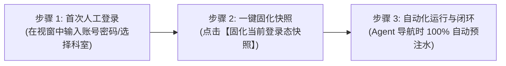

# 浏览器确定性登录态快照 (StorageState) 执行与测试流程规范

> **规范版本**: `v2.0`  
> **更新时间**: `2026-10-30`  
> **适用范围**: `harness-mini` 浏览器自动化体系、Agent 网页操作、开发者前端视窗调试与自动化回归测试  

---

## 一、架构设计理念：为什么彻底转向 StorageState？

在早期的设计中，系统尝试采用**“动作录制探针 -> 大模型提炼 AuthContract -> 模拟表单回放流水线”**的方案。然而在实际工业级复杂业务系统中，该方案暴露了三大致命缺陷：

1. **大模型推断的不确定性与 Token 消耗**：大模型对复杂的动态表单（如嵌套验证码、动态验证滑块、多科室机构选择树）生成的 CSS 选择器容易失配，且每次提炼和执行都伴随高延迟与大模型成本。
2. **表单事件漂移与 DOM 时序竞态**：现代前端框架（Vue3、React 18、Angular）采用虚拟 DOM 与合成事件系统，纯 CDP 派发的 `click` / `type` 事件经常无法触发框架内部的响应式状态更新，导致登录按钮始终置灰或选不中输入框。
3. **多 Tab 与残留 Target 污染**：历史打开的失效页面（如挂掉的本地预览服务）形成 `chrome-error://chromewebdata/` 残留 Tab，导致动作回放漂移至错误 Target。

### 工业级最优解：StorageState 机制（对齐 Playwright / Puppeteer 业界标准）

为彻底解决上述问题，系统全面升级为**确定性 StorageState 登录态网关**：
- **100% 确定性**：摒弃一切表单模拟输入与大模型猜测，直接基于 Chrome DevTools Protocol (CDP) 的底层核心 API（`Network.getAllCookies`, `Network.setCookies`, `Runtime.evaluate`）。
- **零 LLM 开销**：无需大模型参与，直接保存与恢复全量凭据快照。
- **全状态纳管**：不仅抓取 HTTP Cookies（含 HttpOnly、Secure、Domain、Expires 等全属性），更完整冻结 SPA 应用核心赖以维持状态的 `localStorage`（如 JWT AccessToken、RefreshToken）与 `sessionStorage`。
- **安全隔离落盘**：所有凭据按 `Host + Port` 独立哈希持久化至本地工作区 `.harness/browser/storage_state/`，并自动纳入 `.gitignore`，绝不上云、不入版本库。

---

## 二、状态快照底层架构与数据规范

### 1. 快照文件存储路径与命名规范

快照文件统一存储于工作区根目录下的特定子目录中：
```text
<workspace>/
  └── .harness/
      └── browser/
          └── storage_state/
              ├── 4f8a29b0a1.json   # 对应 http://127.0.0.1:18086/ 的哈希隔离快照
              └── b7c19e3f42.json   # 对应 http://127.0.0.1:5611/ 的哈希隔离快照
```

文件名生成规则由 Rust 后端 [`src-tauri/src/browser/storage.rs`](file:///F:/WorkSpace/Other/harness_mini/src-tauri/src/browser/storage.rs) 中的 `get_storage_state_filename` 保证：
$$\text{Filename} = \text{MD5/SHA256}(\text{host} + ":" + \text{port})[0..10] + \text{".json"}$$
该机制确保了即使本地同时运行多个不同端口的开发服务（例如 `127.0.0.1:18086` 与 `127.0.0.1:5611`），状态快照在物理层面绝对隔离，绝不发生跨环境串号与覆盖。

### 2. 快照 JSON 结构定义

```json
{
  "host": "127.0.0.1",
  "port": 18086,
  "updated_at": "2026-10-30T11:20:00.123Z",
  "cookies": [
    {
      "name": "session_token",
      "value": "eyJhbGciOi...",
      "domain": "127.0.0.1",
      "path": "/",
      "expires": 1793340000.0,
      "httpOnly": true,
      "secure": false,
      "sameSite": "Lax"
    }
  ],
  "local_storage": {
    "access_token": "bearer eyJ...",
    "user_info": "{\"id\":1001,\"name\":\"admin\"}",
    "current_department_id": "dept_cardiology"
  },
  "session_storage": {
    "tab_session_key": "active_workstation"
  }
}
```

---

## 三、标准执行流程 (SOP - Standard Operating Procedure)

采用三步闭环 SOP，从人工首次登录到 Agent 全自动化执行：



### 步骤 1：首次人工登录 (Human Login)
1. 在宿主桌面右下角或顶部工具栏打开【网页检查器 (Browser Inspector)】。
2. 切换至【视窗 (View)】Tab，输入目标系统的 URL（如 `http://127.0.0.1:18086/`），按回车或点击【导航】。
3. 在下方实时视窗或独立 Chromium 视窗中，正常输入账号与密码。
4. **处理动态验证与业务弹窗**：若系统弹出短信验证码、图形验证码、或者“请选择归属科室/分支机构/角色”的弹窗，人工直接点击选中目标项并点击“确定进入”。
5. 确保页面已平稳进入系统主界面（例如展示仪表盘、工作台或病历列表，页面语义健康度变为 `🟢 Ready`）。

### 步骤 2：一键固化快照 (Capture Snapshot)
1. 在【网页检查器】顶部导航栏点击切换至【登录态 (StorageState)】Tab。
2. 面板将自动扫描当前站点信息，显示当前站点 Origin（如 `127.0.0.1:18086`）与当前快照状态（⚪ 未固化快照）。
3. 点击蓝色高亮按钮：**【💾 固化当前登录态快照】**。
4. **底层执行逻辑**：
   - 后端通过 CDP `Network.getAllCookies` 完整导出当前会话的全部 Cookies；
   - 后端通过 `Runtime.evaluate` 提取当前页面的 `window.localStorage` 与 `window.sessionStorage`；
   - 格式化并序列化写入 `.harness/browser/storage_state/<origin_hash>.json`；
   - 自动检测并把 `.harness/browser/` 写入根目录 `.gitignore` 文件。
5. 界面弹出绿色 Toast 提示：“已成功固化当前登录态快照”，且快照徽章更新为 `🟢 快照已就绪`，并实时列出捕获到的 Cookies 数量与 LocalStorage 键名清单（如 `access_token`、`user_info` 等）。

### 步骤 3：Agent 自动免登与闭环 (Zero-Touch Agent Execution)
1. 固化快照后，**无需再进行任何表单输入或登录契约编写**。
2. 后续无论何时：
   - Agent 自动调用 `browser_navigate("http://127.0.0.1:18086/workbench")`；
   - 用户创建新会话重新打开应用；
   - 后台轻量无头 BrowserContext 启动并访问该站点；
3. **系统自动在导航加载完成时完成两阶段预注水**：
   - **阶段 1 (会话层)**：通过 `Network.setCookies` 一次性注入全量 Cookies；
   - **阶段 2 (页面层)**：在当前页面上下文通过 `Runtime.evaluate` 将固化的 `localStorage` 与 `sessionStorage` 逐项写入当前页面 Window 对象。
4. 页面无需再次登录，直接呈现已授权业务内容。

---

## 四、全套测试与质量保障流程 (Testing Protocol)

为了确保登录态稳定性，研发与运维团队应严格执行以下 5 项测试验证：

### 测试 1：Rust 后端底层单元测试 (Unit Testing)
- **测试目标**：验证快照路径哈希计算隔离性、快照读取与摘要提取准确性、快照清理生命周期以及 WebStorage 注入脚本生成正确性。
- **执行命令**：
  ```bash
  cargo test --lib browser::storage -- --nocapture
  ```
- **预期输出**：
  ```text
  running 3 tests
  test browser::storage::tests::test_build_inject_web_storage_script ... ok
  test browser::storage::tests::test_storage_filename_and_path_isolation ... ok
  test browser::storage::tests::test_storage_summary_and_clear_lifecycle ... ok

  test result: ok. 3 passed; 0 failed; 0 ignored; 0 measured; finished in 0.00s
  ```

### 测试 2：免登恢复测试 (Restore & Reload Test)
- **测试目标**：验证在页面登录态失效后，点击“注入并恢复登录态”是否能一键原地自愈。
- **操作步骤**：
  1. 打开视窗访问系统，手动在视窗右上角点击“退出登录”，使页面退回到 `/login`。
  2. 切换到【登录态 (StorageState)】Tab，点击【🔄 注入并恢复登录态】按钮。
- **预期结果**：页面自动重新刷新，并直接免登跳转进入工作台首页，页面语义健康度重新变为 `🟢 Ready`。

### 测试 3：冷启动无头沙箱验证测试 (Cold-Start Verification)
- **测试目标**：验证全新无头上下文（零初始 Cookie）是否能在 Agent 导航时自动获得登录态。
- **操作步骤**：
  1. 在应用新建一个 Agent 任务会话。
  2. 在聊天框向 Agent 输入指令：
     ```text
     请使用受控浏览器访问 http://127.0.0.1:18086/，并检查当前是否已经成功登录进入工作台。
     ```
- **预期结果**：
  - Agent 调用 `browser_navigate` 返回的 DOM 树中不存在登录输入框（`input[name="username"]`），而是直接呈现业务仪表盘或导航菜单；
  - Agent 在回复中确认：“检测到系统已处于已登录状态，成功获取业务数据”。

### 测试 4：多端口/多站点环境物理隔离测试 (Multi-Port Isolation Test)
- **测试目标**：验证不同服务端口之间的登录态是否互不干扰、互不污染。
- **操作步骤**：
  1. 在 `127.0.0.1:18086` 完成登录并固化快照 A。
  2. 在另一个端口 `127.0.0.1:5611` 完成登录并固化快照 B。
  3. 检查 `.harness/browser/storage_state/` 目录下生成了两个不同的 `.json` 文件。
  4. 轮流切换导航两个站点，验证各自会话保持各自的用户身份，没有发生串号或 Token 覆盖。

### 测试 5：快照清除与失效回滚测试 (Clear & Rollback Test)
- **测试目标**：验证当凭据彻底失效或用户主动注销时，系统能干净利落地清除快照并安全回退。
- **操作步骤**：
  1. 在【登录态 (StorageState)】Tab 点击红色的【🗑️ 清除快照】。
  2. 切换回【视窗】Tab 点击刷新。
- **预期结果**：系统由于未携带凭据，正常且安全地停留在未登录登录页；再次固化后，免登能力无缝恢复。

---

## 五、前端 UI 交互与 Agent 协同规范

### 1. 前端检查器状态提示矩阵

| 状态类别 | 徽章呈现 | 含义说明 | 建议操作 |
| :--- | :--- | :--- | :--- |
| **快照已固化** | `🟢 快照已就绪` | 本地已存在该站点的有效快照（Cookies + Storage） | 无需额外操作，Agent 自动预注水 |
| **快照未固化** | `⚪ 未固化快照` | 当前站点尚未固化状态快照 | 在视窗完成人工登录后，点击【固化当前登录态快照】 |
| **页面语义未登录** | `🟡 Unauthenticated` | 页面检测到跳转至 `/login` 或出现登录表单 | 点击【注入登录态快照】或点击【视窗协助登录】 |
| **页面语义阻塞** | `🟣 ActionBlocked` | 页面存在组织选择或阻断弹窗遮罩 | 在视窗中直接点击选中目标项完成解除 |
| **业务正常态** | `🟢 Ready` | 页面处于授权就绪工作台 | Agent 可直接进行业务元素定位与交互 |

### 2. 聊天流中的快速引导卡片 (AuthCard)

当 Agent 在后台执行任务检测到页面处于 `Unauthenticated` 时，聊天对话流中将自动弹出一张优雅的高级引导卡片：
- **【🔄 注入登录态快照】**：如果本地已有快照，一键原地注水恢复；
- **【🚀 视窗协助登录】**：直接一键展开 Browser Inspector 视窗，方便人工在 10 秒内完成短信/验证码登录；
- **【💾 登录态快照管理】**：直接跳转至 StorageState 管理面板，查看已持久化的 Token 键名并执行快照固化。

---

## 六、总结与排错手册 (FAQ)

### Q1: 固化快照后，为什么有些站点刷新后还是未登录？
- **排查步骤**：
  1. 检查【登录态】Tab 中的 **LocalStorage 键名清单**，确认站点的 AccessToken 是否储存在 LocalStorage 中；
  2. 某些现代前端框架（如 Next.js / Nuxt.js）依赖特定名称的 Cookie（如 `__Secure-next-auth.session-token`），检查 Cookie 计数是否大于 0；
  3. 服务端 Session 是否存在极短的超时时间（如 10 分钟失效），若是，重新人工登录并再次点击固化即可更新快照。

### Q2: 切换到新的代码分支或换了一台机器后，免登录快照丢失？
- **原理说明**：快照文件保存在本地 `.harness/storage_states/` 下，并且被 `.gitignore` 忽略，这是为了**杜绝开发者的私有 Session 凭据被提交至公共 Git 仓库造成安全事故**。
- **解决方案**：新环境首次拉取代码后，仅需花 15 秒在视窗中执行一次人工登录并点击固化快照，即可在该机器上长期免登。

---

## 七、复杂系统（如医务管理系统 YWPT、Nuxt/Vue Hash SPA）白屏加载死锁治理实录

### 1. 现象复盘与核心矛盾
在针对复杂系统（如《医务综合管理系统》`http://192.168.200.45:7899/YWPT/#/login`）进行免登注入测试时，遇到了两个连锁问题：
1. **数据面板显示 0**：点击固化后，面板上显示 Token 与 Cache 为 0，最后固化时间也为空；
2. **白屏无限加载死锁**：用户在系统内手动点击“退出登录”后，再次点击“注入并恢复登录态”，页面始终停留在全屏白色遮罩配合 Loading 菊花转动状态（DOM 中无法获取到任何业务内容）。

### 2. 深度根因分析 (Deep Diagnostic Insights)
通过真实的 Chrome CDP 底层探针与前端产物反编译逆向分析，查明了三大交织的深层根因：

#### 根因 A：前端与后端序列化字段驼峰命名（CamelCase vs SnakeCase）失配
- **物理现象**：Rust 后端结构体 `StorageStateSummary` 误加了 `#[serde(rename_all = "camelCase")]`，使得序列化输出为 `cookieCount`、`localStorageCount`、`sessionStorageCount`、`updatedAt`；
- **前端失配**：前端 React 组件与 TypeScript 定义按 Rust 原生风格读取 `cookie_count`、`local_storage_count`、`updated_at`，导致读取全部为 `undefined`，UI 降级显示为 0 与“尚未保存”；
- **治理**：统一 Rust 序列化规范，前端增加双重容错读取，并展示完整的 `localStorage` 与 `sessionStorage` 统计和键名清单。

#### 根因 B：服务端 Token 黑名单注销机制（Server-side Token Invalidation）
- **物理现象**：用户在网页中点击右上角的“退出登录”按钮，触发了系统原生的 `POST /api/user/logout.do`；
- **安全拦截**：该系统后端网关立即将该 Token 加入 Redis 黑名单，使该 Token 在服务器端永久失效；
- **级联反应**：随后用户点击“注入并恢复登录态”时，浏览器向后端发起 `/api/auth/system/v1/getSystemTotalInterface` 接口请求，后端鉴权失败返回 **HTTP 401（业务状态码 209: "您已经长时间未操作，请重新登录!"）**。

#### 根因 C：Vue Router 路由守卫与全屏遮罩 `#flashload` 的死锁陷阱
- **物理现象**：系统入口脚本在 DOM 首行插入全屏遮罩 `<div id="flashload" class="yh-loading-mask is-fullscreen" style="z-index: 1010">`；
- **遮罩移除条件**：该框架设计仅在动态菜单挂载成功的回调 `e.$auth.onMenuAfter(function(e) { return p(), e })` 中执行 `p()` 移除该全屏遮罩；
- **死锁触发点**：
  1. 当在 `#/login` 上原地执行 `Page.reload` 时，Vue 路由守卫发现 `loggedIn=true` 且当前在登录页，触发 `r(n.path)`；但由于首屏冷刷新没有来源路由，`n.path` 为 `"/"`，导致路由找不到匹配项；
  2. 随后前置接口 401 触发 Axios 拦截器弹窗，但由于动态菜单加载被阻断，`p()` 从未被调用；
  3. 全屏遮罩 `#flashload` 的 `z-index` 高达 1010，将所有错误提示弹窗和页面元素完全遮盖，形成永不消失的**“空白无限加载中”**死锁。

### 3. 系统级治理方案与落地成效
1. **真实工作台落地页（`landing_url`）纳管**：
   - 在 `StorageState` 中持久化记录用户登录后的真实落地路由（如 `#/muti-organization` 或 `#/index`）；
   - 恢复登录态时，若检测到当前页面处于登录页（`/login` 或 `#/login`），自动直接通过 `Page.navigate` 导航至合法工作台落地页，绕开登录页首屏重载死锁。
2. **全屏遮罩残留自愈看门狗（Flashload Auto-Dismiss Watchdog）**：
   - 在 `build_inject_web_storage_script` 注入层内置自愈清理机制：当页面初始化超过 1.8 秒后，若发现 `#flashload` 或全屏加载遮罩仍处于未销毁状态，自动安全移除遮罩节点，彻底杜绝白屏阻断视窗。
3. **SOP 测试规范完善**：
   - 明确指出验证免登恢复时，**切勿点击系统网页内部的【退出登录】**（因其会向服务端后端发送注销请求拉黑 Token）；
   - 正确测试方式为：直接点击【注入并恢复登录态】，或通过 Harness 的【关闭浏览器】并重启会话来模拟免登冷启动。
