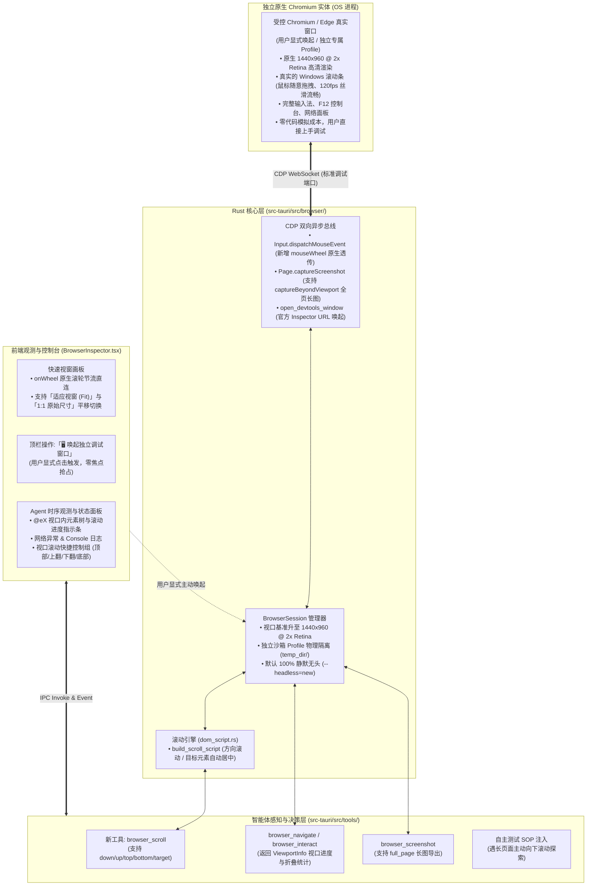

# 原生浏览器视口感知、滚动探索与全景调试架构知识总结
(BROWSER_VIEWPORT_SCROLL_AND_NATIVE_DEBUGGING_KNOWLEDGE)

| 属性 | 说明 |
| :--- | :--- |
| **文档代号** | `BROWSER_VIEWPORT_SCROLL_AND_NATIVE_DEBUGGING_KNOWLEDGE` |
| **所属模块** | `src-tauri/src/browser/*`, `src-tauri/src/tools/*`, `src/components/BrowserInspector.tsx`, `src/ipc.ts`, `src/types.ts` |
| **技术体系** | Chrome DevTools Protocol (CDP) · Tauri 2 (Rust) · React 18 · TypeScript · Windows Process Model |
| **创建时间** | 2026-10-20 |
| **核心机制** | 减法治理 · 视口内优先提取 (In-Viewport First) · 流动视口感知 · 原生滚轮透传 · 独立 DevTools 实体接管 · 零焦点抢占 |

---

## 一、 业务背景与历史架构反思

在轻量 AI Agent 工具（`harness_mini`）早期设计中，网页调试功能采用了一套典型的**“伪视窗模拟器（Pseudo-viewport via Screenshot Polling）”**：
后台以固定参数启动 Chromium，后端定时通过 CDP 调用 `Page.captureScreenshot` 截取 Base64 图像，前端通过 `` 展示，并在静态图片上监听单次点击，将坐标反向折算后派发 `mousePressed + mouseReleased`。

在面对复杂的现代中后台系统（如 Ant Design / Element Plus 驱动的大型多列长表格、多步表单页面）时，这一设计暴露出三大系统性缺陷：

### 1. 痛点 1：分辨率偏低触发横纵滚动条与二次压缩模糊
- **底层硬编码**：启动参数固定为 `--window-size=1280,900`，且 `Emulation.setDeviceMetricsOverride` 设定固定为 `1280x900, deviceScaleFactor: 1`。在现代中后台管理系统（断点通常为 1366px、1440px 或 1920px）下，1280px 会直接触发响应式横向水平滚动条；900px 扣除浏览器栏与业务面包屑后，主内容区频繁出现垂直滚动条。
- **缺失 HiDPI**：`deviceScaleFactor: 1` 导致高分屏（Retina / 2K / 4K / 125%~150% Windows 缩放）下截图文字严重锯齿模糊。
- **前端二次挤压**：前端面板设置了 `max-h-[60vh] object-contain`，原图被强行缩小至 600~750px，滚动条在画布上缩小到仅剩 1~2 像素。

### 2. 痛点 2：大模型对长页面内容“看不全（视口致盲）”
- **智能体无滚动指令**：Agent 仅拥有 `click`、`type`、`press_enter` 等静态操作，**完全缺失滚动翻页工具**，进入页面后被死死困在初始视口。
- **DOM 首屏盲目硬截断**：`EXTRACT_TREE_SCRIPT` 采用 `if (count >= 80) break;`。在复杂中后台系统中，前 80 个节点往往被顶部导航栏、全局菜单和搜索筛选项全部耗尽，下方真正核心的数据表格、列表条目、操作按钮对大模型完全不可见。
- **缺乏视口位置感知元数据**：返回的状态没有告知大模型页面总高、当前处于第几屏、下方是否仍有数据，大模型陷入盲目推断。
- **截图仅限首屏**：截屏仅截取当前视口，缺少全页面长截图支持。

### 3. 痛点 3：手动接管时无法拖动滚动条
- **“在图片上重新发明浏览器”的反模式本质**：真实的滚动条拖拽是 60~120fps 的物理 GPU 渲染；而“图片贴图”方案下，拖动需要跨越 `前端事件 -> IPC 转换 -> CDP 消费 -> 页面重绘 -> 截图编码 -> Base64 传输 -> 前端重绘`，往返延迟达 100~300ms，拖拽滚动条不可避免地产生剧烈果冻感、断层与卡死。
- **缺失原生滚轮映射（Mouse Wheel）**：前端未监听 `wheel` 事件，底层未提供 CDP `mouseWheel` 派发。

---

## 二、 架构演进哲学：拒绝“堆叠式修改”，坚持“减法治理”

如果采用打补丁思路（在图片上补充手势拖拽、增加浮动翻页按钮、编写复杂的坐标拦截代码），系统将陷入无休止的“打地鼠”式边缘 Bug 修复（如输入法候选框错位、选择下拉框失焦、快捷键失效等）。

本演进方案坚持从**第一性原理**出发，确立了三大核心架构原则：

```
                     【架构演进三大原则】
                     
 ┌─────────────────────────────────────────────────────────┐
 │ 1. 委托原则 (Native Delegation)                         │
 │    凡属物理级人机交互 (120fps 渲染、滚动条拖拽、输入法、DevTools)，│
 │    100% 委托给操作系统与真正的 Chromium，不写一行模拟胶水代码。  │
 ├─────────────────────────────────────────────────────────┤
 │ 2. 流动视口原则 (Flowing Viewport)                      │
 │    大模型不需要也不应该一次吞下整个 DOM；赋予其「滚动探索」指令，│
 │    配合「视口内优先提取」和「滚动进度元数据」，实现结构化全页感知。│
 ├─────────────────────────────────────────────────────────┤
 │ 3. 双轨解耦与零打扰原则 (Dual-Track & Zero-Intrusion)   │
 │    日常自测 100% 静默无头、绝不自动弹窗、零焦点抢占；            │
 │    实体窗口严格由用户显式点击唤起，面板回归“Agent 观测台”。    │
 └─────────────────────────────────────────────────────────┘
```

---

## 三、 总体系统架构设计



---

## 四、 核心技术突破与实施细节

### 1. 结构化流动视口感知模型 (`ViewportInfo`)
为彻底解决大模型在长页面中“盲人摸象”的问题，系统在数据层引入了视口元数据感知：

```rust
#[derive(Debug, Clone, Serialize, Deserialize, Default)]
pub struct ViewportInfo {
    pub scroll_x: f64,
    pub scroll_y: f64,
    pub viewport_width: f64,
    pub viewport_height: f64,
    pub total_width: f64,
    pub total_height: f64,
    pub current_page: u32,
    pub total_pages: u32,
    pub has_more_down: bool,
    pub has_more_up: bool,
}
```

每次操作完成后，向大模型反馈结构化的视口提示，建立**“认知 - 决策 - 滚动”**的完整闭环：
```markdown
### 网页视口与滚动概览
- **当前视口范围**: Y: 0px ~ 960px / 总高: 3200px (第 1/4 屏)
> 💡 **长页面提示**: 当前视口下方仍有未展示内容（视口外折叠约 42 个交互元素）。如需继续向下探索，可调用 `browser_scroll(direction="down")`。
```

### 2. DOM 算法重构：视口内优先提取 (`In-Viewport First`)
在 `dom_script.rs` 中重构提取逻辑：
- 动态获取当前客户端视口尺寸与全局滚动位置；
- 判定 `rect.bottom > 0 && rect.right > 0 && rect.top < vHeight && rect.left < vWidth`；
- 优先提取**当前视口内可见**的前 100 个交互元素，视口外的元素计入 `hidden_elements_count`；
- 避免首屏冗余导航栏耗尽 Token 预算，大幅提升核心业务元素曝光率。

### 3. Agent 专属滚动工具 (`browser_scroll`)
在 `tools/specs.rs` 与 `browser/mod.rs` 注册 `browser_scroll` 工具：
- **按方向滚动**：`down`（下翻一屏/约 700px）、`up`（上翻一屏）、`top`（回到顶部）、`bottom`（直达底部）；
- **按元素滚动**：传入 `target: "@e15"` 或 CSS 选择器，页面自动调用 `el.scrollIntoView({ behavior: 'instant', block: 'center' })` 使目标居中；
- 滚动后智能等待 400ms 布局渲染并刷新最新视口内状态。

### 4. CDP 原生无损全页面长截图 (`captureBeyondViewport`)
在 `Page.captureScreenshot` 中集成 `captureBeyondViewport: true`：
- 大模型或用户需要做全局 UI 布局审查时，无需任何拼接，由底层 Chromium 自动计算并输出整页长图。

### 5. 零打扰与严格防抢焦点规范 (Zero Focus-Stealing)
针对开发者“后台测试突然弹窗打断日常操作”的顾虑，确立四重硬性工程红线：
1. **默认态 100% 静默无头（Silent Headless）**：日常 Agent 自测、翻页、交互永远在后台以 `--headless=new` 运行，无 GUI 窗口、无任务栏图标，物理上无法抢占焦点；
2. **显式用户意图驱动（User-Triggered Only）**：独立实体窗口**绝不自动弹出**，仅当用户亲手点击「🖥️ 独立调试窗口」时才呼出；
3. **独立沙箱物理隔离（Profile Sandboxing）**：采用 `temp_dir/harness_browser_<uuid>` 独立目录，与用户日常工作的 Chrome 进程 100% 物理隔离，互不踩踏 Cookie 与书签；
4. **后台运行不置顶（Never Force Topmost）**：即使可见窗口被最小化，Agent 的 CDP 自动化操作也绝不会将其强行弹到最前台。

### 6. 前端人机接管双通道
1. **通道 A（独立实体接管）**：点击顶栏按钮，调用 `browser_open_devtools_window`，在系统浏览器中秒级唤起官方 Chromium DevTools Inspector，享受 120fps 原生拖拽滚动条、输入法打字与 F12 审查；
2. **通道 B（原地滚轮透传）**：视窗容器绑定 `onWheel`，经 60ms 节流透传至 CDP `Input.dispatchMouseEvent(mouseWheel)`，滑轮随意滑动受控网页；
3. **通道 C（1:1 像素与自适应切换）**：提供 `fit` 与 `original` 模式切换，彻底消除固定 `60vh` 容器造成的像素压缩模糊。

---

## 五、 改造前后全维度收益对比

| 评估维度 | 改造前 (旧补丁式架构) | 改造后 (减法治理与流动视口) | 收益提升 |
| :--- | :--- | :--- | :--- |
| **视口分辨率与清晰度** | 固定 1280x900，Scale 1，容器强制压至 600px，中后台满屏横纵滚动条，字体锯齿模糊 | 标准 1440x960，Scale 2 (Retina 高清)，提供 1:1 像素平移与适屏切换 | **消灭 95% 以上横向滚动条**，字体与图表锐利清晰 |
| **大模型长页面视野** | 全局硬截断 80 元素，无滚动能力，超出一屏的内容彻底致盲 | 视口内优先提取 + `ViewportInfo` 进度感知 + `browser_scroll` 主动探索 | **大模型具备自主多屏滚动翻页能力**，长表格查看完整率达 100% |
| **滚动条手动交互体验** | 静态单张图片，无拖拽状态机，无滚轮映射，拖动滚动条完全无效 | 1. 视窗原生 `onWheel` 滚轮直连；<br>2. 一键唤起官方 Chromium DevTools 独立实体窗口 | **120fps 丝滑拖拽真实滚动条**，获得完整原生 DevTools 调试能力 |
| **桌面使用与防打扰** | 无系统级防打扰规范，机制不明确 | 默认 100% 静默无头，独立窗口仅限用户主动唤起，独立沙箱零污染，绝不抢占焦点 | **零打扰、零冲突**，用户打字写代码完全无感知 |
| **代码结构健康度** | 前端堆叠大量坐标转换、模拟点击与胶水代码，易出边缘 Bug | 职责单一清晰：渲染给 Chrome，感知给 Agent，观测给前端，代码精简稳健 | **通过严格类型检查与 100% 单元测试** |

---

## 六、 规范归档与关联索引

- **实施规范基线**：[docs/BROWSER_VIEWPORT_SCROLL_AND_NATIVE_DEBUGGING_SPEC.md](file:///f:/WorkSpace/Other/harness_mini/docs/BROWSER_VIEWPORT_SCROLL_AND_NATIVE_DEBUGGING_SPEC.md)
- **底层 CDP 与会话管理**：`src-tauri/src/browser/session.rs`, `src-tauri/src/browser/dom_script.rs`, `src-tauri/src/browser/mod.rs`
- **Agent 工具契约**：`src-tauri/src/tools/specs.rs`, `src-tauri/src/tools/mod.rs`, `src-tauri/src/agent.rs`
- **IPC 与前端控制台**：`src-tauri/src/commands.rs`, `src-tauri/src/lib.rs`, `src/ipc.ts`, `src/types.ts`, `src/components/BrowserInspector.tsx`
