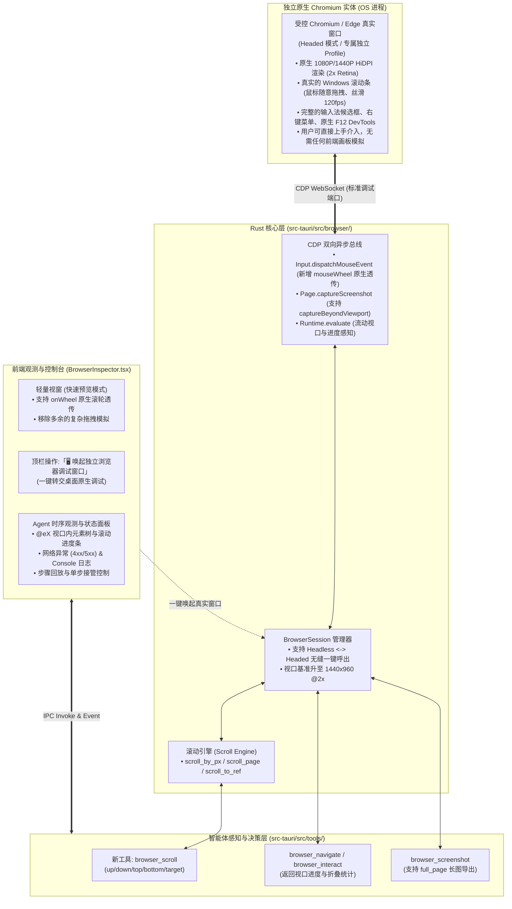

# 原生浏览器视口感知、滚动探索与全景调试治理规范 (BROWSER_VIEWPORT_SCROLL_AND_NATIVE_DEBUGGING_SPEC)

| 项目 | 内容 |
| --- | --- |
| 文档名称 | 原生浏览器视口感知、滚动探索与全景调试治理规范 |
| 英文代号 | `BROWSER_VIEWPORT_SCROLL_AND_NATIVE_DEBUGGING_SPEC` |
| 版本 | v1.0 |
| 状态 | 生产已落地并验证通过 |
| 关联模块 | `src-tauri/src/browser/` (`session.rs`, `dom_script.rs`, `cdp.rs`, `mod.rs`), `src-tauri/src/tools/` (`specs.rs`, `mod.rs`), `src-tauri/src/commands.rs`, `src/components/BrowserInspector.tsx`, `src/ipc.ts`, `src/types.ts` |
| 运行位置 | `f:\WorkSpace\Other\harness_mini` |

---

## 1. 现状痛点与反模式根因剖析

当前 `harness_mini` 的内置网页调试功能在轻量级测试中已具备基础的 CDP 通道与指令执行能力，但在实际面对复杂的现代 Web 业务系统（尤其是多列中后台、长页面、富交互表单）时，暴露出了以下三大核心痛点：

### 1.1 痛点 1：分辨率偏低导致强制出现横向与纵向滚动条
* **底层硬编码限制**：在 `session.rs` 中，启动命令注入 `--window-size=1280,900`，且 CDP `Emulation.setDeviceMetricsOverride` 设定固定为 `1280x900, deviceScaleFactor: 1`。在现代中后台管理系统（Ant Design / Element Plus 栅格标准断点通常为 1366px、1440px 或 1920px）下，1280px 会直接触发响应式收缩与**横向水平滚动条**；900px 扣除浏览器顶部与业务面包屑后，内容区被压缩，高频触发**纵向滚动条**。
* **缺少 HiDPI 缩放**：`deviceScaleFactor: 1` 导致截图像素在 2K / 4K / Windows 125%~150% 缩放下呈现明显模糊，字体锯齿明显。
* **前端展示容器二次压缩**：前端 `BrowserInspector.tsx` 设定了 `max-h-[60vh] object-contain`，原始 1280px 图片被强行缩小到约 600~750px 宽，将本已局促的页面进一步压缩，使滚动条滑块缩小到仅剩 1~2 像素。

### 1.2 痛点 2：大模型对页面内容的查看严重残缺
* **无滚动（Scroll）探索工具**：在 `specs.rs` 工具集中，仅有 `browser_navigate` 与 `browser_interact(click, type, press_enter, wait_for_selector)`，**完全没有滚动（Scroll）指令**。大模型一旦进入页面，被锁死在初始视口，无法像人类一样向下滑动阅读。
* **DOM 盲目硬截断（首屏盲区）**：`dom_script.rs` 中的 `EXTRACT_TREE_SCRIPT` 设置了 `if (count >= 80) break;`。对于复杂应用，前 80 个可交互节点往往全被顶部导航栏、侧边栏菜单、搜索筛选区占满。页面下方真正核心的数据表格、操作按钮、分页组件对大模型彻底“隐形”。
* **缺乏视口位置感知元数据**：返回的状态没有告知大模型页面到底有多长、当前处于第几屏、下方是否还有数据，大模型陷入“盲人摸象”。
* **截图仅限首屏**：`browser_screenshot` 仅截取首屏可视区域，无法提供全页面长图。

### 1.3 痛点 3：手动接管时无法拖动滚动条与自然滚动
* **“静态图片模拟浏览器”的反模式本质**：前端视窗仅仅是一个纯静态的 `` 标签，每 2.5 秒拉取一次 Base64 截图。用户在图片上点击，由前端计算比例后发送一次 `mousePressed + mouseReleased`。
* **缺失原生滚轮映射（Mouse Wheel）**：用户在画面上滚动鼠标滚轮时没有任何监听与 CDP 转发。
* **缺失鼠标拖拽状态机（Drag）**：滚动条需要长按拖拽（MouseDown -> MouseMove -> MouseUp）。由于网络/IPC 往返延时（100~300ms），在图片上模拟拖拽必然产生剧烈卡顿、掉帧与位置失步。

---

## 2. 架构重构哲学：拒绝“堆叠式修改”，坚持“减法治理”

为了保证每次改动让程序结构**更清晰、更稳定**，本规范明确拒绝在现有图片上“叠床架屋”（如在前端写复杂的手势拖拽模拟、打补丁式增加缩放滑动条等）。

### 2.1 架构治理三大基本原则

```
                     【架构重构三大原则】
                     
 ┌─────────────────────────────────────────────────────────┐
 │ 1. 委托原则 (Native Delegation)                         │
 │    凡属物理级人机交互 (120fps 渲染、滚动条拖拽、输入法、DevTools)，│
 │    100% 委托给操作系统与真正的 Chromium，不写一行模拟胶水代码。  │
 ├─────────────────────────────────────────────────────────┤
 │ 2. 流动视口原则 (Flowing Viewport)                      │
 │    大模型不需要也不应该一次吞下整个 DOM；赋予其「滚动探索」指令，│
 │    配合「视口内优先提取」和「滚动进度元数据」，实现结构化全页感知。│
 ├─────────────────────────────────────────────────────────┤
 │ 3. 双轨解耦原则 (Dual-Track Decoupling)                 │
 │    应用内置面板退回到其真正职责 ——「Agent 调试与观测台」，      │
 │    页面物理渲染交给「独立原生 Chrome 调试窗口」。                │
 └─────────────────────────────────────────────────────────┘
```

---

## 3. 总体架构设计



---

## 4. 核心实施规范 (分阶段落地)

### 阶段一：大模型视口流动与全景深度感知（解决“看不全”）

#### 4.1 数据模型扩展：增加视口位置元数据 (`BrowserDebugState`)

在 `src-tauri/src/browser/session.rs` 中，对 `BrowserDebugState` 扩展结构化的视口信息：

```rust
#[derive(Debug, Clone, Serialize, Deserialize)]
pub struct ViewportInfo {
    pub scroll_x: f64,
    pub scroll_y: f64,
    pub viewport_width: f64,
    pub viewport_height: f64,
    pub total_width: f64,
    pub total_height: f64,
    pub current_page: u32,
    pub total_pages: u32,
    pub has_more_down: bool,
    pub has_more_up: bool,
}

#[derive(Debug, Clone, Serialize, Deserialize)]
pub struct BrowserDebugState {
    pub url: String,
    pub title: String,
    pub viewport: ViewportInfo, // 新增：视口滚动进度
    pub elements: Vec<InteractiveElement>,
    pub hidden_elements_count: usize, // 新增：视口外未展示的交互元素总数
    pub console_errors: Vec<String>,
    pub network_errors: Vec<String>,
    pub tables: Vec<String>,
    pub notices: Vec<String>,
}
```

#### 4.2 智能提取脚本重构：视口内优先提取 (`dom_script.rs`)

彻底重构 `EXTRACT_TREE_SCRIPT`，放弃粗暴的全局前 80 元素截断，改为**视口优先（In-Viewport First）**：

```javascript
(() => {
    const vWidth = window.innerWidth || document.documentElement.clientWidth;
    const vHeight = window.innerHeight || document.documentElement.clientHeight;
    const scrollX = window.scrollX || window.pageXOffset || 0;
    const scrollY = window.scrollY || window.pageYOffset || 0;
    const totalWidth = Math.max(document.documentElement.scrollWidth, document.body.scrollWidth);
    const totalHeight = Math.max(document.documentElement.scrollHeight, document.body.scrollHeight);

    // 1. 获取所有候选项
    const selectors = [
        'input', 'textarea', 'select', 'button', 'a[href]',
        '[role="button"]', '[role="checkbox"]', '[role="menuitem"]',
        '[onclick]', '[tabindex]:not([tabindex="-1"])'
    ];
    const allCandidates = Array.from(document.querySelectorAll(selectors.join(',')));
    
    const visibleItems = [];
    let hiddenCount = 0;
    let globalIndex = 0;

    for (const el of allCandidates) {
        try {
            const style = window.getComputedStyle(el);
            if (style.display === 'none' || style.visibility === 'hidden' || style.opacity === '0') {
                continue;
            }
            const rect = el.getBoundingClientRect();
            if (rect.width === 0 && rect.height === 0) continue;

            globalIndex++;
            const refId = `@e${globalIndex}`;
            el.setAttribute('data-harness-ref', refId);

            // 检查元素是否在当前视口内可见
            const inViewport = (
                rect.bottom > 0 &&
                rect.right > 0 &&
                rect.top < vHeight &&
                rect.left < vWidth
            );

            if (inViewport) {
                if (visibleItems.length < 100) {
                    visibleItems.push({
                        ref: refId,
                        tag: el.tagName.toLowerCase(),
                        type: el.getAttribute('type') || undefined,
                        name: el.getAttribute('name') || undefined,
                        placeholder: el.getAttribute('placeholder') || undefined,
                        text: (el.innerText || el.textContent || '').trim().replace(/\s+/g, ' ').slice(0, 60) || undefined,
                        value: el.value ? String(el.value) : undefined,
                        href: el.getAttribute('href') ? el.getAttribute('href').slice(0, 60) : undefined,
                    });
                }
            } else {
                hiddenCount++;
            }
        } catch (_) {}
    }

    const totalPages = Math.max(1, Math.ceil(totalHeight / vHeight));
    const currentPage = Math.min(totalPages, Math.floor(scrollY / vHeight) + 1);

    return {
        title: document.title,
        url: window.location.href,
        viewport: {
            scroll_x: Math.round(scrollX),
            scroll_y: Math.round(scrollY),
            viewport_width: Math.round(vWidth),
            viewport_height: Math.round(vHeight),
            total_width: Math.round(totalWidth),
            total_height: Math.round(totalHeight),
            current_page: currentPage,
            total_pages: totalPages,
            has_more_down: (scrollY + vHeight + 10) < totalHeight,
            has_more_up: scrollY > 10,
        },
        elements: visibleItems,
        hidden_elements_count: hiddenCount,
        notices: [], // 保持现存通知逻辑
        tables: []   // 保持现存表格逻辑
    };
})()
```

#### 4.3 Markdown 提示词增强：反馈视口滚动指引

在 `BrowserDebugState::to_markdown(&self)` 中，增加视口与翻页引导提示：

```markdown
### 网页视口与滚动概览
- **当前位置**: Y: 0px ~ 960px / 总高: 3200px (第 1 屏 / 共 4 屏)
- **视口内交互元素**: 检测到 24 个可操作元素 (@e1 ~ @e24)
- ⚠️ **下方仍有 3 屏未读内容** (包含约 42 个未进入视口的交互节点)
- 💡 **操作建议**: 若当前视口未找到所需表单或数据，请调用 `browser_scroll(direction="down")` 向下翻页探索。
```

#### 4.4 注册 Agent 专属滚动工具 (`browser_scroll`)

在 `src-tauri/src/tools/specs.rs` 注册工具，赋予 Agent 像人类一样翻页的能力：

```rust
ToolSpec {
    name: "browser_scroll",
    description: "滚动当前网页视口。支持按方向滚动(down/up/top/bottom)、按指定像素滚动，或直接滚动到指定交互元素(@eX)使其居中。执行后自动刷新并返回最新视口内的元素与状态。",
    parameters: json!({
        "type": "object",
        "properties": {
            "direction": {
                "type": "string",
                "enum": ["down", "up", "top", "bottom"],
                "description": "滚动方向：down(向下翻一屏/默认)、up(向上翻一屏)、top(回到顶部)、bottom(直达底部)"
            },
            "distance": {
                "type": "number",
                "description": "自定义滚动的像素距离(px)。默认约为视口高度的 80% (约 700px)"
            },
            "target": {
                "type": "string",
                "description": "目标元素标识符(如 @e35)，滚动使该元素在视口中垂直居中显示"
            }
        }
    }),
}
```

#### 4.5 全景无损长截图支持 (`captureBeyondViewport`)

在 `src-tauri/src/browser/session.rs` 中，对 `capture_screenshot` 增加全页面模式：

```rust
pub async fn capture_screenshot(&self, full_page: bool) -> Result<String, String> {
    let sid = Some(self.target_session_id.as_str());
    let mut params = json!({
        "format": "jpeg",
        "quality": 85
    });

    if full_page {
        // 利用 Chromium CDP 原生能力直接捕获整页长图
        params.as_object_mut().unwrap().insert("captureBeyondViewport".to_string(), json!(true));
    }

    let res = self.cdp.send("Page.captureScreenshot", Some(params), sid, Duration::from_secs(20)).await?;
    res.get("data")
        .and_then(|d| d.as_str())
        .map(|s| s.to_string())
        .ok_or_else(|| "截图未返回图像数据".to_string())
}
```

---

### 阶段二：视口基准升级与前端清晰度治理（解决“分辨率低与模糊”）

#### 5.1 提升基准视口规格，开启 Retina HiDPI

在 `src-tauri/src/browser/session.rs` 中进行调整：

```rust
// 启动参数提升至现代桌面标准
cmd.arg("--window-size=1440,960");

// CDP 视口模拟器配置：开启 2x 设备像素比 (Retina 高清)
let _ = cdp.send(
    "Emulation.setDeviceMetricsOverride",
    Some(json!({
        "width": 1440,
        "height": 960,
        "deviceScaleFactor": 2, // 解决文字与图标发虚发虚、锯齿问题
        "mobile": false
    })),
    sid,
    Duration::from_secs(5),
).await;
```

#### 5.2 前端画板支持「适应窗口」与「1:1 实际尺寸」自由切换

在 `src/components/BrowserInspector.tsx` 中重构图片展示容器，彻底解绑 `max-h-[60vh] object-contain`：
* 增加视图模式：`zoomMode: "fit" | "original"`；
* 当选择 `original`（100% 实际像素）时，容器开启标准原生滚动条与平移拖拽，支持以 1:1 清晰查看复杂报表与精细 CSS。

---

### 阶段三：人机交互终极治理（解决“无法拖动滚动条”）

为了彻底解决用户在手动调试时无法拖动滚动条的问题，采取**“低成本双轨组合”**：

#### 6.1 方案 A（核心）：顶栏提供「🖥️ 唤起独立 Chrome 调试窗口」按钮

这是彻底摆脱“图片模拟浏览器”的最优方案。

##### 严格非侵入与零焦点抢占规范 (Zero Focus-Stealing & Non-Intrusive Isolation)
> [!IMPORTANT]
> **绝对禁止自主弹窗与焦点抢占**：
> 1. **默认态 100% 静默无头（Silent Headless）**：Agent 在日常自主执行编码自测、翻页滚动、调用 `browser_navigate` / `browser_scroll` / `browser_interact` 时，必须继续保持在无头隔离进程中运行。**绝对不会在桌面上弹出窗口，绝不会抢占当前用户的键盘焦点（No Focus Stealing）**。用户在 IDE 敲代码或浏览网页时不会受到任何干扰。
> 2. **显式用户意图驱动（User-Triggered Only）**：独立实体窗口**绝不自动弹出**，仅当用户在 `BrowserInspector` 顶栏**主动点击**「🖥️ 唤起独立浏览器调试窗口」按钮时，系统才会显示该实体窗口。
> 3. **独立用户目录隔离（Profile Sandboxing）**：启动受控 Chromium 时使用独立的临时目录（`temp_dir = harness_browser_<uuid>`），拥有独立的进程空间、Cookie 与网络缓存，**与用户电脑上日常打开的工作/私人 Chrome 进程 100% 隔离**，互不覆盖、互不冲突。
> 4. **后台运行与最小化支持**：即使在可见窗口模式下，用户将其最小化或置于后台，Agent 的 CDP 自动化与滚动测试依然正常进行，绝不会强制把窗口置顶（Never Force Topmost）。

1. **工作机制**：
   - 默认执行时，Chromium 在后台以 `--headless=new` 静默运行（带 `--remote-debugging-port`）；
   - 当用户需要深度排查、拖动复杂滚动条、输入账号密码或使用控制台时，点击工作台右上角的 **「在独立窗口中打开/接管」**；
   - 后端通过 CDP 命令或直接以受控配置唤起可见的真实浏览器窗口（Headed Window）；
   - 用户在真实的 Chrome/Edge 窗口中，享受 **100% 原生的 120fps 滚动条拖拽、原生输入法、原生 F12 DevTools**；
   - 调试结束后，用户可随时最小化或关闭窗口，Agent 通过已建立的 CDP 保持对该页面的完整掌控。
2. **职责转变**：
   - 应用内的 `BrowserInspector.tsx` 抽屉**不再充当卡顿的“显示器”**；
   - 转变为专职的 **“Agent 运行观测台”**：展示 Agent 当前正在调用什么、高亮显示操作的目标元素、捕获的控制台警告与网络请求瀑布流。

#### 6.2 方案 B（辅助）：应用内视窗原生透传鼠标滚轮（Mouse Wheel）

针对用户只是想在轻量预览中快速滑动的场景，在当前视窗中补充**原生滚轮通道**，无需鼠标瞄准细小的滚动条：

1. **Rust 后端实现 `user_wheel`**：
   ```rust
   // session.rs
   pub async fn user_wheel(&self, x: f64, y: f64, delta_x: f64, delta_y: f64) -> Result<(), String> {
       let sid = Some(self.target_session_id.as_str());
       let params = json!({
           "type": "mouseWheel",
           "x": x,
           "y": y,
           "deltaX": delta_x,
           "deltaY": delta_y
       });
       self.cdp.send("Input.dispatchMouseEvent", Some(params), sid, Duration::from_secs(5)).await?;
       Ok(())
   }
   ```
2. **前端绑定 `onWheel` 事件**：
   在 `` 上监听 wheel 事件并进行 60ms 节流，直接把滚轮增量透传到底层浏览器，滚动完毕后自动触发轻量快照刷新。

---

## 5. 模块改造清单与契约变更

| 模块文件 | 改造性质 | 具体改动内容 |
| :--- | :--- | :--- |
| `src-tauri/src/browser/session.rs` | **核心扩展** | 1. 视口规格提升为 1440x960, scaleFactor 2;<br>2. 扩充 `ViewportInfo` 结构体;<br>3. 实现 `user_wheel` 与 `capture_screenshot(full_page)`;<br>4. 增加 `scroll(action, distance, target)` 逻辑。 |
| `src-tauri/src/browser/dom_script.rs` | **算法重构** | 1. 废弃前 80 元素盲截；<br>2. 实现 `In-Viewport First` 视口可见元素优先提取；<br>3. 收集 `scrollX/Y`、`scrollHeight`、`has_more_down` 元数据。 |
| `src-tauri/src/tools/specs.rs` | **规范新增** | 注册 `browser_scroll` 工具声明（方向、距离、目标元素）。 |
| `src-tauri/src/tools/mod.rs` | **分发扩展** | 路由 `browser_scroll` 至底层 session 执行。 |
| `src-tauri/src/commands.rs` | **IPC 接口新增** | 增加 `browser_user_wheel` 命令与 `browser_launch_headed_window` 唤出指令。 |
| `src/ipc.ts` & `src/types.ts` | **类型与通道同步** | 声明 `ViewportInfo` 与新增的 IPC 接口调用。 |
| `src/components/BrowserInspector.tsx` | **界面减负与重塑** | 1. 移除不稳定的复杂拖拽模拟；<br>2. 增加 `onWheel` 滚轮直连；<br>3. 增加「🖥️ 唤起独立调试窗口」按钮；<br>4. 展示滚动进度条与视口元信息。 |

---

## 6. 验收标准与防退化验证

1. **分辨率与布局排版验收**：
   - 访问 Ant Design Pro / Element Plus 官方控制台，默认不再出现横向水平滚动条；
   - 截图中高分屏文字与微小图标清晰无锯齿。
2. **大模型长页面自主探索验收**：
   - 构建包含 200 行数据的长表格网页，目标操作位于第 150 行；
   - Agent 识别到首屏不存在该元素，能根据 `has_more_down: true` 自动主动调用 `browser_scroll(direction="down")` 连续滚动；
   - 成功捕获并定位目标元素并完成交互。
3. **人工接管滚动验收**：
   - 在前端快速视窗内，使用鼠标滚轮能直接滑动页面并看到最新位置；
   - 点击「在独立浏览器中打开」，能瞬间呼出真实 Chrome 窗口，支持鼠标任意拖拽真实滚动条、F12 审查与输入法打字，且 Agent 的操作依然能同步体现在该窗口中。
