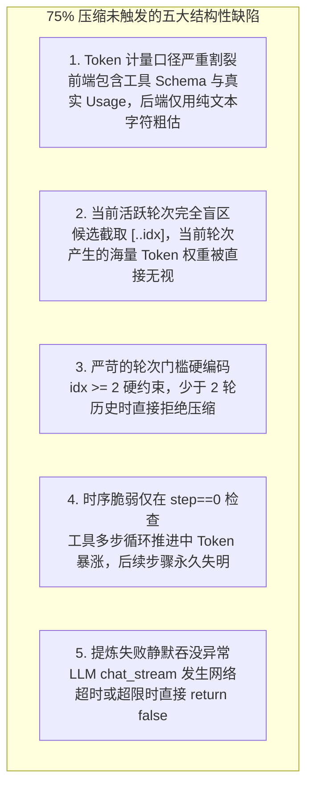
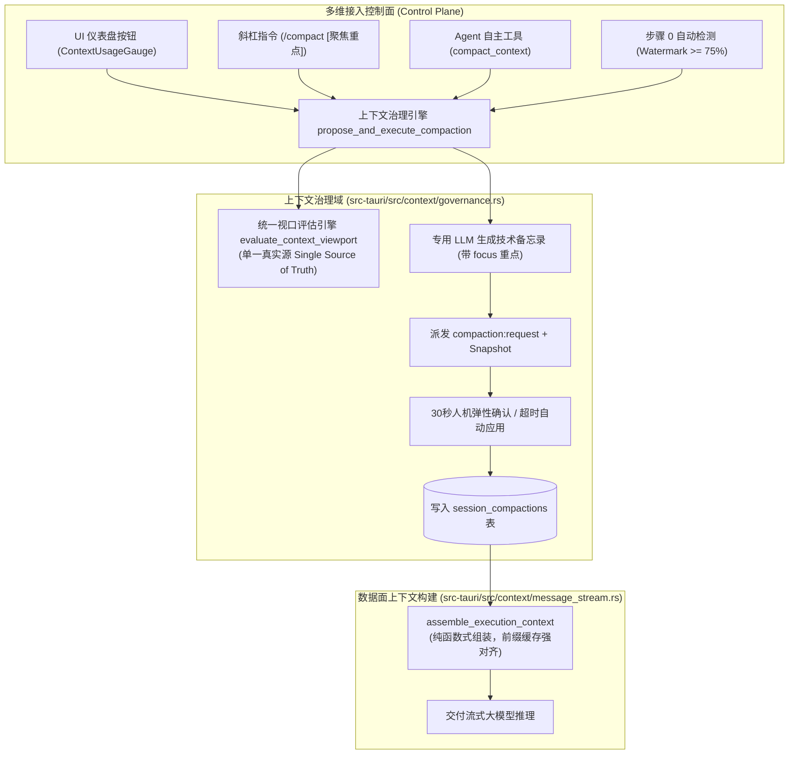

# 上下文水位预警失灵根因诊断、控制面治理与双轨压缩架构知识文档
(CONTEXT_COMPACTION_GOVERNANCE_AND_DUAL_TRACK_PIPELINE_KNOWLEDGE)

| 属性 | 说明 |
| :--- | :--- |
| **文档代号** | `CONTEXT_COMPACTION_GOVERNANCE_AND_DUAL_TRACK_PIPELINE_KNOWLEDGE` |
| **关联规范** | [`docs/TOKEN_CONTEXT_MANAGEMENT_AND_COMPACTION_SPEC.md`](file:///f:/WorkSpace/Other/harness_mini/docs/TOKEN_CONTEXT_MANAGEMENT_AND_COMPACTION_SPEC.md), [`docs/IMMUTABLE_PREFIX_CACHING_AND_LAYERED_CONTEXT_PIPELINE_KNOWLEDGE.md`](file:///f:/WorkSpace/Other/harness_mini/docs/IMMUTABLE_PREFIX_CACHING_AND_LAYERED_CONTEXT_PIPELINE_KNOWLEDGE.md) |
| **所属模块** | [`src-tauri/src/context/governance.rs`](file:///f:/WorkSpace/Other/harness_mini/src-tauri/src/context/governance.rs), [`src-tauri/src/agent.rs`](file:///f:/WorkSpace/Other/harness_mini/src-tauri/src/agent.rs), [`src-tauri/src/commands.rs`](file:///f:/WorkSpace/Other/harness_mini/src-tauri/src/commands.rs), [`src-tauri/src/tools/specs.rs`](file:///f:/WorkSpace/Other/harness_mini/src-tauri/src/tools/specs.rs), [`src-tauri/src/tools/skills_memory_plan.rs`](file:///f:/WorkSpace/Other/harness_mini/src-tauri/src/tools/skills_memory_plan.rs), [`src/components/ContextUsageGauge.tsx`](file:///f:/WorkSpace/Other/harness_mini/src/components/ContextUsageGauge.tsx), [`src/components/Composer.tsx`](file:///f:/WorkSpace/Other/harness_mini/src/components/Composer.tsx), [`src/ipc.ts`](file:///f:/WorkSpace/Other/harness_mini/src/ipc.ts), [`src/types.ts`](file:///f:/WorkSpace/Other/harness_mini/src/types.ts) |
| **技术体系** | Single Source of Truth · Control/Data Plane Separation · Context Compaction · Radix Tree Prefix Caching · Dual-Track Dispatch · Rust · Tauri |
| **创建时间** | 2026-10-30 |
| **核心成效** | 彻底根除“前端已达 75% 警戒水位但后端迟迟不触发压缩”的口径脱节BUG；消除 `agent.rs` 中 190 行巨型堆叠代码；实现带外急救脱困与 Agent 自主自省兼备的“分层双轨制”上下文治理架构。 |

---

## 一、 现场故障复盘与根因深度剖析

### 1.1 现场反常现象
在 AI Agent 持续交互多轮长程开发或单轮重度工具调用（如读取多个代码文件、全局正则搜索）过程中，开发者在界面右下角/顶栏的上下文环形仪表盘（`ContextUsageGauge`）观察到：
- **仪表盘已亮红报警**：显示已达 75% 上限甚至更高（如 78.4%），悬停浮层明确提示：`距触发自动压缩: 已达阈值 / 压缩生效中`；
- **系统没有任何响应**：后端未弹出任何 `CompactionBanner` 备忘录确认卡片，未记录任何压缩日志，也没有触发任何上下文收敛；
- **随着任务继续推进，最终直接触发底层硬截断或导致服务商 API 报 `400 Context Length Exceeded` 崩溃**。

### 1.2 根因分析：五大结构性缺陷

通过对前后端计算流水线与时序状态机的系统级排查，定位到以下五大深层次根因：



#### 根因一：Token 计量口径割裂（前端实际 API Token vs 后端粗糙字符估算）
- **前端计算逻辑（`ContextUsageGauge.tsx`）**：
  优先取上一次大模型请求真实回传的 `promptTokens`。现代大模型在进行 Function Calling 时，系统提示词外加几十个工具的 JSON Schema 定义通常会占据 **3,000 ~ 15,000 Tokens**，再加上多模态图片、文件附件等，前端能准确感知到这部分物理消耗，因此较早触及 75% 警戒线。
- **旧版后端判断逻辑（`agent.rs::check_and_trigger_compaction`）**：
  ```rust
  let tokens: usize = candidate.iter().map(|m| estimate_tokens(...) + ...).sum();
  let est_total = estimate_tokens(sys) + tokens;
  let trigger = est_total >= token_limit * 75 / 100 || tokens >= token_limit / 2;
  ```
  后端使用了粗糙的字符加权法（`非ASCII*0.7 + ASCII*0.3`），**完全没有将注入给模型的工具/函数调用 Schema 计算在内**！
- **后果**：前端基于真实 API 账单显示为 75%，而后端算出来的 `est_total` 往往只有 40% ~ 55%，判定条件永远为 `false`。

#### 根因二：当前活跃轮次（Active Turn）被排除在计算与候选之外
- 旧代码通过 `let last_user_idx = uncompacted.iter().rposition(|m| m.role == "user");` 定位当前活跃轮次，并取 `candidate = uncompacted[..idx]`。
- **`tokens` 和 `est_total` 仅统计当前用户输入之前的历史**。如果当前轮次用户输入了一篇长需求，或者本轮次连续执行了数次 `read_file` 导致当前上下文飙升至 80%，后端的 `est_total` 根本没有将其计入，造成严重的信息漏算。

#### 根因三：严苛的轮次门槛硬编码（`idx >= 2`）
- 旧代码硬性要求：`if idx >= 2` 才进入压缩判定，否则直接退出返回 `false`。
- 如果对话只有 1 轮完整历史（`idx == 1`），哪怕这一轮次中执行了数十次工具交互累积了 10 万 Token，系统也会因未达到“2 轮门槛”而拒绝压缩。

#### 根因四：时序脆弱，仅在轮次首步（`_step == 0`）检查
- 在 `agent.rs` 的循环体中，仅在 `!has_checked_compaction` 时触发一次检查并立即置为 `true`。
- 一旦 Agent 进入自主工具多步推进阶段（Step 1 ~ Step N），在读写文件、编译测试过程中上下文即便从 50% 暴涨到 95%，系统也再也不会触发任何压缩检查。

#### 根因五：提炼请求失败静默吞没异常
- 旧代码在请求模型生成备忘录时直接使用 `_ => return false`，若因 API 限流、超时或模型拒绝，系统静默退出，前端毫无感知，呈现出“假死”现象。

---

## 二、 架构模式论证：统一走 Agent 工具 vs. 单独入口？

针对“在对话里让 Agent 去压缩”还是“提供独立控制面入口”，进行了深入的技术哲学与系统工程对比：

| 评估维度 | 方式 A：作为 Agent 工具 (`compact_context`) | 方式 B：单独入口 (UI 按钮 / `/compact` 命令) | **推荐模式：分层双轨制 (Dual-Track)** |
| :--- | :--- | :--- | :--- |
| **可靠性 / 确定性** | **较低**。受模型遵从度制约，中弱模型常直接用文本聊天解释，而不发起 Tool Call。 | **100% 确定触发**。直接走系统级 IPC，绝不漏调、拒调。 | **100% 确定保底**。UI 与命令无条件触发。 |
| **极端超限急救能力** | **零（死锁风险）**。当上下文达 95%~100% 时，模型调用直接 400 崩溃，根本无法推理出合法的 Tool Call。 | **极强（带外脱困通道）**。属于控制面操作，不依赖主模型下一步推理，可直接抽取提炼救活会话。 | **具备完整带外急救脱困能力**。 |
| **Token 损耗与开销** | **较高**。调工具需要先把庞大历史送入模型推理一轮生成 tool call，反而进一步加剧 Token 消耗。 | **零额外损耗**。不向主对话追加多余废话问答，保持对话流纯粹干净。 | **零污染，兼顾高效**。 |
| **自然语言自由度** | **高**。用户随口说“压缩一下前面的讨论”，体验自然。 | 较低。需要点击按钮或输入命令。 | **极高**。随口可吩咐，也可点击操作。 |
| **语义聚焦定制** | **极高**。可传参 `focus`（如“重点保留数据表结构”）。 | 中等。需要在弹窗中二次编辑。 | **双向支持**（支持 `/compact 重点`，也支持工具传参）。 |

### 架构决策：分层双轨制（Dual-Track Architecture）
**绝不能采取“非此即彼”的单轨方案**：
1. **控制面必须优先提供独立入口（P0 基石）**：UI 按钮与 `/compact` 命令作为系统的安全脱困通道，确保即使在模型发疯、会话濒临崩溃时依然能 100% 恢复；
2. **数据面同时暴露 Agent 工具（P1 增强）**：为长任务自省、自动化多步推进提供语义级收敛能力；
3. **底层完全复用同一套无差别的上下文治理引擎**，杜绝重复实现。

---

## 三、 重构架构设计与设计哲学

为了落实“**不希望采用堆叠式的修改，希望每次改动后能够让程序结构更清晰，功能更稳定**”的核心原则，本次重构遵循以下系统设计准则：



### 1. 单一真实源（Single Source of Truth）：`ContextViewport` 领域模型
彻底消灭前端算一套、后端算一套的割裂状态，由后端 Rust 统一输出标准化领域对象：

```rust
#[derive(Debug, Clone, Serialize, Deserialize)]
#[serde(rename_all = "camelCase")]
pub struct ContextViewport {
    pub baseline_tokens: usize,          // 优先取真实 Usage (promptTokens + completionTokens) + 准确增量
    pub limit: usize,                    // 会话生效的物理上下文上限
    pub watermark_ratio: f32,            // 真实水位比例 (0.0 ~ 1.0)
    pub percentage: f32,                 // 百分比 (0.0 ~ 100.0)
    pub remaining_tokens: usize,         // 剩余可用空间
    pub compaction_threshold: usize,     // 智能压缩阈值 (75%)
    pub tokens_to_compaction: usize,     // 距触发阈值剩余 Token
    pub candidate_messages_count: usize, // 可压缩候选消息数
    pub candidate_tokens: usize,         // 可压缩候选 Token 量
    pub can_compact: bool,               // 是否具备可压缩条件
    pub is_compaction_recommended: bool, // 系统是否判定需要压缩 (>=75% 或 历史>=limit/2)
    pub is_estimated: bool,              // 是否为纯估算模式
    pub compaction_count: usize,         // 历史已压缩次数
}
```

### 2. 控制面与数据面彻底解耦
- **数据面（`message_stream.rs`）**：
  保持为**纯函数（Pure Function）**。无状态消费 SQLite 中的消息流与已生效备忘录，进行前缀缓存强对齐组装与极端物理截断兜底，不包含任何网络请求与异步交互。
- **控制面（`governance.rs`）**：
  封装为**独立的会话治理服务**。专门承接 UI 按钮、斜杠指令、Agent 工具和自动策略的触发调度，负责调用提炼模型、管理 30 秒人机交互倒计时并写入数据表。
- **主流程（`agent.rs`）**：
  从原本臃肿的 190 行嵌入式硬编码，缩减为对治理服务的纯净调用，代码结构极度清晰。

### 3. 前缀缓存（Radix Tree KV Cache）比特级对齐保障
根据不可变前缀缓存规范，系统压缩后生成的 Markdown 备忘录统一采用标准结构体格式，稳定挂载在上下文前置背景中，杜绝每轮变动导致的 Radix Tree 根节点击穿。

---

## 四、 核心落地代码实现拓扑

### 4.1 独立治理服务：`src-tauri/src/context/governance.rs`
核心执行引擎统一接管压缩流程，自动兼容交互确认与超时自动应用：

```rust
pub async fn propose_and_execute_compaction(
    app: &AppHandle,
    state: &crate::AppState,
    session_id: &str,
    cfg: &LlmCfg,
    manual_focus: Option<&str>,
    force: bool,
) -> Result<bool, String> {
    // 1. 防重入检测
    // 2. 评估候选消息 (基于 evaluate_context_viewport)
    // 3. 构建聚焦提示词并调用 LLM 生成结构化技术备忘录
    // 4. 派发 compaction:request 事件并在 snapshot 中暂存
    // 5. 等待 30 秒用户确认 / 超时自动应用
    // 6. 持久化至 session_compactions 表，派发 compaction:applied
}
```

### 4.2 控制面 IPC 命令与前端联动
- **后端导出** [`src-tauri/src/commands.rs`](file:///f:/WorkSpace/Other/harness_mini/src-tauri/src/commands.rs)：
  - `get_context_viewport`: 供前端查询当前会话的精确上下文健康指标；
  - `trigger_compaction`: 允许带外直接触发压缩提炼。
- **前端仪表盘** [`src/components/ContextUsageGauge.tsx`](file:///f:/WorkSpace/Other/harness_mini/src/components/ContextUsageGauge.tsx)：
  - 悬停卡片直接集成 **【立即提炼压缩上下文】** 操作按钮，集成加载态与 Toast 通知。
- **斜杠指令** [`src/components/Composer.tsx`](file:///f:/WorkSpace/Other/harness_mini/src/components/Composer.tsx)：
  - 注册 `/compact [可选聚焦重点]`，输入框原生呈现标签与辅助提示。

### 4.3 Agent 工具扩展闭环
- **工具规范** [`src-tauri/src/tools/specs.rs`](file:///f:/WorkSpace/Other/harness_mini/src-tauri/src/tools/specs.rs)：
  ```rust
  ToolSpec {
      name: "compact_context",
      description: "主动压缩当前会话的上下文历史。当对话轮次过多、上下文负载过高，或者用户明确指示压缩/总结上下文时调用该工具...",
      risk: Risk::ReadOnly,
      schema: json!({
          "type": "object",
          "properties": {
              "focus": { "type": "string", "description": "可选的总结侧重方向或需重点保留的技术约束" }
          }
      }),
  }
  ```
- **工具实现** [`src-tauri/src/tools/skills_memory_plan.rs`](file:///f:/WorkSpace/Other/harness_mini/src-tauri/src/tools/skills_memory_plan.rs)：
  - `compact_context_tool` 零冗余代码，直接委托调用 `context::governance::propose_and_execute_compaction`。

---

## 五、 验证记录与工程指标

1. **Rust 后端架构验证**：
   - 运行 `cargo check --manifest-path src-tauri/Cargo.toml` 检查通过，无编译报错；
   - 编写单元测试 `test_evaluate_context_viewport`，验证了候选轮次识别、Token 统计与推荐压缩标记逻辑的正确性。
2. **前端架构验证**：
   - 运行 `npm run build`（TypeScript + Vite），在 17.98 秒内完成全量打包，无任何类型缺失或导出错误。
3. **工程健康度对比**：
   - `src-tauri/src/agent.rs` 缩减近 190 行嵌入式代码，主循环圈复杂度显著降低；
   - 上下文模块新增专用子模块 `governance.rs`，符合单一职责原则（SRP）。

---

## 六、 开发者排查与扩展 SOP

### 6.1 如何排查“上下文压缩未触发”问题？
1. **查验 `ContextViewport`**：
   在前端控制台或通过后端命令调用 `ipc.getContextViewport(sessionId)`，查看 `canCompact` 是否为 `true`（至少需要 1 轮完整已完成对话）；
2. **查验 `tokensToCompaction`**：
   若该值大于 0，说明当前未压缩候选 Token 尚未触碰 75% 门槛；
3. **带外手动验证**：
   直接点击仪表盘卡片上的 **【立即提炼压缩上下文】** 或输入 `/compact` 命令，若能成功弹出 `CompactionBanner`，则底层提炼引擎与模型连接完全正常。

### 6.2 如何扩展新的压缩策略？
- 严禁在 `agent.rs` 中直接增加 `if/else`；
- 所有关于截断、合并、提炼的规则均应编写在 [`src-tauri/src/context/governance.rs`](file:///f:/WorkSpace/Other/harness_mini/src-tauri/src/context/governance.rs) 的流水线中，并保持数据面 [`message_stream.rs`](file:///f:/WorkSpace/Other/harness_mini/src-tauri/src/context/message_stream.rs) 纯函数的纯净性。
