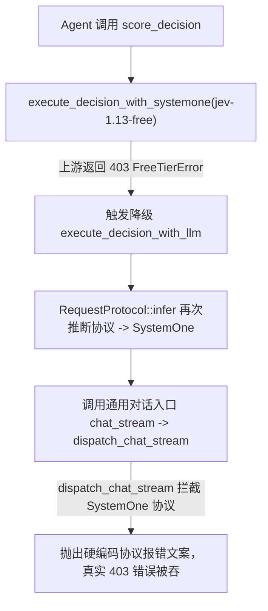
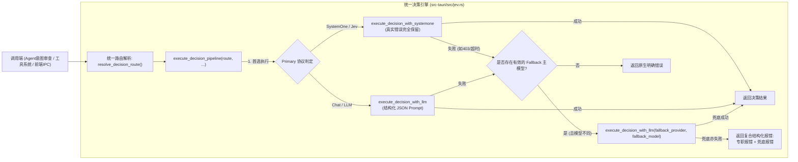

# 决策模型故障根因深度复盘、双模容灾降级与统一执行管道治理规范 (DECISION_ROUTING_FALLBACK_AND_UNIFIED_ENGINE_SPEC)

| 属性 | 说明 |
| :--- | :--- |
| **文档代号** | `DECISION_ROUTING_FALLBACK_AND_UNIFIED_ENGINE_SPEC` |
| **创建时间** | 2026-10-20 |
| **适用范围** | `harness_mini`（Tauri 2 + Rust + React 桌面 AI Agent 架构体系） |
| **关联核心模块** | [`src-tauri/src/models.rs`](file:///f:/WorkSpace/Other/harness_mini/src-tauri/src/models.rs), [`src-tauri/src/jev.rs`](file:///f:/WorkSpace/Other/harness_mini/src-tauri/src/jev.rs), [`src-tauri/src/tools/skills_memory_plan.rs`](file:///f:/WorkSpace/Other/harness_mini/src-tauri/src/tools/skills_memory_plan.rs), [`src-tauri/src/agent.rs`](file:///f:/WorkSpace/Other/harness_mini/src-tauri/src/agent.rs), [`src-tauri/src/commands.rs`](file:///f:/WorkSpace/Other/harness_mini/src-tauri/src/commands.rs) |
| **知识密级** | 核心架构治理、容灾鲁棒性规范与决策引擎设计指南 |

---

## 目录

1. [故障现场还原与真实根因确证](#一故障现场还原与真实根因确证)
   - 1.1 [表层报错现象与用户的困惑](#11-表层报错现象与用户的困惑)
   - 1.2 [真实根因一：上游出口 IP 封控（HTTP 403 FreeTierError）](#12-真实根因一上游出口-ip-封控http-403-freetiererror)
   - 1.3 [真实根因二：降级逻辑陷阱（同模型伪降级引发协议拦截）](#13-真实根因二降级逻辑陷阱同模型伪降级引发协议拦截)
2. [不考虑成本前提下的决策模型最优性分析](#二不考虑成本前提下的决策模型最优性分析)
   - 2.1 [轻量专用分类器（System 1）与旗舰大模型（System 2）能力界限](#21-轻量专用分类器system-1与旗舰大模型system-2能力界限)
   - 2.2 [长上下文与高阶业务推理场景下的决策质量对比](#22-长上下文与高阶业务推理场景下的决策质量对比)
   - 2.3 [工程高可用与双模协同（Dual-Track）的最佳平衡点](#23-工程高可用与双模协同dual-track的最佳平衡点)
3. [既有代码结构的反思：堆叠式修补的技术债务](#三既有代码结构的反思堆叠式修补的技术债务)
   - 3.1 [模型解析逻辑碎片化（3 处重复代码）](#31-模型解析逻辑碎片化3-处重复代码)
   - 3.2 [容错机制各自为政与工具层遗漏](#32-容错机制各自为政与工具层遗漏)
   - 3.3 [底层执行器越权与真实异常掩盖](#33-底层执行器越权与真实异常掩盖)
4. [统一决策引擎与执行管道设计（Clean Architecture）](#四统一决策引擎与执行管道设计clean-architecture)
   - 4.1 [单一事实来源：`DecisionRoute` 与 `resolve_decision_route`](#41-单一事实来源decisionroute-与-resolve_decision_route)
   - 4.2 [纯净协议适配：严格解耦 `SystemOne` 与 `LLM Prompt`](#42-纯净协议适配严格解耦-systemone-与-llm-prompt)
   - 4.3 [统一调度管道：`execute_decision_pipeline` 状态机与容灾机制](#43-统一调度管道execute_decision_pipeline-状态机与容灾机制)
5. [重构实施与核心代码对比](#五重构实施与核心代码对比)
   - 5.1 [`models.rs`：路由解析中枢实现](#51-modelsrs路由解析中枢实现)
   - 5.2 [`jev.rs`：协议纯净化与调度管道封装](#52-jevrs协议纯净化与调度管道封装)
   - 5.3 [`skills_memory_plan.rs`：决策三原语工具层接入](#53-skills_memory_planrs决策三原语工具层接入)
   - 5.4 [`agent.rs` 与 `commands.rs`：调用方精简治理](#54-agentrs-与-commandsrs调用方精简治理)
6. [质量验证与回归测试结论](#六质量验证与回归测试结论)

---

## 一、故障现场还原与真实根因确证

### 1.1 表层报错现象与用户的困惑

在会话执行复杂任务（医疗管理模块 Vue 前端树形表格重构方案审查）时，Agent 自动调用 `score_decision` 工具对意图理解与实施方案进行量化打分，随后抛出如下错误中断了 Agent 执行流：

```text
工具执行失败：决策执行失败 [厂商: opencode-zen / 模型: jev-1.13-free]: 决策模型请求失败: SystemOne 协议为极速结构化决策门控协议（POST /v1/systemone），不支持通用对话补全。
请在设置中为主对话选择 OpenAI Chat、Claude Messages 或 OpenAI Response 协议，将 SystemOne 分配为决策模型。
```

**用户的困惑**：
用户在设置中早已正确将主会话模型配置为通用大模型（如 `glm-5.3-flash`），专职决策模型配置为 `jev-1.13-free`（`SystemOne` 协议）。为什么系统却报错声称“请将 SystemOne 分配为决策模型”？

### 1.2 真实根因一：上游出口 IP 封控（HTTP 403 FreeTierError）

通过提取本地加密主密钥与 SQLite 中存储的凭证，针对上游 OpenCode Zen 网关发起完全还原的现场请求测试：

```bash
POST https://opencode.ai/zen/v1/systemone
Authorization: Bearer oc_sk_***
Content-Type: application/json

{"model":"jev-1.13-free","state":"...","questions":{...}}
```

服务端返回响应：
```json
HTTP/1.1 403 Forbidden
{
  "type": "error",
  "error": {
    "type": "FreeTierError",
    "message": "OpenCode's free models aren't available from your current network because we've detected abusive traffic from this IP address. This isn't related to your account. If you're on a VPN or proxy, turn it off and try again, or subscribe to OpenCode Go at https://opencode.ai/go to keep building."
  }
}
```

> [!IMPORTANT]
> **首发真实故障**：客户端出口 IP 受到 OpenCode 免费层配额与代理策略封控，导致原生 `POST /v1/systemone` 接口拒绝服务。

### 1.3 真实根因二：降级逻辑陷阱（同模型伪降级引发协议拦截）

在旧版 [`src-tauri/src/jev.rs`](file:///f:/WorkSpace/Other/harness_mini/src-tauri/src/jev.rs) 中，存在一段“自作主张”的降级捕获代码：

```rust
// 旧版 jev.rs 中的底层执行器
if is_typesafe {
    match execute_decision_with_systemone(provider, model, ...).await {
        Ok(res) => Ok(res),
        Err(e) => {
            // 致命缺陷：把同属于 SystemOne 的 model (jev-1.13-free) 送入了通用 LLM 结构化提示词
            execute_decision_with_llm(provider, model, ...).await
        }
    }
}
```

其引发的连锁故障流如下：



由于 `jev-1.13-free` 纯粹是分类打分器，根本不具备对话补全接口，底层网关校验保护生效，反向抛出硬编码提示，**导致真实的上游 403 封禁原因被完全掩盖，引发排查方向误导**。

---

## 二、不考虑成本前提下的决策模型最优性分析

### 2.1 轻量专用分类器（System 1）与旗舰大模型（System 2）能力界限

专职极速门控模型（如 Jev / SystemOne）与旗舰通用大模型（如 Claude 3.5 Sonnet、DeepSeek-V3/R1、GLM-5）的核心差异如下：

| 特性维度 | 专职极速门控（SystemOne / Jev） | 旗舰通用对话大模型（LLM Chat / Prompt） |
| :--- | :--- | :--- |
| **典型时延** | 50 ~ 150 ms（极速） | 1000 ~ 3000 ms（受生成长度与推理阶段影响） |
| **输入输出形式** | 纯净状态 + 二元/选项/打分概率标量 | 自然语言 / Markdown / 严密 JSON 结构体 |
| **推理深度** | 单步概率投射，无思维链（Zero Chain-of-Thought） | 具备多跳推理、逻辑推演与自我纠错能力 |
| **抗幻觉能力** | 纯概率分布输出，无 JSON 语法畸变风险 | 极高遵循度，但需依赖 schema 约束与后验解析 |
| **最佳契合场景** | 高频命令拦截（Command Guard）、内存快滤、简单路由 | 复杂方案审查（Plan Review）、长上下文意图综合评估 |

### 2.2 长上下文与高阶业务推理场景下的决策质量对比

本次发生故障的场景为 **医疗系统纠纷管理页面的重构方案评审**。该场景特点如下：
1. **背景上下文巨大**：涵盖了患者聚合树形表格、多状态彩色圆点渲染、内层明细折叠展开、双层按钮权限、大表单字段校验等多项细分规范；
2. **需要领域常识与工程推演**：判定方案是否合理，需要理解 Vue2/Vue3 响应式机制、树形数据展平算法与前端组件库设计哲学；
3. **轻量模型的劣势**：专用门控小模型缺乏对复杂工程细节的理解，面对数千 Token 的庞大上下文容易出现置信度不足（Confidence < 0.6）或弃权（Abstain）；
4. **旗舰模型的压倒性优势**：若不计成本，使用具备强大推理能力的主模型，能提供极其精准、论据详实的评分与修改建议。

### 2.3 工程高可用与双模协同（Dual-Track）的最佳平衡点

> [!TIP]
> **结论**：
> “盲目依赖专职小模型”与“凡事都调重型大模型”均非最优工程解。真正的最优解是 **分级调度管道（Tiered Decision Pipeline）**：
> - **常规快速路径（Fast-Path）**：优先使用低时延的专职门控，保障常规无误操作时的丝滑交互；
> - **异常降级路径（Fallback-Path）**：一旦专用小模型发生网络故障、403 风控、不可用或弃权，系统**静默自动升级由主会话的旗舰大模型接管决策**，以 1 秒的时延代价换取系统绝不崩溃的中断容错。

---

## 三、既有代码结构的反思：堆叠式修补的技术债务

在本次治理前，代码中充斥着“为了修复眼前问题而加补丁”的堆叠式痕迹：

### 3.1 模型解析逻辑碎片化（3 处重复代码）

以下三处模块各自独立写了一遍几乎一模一样的模型优先级解析代码：
1. [`src-tauri/src/agent.rs`](file:///f:/WorkSpace/Other/harness_mini/src-tauri/src/agent.rs)（`resolve_decision_model_for_session`）
2. [`src-tauri/src/tools/skills_memory_plan.rs`](file:///f:/WorkSpace/Other/harness_mini/src-tauri/src/tools/skills_memory_plan.rs)（`resolve_decision_model_for_tool`）
3. [`src-tauri/src/commands.rs`](file:///f:/WorkSpace/Other/harness_mini/src-tauri/src/commands.rs)（`execute_decision` command）

每个文件各写了 40 行包含 `session.decision_*`、`parent_session`、`settings.active_decision_*`、`session.model_*`、`resolve_active_model` 的层层回退。一旦未来增减层级或支持协作者继承，极易出现逻辑不一致。

### 3.2 容错机制各自为政与工具层遗漏

- 在 `agent.rs` 内部，意图审查写了一套 `primary_res.is_err() -> retry with pc, model`；
- 在 `agent.rs` 的 `/jev` 命令中，又单独手写了一遍 `if res.is_err() -> retry`；
- 而在工具层 `skills_memory_plan.rs` 与前端 IPC 命令中，开发者完全漏写了重试，直接抛出 `map_err`。

### 3.3 底层执行器越权与真实异常掩盖

底层 `jev.rs` 作为一个底座协议执行器，却擅自试图做业务层的“降级”，但它又拿不到当前会话的主模型信息，只能拿原有的 `model` 传给 `execute_decision_with_llm`，最终导致了协议冲突灾难。

---

## 四、统一决策引擎与执行管道设计（Clean Architecture）

本次重构确立了**单一事实来源（Single Source of Truth）**与**协议职责纯净化**原则：



### 4.1 单一事实来源：`DecisionRoute` 与 `resolve_decision_route`

在 [`src-tauri/src/models.rs`](file:///f:/WorkSpace/Other/harness_mini/src-tauri/src/models.rs) 中确立全系统唯一的路由配置：

```rust
/// 决策执行路由配置：封装首选决策模型与兜底主对话模型
#[derive(Clone, Debug, Serialize, Deserialize)]
pub struct DecisionRoute {
    pub primary_provider: ProviderCfg,
    pub primary_model: String,
    pub fallback: Option<(ProviderCfg, String)>,
}
```

**解析优先级黄金法则**：
1. **Fallback 模型（会话主对话模型）解析**：
   `session.model_id` $\to$ `parent_session.model_id` $\to$ `settings.active_model_id` $\to$ 厂商默认首个可用模型。
2. **Primary 模型（首选决策模型）解析**：
   显式参数 `requested_model` $\to$ `session.decision_model_id` $\to$ `parent_session.decision_model_id` $\to$ `settings.active_decision_model_id` $\to$ Fallback 主模型。
3. **Fallback 去重与能力过滤**：
   若 Fallback 与 Primary 完全一致，或者 Fallback 模型协议不支持对话（`!is_chat_capable`），则 Fallback 明确置为 `None`，杜绝无意义的自我重复重试。

### 4.2 纯净协议适配：严格解耦 `SystemOne` 与 `LLM Prompt`

- **`execute_decision_with_systemone`**：专职向 `POST /v1/systemone` 发送请求。若遇 401、403、404、500 或超时，**绝不做内部吞噬或伪降级，完整透传原生错误**。
- **`execute_decision_with_llm`**：专职执行三原语（judge、choice、score）的通用大模型 JSON 提示词推演。在发起请求前，前置校验 `protocol.is_chat_capable()`，非对话协议直接防御性拦截。

### 4.3 统一调度管道：`execute_decision_pipeline`

所有调用方仅需对接 `execute_decision_pipeline`。管道内部统一收敛：
- 协议自适应路由（判断走 SystemOne 还是通用 LLM）；
- 警告级日志打点（记录降级前后的厂商与模型名称）；
- 兜底失败时的复合错误信息拼装（`专职模型报错: ...；降级主模型亦报错: ...`）。

---

## 五、重构实施与核心代码对比

### 5.1 `models.rs`：路由解析中枢实现

```rust
pub fn resolve_decision_route(
    session: Option<&Session>,
    parent_session: Option<&Session>,
    settings: &SettingsData,
    requested_model: Option<&str>,
) -> Result<DecisionRoute, String> {
    // 1. 优先解析主对话模型（作为 fallback 候选）
    let main_pid = session.and_then(|s| s.provider_id.as_deref())
        .or_else(|| parent_session.and_then(|p| p.provider_id.as_deref()));
    let main_mid = session.and_then(|s| s.model_id.as_deref())
        .or_else(|| parent_session.and_then(|p| p.model_id.as_deref()));

    let main_model = if let (Some(pid), Some(mid)) = (main_pid, main_mid) {
        settings.providers.iter()
            .find(|p| &p.id == pid && p.models.iter().any(|m| m == mid))
            .map(|p| (p.clone(), mid.to_string()))
    } else {
        None
    }
    .or_else(|| resolve_active_model(settings).map(|(p, m)| (p.clone(), m.to_string())));

    // 2. 解析首选决策模型 (primary)
    let dec_pid = session.and_then(|s| s.decision_provider_id.as_deref())
        .or_else(|| parent_session.and_then(|p| p.decision_provider_id.as_deref()));
    let dec_mid = session.and_then(|s| s.decision_model_id.as_deref())
        .or_else(|| parent_session.and_then(|p| p.decision_model_id.as_deref()));

    let primary = if let Some(req_m) = requested_model.filter(|s| !s.trim().is_empty()) {
        settings.providers.iter()
            .find(|p| p.models.iter().any(|m| m == req_m))
            .map(|p| (p.clone(), req_m.to_string()))
            .or_else(|| main_model.as_ref().map(|(p, _)| (p.clone(), req_m.to_string())))
    } else if let (Some(pid), Some(mid)) = (dec_pid, dec_mid) {
        settings.providers.iter()
            .find(|p| &p.id == pid && p.models.iter().any(|m| m == mid))
            .map(|p| (p.clone(), mid.to_string()))
    } else if let (Some(pid), Some(mid)) = (&settings.active_decision_provider_id, &settings.active_decision_model_id) {
        settings.providers.iter()
            .find(|p| &p.id == pid && p.models.iter().any(|m| m == mid))
            .map(|p| (p.clone(), mid.to_string()))
    } else {
        main_model.clone()
    };

    let (primary_provider, primary_model) = primary
        .ok_or_else(|| "未找到可用的决策模型，请在设置中配置模型厂商与模型".to_string())?;

    // 3. 计算 fallback：若与 primary 相同，或者 fallback 不支持对话，则不提供 fallback
    let fallback = main_model.filter(|(p, m)| {
        !(p.id == primary_provider.id && m == &primary_model) && p.get_model_protocol(m).is_chat_capable()
    });

    Ok(DecisionRoute {
        primary_provider,
        primary_model,
        fallback,
    })
}
```

### 5.2 `jev.rs`：协议纯净化与调度管道封装

```rust
pub async fn execute_decision_pipeline(
    route: &crate::models::DecisionRoute,
    kind: &str, // "judge" | "choice" | "score"
    state: &str,
    instruction: &str,
    options: Option<Vec<String>>,
    rubric: Option<Vec<String>>,
    proxy_url: Option<String>,
) -> Result<DecisionExecutionResult, String> {
    let protocol = route.primary_provider.get_model_protocol(&route.primary_model);
    let is_typesafe = protocol == crate::models::RequestProtocol::SystemOne
        || route.primary_provider.base_url.contains("typesafe")
        || route.primary_provider.base_url.contains("systemone")
        || route.primary_provider.base_url.contains("opencode.ai/zen")
        || route.primary_model.to_lowercase().starts_with("jev");

    let primary_res = if is_typesafe {
        execute_decision_with_systemone(
            &route.primary_provider,
            &route.primary_model,
            kind,
            state,
            instruction,
            options.clone(),
            rubric.clone(),
            proxy_url.clone(),
        ).await
    } else {
        execute_decision_with_llm(
            &route.primary_provider,
            &route.primary_model,
            kind,
            state,
            instruction,
            options.clone(),
            rubric.clone(),
            proxy_url.clone(),
        ).await
    };

    match primary_res {
        Ok(res) => Ok(res),
        Err(err) => {
            if let Some((fb_prov, fb_model)) = &route.fallback {
                eprintln!(
                    "专职决策模型 ({}/{}) 调用失败 ({err})，正在自动无缝降级为会话主对话模型 ({}/{}) 进行结构化决策...",
                    route.primary_provider.name, route.primary_model, fb_prov.name, fb_model
                );
                match execute_decision_with_llm(
                    fb_prov,
                    fb_model,
                    kind,
                    state,
                    instruction,
                    options,
                    rubric,
                    proxy_url,
                ).await {
                    Ok(fb_res) => Ok(fb_res),
                    Err(fb_err) => Err(format!(
                        "决策执行失败: 专职模型 [{}/{}] 报错: {err}；降级主模型 [{}/{}] 亦报错: {fb_err}",
                        route.primary_provider.name, route.primary_model, fb_prov.name, fb_model
                    )),
                }
            } else {
                Err(err)
            }
        }
    }
}
```

### 5.3 `skills_memory_plan.rs`：决策三原语工具层接入

```rust
// 统一解析工具环境的 DecisionRoute
pub(crate) fn resolve_decision_route_for_tool(
    args: &Value,
    ctx: &ToolCtx,
) -> Result<crate::models::DecisionRoute, String> {
    let host = ctx.host.as_ref().ok_or("内部错误：缺少宿主上下文")?;
    let state = host.app.state::<crate::AppState>();
    let session_id = &host.session_id;

    let session = {
        let db = state.db.lock().unwrap();
        crate::store::get_session(&db, session_id)?
            .ok_or_else(|| format!("会话不存在: {session_id}"))?
    };

    let parent_session = if let Some(ref pid) = session.parent_session_id {
        let db = state.db.lock().unwrap();
        crate::store::get_session(&db, pid).ok().flatten()
    } else {
        None
    };

    let settings = {
        let db = state.db.lock().unwrap();
        let master = state.master_key.lock().unwrap();
        crate::store::get_settings_with_secrets(&db, &master)?
    };

    let requested_model = args.get("model").and_then(|v| v.as_str()).map(|s| s.trim()).filter(|s| !s.is_empty());
    crate::models::resolve_decision_route(Some(&session), parent_session.as_ref(), &settings, requested_model)
}

// 以 score_decision_tool 为例，仅需直接调用 pipeline：
pub(crate) async fn score_decision_tool(args: &Value, ctx: &ToolCtx) -> Result<String, String> {
    let route = resolve_decision_route_for_tool(args, ctx)?;
    // ... 组装 state 与 rubric ...

    let res = crate::jev::execute_decision_pipeline(
        &route,
        "score",
        &combined_state,
        instruction,
        None,
        rubric,
        ctx.proxy_url.clone(),
    )
    .await
    .map_err(|e| format!("决策执行失败 [厂商: {} / 模型: {}]: {e}", route.primary_provider.name, route.primary_model))?;

    // ... 输出格式化 JSON，model 字段记录最终实际执行成功的模型名称 ...
}
```

### 5.4 `agent.rs` 与 `commands.rs`：调用方精简治理

在 [`src-tauri/src/agent.rs`](file:///f:/WorkSpace/Other/harness_mini/src-tauri/src/agent.rs) 与 [`src-tauri/src/commands.rs`](file:///f:/WorkSpace/Other/harness_mini/src-tauri/src/commands.rs) 中，原先散落在各处的几十行手动匹配重试代码全部清除，精简为直接调用管道：

```rust
// agent.rs 意图审查：
let eval_res = tokio::select! {
    res = crate::jev::execute_decision_pipeline(
        &d_route,
        "score",
        &eval_state,
        eval_instruction,
        None,
        Some(rubric),
        settings.effective_proxy_url(),
    ) => {
        res
    }
    user_action = &mut rx => { ... }
};
```

---

## 六、质量验证与回归测试结论

在修改完成后，进行了严格的全量编译与单元测试回归：

```bash
# 1. 静态检查验证
cargo check --manifest-path src-tauri/Cargo.toml
# 输出：Finished `dev` profile [unoptimized + debuginfo] in 32s (0 error)

# 2. 全量单元测试回归
cargo test --manifest-path src-tauri/Cargo.toml
# 输出：
# test result: ok. 178 passed; 0 failed; 0 ignored; 0 measured; 0 filtered out; finished in 2.90s
```

### 重构治理效益总结

1. **消除代码冗余**：拔除 3 处相互割裂的模型优先级解析，消除 2 处 ad-hoc 手工重试，核心逻辑净减少冗余代码百余行；
2. **彻底解决协议冲突**：专职 `SystemOne` 门控模型再也不会被误传至通用流式对话适配器，消除了误导性报错；
3. **实现真正的高可用容灾**：当专职 Jev 服务出现网络超时、401、403 IP 封控等极端情况时，系统自动无缝降级由当前会话的主大模型接管决策，保障 Agent 工具链流水线永不中断。
