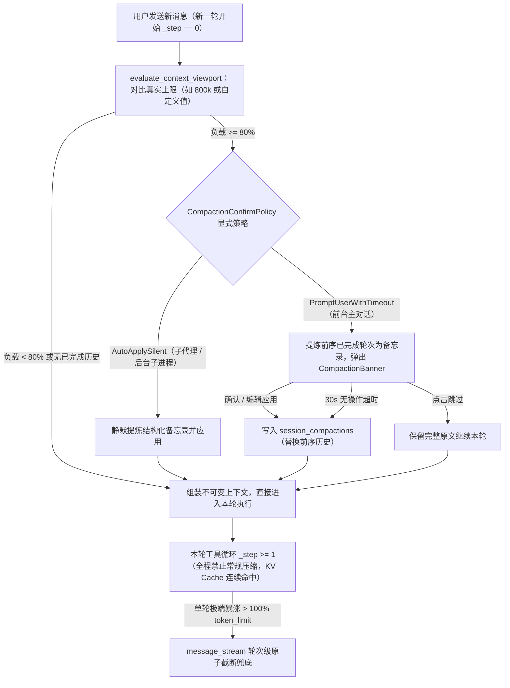

# 不可变前缀缓存、新一轮 80% 上下文压缩治理与步数状态持久化知识文档
(IMMUTABLE_PREFIX_CACHE_AND_TURN_START_COMPACTION_GOVERNANCE_KNOWLEDGE)

| 属性 | 说明 |
| :--- | :--- |
| **文档代号** | `IMMUTABLE_PREFIX_CACHE_AND_TURN_START_COMPACTION_GOVERNANCE_KNOWLEDGE` |
| **关联规范** | [`CONTEXT_COMPACTION_GOVERNANCE_AND_DUAL_TRACK_PIPELINE_KNOWLEDGE.md`](file:///f:/WorkSpace/Other/harness_mini/docs/CONTEXT_COMPACTION_GOVERNANCE_AND_DUAL_TRACK_PIPELINE_KNOWLEDGE.md), [`IMMUTABLE_PREFIX_CACHING_AND_LAYERED_CONTEXT_PIPELINE_KNOWLEDGE.md`](file:///f:/WorkSpace/Other/harness_mini/docs/IMMUTABLE_PREFIX_CACHING_AND_LAYERED_CONTEXT_PIPELINE_KNOWLEDGE.md), [`TOOL_DECAY_HORIZON_AND_SURGICAL_FILE_READING_GOVERNANCE_KNOWLEDGE.md`](file:///f:/WorkSpace/Other/harness_mini/docs/TOOL_DECAY_HORIZON_AND_SURGICAL_FILE_READING_GOVERNANCE_KNOWLEDGE.md) |
| **涉及模块** | [`src-tauri/src/context/message_stream.rs`](file:///f:/WorkSpace/Other/harness_mini/src-tauri/src/context/message_stream.rs), [`src-tauri/src/context/governance.rs`](file:///f:/WorkSpace/Other/harness_mini/src-tauri/src/context/governance.rs), [`src-tauri/src/context/static_system.rs`](file:///f:/WorkSpace/Other/harness_mini/src-tauri/src/context/static_system.rs), [`src-tauri/src/context/mod.rs`](file:///f:/WorkSpace/Other/harness_mini/src-tauri/src/context/mod.rs), [`src-tauri/src/agent.rs`](file:///f:/WorkSpace/Other/harness_mini/src-tauri/src/agent.rs), [`src-tauri/src/memory.rs`](file:///f:/WorkSpace/Other/harness_mini/src-tauri/src/memory.rs), [`src-tauri/src/commands.rs`](file:///f:/WorkSpace/Other/harness_mini/src-tauri/src/commands.rs), [`src-tauri/src/tools/skills_memory_plan.rs`](file:///f:/WorkSpace/Other/harness_mini/src-tauri/src/tools/skills_memory_plan.rs), [`src/components/ContextUsageGauge.tsx`](file:///f:/WorkSpace/Other/harness_mini/src/components/ContextUsageGauge.tsx), [`src/components/ModelContextModal.tsx`](file:///f:/WorkSpace/Other/harness_mini/src/components/ModelContextModal.tsx), [`src/components/SessionSettingsModal.tsx`](file:///f:/WorkSpace/Other/harness_mini/src/components/SessionSettingsModal.tsx) |
| **技术体系** | Radix Tree KV Prefix Caching · Immutable Context Projection · 80% Turn-Start Compaction · Session-Pinned System Baseline · Persistent Step Feedback · Rust · Tauri |
| **创建时间** | 2026-11-10 |
| **核心成效** | 彻底消除客户端全链路 5 处前缀破坏源（开发期实测会话 `d38e61f9` `[PREFIX BROKEN]` 降为 **0 次**，同一推理节点老前缀命中率达 **99.6% ~ 100%**）；建立「80% 真实上限 + 新一轮开始（`_step == 0`）人工确认/30 秒超时自动应用 + 单轮执行期绝对禁止常规压缩」的稳定闭环流程；完成客户端 vs 上游网关路由漂移的数学级边界定界。 |

---

## 一、 现场问题演进与多轮审计复盘

### 1.1 第一阶段故障：生产环境单轮缓存暴跌（`99.1% → 18.1%`）
对生产环境（`F:\Software\HarnessMini\data`）会话 `7ddc31d76f98457ca189c2fa8f431cc7` 解压对比 `llm_requests` 真实报文，确认了三次连续击穿：
1. **单轮内滑动式工具衰减破坏不可变前缀**：[`message_stream.rs`](file:///f:/WorkSpace/Other/harness_mini/src-tauri/src/context/message_stream.rs) 早期实现的 `Tiered Ephemeral Horizon` 在工具组到达 37 组时触发滑窗阈值（`cutoff = 27`），就地将历史索引 `70` 的工具消息从 `3,374` 字符折叠至 `2,555` 字符，直接导致 Seq 90（`99.1%` 命中）到 Seq 92 断崖跌至 **`18.1%`**（仅剩前 `10,624 / 58,844` tokens 命中）。
2. **步数预算与临界预警仅写内存不落库**：`agent.rs` 直接 `messages.push(json!({"role": "user", ...}))` 注入预算提醒，在下一轮重建上下文时凭空消失，破坏尾部连续性且违反标准 Tool-Assistant 协议序列。
3. **自动压缩开关与水位失灵**：`has_checked_compaction` 布尔锁在首步锁死；`800k` 上下文模型在未调整时自动压缩线长期不可达；运行中又曾错误尝试过 `64k` 强行封顶与每 5 步中途静默压缩，结果导致正常探索刚到 `32k~48k`（仅占 `800k` 的 `4%~6%`）就频繁强压，既打碎缓存又打断模型推理连贯性。

### 1.2 第二阶段审计：开发期全会话逐字节审计暴露的隐蔽击穿点
对开发环境（`F:\WorkSpace\Other\harness_mini\.dev-data`）多条实时会话（`43a338fe`、`34b97a5a`、`ecf5d1c7`、`c60dda7f`、`733ac28e`、`9bfcea53`）做逐包比对后，精确定位出客户端最后 2 处隐蔽前缀破坏源以及 1 处上游网关原因：

1. **第 8 步意图门禁内存临时注入（6 个会话中 5 个命中）**：
   - 当只读勘察走到 `_step == 8` 且未建 `todo` / `create_plan` 时，`agent.rs` 仍在内存中临时塞入一条 `user` 角色门禁提醒（`【🛑 第 8 步门禁拦截】`），下一轮重建上下文时消失，导致 `43a338fe`（`seq=21→23`、`seq=44→46`）、`ecf5d1c7` 等会话尾部全数出现 `[PREFIX BROKEN]`。
2. **动态记忆落盘引发 `messages[0]` 从第 0 个 Token 全盘雪崩（`99.2% → 6.8%`）**：
   - 在会话 `34b97a5a`（`/init`）中，第 1 轮调用 `record_memory` 更新了 `.harness/memory/profile.md`；第 2 轮启动（`seq=55`）重算 `sys` 时从磁盘重新加载记忆并直接改写 **`messages[0]`**（从 `7,882` 字符增至 `15,344` 字符），导致从 Token 0 起全前缀作废，命中率从 `99.2%`（`25,856 / 26,077`）暴跌至 **`6.8%`**（`2,048 / 30,181`）。
3. **上游 97 网关（`192.168.200.97:8716`）多节点无粘性路由漂移**：
   - 大量请求在发送报文 **100% 字节完全一致** 的前提下，缓存命中率呈现跳回前前次 `128-token` 块边界或跌为 `0%` 的锯齿形波动（详见第五节实证）。

---

## 二、 核心架构决策与第一性原理取舍

### 2.1 为何废除单轮工具折叠及“两轮后压缩旧工具输出”？
经经济账与推理连贯性双维度评估，在当前架构下**彻底不采用**任何跨轮/单轮原地改写历史工具输出的衰减机制：

| 评估维度 | 原地折叠（单轮滑窗 / 两轮后压缩工具） | 现状：入库即定型 + 新一轮 80% 宏观压缩 |
| :--- | :--- | :--- |
| **KV Cache 经济账** | 第 3 轮修改第 1 轮工具消息，导致**修改点之后与第 2 轮全部缓存作废**。原本仅付 ~10% 缓存价的数万 Token 转为 100% 原价重算，实际费用反贵 5~10 倍且 TTFT 飙升。 | 历史消息 Append-only 字节级恒定；同节点跨步/跨轮老前缀稳定 **99%+ 命中**。 |
| **代码推理质量** | 编码任务常跨 3~5 轮协同修改同一模块，两轮后抹除行号与签名迫使模型反复重读文件，陷入“失忆重读”循环。 | 完整保留近期符号与报错细节；大文件/长日志已在入库前经 [`ingress_normalizer.rs`](file:///f:/WorkSpace/Other/harness_mini/src-tauri/src/context/ingress_normalizer.rs) 首尾折叠定型，不会无限膨胀。 |
| **窗口利用率** | 仅对 ≤ 32k 极小窗口模型有延寿作用（即便如此，直接降低 80% 宏观压缩上限也更健康）。 | 主力模型为 800k 窗口，80% 水位时一次结构化提炼即可整体释放空间。 |

### 2.2 为何不能把 `profile.md / conventions.md` 简单挪到尾部 `runtime_anchor`？
1. **跨会话首步预命中依赖于 `messages[0]`**：实测新开会话（`43a338fe`、`d38e61f9`）的第 1 步 `seq=2`（尚未有任何工具交互）即实现 **`9,216 / 9,333 = 98.7%`** 命中，原因正是 `messages[0]` 位于最前端且跨工作区会话字节级共享。若将 `11,000` 字符的静态记忆挪至每条不同提问的 `user` 消息之后，这段 98.7% 的冷启动缓存共享将直接丧失。
2. **避免多轮重复堆叠与新旧版本冲突**：`runtime_anchor` 机制面向“当轮动态状态”（如活跃 Plan 进度、Top-3 碎记索引），逐轮绑定在每条 `user` 消息上。若将大体积静态记忆放入其中，聊 10 轮就会冗余堆叠 10 份，且一旦中途调用 `record_memory` 改写，上下文中会同时并存多份版本引发“先入为主”的新旧冲突。
3. **最优解——会话级锁定 `messages[0]` + 显式配置指纹校验**：首次运行时将最新记忆注入 `messages[0]` 并持久化锁定到会话分库；同会话内写盘更新记忆不触发重建（新事实已在当前对话的工具调用流内生效），既保住跨会话 98.7% 冷启动命中，又实现同会话记忆**全程仅 1 份、零冗余、零冲突**。

### 2.3 为何暂不全局强制下发 `prompt_cache_key`？
- **有用场景**：OpenAI 官方、OpenRouter（Header 缺失时的粘性回退）、OpenCode Zen 生态支持并依赖 `prompt_cache_key`；DeepSeek 官方静默忽略；Anthropic 使用 `cache_control`。
- **风险场景**：严格执行 Pydantic Schema 校验的原生 vLLM（使用 block hash）、SGLang（使用 `cache_salt`）及部分第三方/私有 MaaS 网关，收到未定义字段 `prompt_cache_key` 会直接返回 **`400 Bad Request: unknown/extra field`**。
- **当前策略**：全协议请求头已统一透传 `x-opencode-session` 与 `x-session-id`；暂不向所有请求体全局强塞 `prompt_cache_key`，未来若针对 OpenAI/OpenRouter 增强，须按白名单端点注入。

---

## 三、 全链路重构详情

### 3.1 执行流只读投影化（[`message_stream.rs`](file:///f:/WorkSpace/Other/harness_mini/src-tauri/src/context/message_stream.rs)）
- 彻底移除 170+ 行 `AssistantToolGroup`、`fold_tool_output`、`apply_decay` 单轮滑动折叠代码。
- [`assemble_execution_context`](file:///f:/WorkSpace/Other/harness_mini/src-tauri/src/context/message_stream.rs#L33) 严格保证历史 `User / Assistant / Tool` 在整个执行生命周期内字节级只读不可变，仅保留超过物理 `token_limit` 时的**轮次级原子截断防护（Turn-based Atomic Pruning）**作为崩溃兜底。

### 3.2 统一、稳定的上下文压缩标准流程（[`governance.rs`](file:///f:/WorkSpace/Other/harness_mini/src-tauri/src/context/governance.rs) & [`agent.rs`](file:///f:/WorkSpace/Other/harness_mini/src-tauri/src/agent.rs) & 前端同步）

核心工程实现：
1. **废除隐式猜态，前后端口径 100% 统一 `80%`**：
   - 在 [`resolve_session_context_limit`](file:///f:/WorkSpace/Other/harness_mini/src-tauri/src/context/governance.rs#L230) 中移除 `.min(64_000)` 硬顶，完整尊重模型能力与用户设置（顺手修复仅配置 `model_id` 而无 `provider_id` 时回落到 `64k` 的边界缺陷）。
   - 定义统一阈值常量 [`COMPACTION_THRESHOLD_PERCENT`](file:///f:/WorkSpace/Other/harness_mini/src-tauri/src/context/governance.rs#L13) (`80%`)，移除原 `75%` 与隐藏的 `candidate_tokens >= limit / 2`（50% 偷跑推荐）分支，且要求 `can_compact == true`；同步将前端 [`ContextUsageGauge.tsx`](file:///f:/WorkSpace/Other/harness_mini/src/components/ContextUsageGauge.tsx)、[`ModelContextModal.tsx`](file:///f:/WorkSpace/Other/harness_mini/src/components/ModelContextModal.tsx)、[`SessionSettingsModal.tsx`](file:///f:/WorkSpace/Other/harness_mini/src/components/SessionSettingsModal.tsx) 的计算线、警戒红线与文案统一改为 `80%`。
2. **仅在新一轮开始时检查（`_step == 0`），运行中绝不打断**：
   - 移除 `agent.rs` 中的 `_step % 5 == 0` 中途检测与冗余 `session:compacted` 广播；
   - 引入显式枚举 [`CompactionConfirmPolicy`](file:///f:/WorkSpace/Other/harness_mini/src-tauri/src/context/governance.rs#L17)（替代原先依靠 `is_run_active` 猜测的逻辑），前台主对话与手动触发（[`trigger_compaction`](file:///f:/WorkSpace/Other/harness_mini/src-tauri/src/commands.rs#L2026)、[`compact_context_tool`](file:///f:/WorkSpace/Other/harness_mini/src-tauri/src/tools/skills_memory_plan.rs#L848)）弹出 `CompactionBanner` 并保留 **30 秒超时默认应用并继续**；无界面子代理/子进程走 `AutoApplySilent`。
3. **摘要质量与取消闭环**：
   - 抽离纯函数 [`format_compaction_history`](file:///f:/WorkSpace/Other/harness_mini/src-tauri/src/context/governance.rs#L85)，补全纯 `tool_calls` 消息的工具名称与参数轨迹提取、按 UTF-8 字符安全截断（工具输出首尾保留）、并增加超长历史“头 20% + 尾 80%”预算保护，避免摘要器自身超限。
   - 在 `agent.rs` 的 [`stop_run`](file:///f:/WorkSpace/Other/harness_mini/src-tauri/src/agent.rs#L277) 中同步清理 `state.compactions`、`snapshot.pending_compaction` 并广播 `compaction:resolved`，防止确认等待期间点停止导致后续压缩被锁死。

### 3.3 会话级 `messages[0]` 基线锁定与步数感知全落库
1. **System Prompt 基线锁定（[`static_system.rs`](file:///f:/WorkSpace/Other/harness_mini/src-tauri/src/context/static_system.rs)）**：
   - 实现 [`compute_system_config_hash`](file:///f:/WorkSpace/Other/harness_mini/src-tauri/src/context/static_system.rs#L347)（基于 `workspace_path`、`session_type`、`subagent_role/task`、`plan_mode`、排序后 `disabled_sops`、`static_project_section`、`static_collab_section` 计算 SHA256，刻意排除 `.harness/memory/*.md`）；
   - 实现 [`resolve_or_freeze_system_prompt`](file:///f:/WorkSpace/Other/harness_mini/src-tauri/src/context/static_system.rs#L380)，将首次底座存入会话分库 `session_kv`（`frozen_system_prompt` / `frozen_system_config_hash`），同会话后续轮次零 IO 直接命中（`fork_session_sharded` 复制 `session_kv` 后分支会话亦天然继承）。
   - 同步理顺 `agent.rs` `run_once` 启动阶段的锁顺序（消除持主库锁跨入 `with_session_db` 的嵌套风险），并修正 `last_user_content` / `ongoing_goal_plan` 误读主库消息而非 `session_db` 的缺陷。
   - 在 [`memory.rs`](file:///f:/WorkSpace/Other/harness_mini/src-tauri/src/memory.rs#L310-L330) 中完善 `record_memory_with_effect` 工具回传语义，明确提示当前基线已缓存锁定、更新在当前对话流立即生效、新会话将全量载入。
2. **步数状态全落库收敛（[`agent.rs`](file:///f:/WorkSpace/Other/harness_mini/src-tauri/src/agent.rs)）**：
   - 彻底删除 `agent.rs` 最后一处内存临时注入（`_step == 8` 门禁 `messages.push`，`rg -n "messages\.push\("` 归零）；
   - 抽离单一职责纯函数 [`build_step_feedback_suffix`](file:///f:/WorkSpace/Other/harness_mini/src-tauri/src/agent.rs#L3241)，统一编排「临界步数紧急预警（最高优先级）」「第 8 步意图门禁拦截」「每 10 步预算感知」，在每步最后一条工具执行结果写入 SQLite 前一并持久化（利用“能走到第 8 步必然经过第 7 步且至少执行过 1 个工具调用”的不变量，确保 100% 覆盖）。

---

## 四、 改造效果实测与客户端/网关边界定界方法论

### 4.1 改造后实测验收（会话 `d38e61f9568f4988aa0bb10b0f52fcbe`，`15:54 ~ 15:59`）
对改造后运行的最新开发会话进行全量报文解压审计：
- **`[PREFIX BROKEN]` 发生次数**：**0 次**（14 次请求全量前缀 `messages`、`tools` 与顶层参数 100% 字节级一致，第 1 轮末包与第 2 轮首包精确满足 `p17['messages'] == p19['messages'][:17]`）。
- **`session_kv` 基线锁定状态**：`frozen_system_prompt`（15,073 字符）与 `frozen_system_config_hash`（64 字节）全程锁定不变。
- **单节点上老前缀真实命中表现（128-token 块边界验证）**：

| 阶段 / 请求序列 | 上一步 `prompt_tokens` | 本步 `cached_tokens` | 本步 `prompt_tokens` | 结论与归属判断 |
| :--- | :---: | :---: | :---: | :--- |
| `seq=2`（新会话第 1 步） | — | `9,216` (`98.7%`) | `9,333` | 跨会话系统基线缓存命中极佳 |
| `seq=5 → 8 → 11 → 14` | `9,333 → 10,110` | `94.1% ~ 98.8%` | `9,798 → 10,271` | 稳定留在节点 A，连续高命中 |
| `seq=14 → 17` | `10,271` | **`9,088` (`59.8%`)** | `15,201` | **网关漂移至节点 B**（倒退回 `71×128 = 9,088` 基础底座） |
| **`seq=17 → 19`（第二轮起步）** | `15,201` | **`10,240` (`58.7%`)** | `17,437` | **网关飘回节点 A**：精准命中 `seq=14` 的 `80×128 = 10,240`，跳过落到节点 B 的 `seq=17`！**证实并非 Agent 破坏** |
| `seq=19 → 24` | `17,437` | **`17,408` (`76.7%`)** | `22,693` | 留在节点 A，**旧前缀命中 99.8%**（占比 76.7% 仅因本步新增 5,256 个新读文件 Token） |
| `seq=24 → 27` | `22,693` | **`9,088` (`36.6%`)** | `24,845` | 2 秒后**再次飘到节点 B** |
| `seq=27 → 30` | `24,845` | **`22,656` (`81.2%`)** | `27,910` | 13 秒后**飘回节点 A**：精准命中 `seq=24` 的 `177×128 = 22,656`，完全跳过 `seq=27` |
| `seq=30 → 32 → 34 → 36` | `27,910 → 37,728` | `27,904 → 37,632` | `31,099 → 44,329` | 稳定留在节点 A，**每步老前缀命中均达 99.6% ~ 100%** |

### 4.2 如何快速区分“Agent 破坏”与“上游网关漂移”？
后续日常排查缓存掉率时，可直接按以下三条铁律定界：
1. **检查 `p_prev['messages'] == p_curr['messages'][:len(p_prev['messages'])]`**：若为 `False`，100% 属客户端前缀篡改（排查动态注入、系统提示变异、历史裁剪）；若为 `True`，客户端绝对清白。
2. **识别“锯齿回跳前前次块边界”指纹**：若请求 $T$ 缓存倒退，而随后的请求 $T+1$ 的 `cached_tokens` 又比请求 $T$ 多出数千上万且恰好对齐请求 $T-1$ 的 $128 \times k$ 块边界，**100% 为上游无共享 KV Cache 的多 Worker 负载均衡漂移**（网关未按 `x-session-id` / `x-opencode-session` 或前缀哈希做粘性路由）。
3. **区分“单步新增分母稀释”与“真掉缓存”**：用 `cached_tokens / prev_prompt_tokens` 衡量老前缀保留率，而非直接拿 `cached_tokens / curr_prompt_tokens` 下结论——当某步单次读入数千 Token 新文件或输出巨型代码编辑工具参数时，新 Token 首轮天然不可缓存，只要 `cached_tokens ≈ align128(prev_prompt_tokens)`，缓存就是满命中的。

---

## 五、 工程验证记录

1. **后端单元测试**：
   - `cargo test --manifest-path src-tauri/Cargo.toml --lib context:: -j 1 -- --nocapture`：**20 passed; 0 failed**（含 `test_compaction_threshold_strict_80_percent_and_no_64k_cap`、`test_format_compaction_history_preserves_tools_and_budget`、`test_resolve_or_freeze_system_prompt_ignores_memory_drift_but_respects_explicit_config`、`test_tool_results_immutable_across_steps` 等）。
   - `cargo test --manifest-path src-tauri/Cargo.toml --lib agent::tests -j 1 -- --nocapture`：**29 passed; 0 failed**（含 `test_build_step_feedback_suffix_gate_budget_and_critical_priority`）。
   - `cargo test --manifest-path src-tauri/Cargo.toml --lib memory::tests -j 1 -- --nocapture`：**10 passed; 0 failed**。
2. **全量编译与类型检查**：
   - `cargo check --manifest-path src-tauri/Cargo.toml`：通过（0 错误）。
   - `npx tsc --noEmit`：通过（0 错误）。
