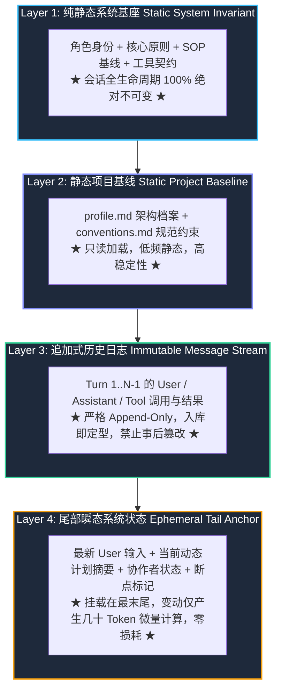
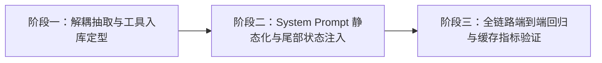

# 长程对话不可变前缀缓存架构与分层上下文流水线技术规范
# (IMMUTABLE_PREFIX_CACHING_AND_CONTEXT_PIPELINE_SPEC)

| 项目 | 内容 |
| --- | --- |
| 文档名称 | 长程对话不可变前缀缓存架构与分层上下文流水线技术规范 (Immutable Prefix Caching & Layered Context Pipeline Specification) |
| 版本 | v1.0 |
| 状态 | 方案确立与实施准备基线 |
| 关联模块 | `src-tauri/src/agent.rs`, `src-tauri/src/context/` (新建), `src-tauri/src/plan.rs`, `src-tauri/src/memory.rs`, `src-tauri/src/store.rs`, `src-tauri/src/models.rs` |

---

## 1. 背景与核心问题复盘

在当前 `harness_mini` 的真实执行链路中，针对大模型（以 DeepSeek-V3 / deepseek-v4.1-flash 为例）的长对话轮次，出现了一次具有代表性的性能断崖：

> **实测数据现象**：
> 在会话 `1df86a8b` 中，上一轮对话刚完成并累积了 13.6 万 Tokens。用户输入新指令：
> *“数据导出，我希望按子节点导出，但是需要在当前子节点的基础上增加列...”*
> 该指令发起的第 1 步思考（Seq 289）耗时高达 **31.7 秒**，`prompt_tokens` 为 **106,433**，而服务端缓存命中 `cached_tokens` 为 **0（0% 命中）**；
> 然而，进入第 2、3、4 步思考后，耗时迅速骤降至 **2.6s ~ 6.8s**，缓存命中数迅速飙升至 **106,880 ~ 116,352 Tokens（93.5% ~ 98.7% 命中）**。

### 1.1 根因剖析：为什么新一轮首步思考必然击穿缓存？

现代推理集群（如 DeepSeek、vLLM、SGLang、OpenCode）采用 **Radix Tree（基数树/前缀树）** 进行 KV Cache 管理。前缀缓存的判定准则是：**从 Token 0 开始，序列必须比特级严格一致；一旦前序任何一个 Token 发生变化，后续所有累积的数十万 Token 缓存全盘报废**。

经对数据库历史请求报文（`llm_requests`）的比对，导致跨轮次缓存被 100% 击穿的核心缺陷有两点：

1. **System Prompt 根节点混入高频动态变量（根部污染）**：
   - 当前系统的 `system_prompt()` 将当前任务计划 Markdown 进度（如 `版本 v3`、`完成度 (8/8)`、勾选状态 `[x]`）和最新知识碎记（`digests`）直接拼入了 `messages[0]`。
   - 上一轮 Agent 刚调用 `update_plan` 或 `record_memory`，就会修改这些内容。
   - 结果：`messages[0]` 在新一轮对话中必定被篡改，导致大模型在 **Token 0 处就发生分支断裂**，前序累积的 10 万+ Tokens 缓存瞬间归零，GPU 必须从头全量做 Prefill 矩阵乘法（耗时 ~30 秒）。
2. **跨轮次事后篡改历史工具消息（中途截断）**：
   - 当前在 `agent.rs:3181` 中存在 `is_historical_turn = m.seq < last_user_seq` 逻辑。
   - 当用户发送新指令导致 `last_user_seq` 推进时，上一轮产生的 17 条工具输出（如无头浏览器交互记录、长执行日志、截图等）被原地改写为 `[浏览器页面交互与渲染已核验完成]` 或强制截断。
   - 这种“跨轮篡改历史消息”的操作，即使根节点不改，也会在中途第 200+ 条消息处再次击穿缓存。

---

## 2. 业界标杆设计哲学：分层不可变上下文流 (Layered Context Pipeline)

参考业内顶尖 Coding Agent（如 Claude Code、Cursor、Aider、Windsurf）的最佳工程实践，长程对话上下文必须遵循两大基本铁律：

1. **“静态在首、追加在中、动态在尾”**：
   - 绝对不可在 Prompt 的前部和中部放置任何可变状态；
   - 动态的、容易变动的状态，必须沉降到上下文的**最末端**（最新 User 消息或尾部附注）。
2. **“历史消息入库即定型，终生不可变（Immutable History）”**：
   - 消息一旦写入数据库和上下文流，其上下文表示形式永久固定，严禁在后续轮次中事后改写其字符。



---

## 3. 四层上下文流水线技术规范

### 3.1 Layer 1: Core System Invariant (纯静态系统前缀)

- **位置**：`messages[0]`（Role: `system`）。
- **内容范畴**：
  - Agent 身份定义（`你是 harness_mini...`）；
  - 操作系统环境与固定工作区根路径；
  - 启用的 SOP 标准工作流规范（方案先行、精益阅读、分级验证等静态文字）；
  - 工具能力契约与思考交付分离准则。
- **强制约束**：
  - **严禁**调用任何可能随轮次变动的函数（严禁读取计划进度、严禁读取动态 digests、严禁读取数据库中断标记）；
  - 同一个 Session 内，无论推进到第几轮，`messages[0]` 的 MD5 哈希值必须保持恒等。

### 3.2 Layer 2: Static Project Baseline (低频静态项目基线)

- **位置**：紧随 System Prompt 或拼接在其稳定尾部。
- **内容范畴**：
  - `profile.md`：项目技术大盘与框架体系（若有）；
  - `conventions.md`：团队工程规范与避坑约定（若有）。
- **强制约束**：
  - 这两个文件属于项目的静态架构知识库，正常对话中极少变动；
  - **剔除**原本在这里提取的 `digests`（因为 digests 会在每一轮探索后被高频刷新）。

### 3.3 Layer 3: Immutable Message Stream (纯追加式对话历史)

- **位置**：`messages[1 .. N-1]`（涵盖前序所有历史回合）。
- **内容范畴**：
  - 用户的原始指令文本与附件图钉；
  - 模型的思考（`reasoning_content`）与回复文本；
  - 工具调用请求与工具执行结果。
- **核心革新（废除 `is_historical_turn`）**：
  - **历史顽疾**：旧逻辑在跨轮时，检测到 `m.seq < last_user_seq` 便事后将工具结果篡改缩水，破坏了已缓存的前缀。
  - **新规范**：**入库定型机制（Ingress Normalization）**。
    - 工具执行完毕后，在其输出**初次进入上下文**时即完成轻量化；
    - 若产生超长输出（如 `run_command` 输出 > 4000 字符），在初次放入该轮消息时即裁定为：`[前 1000 字符] + ... + [后 500 字符] + 完整工件落盘引用`；
    - **一旦形成 Message 存入数据库和上下文数组，其文本永远不再被修改**。
    - 进入下一轮对话时，前序所有历史消息原封不动直接复用。

### 3.4 Layer 4: Ephemeral Tail Anchor (尾部瞬态系统状态注入)

- **位置**：整个 Prompt 的最末尾（`messages.last()`，即当期活跃轮次的 User 消息内部或其紧随的独立标记）。
- **内容范畴**：
  - **当前任务权威计划实时状态**：`20261021-xxx.md (完成度 8/8, status: in_progress)`、当前步骤清单；
  - **近期记忆感知**：最近更新的高价值 digest 摘要索引；
  - **运行时断点恢复提示**：若上一轮被用户中断，在此给出核对提示；
  - **协作者实时忙闲状态**：`collab_a: idle, collab_b: busy`；
  - **特殊指令意图**：用户发送的 `/jev` 门禁决策约束。
- **注入载体与格式规范**：
  在最新一条 User 消息末尾以结构化 XML 标签追加：
  ```markdown
  数据导出，我希望按子节点导出，但是需要在当前子节点的基础上增加列...

  <runtime_environment_anchor>
  ## 📋 当前任务执行计划基准
  - 计划文件: .harness/plans/20261021-医疗纠纷导出改造.md (版本 v3)
  - 当前进度: 完成度 (8/8)
  - 核心步骤清单:
    - [x] 步骤 1: 后端新增明细查询接口
    - ...
  ## ⚡ 实时状态注记
  - 协作者状态: 全部空闲 (可随时委派)
  </runtime_environment_anchor>
  ```
- **核心收益**：
  - 随着步骤从 `[ ]` 变成 `[x]`，**变动的仅仅是末尾这 100~300 个 Token**。
  - 前序完整的 10 万+ Tokens 保持 100% 比特级一致，GPU 显存中保存的 KV 状态直接热命中，TTFT（首字响应时间）直接从 31.7s 下降至 300ms 左右！

---

## 4. 程序代码架构重构规划 (Decoupled Architecture)

为彻底解决 `agent.rs` 达 4,720 行的“巨石代码”问题，杜绝堆叠式修改，将上下文工程全量抽离至专属子模块 `src-tauri/src/context/`：

```
src-tauri/src/
├── agent.rs                   # 精简为纯粹的 ReAct 执行循环、工具调度与事件广播
└── context/                   # [新增] 专职上下文工程模块 (Context Engine)
    ├── mod.rs                 # 统一门面: 导出 build_execution_context 及对外数据结构
    ├── static_system.rs       # Layer 1 & 2: 纯静态系统前缀构建器
    ├── tail_anchor.rs         # Layer 4: 尾部动态感知与运行时状态提取器
    ├── message_stream.rs      # Layer 3: 严格不可变历史流组装器
    └── ingress_normalizer.rs  # 工具输出入库定型器 (彻底替代 is_historical_turn)
```

### 4.1 各子模块职责与接口契约

#### ① `context/static_system.rs`
```rust
/// 纯函数：构建 100% 静态不变的系统基底
/// 仅依赖静态会话配置和工作区只读规范，严禁接入任何动态查询
pub fn build_static_system_prompt(
    session: &crate::models::Session,
    disabled_sops: &[String],
    plan_mode: &str,
) -> String;
```

#### ② `context/tail_anchor.rs`
```rust
/// 收集所有高频变动的动态状态，打包为尾部追加块
pub fn build_tail_runtime_anchor(
    conn: &rusqlite::Connection,
    session: &crate::models::Session,
    last_user_msg: &str,
) -> Option<String>;
```

#### ③ `context/ingress_normalizer.rs`
```rust
/// 工具执行完毕后的入库前轻量化定型器
/// 在写入数据库前就决定最终文本，杜绝事后跨轮次篡改
pub fn normalize_tool_output_for_ingress(
    tool_name: &str,
    raw_output: &str,
    session_id: &str,
) -> String;
```

#### ④ `context/mod.rs`（统一组装门面）
```rust
pub struct ExecutionContext {
    pub messages: Vec<serde_json::Value>,
    pub est_tokens: usize,
    pub truncation_notice: Option<crate::models::TruncationNotice>,
}

pub fn build_execution_context(
    conn: &rusqlite::Connection,
    session: &crate::models::Session,
    token_limit: usize,
) -> Result<ExecutionContext, String>;
```

---

## 5. 分步实施路径 (Phased Implementation Roadmap)

为确保“每次改动后程序结构更清晰、功能更稳定”，实施过程划分为三个独立校验阶段，严禁一次性大跨步重构。



### 阶段一：建立 `context/` 模块与工具输出入库定型
1. **创建 `src-tauri/src/context/` 架构目录**；
2. **实现 `ingress_normalizer.rs`**：
   - 提取原本分散在 `agent.rs` 中的工具截断与收敛逻辑；
   - 保证工具执行产生的文本在存入 `tool_events` 和 `messages` 表时就已经定型；
3. **安全废除 `agent.rs` 中的 `is_historical_turn` 改写逻辑**：
   - 历史消息取出后只读消费，严禁在遍历中重新 `if is_historical_turn { ... }` 替换文本；
4. **验证门禁**：运行 `cargo test` 及现有单元测试，确保旧会话回显正常，工具事件写入无丢失。

### 阶段二：System Prompt 静态化与尾部状态注入（核心性能跨越）
1. **实现 `static_system.rs`**：
   - 从 `system_prompt()` 中剔除 `plan_sec`、`digests`、`last_run_was_interrupted`、`collabs_sec`；
   - 使生成的字符串在整个 Session 生命周期中保持纯静态；
2. **实现 `tail_anchor.rs`**：
   - 将上述动态块格式化为标准 `<runtime_environment_anchor>`；
   - 在构造活跃上下文时，自动追加到最新一条用户指令末尾；
3. **重构 `build_context`**：
   - 替换为 `context::build_execution_context` 统一门面；
4. **验证门禁**：针对多轮带计划任务进行测试，验证模型依然能准确感知计划进度（8/8）和协作者状态，同时比对前后两次 LLM 请求的 `messages[0]` 哈希值完全一致。

### 阶段三：端到端指标验收与可观测性对齐
1. **实测多轮对话**：
   - 模拟连续 5 轮以上的编码任务，包含单步执行、计划更新与记忆沉淀；
2. **指标验收门禁**：
   - **跨轮次首步调用缓存命中率**：由目前的 **0%** 提升至 **≥ 95%**；
   - **首字响应延迟（TTFT）**：由 **31.7s** 骤降至 **≤ 1.5s**；
   - **数据库请求审计**：查看 `llm_requests` 表，验证多轮请求的前缀消息序列（0 .. N-1）完全匹配。

---

## 6. 预期效果与技术红利

| 核心维度 | 当前基线状态 | 规范实施后状态 | 演进价值 |
| :--- | :--- | :--- | :--- |
| **跨轮次首步响应速度** | **31.7 秒** (漫长等待) | **< 1 秒** (即点即思考) | 彻底消除用户端卡顿感与焦虑感 |
| **跨轮首步缓存命中率** | **0%** (完全穿透) | **95% ~ 99%** (几乎全量命中) | 顺应现代推理集群前缀树缓存设计 |
| **API 调用计费成本** | 每次重复支付 10 万+ Input Tokens | 享受大厂 1 折甚至免费的 Cached Token 折扣 | 长期运行降本 80% 以上 |
| **代码架构清晰度** | `agent.rs` 4720 行单文件混杂 | 上下文分层管道独立解耦，单职责纯函数 | 可测性大幅提升，杜绝打补丁式维护 |
