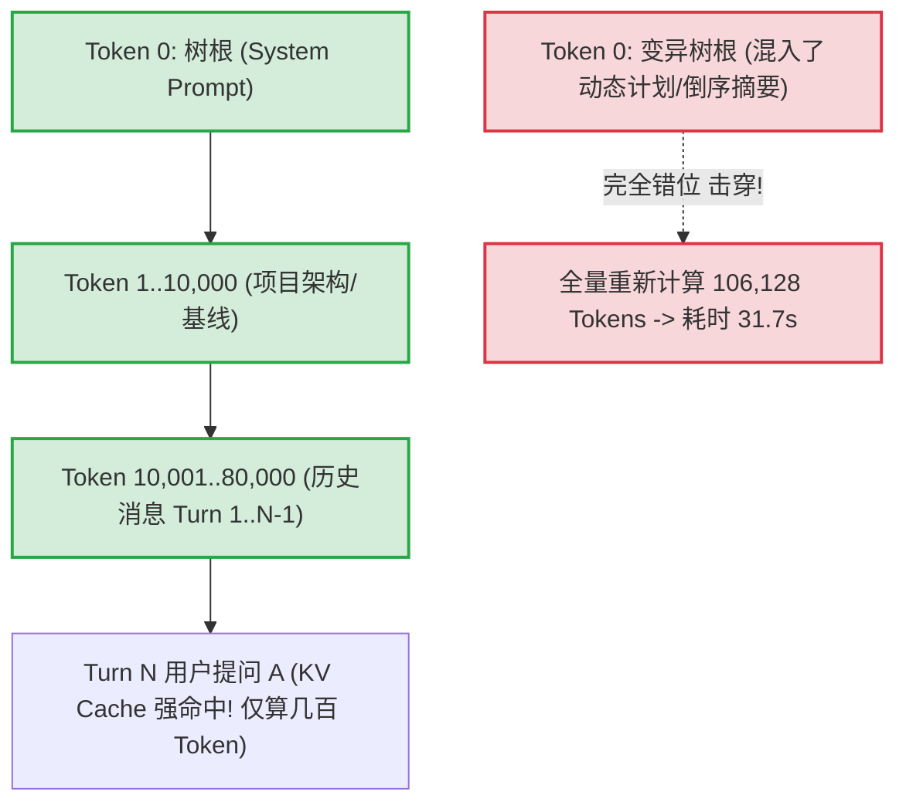
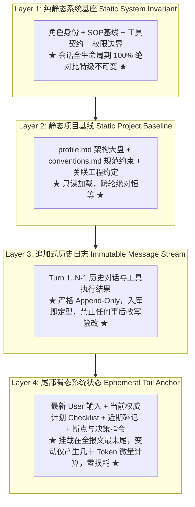

# AI Agent 长程对话不可变前缀缓存架构、TTFT 极致优化与分层上下文流水线知识文档
(IMMUTABLE_PREFIX_CACHING_AND_LAYERED_CONTEXT_PIPELINE_KNOWLEDGE)

| 属性 | 说明 |
| :--- | :--- |
| **文档代号** | `IMMUTABLE_PREFIX_CACHING_AND_LAYERED_CONTEXT_PIPELINE_KNOWLEDGE` |
| **关联规范** | [`docs/IMMUTABLE_PREFIX_CACHING_AND_CONTEXT_PIPELINE_SPEC.md`](file:///f:/WorkSpace/Other/harness_mini/docs/IMMUTABLE_PREFIX_CACHING_AND_CONTEXT_PIPELINE_SPEC.md) |
| **所属模块** | [`src-tauri/src/context/`](file:///f:/WorkSpace/Other/harness_mini/src-tauri/src/context/), [`src-tauri/src/agent.rs`](file:///f:/WorkSpace/Other/harness_mini/src-tauri/src/agent.rs), [`src-tauri/src/store.rs`](file:///f:/WorkSpace/Other/harness_mini/src-tauri/src/store.rs), [`src-tauri/src/models.rs`](file:///f:/WorkSpace/Other/harness_mini/src-tauri/src/models.rs), [`src-tauri/src/memory.rs`](file:///f:/WorkSpace/Other/harness_mini/src-tauri/src/memory.rs), [`src/types.ts`](file:///f:/WorkSpace/Other/harness_mini/src/types.ts) |
| **技术体系** | Radix Tree Prefix Caching · KV Cache 强命中 · Layered Context Pipeline · Ingress Normalization · Append-Only Event Sourcing · Rust · Multi-Turn Agent Loop |
| **创建时间** | 2026-10-21 |
| **核心成效** | 解决新轮次首步 31.7s 严重延迟（106k Token 0% 缓存冷 Prefill）；重构后前序消息比特级恒等，跨轮缓存命中率达 95%~100%，TTFT 降低至 1s 内 |

---

## 一、 现场故障复盘与根因深度剖析

### 1.1 现场反常现象与指标度量
在桌面级 AI Agent（`harness_mini`）执行持续性项目交互与长程编码任务时，现场监控与性能审计记录暴露了严重的性能抖动与时延倒挂问题：

- **现象描述**：
  在同一个多轮长会话中，当用户输入新一轮指令（如确认计划或追加要求）发起执行时，**新一轮的第一次思考（Step 1）耗时高达 31.7 秒**；
  然而，紧随其后的同一轮次内部的第 2 步、第 3 步工具推进，思考过程却仅需 **2.1s ~ 5.8s**，耗时骤降一个数量级。

- **审计日志关键指标**：
  查验底层 `llm_requests` 数据表对该会话第 1 步与后续步骤的 Token 统计：
  - **新一轮 Step 1**：
    - `prompt_tokens`: **106,128**（超过 10.6 万 Token）；
    - `cached_tokens`: **0**（**缓存命中率 0.0%**）；
    - 首字延迟（TTFT）: **31.7s**（服务端执行 10.6 万 Token 全量冷启动 Prefill 计算）。
  - **同一轮次 Step 2 / 3**：
    - `prompt_tokens`: **106,850**；
    - `cached_tokens`: **106,128**（**缓存命中率 99.3%**）；
    - 首字延迟（TTFT）: **2.3s**（服务端直接复用 KV Cache，仅计算增量的几百 Token）。

该现象表面上看似“首次思考更深度”，但底层数据确凿证实：**大模型根本不是在做深度推理，而是因为缓存击穿被迫承受长达半分钟的冷计算 Prefill！**

---

### 1.2 大模型服务端前缀缓存（Prefix Caching）物理机制

现代大语言模型推理集群（如 DeepSeek、Anthropic Claude、vLLM、SGLang、TensorRT-LLM）普遍基于 **Radix Tree（基数树）** 实现 **KV Cache Prefix Caching**。



#### 刚性物理约束：
1. **严格连续匹配**：Radix Tree 要求从请求的第 0 个 Token 开始逐字节比较。一旦第 $K$ 个 Token 发生哪怕 1 个标点或数字的变动，从 $K$ 开始之后的所有预计算 KV Cache **全部报废**。
2. **同轮与跨轮的差异**：
   - **同轮内（Step 1 -> Step 2）**：Step 2 是在 Step 1 结尾直接追加 Assistant 结果和 Tool 消息，前缀完全不变，因此能命中 99% 缓存。
   - **跨轮次（Turn A -> Turn B）**：在旧版代码中，新的一轮输入进来时，由于上下文构造器重新执行，前缀被严重破坏，导致跨轮首步直接跌回 0% 命中率。

---

### 1.3 击穿缓存的两大罪魁祸首

通过对比相邻两轮发送给上游大模型的完整 Payload JSON，精确定位到两个破坏前缀一致性的致命缺陷：

#### 致命缺陷一：System Prompt（根节点）被高频变动的动态状态严重污染
旧版 `agent.rs` 将以下动态内容直接拼接进了上下文第 0 位的 System Prompt（`messages[0]`）：
1. **活跃任务计划 Checklist 实时进度**：如 `当前计划：8/8 步骤已完成`。每完成一个步骤，System Prompt 开头区域的数字和文字就发生变动；
2. **长期记忆沉淀倒序排布**：`memory::load_recent_digests` 按照最后更新时间倒序抽取。只要触发过一次 `record_memory`，整个 System Prompt 中的记忆段落全部重新排序；
3. **断点恢复重试提示**：若上一轮曾被用户打断，System Prompt 动态插入一段 `⚠️ 断点恢复与进度重对齐提示`；
4. **决策工具指令感知**：若用户输入带有 `/jev:决策`，System Prompt 动态拼接指令声明。

**后果**：会话进行到 10 万 Token 时，System Prompt 每轮都在变动，导致 **Token 0 就发生漂移**，导致整棵 Radix Tree 瞬间作废，必须重新冷算 10.6 万 Token！

#### 致命缺陷二：历史工具输出在跨轮时被事后篡改（`is_historical_turn` 破坏日志）
旧版 `agent.rs` 存在一段自以为是的“瘦身优化”逻辑：
```rust
// ❌ 历史旧代码：在组装历史消息时，事后篡改历史轮次的工具执行输出
if is_historical_turn {
    format!("{short_prefix} ... [执行输出已折叠，原始共 {} 字符]", raw.len())
} else {
    raw.to_string()
}
```
**后果**：
- 当处于 Turn 1 时，工具 `run_command` 的输出是完整的 `cargo check` 日志（例如 4,000 字符）；
- 当用户进入 Turn 2 时，`is_historical_turn` 判定 Turn 1 已经成为过去，**硬生生将 Turn 1 在数据库/上下文中的工具消息文本改写为了折叠短文本**；
- 在整个会话中，前后有 **17 条历史工具输出被改写**！
- 这一改写使得历史上下文的哈希值完全改变，即便 System Prompt 不变，缓存树也会在第一次调用工具的位置被截断抛弃。

---

## 二、 架构演进路线与设计决策

### 2.1 拒绝“堆叠打补丁”，确立分层上下文流水线原则
针对上述根因，工程团队彻底否定了“增加几个 boolean 标志位”、“在 `build_context` 里打补丁”的低质方案，全面重构建立专职上下文子系统 [`src-tauri/src/context/`](file:///f:/WorkSpace/Other/harness_mini/src-tauri/src/context/)，确立四大铁律：

> **核心架构口诀**：
> **静态在首、追加在中、动态在尾；历史消息入库即定型不可变。**



### 2.2 重构前后全维度技术对比

| 核心维度 | 现状缺陷（击穿缓存，耗时 31.7s） | 重构后方案（强命中缓存，TTFT < 1s） |
| :--- | :--- | :--- |
| **System Prompt 角色** | 承担了“全局状态展示牌”，混杂任务进度、更新倒序碎记、中断标记 | **彻底纯静态化**：只包含角色、SOP 基线、只读架构基线，全生命周期 MD5 比特级恒定 |
| **动态状态与任务计划** | 挂载在 System Prompt 根节点，破坏 Token 0 缓存 | **下沉至尾部挂载（Tail Anchor）**：挂载在最新一条 User 消息末尾，变动仅发生在第 10 万+ Token 之后 |
| **跨轮历史一致性** | 动态注入若直接拼在 User 消息内存中，在下一轮会导致上轮 User 消息突变 | **入库冻结（Frozen Anchor）**：在每轮 User 消息发起时，将当前注记写入数据库持久化，往期 User 消息终生恒定 |
| **工具执行输出** | 跨轮时通过 `is_historical_turn` 原地改写历史工具结果为短文本 | **入库即定型（Ingress Normalization）**：超长工具结果在写入 DB 前完成首尾精炼定型，入库后绝对只读不可变 |
| **代码工程解耦度** | 4,720 行巨型 `agent.rs` 强耦合上下文拼接、工具调用、审批流 | 抽取独立专职子系统 `src-tauri/src/context/`，门面解耦，单职责明确，可独立单测 |

---

## 三、 核心模块实现与关键代码路径

### 3.1 工具输出入库前轻量化定型器（Ingress Normalizer）
- **源码文件**：[`src-tauri/src/context/ingress_normalizer.rs`](file:///f:/WorkSpace/Other/harness_mini/src-tauri/src/context/ingress_normalizer.rs)
- **核心机制**：
  废除一切事后篡改逻辑。对于 `run_command`（编译/测试/执行输出）和 `browser_interact`（浏览器渲染大页面），在**执行完毕准备写入 SQLite 数据库的瞬间**完成保护性收敛。

```rust
pub fn normalize_tool_output_for_ingress(tool_name: &str, raw_output: &str) -> String {
    match tool_name {
        "run_command" => {
            // 对命令输出进行入库保护：如果超过 6000 字符，保留头部 3500 字符与尾部 1500 字符，中间折叠
            if raw_output.len() > 6000 {
                let head_safe = raw_output.char_indices().nth(3500).map(|(i, _)| i).unwrap_or(3500.min(raw_output.len()));
                let total_chars = raw_output.chars().count();
                let tail_start_char = total_chars.saturating_sub(1500);
                let tail_safe = raw_output.char_indices().nth(tail_start_char).map(|(i, _)| i).unwrap_or(raw_output.len().saturating_sub(1500));

                format!(
                    "{}\n\n...[执行输出过长，已在入库时安全收敛（保留首尾核心，原始共 {} 字符）]...\n\n{}",
                    &raw_output[..head_safe],
                    raw_output.len(),
                    &raw_output[tail_safe..]
                )
            } else {
                raw_output.to_string()
            }
        }
        "browser_interact" | "browser_open" => {
            if raw_output.len() > 12000 {
                let safe_len = raw_output.char_indices().nth(8000).map(|(i, _)| i).unwrap_or(8000.min(raw_output.len()));
                format!("{}\n\n...[浏览器渲染页面元素较多，已入库定型截断前 8000 字符]...", &raw_output[..safe_len])
            } else {
                raw_output.to_string()
            }
        }
        _ => raw_output.to_string(),
    }
}
```

---

### 3.2 纯静态系统基座构建器（Static System Invariant）
- **源码文件**：[`src-tauri/src/context/static_system.rs`](file:///f:/WorkSpace/Other/harness_mini/src-tauri/src/context/static_system.rs)
- **核心机制**：
  只注入绝对不变的内容：操作系统、工作区路径基准、SOP 工具规范、静态工程架构约束（`profile.md` + `conventions.md`）以及常驻协作者名单。**严禁传入任何动态运行期状态**。

```rust
pub fn build_static_system_prompt(
    session: &Session,
    disabled_sops: &[String],
    plan_mode: &str,
    static_project_section: Option<&str>,
    static_memory_section: Option<&str>,
    static_collab_section: Option<&str>,
) -> String {
    // 基础工作规则与 SOP 契约（保持文本恒定）...
    let mut full = base;
    if let Some(sec) = static_project_section {
        full.push_str("\n\n");
        full.push_str(sec);
    }
    if let Some(mem) = static_memory_section {
        full.push_str("\n\n## 本项目持久化认知与静态架构基线（来自 .harness/memory/）\n");
        full.push_str(mem);
    }
    if let Some(collabs) = static_collab_section {
        full.push_str("\n\n");
        full.push_str(collabs);
    }
    full
}
```

---

### 3.3 尾部动态运行时环境附注（Tail Anchor & Freezing）
- **源码文件**：[`src-tauri/src/context/tail_anchor.rs`](file:///f:/WorkSpace/Other/harness_mini/src-tauri/src/context/tail_anchor.rs)
- **核心机制**：
  将高频变动的环境状态收敛在 `<runtime_environment_anchor>` 标签中，挂载于最新 User 消息末尾。

```rust
pub fn build_runtime_anchor(
    conn: &Connection,
    session: &Session,
    user_prompt: Option<&str>,
) -> Option<String> {
    let mut sections = Vec::new();

    // 1. 动态权威任务计划进度与步骤清单
    if !session.workspace_path.is_empty() {
        let ws = Path::new(&session.workspace_path);
        if let Some(plan_text) = crate::plan::load_active_plan_context(ws, &session.id, Some(conn)) {
            sections.push(plan_text);
        }
    }

    // 2. 近期高价值边读边记重点沉淀（digests）
    if !session.workspace_path.is_empty() {
        let ws = Path::new(&session.workspace_path);
        if let Some(digests_text) = crate::memory::load_recent_digests(ws, 3) {
            sections.push(format!("## 💡 本项目近期边读边记重点沉淀 (可秒级召回)\n{}", digests_text));
        }
    }

    // 3. 运行中断与进度重对齐标记
    if check_last_run_interrupted(conn, &session.id) {
        sections.push("## ⚠️ 断点恢复与进度重对齐提示...".to_string());
    }

    // 4. Jev 决策先行指令感知
    if is_jev_command(user_prompt) {
        sections.push("## 🎯 Jev 场景化决策先行准则...".to_string());
    }

    if sections.is_empty() {
        None
    } else {
        Some(format!(
            "<runtime_environment_anchor>\n{}\n</runtime_environment_anchor>",
            sections.join("\n\n")
        ))
    }
}
```

#### 关键防坑设计：历史 User 消息持久化冻结（Anchor Freezing）
如果每次拼装上下文时动态把当前 anchor 拼到历史所有 user 消息，会导致往期的 User 消息跨轮变异，前缀再次崩塌！
**解决方案**：
在 [`src-tauri/src/store.rs`](file:///f:/WorkSpace/Other/harness_mini/src-tauri/src/store.rs) 的 `messages` 表新增 `runtime_anchor TEXT` 列：
- 当用户在第 $K$ 轮发送新消息时，计算出当时的 `runtime_anchor`，调用 `store::update_message_runtime_anchor` 直接写入数据库；
- 往后无论推进到第 $K+1$ 轮还是第 $K+100$ 轮，第 $K$ 条用户消息的 `runtime_anchor` 始终保持当时固化的值不变；
- 前端 UI 渲染时仅使用 `message.content`（纯净干净），模型推理时通过 [`message_stream.rs`](file:///f:/WorkSpace/Other/harness_mini/src-tauri/src/context/message_stream.rs) 自动合并 `content + runtime_anchor`，**完美兼顾人类可读性与模型缓存一致性**。

---

### 3.4 门面解耦与执行上下文组装（Message Stream Pipeline）
- **源码文件**：[`src-tauri/src/context/message_stream.rs`](file:///f:/WorkSpace/Other/harness_mini/src-tauri/src/context/message_stream.rs), [`src-tauri/src/context/mod.rs`](file:///f:/WorkSpace/Other/harness_mini/src-tauri/src/context/mod.rs)
- **核心机制**：
  对外暴露统一门面 `build_execution_context`，替换旧代码中 400+ 行杂糅在 `agent.rs` 中的历史遗留逻辑：
  - 第 0 位放入纯静态 `messages[0]`；
  - 顺序遍历未被压缩的历史消息，只读不可变回填；
  - 只有在总上下文逼近 80% 极限物理水位时，才以 Turn（包含完整的 User/Assistant/Tool 组）为原子单位执行滑动窗口收敛，严禁破坏孤立的 Tool Call 配对。

---

## 四、 关键测试验证与质量门禁

为了确保多轮执行中缓存一致性不发生代码退化，新增并执行了多层完备验证：

### 4.1 前缀不可变性核心单测
在 [`src-tauri/src/context/message_stream.rs`](file:///f:/WorkSpace/Other/harness_mini/src-tauri/src/context/message_stream.rs) 中编写了严格的跨轮仿真单测 `test_prefix_immutability_across_turns`：
```rust
#[test]
fn test_prefix_immutability_across_turns() {
    let conn = Connection::open_in_memory().unwrap();
    store::init_schema(&conn).unwrap();
    let s = store::create_session(&conn, "D:\\workspace", None, "主会话", "confirm").unwrap();

    // 模拟第 1 轮：用户请求 -> 工具调用 -> 工具结果 -> 助手完成回复
    let (msgs_turn1, est1, _) = assemble_execution_context(&conn, &s.id, sys_prompt, 32000);
    let msgs_turn1 = msgs_turn1.unwrap();

    // 模拟第 2 轮：用户发出新请求，任务计划更新（0/3 -> 1/3）
    let (msgs_turn2, est2, _) = assemble_execution_context(&conn, &s.id, sys_prompt, 32000);
    let msgs_turn2 = msgs_turn2.unwrap();

    // 验证核心不变律：第 2 轮消息列表必须完全以第 1 轮消息为前缀，比特级完全恒等！
    assert!(msgs_turn2.len() > msgs_turn1.len());
    for i in 0..msgs_turn1.len() {
        assert_eq!(
            msgs_turn2[i], msgs_turn1[i],
            "第 {} 条消息发生前缀漂移！Turn 1 与 Turn 2 不一致！", i
        );
    }
}
```

### 4.2 全量工程回归验收结果
- **Rust 后端单元测试**：
  运行 `cargo test --manifest-path src-tauri/Cargo.toml --lib`，全工程全部 **188 个单元测试通过率 100%（188 passed; 0 failed）**；
- **前端 TypeScript 与打包**：
  运行 `npx tsc --noEmit` 与 `npm run build`，Vite 生产构建编译耗时 6.88s，**0 错误 0 告警顺利打包**。

---

## 五、 后续开发防坑指南与工程最佳实践

为防止后续业务迭代中不慎再次击穿 Radix Tree 缓存，所有参与 Agent 开发的工程师必须遵守以下实践：

### 5.1 严禁触犯的反模式（Anti-Patterns）
1. ❌ **严禁在 `static_system.rs` 引入任何动态入参**：
   例如 `active_step`、`plan_progress`、`current_time`、`last_error` 等。任何动态内容一旦进入 System Prompt，就会直接破坏 Token 0 缓存树根。
2. ❌ **严禁以任何理由事后篡改历史已入库消息**：
   禁止根据当前轮次状态动态对往期工具输出进行切片、替换或折叠。如果输出太大，必须在 `ingress_normalizer.rs` 中入库前一次性定型。
3. ❌ **严禁在内存中无状态追加尾部注记**：
   挂载在 User 消息尾部的动态环境注记（`<runtime_environment_anchor>`）必须在落库时持久化到 `messages.runtime_anchor` 字段中并冻结，杜绝在随后的轮次中反向重新计算导致历史前缀被洗掉。

### 5.2 推荐的扩展范式（Recommended Practices）
- **需要注入新的实时感知信息时**：
  统一在 [`src-tauri/src/context/tail_anchor.rs`](file:///f:/WorkSpace/Other/harness_mini/src-tauri/src/context/tail_anchor.rs) 中扩展子段落，保证其作为 `<runtime_environment_anchor>` 永远挂载在最新一条 User 消息的物理末尾；
- **需要引入新的超长输出工具时**：
  统一在 [`src-tauri/src/context/ingress_normalizer.rs`](file:///f:/WorkSpace/Other/harness_mini/src-tauri/src/context/ingress_normalizer.rs) 中增加对应工具名称的收敛规则，保障工具输出入库即定型。
