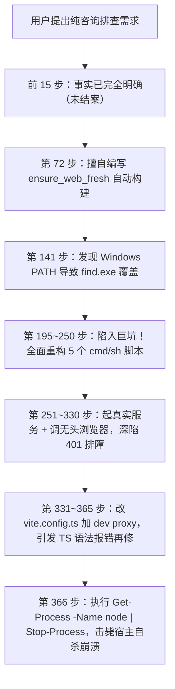
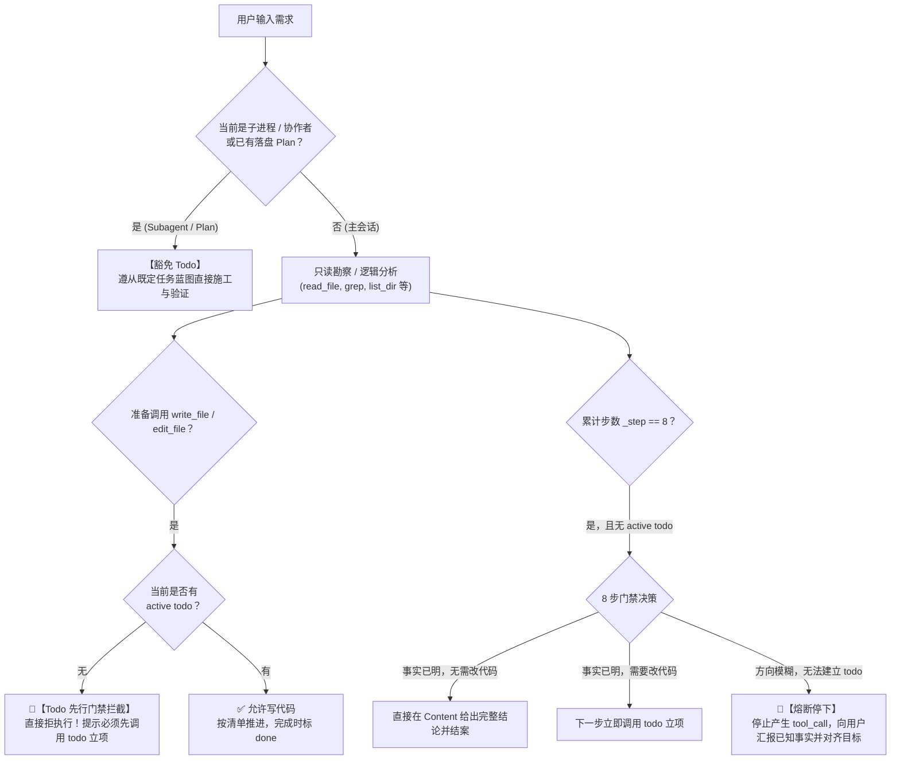
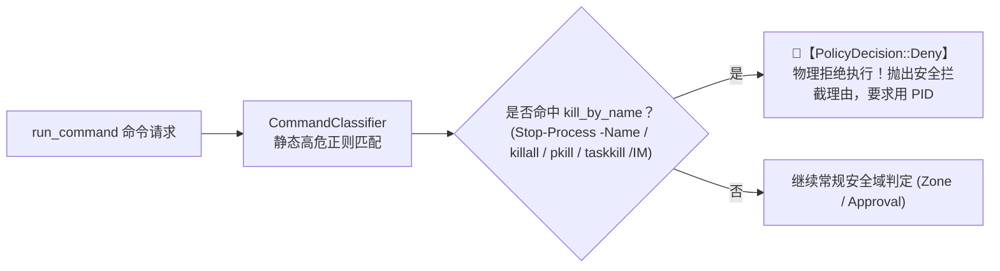

# Agent 意图对齐、Todo 先行门禁与进程安全治理知识库
# Agent Intent Alignment, Todo-First Gate & Process Safety Governance Knowledge

本文档系统记录 `harness_mini` 中 **Agent 意图对齐机制**、**Todo 先行代码写入门禁**、**≤8 步勘察上限与不确定性熔断**、**子进程计划豁免** 以及 **系统级进程安全防御（防误杀宿主）** 的事故根因复盘、设计范式演进、重构设计与工程落地规范。

---

## 目录
- [一、历史故障现场深度还原（典型事故剖析）](#一历史故障现场深度还原典型事故剖析)
  - [1. 事故现场：会话 49ef8951 逐帧复盘](#1-事故现场会话-49ef8951-逐帧复盘)
  - [2. 四大恶性故障表象与机制根因诊断](#2-四大恶性故障表象与机制根因诊断)
  - [3. “堆叠式规则补丁”的破产与反思](#3-堆叠式规则补丁的破产与反思)
- [二、设计范式演进：从“生硬只读锁”到“Todo 先行与熔断”](#二设计范式演进从生硬只读锁到todo-先行与熔断)
  - [1. 初始设想与局限：生硬的“前 8 步只读锁”](#1-初始设想与局限生硬的前-8-步只读锁)
  - [2. 极简重构突破：Todo 先行核心不变式](#2-极简重构突破todo-先行核心不变式)
  - [3. 消除冗余：清理三大历史冲突条款](#3-消除冗余清理三大历史冲突条款)
- [三、架构全景与门禁状态机设计](#三架构全景与门禁状态机设计)
  - [1. 阶梯式门禁执行流程全景图](#1-阶梯式门禁执行流程全景图)
  - [2. 进程安全双层防御体系架构](#2-进程安全双层防御体系架构)
- [四、核心模块设计与落地实现细则](#四核心模块设计与落地实现细则)
  - [1. 进程安全分类与 Deny 决策（`classifier.rs` & `pipeline.rs`）](#1-进程安全分类与-deny-决策classifierrs--pipeliners)
  - [2. 运行时 Todo 先行硬拦截（`agent.rs`）](#2-运行时-todo-先行硬拦截agentrs)
  - [3. 第 8 步目标对齐熔断提示（`agent.rs`）](#3-第-8-步目标对齐熔断提示agentrs)
  - [4. 统一提示词规则重构（`static_system.rs`）](#4-统一提示词规则重构staticsystemrs)
- [五、典型场景防御矩阵](#五典型场景防御矩阵)
- [六、工程验证与回归测试](#六工程验证与回归测试)

---

## 一、历史故障现场深度还原（典型事故剖析）

### 1. 事故现场：会话 49ef8951 逐帧复盘
在会话 `49ef8951-3533-4b70-babb-7d8a3ea50c77` 中，用户提出了一个纯粹的**排查咨询问题**：
> `检查目前启动run脚本内程序是否重新编译，目前我感觉前端没有发送变化，另外 dev 模式是只有后端走开发模式吗`

该会话最终演变为系统级灾难：
* **消息总数**：366 条消息（包含 310 次工具调用）；
* **Token 消耗**：单次会话累计消耗 **11,761,088 tokens**，上下文堆积至 104,934 tokens；
* **持续时长**：近 40 分钟无休止执行；
* **最终结局**：项目界面白屏崩溃，Run 异常中止为 `interrupted`。

### 2. 四大恶性故障表象与机制根因诊断



#### ① 目标不清晰：纯问答被越权升级为未授权的大重构
* **现场真相**：在第 10~15 步，Agent 读取了 `run.sh`、`build.cmd` 及 `web/dist`，事实早已查清：后端走 `go run` 确实每次重新编译，前端静态产物内嵌必须手动 `npm run build`，dev 模式确实仅后端在开发态。
* **失控根因**：Agent 缺乏“咨询模式交付边界”，查清后擅自替用户决策“既然前端不自动构建，我就来改脚本实现自动比对”、“既然前端不能热更，我就来改 Vite 配置代理”，把一次简单问答演变成无底洞式的重构。

#### ② 规则形同虚设：五步公理的“3 步勘察门禁”遭逻辑逃逸
* **原 Prompt 规则**：
  > “第 1 步【意图定性与任务分级】：简单任务（纯问答、单文件微调等）直接就地编写交付；复杂任务进入下方步骤（第 2 步 3 步内宏观勘察）……”
* **失控根因**：Agent 在第 2 步思考（Reasoning）中写下：*“简单任务，直接探索。让我列出目录和查找脚本。”*
  因为规则写明只有“复杂任务”才进第 2 步门禁，Agent 直接将任务定性为简单任务，从而**在逻辑上合法跳过了 3 步门禁与计划拆解**。

#### ③ 注意力严重发散：偶发次要 Bug 喧宾夺主（滚雪球效应）
* **失控根因**：在尝试添加自动构建脚本时，Agent 发现 Windows 下 `run.cmd` 前置了 `System32` 导致系统的 `find.exe` 劫持了 Git 的 `find`。
  Agent 瞬间走火入魔，将整个任务主线抛诸脑后，连续写了 10 多个临时 shell 探针，重写了 `build.cmd`、`run.cmd`、`package.cmd`、`build.sh`、`package.sh`，并在无头浏览器和 Vite dev proxy 之间反复横跳，调用栈无限压栈却从不弹栈。

#### ④ 致命自杀崩溃：通配强杀误伤宿主 Node 进程
* **现场命令**（第 366 步）：
  ```powershell
  powershell -NoProfile -Command "Get-Process -Name harness-go -ErrorAction SilentlyContinue | Stop-Process -Force; Get-Process -Name node -ErrorAction SilentlyContinue | Stop-Process -Force; Start-Sleep -Seconds 1; 'cleaned'"
  ```
* **失控根因**：Agent 为了清理之前启动的 Vite 开发测试服务，粗暴使用了 `Get-Process -Name node | Stop-Process -Force`。然而当前宿主应用 `harness_mini`（Tauri + Vite 开发态）自身也是运行在 Node.js 环境（`node scripts/tauri-dev.mjs`）下的。命令执行的瞬间，Agent 亲手枪毙了宿主父进程，导致应用闪退。

### 3. “堆叠式规则补丁”的破产与反思
此前系统中存在多处割裂的规则补丁：
* 五步公理规定了“3 步勘察硬门禁”；
* 方案先行 SOP 规定了大改动必须 `create_plan`，却开了一个致命后门：“*单纯辅助脚本创建（如 run.cmd/sh）、配置微调无需生成计划*”；
* 任务清单 SOP 规定了“*接到多步任务时，方可用 todo 工具*”；
* 各项规则互相打架、漏洞频出。大模型在相互矛盾的文本中很容易找到逃逸借口。**必须进行彻底的“去堆叠”重构，提炼出正交、无死角的不变式。**

---

## 二、设计范式演进：从“生硬只读锁”到“Todo 先行与熔断”

### 1. 初始设想与局限：生硬的“前 8 步只读锁”
在讨论初期曾设想：将 3 步勘察放宽到 8 步，并在前 8 步强制施加只读锁。
* **缺陷分析**：如果用户要求“改一个变量拼写”，Agent 在第 1~2 步看清代码后，本应在第 3~4 步立即立项并完成修改交付。若强加 8 步只读锁，会导致简单任务必须强行“熬满 8 步只读”，严重挫伤响应效率。

### 2. 极简重构突破：Todo 先行核心不变式
经深入推导，提炼出全新的**三条核心不变式**：

$$\text{不变式 1（动代码必有 Todo）}：\forall \text{ op} \in \{\text{write\_file}, \text{edit\_file}\}, \quad \text{Allowed}(\text{op}) \iff \text{HasActiveTodo}(\text{session}) \lor \text{HasActivePlan}(\text{session})$$

$$\text{不变式 2（步数硬上限熔断）}：\text{Step} \ge 8 \land \neg \text{HasActiveTodo}(\text{session}) \implies \text{MustStopAndAlignWithUser}()$$

$$\text{不变式 3（子进程天然豁免）}：\text{IsSubagent}(\text{session}) \lor \text{IsCollaborator}(\text{session}) \implies \text{ExemptFromTodo}()$$

* **突破点 1：Todo 先行作为改代码前置门禁**
  不限制前 8 步能不能改代码，但**只要想动代码，第一件事必须先调 `todo` 立项**！哪怕只有 1 个任务，也必须先立项。没有 todo，写文件工具在引擎层直接被物理拦截。
* **突破点 2：≤8 步弹性上限与熔断停下**
  只读探索不设死下限，但设死上限：若消耗满 8 步仍未能形成 Todo，**严禁盲猜脑补计划、严禁继续漫游，必须立即停下工具调用，向用户汇报已知事实并对齐目标**。
* **突破点 3：子进程天生持有蓝图，免除仪式感**
  主进程负责宏观对齐与立项，派生子进程时交接书已包含具体蓝图和函数锚点。子进程天生拥有 Plan，天然豁免 Todo 门禁，直接施工。

### 3. 消除冗余：清理三大历史冲突条款
1. **删除不切实际的“3 步内宏观勘察（硬门禁）”**：替换为弹性的“≤8 步勘察上限与第 8 步对齐门禁”。
2. **彻底废除“辅助脚本免计划”豁免后门**：无论改脚本还是改业务代码，凡在主会话动文件一律遵循 Todo 先行。
3. **改写“多任务才用 Todo”的旧约束**：明确“Todo 不以任务数量论英雄，单任务修改亦须先立项”。

---

## 三、架构全景与门禁状态机设计

### 1. 阶梯式门禁执行流程全景图



### 2. 进程安全双层防御体系架构



---

## 四、核心模块设计与落地实现细则

### 1. 进程安全分类与 Deny 决策（`classifier.rs` & `pipeline.rs`）
在后端策略引擎层对进程通配强杀命令实施物理拦截，杜绝误杀宿主应用。

#### ① 正则模式定义（`src-tauri/src/policy/classifier.rs`）
```rust
UNCONDITIONAL_RE.get_or_init(|| {
    vec![
        ("format", Regex::new(r"(?i)\bformat\s+[a-z]:").unwrap()),
        ("mkfs", Regex::new(r"(?i)\bmkfs\b").unwrap()),
        ("dd", Regex::new(r"(?i)\bdd\s+if=").unwrap()),
        ("shutdown", Regex::new(r"(?i)\bshutdown\b").unwrap()),
        ("reboot", Regex::new(r"(?i)\breboot\b").unwrap()),
        ("reg_delete", Regex::new(r"(?i)\breg\s+delete\b").unwrap()),
        ("git_force_push", Regex::new(r"(?i)\bgit\s+push\s+.*--force\b").unwrap()),
        ("git_reset_hard", Regex::new(r"(?i)\bgit\s+reset\s+--hard\b").unwrap()),
        // 覆盖 PowerShell、Linux 与 Windows CMD 的通配杀进程特征
        ("kill_by_name", Regex::new(r"(?i)\b(killall|pkill)\b|Stop-Process\s+.*-(?:Process)?Name\b|Get-Process\s+.*\|\s*(?:Stop-Process|spps|kill)\b|taskkill\b.*[/\-]im\b").unwrap()),
    ]
});
```

#### ② 强制 Deny 拦截（`src-tauri/src/policy/pipeline.rs`）
```rust
match classification {
    CommandRiskCategory::UnconditionalHighDanger { pattern_name } => {
        if pattern_name == "kill_by_name" {
            return PolicyDecision::Deny {
                reason: "[安全拦截] 严禁使用进程名称全局通配强杀命令（如 Stop-Process -Name / killall / pkill / taskkill /IM）！此操作会误杀宿主应用。请使用具体的 PID (如 Stop-Process -Id $PID 或 taskkill /PID $PID) 仅定向管理由当前任务主动启动的子进程。".into(),
            };
        }
        PolicyDecision::RequireApproval { ... }
    }
}
```

---

### 2. 运行时 Todo 先行硬拦截（`agent.rs`）
在 `handle_tool_call` 工具分发执行的入口处，阻断无 Todo 状态下的代码修改行为。

```rust
// Todo 先行门禁校验：主会话中未立项严禁动写工具
if tool_name == "write_file" || tool_name == "edit_file" {
    let (is_sub, has_active_plan_or_todo) = {
        let db = state.db.lock().unwrap();
        let s = store::get_session(&db, session_id).ok().flatten();
        let sub = s.as_ref().map(|s| {
            s.session_type == "subagent"
                || s.session_type == "subprocess"
                || s.session_type == "collaborator"
                || s.parent_session_id.is_some()
        }).unwrap_or(false);
        let has_plan = store::get_kv(&db, session_id, "active_plan_id")
            .ok()
            .flatten()
            .map(|id| !id.trim().is_empty())
            .unwrap_or(false);
        let has_todo = store::get_kv(&db, session_id, "todos")
            .ok()
            .flatten()
            .map(|raw| raw.contains(r#""in_progress""#) || raw.contains(r#""pending""#))
            .unwrap_or(false);
        (sub, has_plan || has_todo)
    };
    if !is_sub && !has_active_plan_or_todo {
        let reason = "【Todo 先行门禁拦截】：修改代码或文件前必须先调用 todo 工具声明任务清单（哪怕只有 1 个任务）。请先调用 todo 工具明确你将要执行的具体修改，然后再调用编辑或写入工具。".to_string();
        ev.status = "failed".into();
        ev.result_text = Some(reason.clone());
        {
            let db = state.db.lock().unwrap();
            let _ = store::insert_tool_event(&db, &ev);
        }
        emit_tool(app, session_id, &ev);
        return ("failed".into(), reason);
    }
}
```

---

### 3. 第 8 步目标对齐熔断提示（`agent.rs`）
在 `run_once` 循环中注入上下文动态提示：

```rust
if !is_subagent && _step == 8 {
    let has_active_plan_or_todo = {
        let db = state.db.lock().unwrap();
        let has_plan = store::get_kv(&db, session_id, "active_plan_id")
            .ok()
            .flatten()
            .map(|id| !id.trim().is_empty())
            .unwrap_or(false);
        let has_todo = store::get_kv(&db, session_id, "todos")
            .ok()
            .flatten()
            .map(|raw| raw.contains(r#""in_progress""#) || raw.contains(r#""pending""#))
            .unwrap_or(false);
        has_plan || has_todo
    };
    if !has_active_plan_or_todo {
        let gate_msg = "【🛑 第 8 步门禁拦截】：只读勘察已达 8 步上限且当前未创建 Todo 任务！\n\
            1. 若已查明事实且无需修改代码（如咨询答疑），必须立即在正式回复（Content）中输出完整答复并直接结案；\n\
            2. 若需要修改代码且方向明确，必须在下一步先调用 todo 工具声明任务清单（哪怕只有 1 个任务），方可进行代码修改；\n\
            3. 若依然方向模糊、无法梳理出清晰的 todo 计划，严禁盲目漫游或脑补计划，必须立即停止调用工具，在正式回复中向用户汇报当前事实并对齐目标！";
        messages.push(json!({
            "role": "user",
            "content": gate_msg,
        }));
    }
}
```

---

### 4. 统一提示词规则重构（`static_system.rs`）
精炼主会话 Prompt，以《Todo 先行与阶梯门禁公理》统驭全流程：

```markdown
1. 【Todo 先行与阶梯门禁公理（所有交互必须严格遵守）】：
   - 门禁 ①【Todo 先行与写入前置拦截】：
     * 严禁在没有 active todo 的情况下擅自调用 `write_file` 或 `edit_file` 修改项目文件；
     * 只要涉及修改代码/文件，动工前必须先调用 `todo` 工具声明任务清单（哪怕只有 1 个微小改动任务，也必须先立项）；
     * 纯咨询、诊断排查或问答任务：未经用户明确要求修改，严禁调用 todo，更严禁擅自修改文件。
   - 门禁 ②【≤8 步勘察上限与目标对齐（防盲目漫游）】：
     * 勘察排查类只读工具（glob / list_dir / read_file / grep / file_outline）调用累计不大于 8 步；
     * 若在 8 步内已查清事实且无需修改代码，立即在正文中完整回复用户并结案；
     * 若在 8 步内明确需要修改代码，必须先调用 `todo` 工具立项，再开始编写代码并按清单推进；
     * 🚨 熔断停下：若工具调用达到第 8 步仍未能梳理出清晰的 todo 计划，严禁凭空脑补计划、严禁继续只读漫游，必须立即停止调用工具，向用户汇报当前事实并对齐目标！
   - 门禁 ③【已有计划与子进程豁免】：
     * 若当前会话已存在用户明确确认的落盘方案（active_plan_id 有效），或当前属于子进程（Subagent / Collaborator），因其已持有明确的任务蓝图，天然免除重复创建 todo 的要求，严格遵从既定蓝图推进。

...

【进程生命周期安全红线（严防自杀与误杀）】：
- 严禁按进程名称全局通配强杀：绝对禁止执行任何 `Stop-Process -Name <name>`、`killall`、`pkill`、`taskkill /IM` 等命令；
- 进程管理必须精确到 PID：仅允许通过具体 PID（`Stop-Process -Id $PID` 或 `taskkill /PID $PID`）定向终止由当前会话主动启动的子进程；严禁操作任何非自身派生的宿主与系统公共进程。
```

---

## 五、典型场景防御矩阵

| 交互场景 | Agent 潜在风险行为 | 本套架构防御表现 | 最终处置动作 |
| :--- | :--- | :--- | :--- |
| **纯诊断咨询**<br/>（如问答、查脚本机制） | 查明原因后擅自修改脚本并增加新特性 | 引擎在未立项时封锁写工具；8 步内查明直接结案 | 只读回答，零代码改动 |
| **极速微调**<br/>（如单文件改拼写、小 Bug） | 必须熬满 8 步只读锁导致延迟 | 2 步只读看清代码 ➔ 3 步 `todo` 立项 ➔ 4 步 `edit_file` 改完自测交付 | 4 步内极速闭环交付 |
| **迷茫/线索不足**<br/>（探查 8 步仍找不到入口） | 脑补伪计划硬写代码，或陷入无限漫游 | 第 8 步注入熔断提示；禁止无 Todo 动代码 | 立即停止调用工具，向用户汇报已知事实并对齐目标 |
| **重构/服务调试**<br/>（调试前端 Vite/后端服务） | 重启时通配执行 `Get-Process node \| Stop-Process` | `PolicyEngine` 检测到特征，判定为 `Deny` 物理拒执行 | 拦截并提示使用启动时记录的 PID 精准关闭 |
| **子任务高并发委派**<br/>（多子 Agent 协同开发） | 子 Agent 被迫在本地再搞一套繁琐的 Todo | 判定 `is_sub` 为 true，自动豁免 Todo 门禁 | 严格遵循主进程下发的蓝图快速精准施工 |

---

## 六、工程验证与回归测试

### 1. 单元测试验证（`src-tauri/src/policy/tests.rs`）
新增专用单测 `test_kill_by_name_denied`，覆盖跨平台的高危强杀语法：
```bash
cargo test --manifest-path src-tauri/Cargo.toml test_kill_by_name_denied
```
* **测试用例集**：
  * `Stop-Process -Name node -Force` ➔ 命中 Deny ✅
  * `powershell -NoProfile -Command "Get-Process -Name harness-go ... | Stop-Process -Force"` ➔ 命中 Deny ✅
  * `Get-Process -Name node | Stop-Process -Force` ➔ 命中 Deny ✅
  * `killall -9 node` ➔ 命中 Deny ✅
  * `pkill -f vite` ➔ 命中 Deny ✅
  * `taskkill /IM node.exe /F` ➔ 命中 Deny ✅
  * `taskkill -im python.exe` ➔ 命中 Deny ✅
  * `Stop-Process -ProcessName node` ➔ 命中 Deny ✅
  * `Stop-Process -Id 1234` ➔ 判定为安全 PID 命令放行 ✅
  * `taskkill /PID 1234 /F` ➔ 判定为安全 PID 命令放行 ✅
* **测试结果**：`test policy::tests::test_kill_by_name_denied ... ok`（耗时 0.03s）。

### 2. 全量编译验证
```bash
cargo check --manifest-path src-tauri/Cargo.toml
```
* **验证结果**：编译通过（Exit code: 0），所有修改无语法、类型及所有权借用错误。


---

## 七、SOP 设置中心集成与提示词精益治理

在后续治理中，为了彻底杜绝由于冗余提示词诱发的大模型注意力发散与越权改代码行为，并为用户提供全局可视化的 SOP 开关能力，完成了以下四项治理（均采用方案 A）：

1. **`todo_first_gate` 设置中心可视化与开关接入（Phase 1）**：
   - 在 `src/types.ts` 中将 `todo_first_gate` 注册为第一层级（`phase: 1` · 前置意图与写入门禁），用户可在“设置 -> SOP 规范”中自由开启或关闭；
   - 在 `static_system.rs` 与 `agent.rs`（工具执行门禁与第 8 步熔断器）中全面接入 `disabled_sops` 校验；
   - 禁用后：免除改代码前的强制 todo 校验与第 8 步目标对齐熔断，满足用户自由勘察探索的特定需要。

2. **彻底移除强制浏览器自主测试提示词（Option A）**：
   - 移除 `static_system.rs` 中原有的 `browser_autonomous_testing` 提示词；
   - 避免模型在开发或修改非 Web 逻辑时被强行诱导调用无头浏览器进入冗长自测排障闭环；浏览器工具（`browser_*`）完整保留在工具箱中，仅在用户显式要求浏览器测试时方可按需调用。

3. **彻底移除行动优先准则（Option A）**：
   - 删除 `【崇尚行动与精益收敛准则（行动优先，严禁分析瘫痪）】` 提示词；
   - 消除诱使大模型在无明确任务、无用户授权下提前“动手写脚本验证”的偏置，强化 Todo 先行与意图对齐原则。

4. **前端设置界面层级恢复与描述同步**：
   - `SettingsModal.tsx` 恢复 Phase 1（前置意图与写入门禁公理）与 Phase 2（工程规划与落地执行规范）的双层分组布局；
   - 同步校准 `todo_lifecycle`（不再限多步任务，单项任务改动亦须立项）与 `plan_first`（计划落盘天然满足写入门禁）的文案描述。
