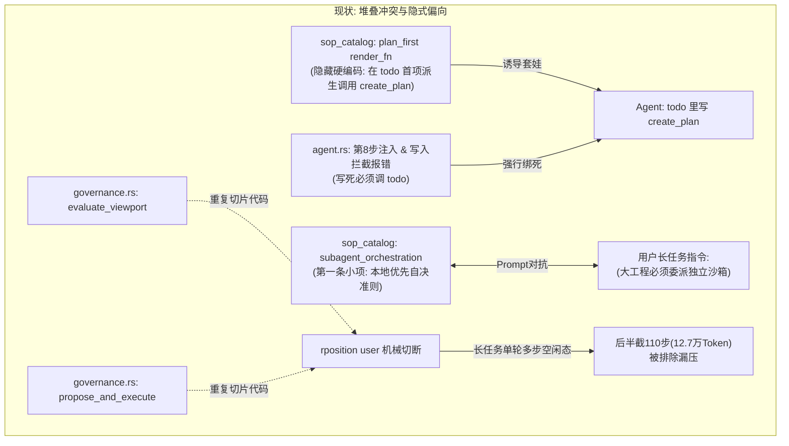

# 系统架构重构与治理实施方案 (SPEC) - v2

> **设计宗旨**：拒绝“打补丁、叠条件”的堆叠式修改。通过领域状态模型重构、职责边界清晰化与单一真实源（SSOT）收拢，使系统在本次改动后**程序结构更清晰、模块职责更纯粹、运行表现更稳定**。

---

## 1. 架构现状与调优判据 (Design Audit)



### 核心调优原则
1. **意图声明门禁正交化（二选一）**：
   - 门禁判定在物理层原已有 `has_plan || has_todo` 豁免，本次核心在于**将第 8 步硬注入、代码写入拦截报错以及 SOP 规则彻底正交化**：小型改动选 Todo，架构工程选 Plan，两者互斥且天然豁免，彻底消除套娃冗余。
2. **多 Agent 编排规范去偏净化（保留纪律，剔除就地偏见）**：
   - **`subagent_orchestration` 坚决不下线**。其内部沉淀的按职责切分、50 步工作量控制、雷达探针定界、验收打回纪律、正交战场并发等均为核心工业级规范；
   - **仅精准剔除**导致 Prompt 对抗的“本地优先自决准则：主会话默认优先亲自就地阅读、分析与修改代码”，系统不加死板的强制委派规则，保持客观中立，完全遵从用户的长任务上下文指令。
3. **上下文候选切片算法收拢（单一真实源）**：
   - 抽象统一纯函数 `partition_compaction_candidates`，收拢两处重复切片逻辑；
   - 空闲态下将末轮已完结的长任务历史（如 110 步工具调用）全量纳入候选，压缩后 `maxCompactedSeq` 覆盖全部执行链，前端仪表盘由 12.8 万骤降至 3,000，**前端历史渲染保持平铺原貌，零引入风险**。

---

## 2. 重构后目标架构 (Target Architecture)

```mermaid
graph TD
    subgraph 重构后: 正交解耦与单一真实源 (Clean Architecture)
        EvalGate["evaluate_intent_gate(db, session_id)<br/>统一纯函数判定"] -->|小型调整/快速修复/探索| TD["Todo 清单 (todo_lifecycle)<br/>可以调用，随进展推进，交付前置 done"]
        EvalGate -->|大型/跨模块架构工程| PL["Plan 方案 (plan_first)<br/>直接 create_plan 落盘，豁免 todo"]
        
        subgraph SOP 规范体系 (SOP Catalog)
            SO1["subagent_orchestration<br/>(保留职责切分/50步/打回等核心纪律，仅剔除就地修改偏向)"]
            SO2["plan_first<br/>(剔除 render_fn 中的套娃描述，直接落盘)"]
            SO3["todo_lifecycle<br/>(针对小的调整和探索，可以调用...)"]
        end

        subgraph 上下文治理引擎 (Context Engine)
            SliceFn["统一候选切片算法<br/>partition_compaction_candidates(msgs, is_running)"]
            SliceFn -->|运行中| S1["保留当前进行中的轮次"]
            SliceFn -->|空闲态| S2["全量覆盖末轮大历史(推进到末尾)"]
            SliceFn --> Viewport["evaluate_context_viewport"]
            SliceFn --> Propose["propose_and_execute_compaction"]
        end
    end
```

---

## 3. 详细设计与重构清单

### 模块 A：前置意图门禁正交化（Intent Gate Refactor）

#### A.1 提炼统一判定函数（消除重复 SQL 查询）
在 `src-tauri/src/agent.rs` 中提取统一判定函数，替代散落在各处的 `get_kv`：

```rust
pub enum IntentGateState {
    /// 已满足门禁：持有活跃的 Todo 清单或已生效的 Plan 方案
    Satisfied { has_plan: bool, has_todo: bool },
    /// 未声明意图：代码写入将被拦截
    Missing,
}

pub fn evaluate_intent_gate(db: &rusqlite::Connection, session_id: &str) -> IntentGateState {
    let has_plan = store::get_kv(db, session_id, "active_plan_id")
        .ok()
        .flatten()
        .map(|id| !id.trim().is_empty())
        .unwrap_or(false);
    let has_todo = store::get_kv(db, session_id, "todos")
        .ok()
        .flatten()
        .map(|raw| raw.contains(r#""in_progress""#) || raw.contains(r#""pending""#))
        .unwrap_or(false);

    if has_plan || has_todo {
        IntentGateState::Satisfied { has_plan, has_todo }
    } else {
        IntentGateState::Missing
    }
}
```

#### A.2 升级第 8 步门禁与代码写入拦截提示
* **第 8 步系统级提示词注入**（`agent.rs:1707`）：
  ```text
  【🛑 第 8 步门禁拦截】：只读勘察已达 8 步上限且当前未声明施工意图！
  1. 若已查明事实且无需修改代码（如咨询答疑），必须立即在正式回复中输出完整答复并直接结案；
  2. 若需要修改代码且方向明确，必须在下一步声明施工意图（二选一即可，严禁重复）：
     - 小型局部改动 / 快速修复 / 探索：调用 todo 工具声明任务列表；
     - 大型 / 复杂 / 跨模块工程：调用 create_plan 工具生成实施方案；
  3. 若依然方向模糊，严禁盲目漫游，立即向用户汇报阻碍并对齐目标！
  ```
* **代码写入拦截报错文案**（`agent.rs:2532`）：
  ```text
  【前置意图门禁拦截】：修改代码或文件前必须先声明施工意图（二选一即可）。
  - 小型局部改动：请先调用 todo 工具声明任务清单；
  - 复杂架构改造：请先调用 create_plan 工具创建结构化实施方案；
  完成意图声明后方可进行文件写入或编辑。
  ```

---

### 模块 B：SOP 规范体系精准调整与偏见净化

#### B.1 重构 `todo_lifecycle`
* **前端 `src/types.ts` 与后端 `sop_catalog.rs` 统一调整文案**：
  > *针对小的调整和探索，可以调用 todo 工具列出任务列表，并随进展更新各项任务状态；在执行完最后一步、给出最终回复前，务必调用 todo 工具将已完成任务的状态更新为 done，切勿遗留 in_progress 状态。*

#### B.2 精准净化 `subagent_orchestration`（保留 SOP，仅剔除就地偏见）
* **后端 `sop_catalog.rs:220-230` 调整**：
  * **原内容第一项**：
    ~~`- 本地优先自决准则：主会话默认优先亲自就地阅读、分析与修改代码，快速高效闭环。面对跨模块、多领域（如前后端并行开发、独立脚本与界面改造等）大体量任务时，可按需调用 \`spawn_subagent\` 委派专职子 Agent 并行推进。`~~
  * **替换为中立表述**：
    `- 面对跨模块、多领域（如前后端并行开发、独立脚本与界面改造等）大体量任务时，可按需调用 \`spawn_subagent\` 委派专职子 Agent 并行推进。`
  * **完整保留后续全部核心纪律**：
    - 🎯【按职责拆分与工作量控制原则（必须严格遵守）】：① 按职责拆分严禁按步数生硬切分；② 工作量尽量控制在 50 步以内；
    - 🧭【委派前雷达探针与定界规范】：1~2 步只读工具完成宏观地貌锚定，交接书明确 `target_anchors` 与 `negative_scope`；
    - 🚨【自检验收与打回纪律】：交付代码有缺陷时调用 `reject_subagent` 打回返工，非必要情况禁止私自编码；
    - 弹性多子 Agent 并行：互不正交战场划分。
* **前端 `src/types.ts:384` 与后端简介同步更新**：
  > 描述改为：*“面对复杂需求、多模块并发开发（如前后端分离、多独立模块并行）时，可按需派生专职子 Agent 协同推进。”*
* **净化协作者名录导语（`static_system.rs:137`）**：
  * 移除“主进程作为总架构师，默认优先就地直接处理简单任务……”的硬编码偏向，改为客观叙述：*“你拥有以下常驻专业协作者团队。根据下述职责定位与任务指示按需委派给对应协作者。”*

#### B.3 剔除 `plan_first` 中的套娃诱导
* **前端展示保持不变**（前端 `description` 原本即无套娃描述）。
* **修改后端 `sop_catalog.rs:176`（`render_fn`）**：
  * **原内容**：~~`在 todo 首项派生调用 create_plan 生成结构化计划 MD 文档并向用户呈现确认。`~~
  * **调整为**：`凡是涉及核心业务架构重构、多模块接口改造或预计修改 3 个以上核心文件的复杂任务，直接调用 create_plan 生成结构化方案文档；已有方案天然豁免 todo，执行阶段严格以方案 Checklist 为基准推进。`

---

### 模块 C：上下文治理引擎（空闲态大历史候选切片算法重构）

#### C.1 提炼统一纯函数 `partition_compaction_candidates`
在 `src-tauri/src/context/governance.rs` 中，将候选消息评估抽象为独立纯函数，供 `evaluate_context_viewport` 和 `propose_and_execute_compaction` 共同调用：

```rust
/// 针对未压缩消息流，评估可供压缩的候选历史消息
/// 
/// 核心准则：
/// 1. 运行态（is_running = true）：必须保留当前正在进行的交互轮次（last_user_idx 之后的内容）；
/// 2. 空闲态（is_running = false）：末轮任务已彻底完成并交付！
///    无论这一轮包含多少步工具调用，全量未压缩历史全部纳入压缩候选，
///    彻底释放长任务自治过程产生的大量 Token！
pub fn partition_compaction_candidates<'a>(
    uncompacted: &'a [&'a crate::models::Message],
    is_running: bool,
) -> Vec<&'a crate::models::Message> {
    if uncompacted.is_empty() {
        return Vec::new();
    }

    if is_running {
        // 正在执行中：定位当前活跃轮次起点（最后一个 user 消息）
        let last_user_idx = uncompacted.iter().rposition(|m| m.role == "user");
        match last_user_idx {
            Some(idx) if idx > 0 => uncompacted[..idx].to_vec(),
            _ => {
                if uncompacted.len() >= 2 {
                    uncompacted[..uncompacted.len().saturating_sub(1)].to_vec()
                } else {
                    Vec::new()
                }
            }
        }
    } else {
        // 空闲完成态：末轮长任务已收工，全量未压缩消息皆为可总结的历史工件
        uncompacted.to_vec()
    }
}
```

#### C.2 效果验证与数据流向
* 当用户在长任务结束后点击【立即提炼压缩上下文】（或系统自动触发）：
  * 当前会话处于空闲态（`is_running == false`）；
  * `partition_compaction_candidates` 返回包含末轮 110 步工具调用的全部消息；
  * 生成的压缩记录 `end_seq` 推进至末尾（如 Seq 391）；
  * 前端 `ContextUsageGauge` 重新计算时，`m.seq <= maxCompactedSeq` 覆盖全部历史，**活跃 Token 瞬间由 12.8 万暴降至 3,000，进度条瞬间从红（100%）变绿（5%）**；
  * **前端历史展示保持原有平铺逻辑不变**，零前端风险，立竿见影。

---

## 4. 实施阶段与验证矩阵 (Phases & Verification)

### Phase 1：后端口径与算法重构
1. `agent.rs`：提炼 `evaluate_intent_gate`，升级第 8 步注入与写入拦截提示。
2. `governance.rs`：实现 `partition_compaction_candidates`，重构 `evaluate_context_viewport` 与 `propose_and_execute_compaction`。

### Phase 2：SOP 规范清理与 Prompt 净化
1. `sop_catalog.rs`：
   - 更新 `todo_lifecycle` 聚焦于小调整；
   - 修正 `plan_first` 的 `render_fn` 剔除套娃；
   - 修正 `subagent_orchestration` 剔除“本地优先自决”。
2. `static_system.rs`：净化协作者导语。
3. `src/types.ts`：前端 SOP 字典对应文案同步。

### Phase 3：质量门禁与回归验证
1. **Rust 单元测试**：
   - 运行 `cargo test --lib` 确保现有单测（特别是 `test_todo_first_gate_sop_in_system_prompt` 等）全绿；
   - 新增 `partition_compaction_candidates` 空闲态与运行态的测试用例。
2. **前端构建检查**：
   - 运行 `npx tsc -b` 确保类型与构建 100% 通过。
