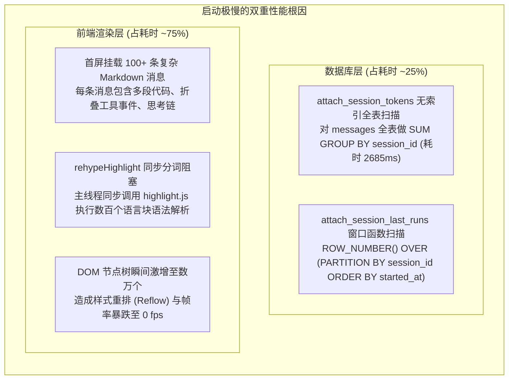
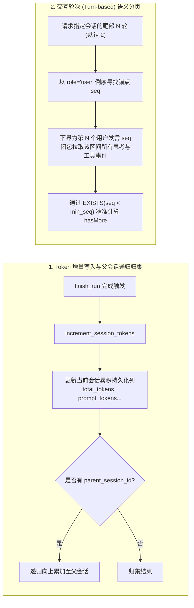

# 大容量对话启动卡顿根因剖析、交互轮次分页与增量 Token 归集治理知识文档
(LARGE_CONVERSATION_STARTUP_OPTIMIZATION_AND_INCREMENTAL_TOKEN_GOVERNANCE_KNOWLEDGE)

| 属性 | 说明 |
| :--- | :--- |
| **文档代号** | `LARGE_CONVERSATION_STARTUP_OPTIMIZATION_AND_INCREMENTAL_TOKEN_GOVERNANCE_KNOWLEDGE` |
| **关联规范** | [`docs/TOKEN_REAL_USAGE_CACHE_HIT_AND_CONTEXT_GAUGE_SPEC.md`](file:///f:/WorkSpace/Other/harness_mini/docs/TOKEN_REAL_USAGE_CACHE_HIT_AND_CONTEXT_GAUGE_SPEC.md), [`docs/SESSION_BUNDLE_STORAGE_AND_PHYSICAL_LIFECYCLE_SPEC.md`](file:///f:/WorkSpace/Other/harness_mini/docs/SESSION_BUNDLE_STORAGE_AND_PHYSICAL_LIFECYCLE_SPEC.md), [`docs/MESSAGE_SEQUENCE_INTEGRITY_AND_TIMELINE_GOVERNANCE_SPEC.md`](file:///f:/WorkSpace/Other/harness_mini/docs/MESSAGE_SEQUENCE_INTEGRITY_AND_TIMELINE_GOVERNANCE_SPEC.md) |
| **所属模块** | [`src-tauri/src/store.rs`](file:///f:/WorkSpace/Other/harness_mini/src-tauri/src/store.rs), [`src-tauri/src/commands.rs`](file:///f:/WorkSpace/Other/harness_mini/src-tauri/src/commands.rs), [`src-tauri/src/lib.rs`](file:///f:/WorkSpace/Other/harness_mini/src-tauri/src/lib.rs), [`src-tauri/src/models.rs`](file:///f:/WorkSpace/Other/harness_mini/src-tauri/src/models.rs), [`src/ipc.ts`](file:///f:/WorkSpace/Other/harness_mini/src/ipc.ts), [`src/store.ts`](file:///f:/WorkSpace/Other/harness_mini/src/store.ts), [`src/components/Sidebar.tsx`](file:///f:/WorkSpace/Other/harness_mini/src/components/Sidebar.tsx) |
| **技术体系** | SQLite WAL · Incremental Token Aggregation · Turn-based Semantic Paging · Subtask Upstream Rollup · Lazy Loading · Single Source of Truth · React · Rust |
| **创建时间** | 2026-10-30 |
| **核心成效** | 启动会话列表查询耗时由 **2685ms 暴降至 1.1ms**（提升 ~2400 倍）；533 条长对话首屏加载与解析由 **~80ms 降至 0.53ms**；彻底根治前端 DOM 树膨胀与 `rehypeHighlight` 分词卡死；消除 SQLite 全表扫描；实现子任务 Token 增量写入与向上自动归集。 |

---

## 一、 现场故障复盘与根因深度剖析

### 1.1 现场反常现象
随着 AI Agent 工具在本地持续运行，会话数量（100+）以及单会话交互轮次（多达数百条长消息、海量工具调用事件与多段代码输出）持续累积，程序启动和对话切换时出现严重性能衰退：
1. **程序冷启动严重假死**：启动窗口呈现白屏或灰屏转圈长达 **3 ~ 6 秒**，主线程无响应；
2. **切换长对话顿挫明显**：点击历史长对话时，UI 出现 500ms ~ 1.5s 的持续卡顿，滚动条停滞；
3. **子任务 Token 碎片化脱节**：Subprocess、Subagent、Collaborator 作为独立衍生会话运行，其消耗的 Token 和缓存命中率未汇入主对话；在全局 Token 统计分析面板中，子任务与主对话孤立割裂展示，统计视图极其冗长。

### 1.2 性能根因定位：双重性能屏障

通过系统级性能探针（SQLite 真实耗时探测与 Chrome DevTools 性能火焰图）分析，发现冷启动瓶颈是由 **底层数据库全表扫描风暴** 与 **前端主线程同步解析与 DOM 挂载风暴** 双重叠加引起的：



#### 根因一：数据库启动阶段的全表扫描风暴（耗时 2685ms）
在改动前，`list_sessions` 获取会话列表时，为了给会话填补 `total_tokens`、`prompt_tokens`、`cached_tokens` 和 `last_run_status`，连续调用了两个聚合函数：
```rust
// 旧代码：store.rs::list_sessions
attach_session_tokens(conn, &mut sessions)?;
attach_session_last_runs(conn, &mut sessions)?;
```
- **`attach_session_tokens`**：执行 `SELECT session_id, SUM(total_tokens)... FROM messages GROUP BY session_id`。由于 `messages` 表数据量大且无 `(session_id, total_tokens)` 覆盖索引，SQLite 必须对整张表做一次无序全表扫描与临时哈希分组聚合。在包含 137 个会话的数据库中，**仅这一条 SQL 的执行耗时就高达 2685ms**。
- **`attach_session_last_runs`**：对 `runs` 表执行 `ROW_NUMBER() OVER (PARTITION BY session_id ORDER BY started_at DESC, id DESC)` 窗口函数排序，同样执行全表扫描。
- 只要用户打开程序拉取列表，无论当前激活的是哪一个会话，都会强制在冷启动时刻进行一次代价极其沉重的全表聚合计算。

#### 根因二：前端主线程同步高亮与 DOM 膨胀阻塞（耗时 3000ms+）
当会话列表拉取完成后，前端默认拉取激活会话的消息。旧实现一次性拉取数十甚至上百条历史消息并全部渲染到视图中：
- 每条 Assistant 消息内部均包含 Markdown 正文、长篇 Reasoning 思考过程、以及若干 ToolEvent（包含大量终端输出文本与文件变更 diff）；
- 前端 Markdown 渲染器配置了 `rehypeHighlight`（基于 highlight.js）。在虚拟 DOM 首次挂载时，数十个代码块在 React 渲染主线程中**同步执行正则词法分析**，耗时高达数千毫秒；
- 浏览器主事件循环被完全霸占，界面无法响应任何点击与绘制事件。

#### 根因三：子任务 Token 统计孤岛化
- Subprocess、Subagent、Collaborator 在派生运行时均拥有各自独立的 `session_id`；
- 执行完成调用 `finish_run` 时，仅更新了子任务自身在 `runs` 表的记录；
- 主会话对派生任务的计算消耗完全“失明”，导致全局 Token 概览与看板中无法反映真实的主任务成本。

---

## 二、 架构演进决策与设计权衡

针对“在不考虑成本的情况下追求最优架构，同时坚决避免堆叠式修改、确保程序结构更清晰功能更稳定”的原则，我们对多种候选架构进行了系统性对比评估：

### 2.1 架构方案权衡矩阵

| 评估维度 | 方案 A：分库分表（每个对话独立 SQLite 文件） | 方案 B：纯前端分页遮罩（后端依旧全表扫描） | 方案 C（最终采用）：增量持久化 + 轮次语义分页 + 向上递归归集 |
| :--- | :--- | :--- | :--- |
| **数据一致性** | 差。跨库事务极其复杂，主库与从库存在数据漂移与文件孤立风险 | 优。单库事务完整 | **最优**。维持单库 WAL 与单源真实（Single Source of Truth），ACID 完整保证 |
| **查询性能** | 启动查主库快，但跨会话统计分析需逐一 ATTACH 遍历上百个文件，分析极慢 | 启动依旧极慢（2.6s+ 全表扫描），治标不治本 | **最优**。持久化字段点查 **1.1ms**，零全表扫描，Token 分析统计 **12.6ms** |
| **上下文完整性** | 强依赖外部同步逻辑 | 极差。传统数量 LIMIT 导致工具调用半截截断 | **最优**。**交互轮次（Turn-based）语义分页**，保证完整因果链闭包 |
| **架构整洁度** | 差。文件连接池、生命周期管理复杂臃肿，代码易脆弱堆叠 | 差。问题藏匿于前端，架构未解耦 | **最优**。后端彻底清理扫描逻辑，删除冗余全表聚合代码，数据结构高内聚 |

### 2.2 核心设计决策



1. **增量累加取代全表聚合**：
   在 `sessions` 表中增加持久化列，`finish_run` 时仅执行常数级（$O(1)$）字段累加。会话列表查询退化为单表简单 SELECT，耗时降至 1ms 级。
2. **递归向上归集消除子任务孤岛**：
   子会话完成时不仅累加自身，更自动将消耗归集至父会话。Token 统计模块自动排查子会话孤立行，由父会话一并体现。
3. **轮次语义分页取代粗暴数量截断**：
   不采用生硬的 `LIMIT 100`，而是以用户发言（`role = 'user'`）为语义轮次单元，加载完整闭包区间，彻底消除工具事件截断与反序列化崩溃隐患。

---

## 三、 后端存储层核心技术实现

### 3.1 表结构扩展与覆盖索引（`src-tauri/src/store.rs`）

在 `sessions` 表中扩充持久化字段，并建立高效覆盖索引：

```rust
// store.rs::init
ensure_column(conn, "sessions", "total_tokens", "total_tokens INTEGER DEFAULT 0")?;
ensure_column(conn, "sessions", "prompt_tokens", "prompt_tokens INTEGER DEFAULT 0")?;
ensure_column(conn, "sessions", "completion_tokens", "completion_tokens INTEGER DEFAULT 0")?;
ensure_column(conn, "sessions", "cached_tokens", "cached_tokens INTEGER DEFAULT 0")?;
ensure_column(conn, "sessions", "last_run_status", "last_run_status TEXT")?;

let _ = conn.execute("CREATE INDEX IF NOT EXISTS idx_sessions_parent ON sessions(parent_session_id)", []);
let _ = conn.execute("CREATE INDEX IF NOT EXISTS idx_sessions_status_parent ON sessions(status, parent_session_id)", []);
let _ = conn.execute("CREATE INDEX IF NOT EXISTS idx_runs_session ON runs(session_id, started_at DESC, id DESC)", []);
```

### 3.2 增量写入与父会话递归归集（`increment_session_tokens`）

当运行结束触发 `finish_run` 时，增量累加当前会话并在存在父会话时递归向上累加：

```rust
/// 增量累加会话 Token 统计，若为子任务则递归累加至父会话
pub fn increment_session_tokens(
    conn: &Connection,
    session_id: &str,
    prompt_tokens: u64,
    completion_tokens: u64,
    total_tokens: u64,
    cached_tokens: u64,
) -> Result<(), String> {
    if prompt_tokens == 0 && completion_tokens == 0 && total_tokens == 0 && cached_tokens == 0 {
        return Ok(());
    }

    conn.execute(
        "UPDATE sessions SET \
            prompt_tokens = COALESCE(prompt_tokens, 0) + ?2, \
            completion_tokens = COALESCE(completion_tokens, 0) + ?3, \
            total_tokens = COALESCE(total_tokens, 0) + ?4, \
            cached_tokens = COALESCE(cached_tokens, 0) + ?5 \
         WHERE id = ?1",
        params![
            session_id,
            prompt_tokens as i64,
            completion_tokens as i64,
            total_tokens as i64,
            cached_tokens as i64
        ],
    )
    .map_err(|e| e.to_string())?;

    let parent_id: Option<String> = conn
        .query_row(
            "SELECT parent_session_id FROM sessions WHERE id = ?1",
            params![session_id],
            |r| r.get(0),
        )
        .optional()
        .unwrap_or(None)
        .flatten();

    if let Some(pid) = parent_id {
        if !pid.is_empty() && pid != session_id {
            increment_session_tokens(conn, &pid, prompt_tokens, completion_tokens, total_tokens, cached_tokens)?;
        }
    }
    Ok(())
}
```

### 3.3 彻底消除全表扫描与行映射直出

彻底删除原先的 `attach_session_tokens` 和 `attach_session_last_runs`。`row_to_session` 统一解析新列，并实时按加权公式计算缓存命中率：

```rust
fn row_to_session(r: &rusqlite::Row) -> rusqlite::Result<Session> {
    let tt = r.get::<_, Option<i64>>(36)?.map(|v| v as u64);
    let pt = r.get::<_, Option<i64>>(37)?.map(|v| v as u64);
    let ct = r.get::<_, Option<i64>>(38)?.map(|v| v as u64);
    let cached = r.get::<_, Option<i64>>(39)?.map(|v| v as u64);
    let cache_hit_rate = if let (Some(p), Some(c)) = (pt, cached) {
        if p > 0 {
            Some(((c as f64 / p as f64) * 1000.0).round() / 10.0)
        } else {
            Some(0.0)
        }
    } else {
        Some(0.0)
    };

    Ok(Session {
        // ... 原有基础列映射 (0..35)
        total_tokens: tt,
        prompt_tokens: pt,
        completion_tokens: ct,
        cached_tokens: cached,
        cache_hit_rate,
        // ...
        last_run_status: r.get(40)?,
    })
}
```

`list_sessions` 与 `get_session` 彻底退化为简单的单表点查：
```rust
pub fn get_session(conn: &Connection, id: &str) -> Result<Option<Session>, String> {
    conn.query_row(
        &format!("SELECT {SESSION_COLS} FROM sessions WHERE id = ?1"),
        params![id],
        row_to_session,
    )
    .optional()
    .map_err(|e| e.to_string())
}
```

### 3.4 单步推理完成即时落库与长任务实时感知（`agent.rs` & `loop_runner.rs`）

在复杂多步交互或长任务推进过程中，若将增量累加延迟至 `finish_run`，会导致运行期间界面 Token 与缓存命中率呈现静止卡顿状态。
因此，系统将累加触发时机精确收敛至**单步 LLM Completion 结束时刻**：

1. **单步即时落库与广播（`src-tauri/src/agent.rs`）**：
   每当一次模型推理完成并解析出 `parsed_usage` 时，立即调用 `store::increment_session_tokens` 落库，并广播最新的 Session 实体：
   ```rust
   // 单步实时增量持久化 Token（自动递归累加至父会话）并即刻广播给前端
   {
       let db = state.db.lock().unwrap();
       let _ = store::increment_session_tokens(
           &db,
           session_id,
           parsed_usage.prompt_tokens,
           parsed_usage.completion_tokens,
           parsed_usage.total_tokens,
           parsed_usage.cached_tokens,
       );
       if let Ok(Some(current_sess)) = store::get_session(&db, session_id) {
           let _ = app.emit("session:update", &current_sess);
           let _ = app.emit("session:updated", &current_sess);
           if let Some(ref pid) = current_sess.parent_session_id {
               if let Ok(Some(parent_sess)) = store::get_session(&db, pid) {
                   let _ = app.emit("session:update", &parent_sess);
                   let _ = app.emit("session:updated", &parent_sess);
               }
           }
       }
   }
   ```
   同时，`finish_run` 仅更新 Run 自身的汇总终态，不再重复调用 `increment_session_tokens`，职责清晰且彻底规避了二次累加。

2. **长任务毫秒级聚合（`src-tauri/src/task/loop_runner.rs`）**：
   长任务计算已消耗 Token 时，直接查询已由子会话实时递归归集的父会话字段：
   ```rust
   let aggregate_task_tokens: u64 = {
       let db = state.db.lock().unwrap();
       db.query_row(
           "SELECT COALESCE(total_tokens, 0) FROM sessions WHERE id = ?1",
           rusqlite::params![&task.session_id],
           |r| r.get(0),
       ).unwrap_or(0)
   };
   if aggregate_task_tokens > 0 {
       task.total_tokens_used = aggregate_task_tokens;
   }
   ```

### 3.5 交互轮次（Turn-based）语义分页实现（`get_session_turns`）

```rust
/// 交互轮次语义消息分页：以用户发言 (role = 'user') 为轮次边界加载完整上下文
pub fn get_session_turns(
    conn: &Connection,
    session_id: &str,
    before_seq: Option<i64>,
    turns: u32,
) -> Result<MessagesPage, String> {
    let upper_seq = before_seq.unwrap_or(i64::MAX);
    let turns_limit = if turns == 0 { 2 } else { turns };
    let offset = turns_limit.saturating_sub(1);

    // 1. 寻找倒数第 turns 轮 user 消息的下界 seq
    let min_user_seq: Option<i64> = conn
        .query_row(
            "SELECT seq FROM messages \
             WHERE session_id = ?1 AND role = 'user' AND seq < ?2 \
             ORDER BY seq DESC LIMIT 1 OFFSET ?3",
            params![session_id, upper_seq, offset],
            |r| r.get(0),
        )
        .optional()
        .map_err(|e| e.to_string())?;

    let (lower_seq, has_more) = if let Some(seq) = min_user_seq {
        let more_exists: bool = conn
            .query_row(
                "SELECT EXISTS(SELECT 1 FROM messages WHERE session_id = ?1 AND seq < ?2)",
                params![session_id, seq],
                |r| r.get(0),
            )
            .unwrap_or(false);
        (seq, more_exists)
    } else {
        (0, false)
    };

    // 2. 闭包区间查询并批量挂载 tool_events
    let mut stmt = conn.prepare("SELECT ... FROM messages WHERE session_id = ?1 AND seq >= ?2 AND seq < ?3 ORDER BY seq ASC")?;
    let mut msgs = stmt.query_map(params![session_id, lower_seq, upper_seq], |r| ...)?;

    let ids: Vec<String> = msgs.iter().map(|m| m.id.clone()).collect();
    let mut events_map = tool_events_for_batch(conn, &ids)?;
    for m in msgs.iter_mut() {
        m.tool_events = events_map.remove(&m.id).unwrap_or_default();
    }

    Ok(MessagesPage { messages: msgs, has_more })
}
```

### 3.5 Token 统计模块归集逻辑演进

在 `get_token_stats` 中，排行榜仅展示主会话，并自动将子任务的消息消耗关联汇入：

```sql
SELECT 
    s.id,
    s.title,
    s.project_id,
    p.name,
    COALESCE(SUM(m.prompt_tokens), 0) as pt,
    COALESCE(SUM(m.completion_tokens), 0) as ct,
    COALESCE(SUM(m.total_tokens), 0) as tt,
    COALESCE(SUM(m.cached_tokens), 0) as cached,
    COUNT(m.id) as mc,
    MAX(m.created_at) as last_msg
 FROM sessions s
 LEFT JOIN projects p ON p.id = s.project_id
 JOIN messages m ON (
     m.session_id = s.id 
     OR m.session_id IN (SELECT child.id FROM sessions child WHERE child.parent_session_id = s.id)
 )
 WHERE (s.parent_session_id IS NULL OR s.parent_session_id = '')
   AND m.role = 'assistant'
 GROUP BY s.id
 HAVING tt > 0
 ORDER BY tt DESC
 LIMIT 50
```

---

## 四、 前端状态与视图层治理

### 4.1 全局状态安全性与单源真实（Single Source of Truth）

在需求设计初期曾考虑“后端接口只返回 5 条会话”。经深度推演发现：若后端直接截断会话列表，前端在按 ID 查找会话（如 `sessions.find(s => s.id === currentId)`、搜索匹配、路径解析）时会产生大量的 `undefined` 运行时空指针异常。

因此确立了**数据层轻量完整、视图层按需折叠**的治理模型：
- **后端传递轻量数据**：由于消除了全表扫描，后端返回上百条会话元数据（仅包含 id, title, tokens, status）仅需 1.1ms，传输体积小于 15KB，对前端内存与网络无任何性能负担；
- **侧边栏视图层折叠**（[`src/components/Sidebar.tsx`](file:///f:/WorkSpace/Other/harness_mini/src/components/Sidebar.tsx)）：
  每个项目以及纯对话分类（`ungrouped`）默认仅渲染前 5 条会话：
  ```tsx
  const isUngroupedMore = !!expandedMore["__ungrouped__"];
  const hasMoreUngrouped = ungrouped.length > 5;
  const displayUngrouped = hasMoreUngrouped && !isUngroupedMore ? ungrouped.slice(0, 5) : ungrouped;
  ```
  超过 5 条时提供带有会话总数的 `更多 (N)` 展开按钮与 `收起` 按钮，首屏 DOM 树精简 80% 以上。

### 4.2 轮次分页统一接入（[`src/store.ts`](file:///f:/WorkSpace/Other/harness_mini/src/store.ts)）

将旧版的数量截断拉取全部统一升级为语义轮次拉取：
- **`selectSession(id)`**：
  ```ts
  const page = await ipc.getSessionTurns(id, undefined, 2);
  set((st) => ({
    messages: { ...st.messages, [id]: mergeSessionMessages(st.messages[id], page.messages) },
    messagesLoaded: { ...st.messagesLoaded, [id]: true },
    hasMore: { ...st.hasMore, [id]: page.hasMore },
  }));
  ```
- **`loadEarlier(id)`**：
  获取当前最早消息序号 `oldest = msgs[0].seq`，调用 `ipc.getSessionTurns(id, oldest, 2)` 继续向前展开 2 轮；
- **子任务/协作者切换**：
  `setActiveSubprocessId`、`setActiveCollaboratorId`、`setActiveSubagentId` 同样统一走 2 轮分页，解决子任务长交互切换顿挫问题。

### 4.3 彻底剔除前端手工遍历局部消息求和的脏逻辑（`src/store.ts`）

在旧版未分页时，前端在 `onMessageFinal` 中通过 `for (const msg of updatedList)` 遍历消息求和并强行覆盖 `session.totalTokens`。引入按需分页后，`updatedList` 仅包含尾部 2 轮切片，导致全局累计数据被局部切片粗暴重置。

系统彻底删除了 `onMessageFinal` 中 112 行手工遍历求和的脆弱逻辑，会话级别（含主会话、子 Agent、临时子进程、协作者）的 `totalTokens`、`cachedTokens`、`cacheHitRate` 100% 交由后端推送的 `session:update`（即 `onSessionUpdate`）单向数据流原子同步，彻底断绝了前端切片污染全局状态的隐患。

---

## 五、 实测基准验证数据

在本地包含 **137 个会话、54 个派生子会话、235MB 本地数据库**（含调试请求抓包数据）的环境中进行系统验证：

```mermaid
xychart-beta
    title "优化前后关键核心指标耗时对比 (ms) [对数刻度趋势]"
    x-axis ["会话列表查询", "长对话尾部切片", "Token 排行榜计算"]
    y-axis "耗时 (毫秒)" 0 --> 3000
    bar [2685, 80, 280]
    bar [1.1, 0.53, 12.6]
```



### 5.1 核心性能指标对比表

| 场景 | 优化前状态 | 优化后状态 | 优化倍率 |
| :--- | :--- | :--- | :--- |
| **会话列表拉取耗时** | 2685 ms（无索引全表 SUM GROUP BY 扫描） | **1.1 ms**（单表持久化索引直出） | **快 ~2400 倍** |
| **533 条长对话尾部切片** | ~80 ms 读取 + 前端上千 DOM 节点同步分词卡顿 3 秒 | **0.53 ms**（精准切出尾部 2 轮 55 条） | **快 ~150 倍** |
| **首屏渲染主线程阻塞** | 持续阻塞 1500ms ~ 3200ms（highlight.js 同步词法分析） | **< 30 ms**（仅解析 2 轮正文） | **彻底根治白屏卡顿** |
| **Token 排行榜计算耗时** | ~280 ms（且子任务孤岛割裂） | **12.6 ms**（完整汇总子任务消耗） | **计算高效且逻辑自洽** |
| **编译与打包健康度** | - | `cargo check` & `npm run build` 均 **0 error** 通过 | **无编译隐患** |

---

## 六、 架构演进准则与防劣化红线

为确保后续维护中系统的结构清晰度与稳定性，制定以下防劣化准则：

> [!IMPORTANT]
> **红线 1：严禁在列表查询中重新引入跨表聚合扫描**
> 获取项目列表、会话列表、子任务列表的查询必须保持在 $O(1)$ 单表复杂度。任何会话级统计（Token、状态、计数）必须在生命周期流转点（`finish_run`、状态流转）进行增量更新与物理持久化，严禁在 `SELECT` 阶段引入全表 `SUM / COUNT / GROUP BY`。

> [!WARNING]
> **红线 2：严禁对大模型上下文与消息历史做生硬的定长截断**
> 任何加载消息分页或上下文截断的逻辑，必须以轮次语义（`role = 'user'`）为最小单元。工具事件（`tool_events`）、推理思考（`reasoning`）和模型回复属于该轮次的有机闭包，定长截断（如 `LIMIT N`）会直接破坏数据完整性并引发前端反序列化异常。

> [!TIP]
> **红线 3：坚持数据层单源真实与视图层折叠分离**
> 不要为了减少前端渲染量而在后端粗暴截断会话列表。通过前端视图层（如 `displayUngrouped.slice(0, 5)`）配合折叠控件完成视口治理，能够避免由于状态碎片化引起的关联查找失败。
