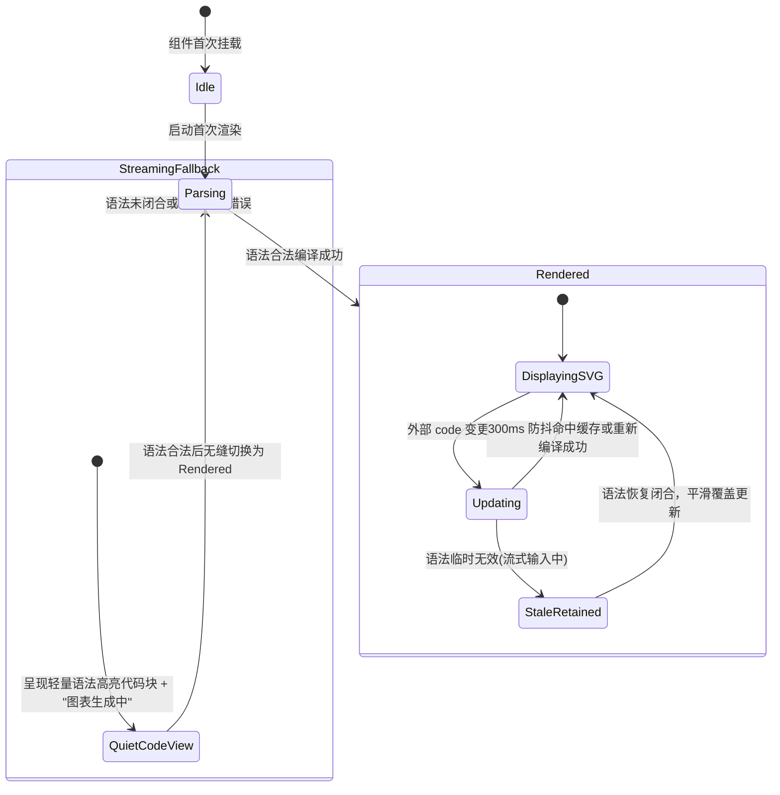

# Mermaid 图表流式零闪烁渲染与交互式矢量缩放治理技术规范
# Mermaid Diagram Streaming Zero-Flicker Rendering and Interactive Pan-Zoom Governance Specification

| 属性 | 说明 |
| :--- | :--- |
| **文档代号** | `MERMAID_STREAMING_ZERO_FLICKER_AND_INTERACTIVE_ZOOM_SPEC` |
| **所属模块** | [`src/components/MermaidBlock.tsx`](file:///f:/WorkSpace/Other/harness_mini/src/components/MermaidBlock.tsx), [`src/components/Markdown.tsx`](file:///f:/WorkSpace/Other/harness_mini/src/components/Markdown.tsx), [`src/components/ChatView.tsx`](file:///f:/WorkSpace/Other/harness_mini/src/components/ChatView.tsx), [`src/components/Icons.tsx`](file:///f:/WorkSpace/Other/harness_mini/src/components/Icons.tsx) |
| **技术体系** | React 18 · TypeScript · TailwindCSS · Mermaid.js · Web Component / SVG Transform Matrix · Viewport Reflow Governance |
| **创建时间** | 2026-11-09 |
| **核心机制** | 组件引用静态化保序 · 双阶段流式状态机 (Dual-Phase Streaming FSM) · 图表语法未闭合静默容错 · 内存级 SVG 渲染缓存 · 交互式矢量全屏灯箱 (Pan & Zoom Matrix) |
| **设计原则** | **拒绝补丁堆叠 (No Patch-Stacking)** · 单一职责与清晰分层 · 状态机确定性推导 · 视口布局零塌陷 |

---

## 目录
- [一、 设计哲学与反堆叠原则](#一-设计哲学与反堆叠原则)
- [二、 现场故障复盘与根因分析](#二-现场故障复盘与根因分析)
  - [2.1 匿名组件定义反模式导致 DOM 每秒 20 次整体重建](#21-匿名组件定义反模式导致-dom-每秒-20-次整体重建)
  - [2.2 挂载空白态与未闭合语法报错的交替震荡](#22-挂载空白态与未闭合语法报错的交替震荡)
  - [2.3 容器高度巨幅变动引发视口滚屏共振闪现](#23-容器高度巨幅变动引发视口滚屏共振闪现)
  - [2.4 样式强行压缩与缺少矢量缩放引擎](#24-样式强行压缩与缺少矢量缩放引擎)
- [三、 系统架构演进与清晰分层](#三-系统架构演进与清晰分层)
  - [3.1 渲染组件引用恒定契约 (Component Referential Stability)](#31-渲染组件引用恒定契约-component-referential-stability)
  - [3.2 Mermaid 流式双阶段状态机 (Dual-Phase FSM)](#32-mermaid-流式双阶段状态机-dual-phase-fsm)
  - [3.3 矢量级平移缩放矩阵引擎 (Transform Pan-Zoom Engine)](#33-矢量级平移缩放矩阵引擎-transform-pan-zoom-engine)
- [四、 完整实施方案与代码重构契约](#四-完整实施方案与代码重构契约)
  - [4.1 重构 Layer 1: Markdown 组件映射表纯化与静态提取](#41-重构-layer-1-markdown-组件映射表纯化与静态提取)
  - [4.2 重构 Layer 2: MermaidBlock 双阶段状态机与缓存机制](#42-重构-layer-2-mermaidblock-双阶段状态机与缓存机制)
  - [4.3 重构 Layer 3: DiagramLightboxModal 全屏交互灯箱子系统](#43-重构-layer-3-diagramlightboxmodal-全屏交互灯箱子系统)
  - [4.4 重构 Layer 4: 容器尺寸阻尼与横向 1:1 滚动放开](#44-重构-layer-4-容器尺寸阻尼与横向-11-滚动放开)
- [五、 验证标准与防劣化基线](#五-验证标准与防劣化基线)

---

## 一、 设计哲学与反堆叠原则

在以往的代码迭代中，当遇到流式闪烁或特定图表显示异常时，常见的劣质做法是**“在条件判断中加 flag、在 useEffect 中套 setTimeout、在父组件透传 isStreaming 属性”**。这种堆叠式修补会导致：
1. **职责污染**：流式状态渗透进原本纯粹的展示组件，各层抽象被击穿；
2. **逻辑纠缠**：状态机存在大量隐式分支，一旦新增图表类型或切换模型便发生不可预测的回退；
3. **性能暗礁**：重复的无效重绘和内存泄漏隐藏在异步闭包中。

**本方案严格遵循“第一性原理”与“清晰分工”四项铁律**：
- **铁律 1（引用恒定性）**：父级 `Markdown` 只负责词法 AST 解析，向子级传递的渲染器组件引用必须物理级恒定，严禁在 render 周期内动态实例化组件函数。
- **铁律 2（状态自治性）**：`MermaidBlock` 自身必须具备处理“流式不完整代码”和“完备代码”的能力，通过状态机在组件内部消除未闭合语法的视觉干扰，不依赖父级传递外部状态标志。
- **铁律 3（渲染平滑性）**：渲染过程决不发生“有内容 $\rightarrow$ 空白 $\rightarrow$ 重新有内容”的塌陷；任何异步重绘必须无缝覆盖上一帧（Double Buffering 思想）。
- **铁律 4（动静解耦）**：内联卡片专注于“紧凑、安全、自适应阅读与代码查阅”；深度缩放与全屏探索抽离为独立的“矢量灯箱（Lightbox）子系统”，职责清晰明确。

---

## 二、 现场故障复盘与根因分析

```
流式 Token 每 48ms 刷入
       │
       ▼
Markdown 重新执行 render()
       │
       ▼
components={{ code: () => ... }} 重新生成全新匿名函数指针
       │
       ▼
React Fiber 判定组件类型变异 ──► 强制销毁旧 DOM (Unmount) ──► 重新挂载新 DOM (Mount)
       │
       ├──► 1. 挂载初始 state 为 "" ──► 高度塌陷为 0px (空白)
       │
       ├──► 2. 代码流式尚未闭合 ────► 抛出 SyntaxError ──► 突变为黄色报错卡片 (80px)
       │
       └──► 3. 异步编译成功 ────────► 突变为 SVG 矢量图 (400px+)
       │
       ▼
容器高度以 20 FPS 频率在 0px / 80px / 400px 间振荡
       │
       ▼
ChatView 触发 el.scrollTop = el.scrollHeight 贴底共振
       │
       ▼
【用户感知】：整屏聊天内容剧烈跳跃闪现；且图表被 [&_svg]:max-w-full 挤压成“蚂蚁字”，无法放大
```

### 2.1 匿名组件定义反模式导致 DOM 每秒 20 次整体重建
在 [`src/components/Markdown.tsx#L145-L279`](file:///f:/WorkSpace/Other/harness_mini/src/components/Markdown.tsx#L145-L279) 中：
```tsx
<ReactMarkdown
  components={{
    code: ({ className, children, ...props }) => {
      // 匿名函数每次 render() 重新创建！
      if (/language-mermaid\b/.test(className)) {
        return <MermaidBlock code={text} />;
      }
    }
  }}
/>
```
每当 [`store.ts`](file:///f:/WorkSpace/Other/harness_mini/src/store.ts#L666) 的流式缓冲器以 48ms 节流触发一次状态更新，`Markdown` 重新渲染，`components.code` 产生新的引用。React 协调器将旧的 `<MermaidBlock>` 连根拔起并销毁，重新建立新的组件实例，导致所有挂载期异步加载逻辑全部重走。

### 2.2 挂载空白态与未闭合语法报错的交替震荡
在 [`src/components/MermaidBlock.tsx#L34-L67`](file:///f:/WorkSpace/Other/harness_mini/src/components/MermaidBlock.tsx#L34-L67) 中：
- `const [svgHtml, setSvgHtml] = useState<string>("")`：由于组件反复重建，初始 `svgHtml` 恒为 `""`，容器高度从上一帧的 400px 瞬间跌落至 0px；
- 大模型输出 Mermaid 代码时逐字流动（如 `graph TD\n A[开始] --> B[`），中间状态必定是不完整的无效语法。当前实现遇到未闭合语法立即捕获并展示带有黄色警告的错误卡片；当末尾方括号补全时又瞬间切回 SVG，两者样式和高度巨大差异，形成视觉抽搐。

### 2.3 容器高度巨幅变动引发视口滚屏共振闪现
在 [`src/components/ChatView.tsx#L190-L194`](file:///f:/WorkSpace/Other/harness_mini/src/components/ChatView.tsx#L190-L194) 中：
```tsx
useEffect(() => {
  const el = boxRef.current;
  if (el && stick.current) {
    el.scrollTop = el.scrollHeight;
  }
}, [msgs, running]);
```
当 Mermaid 卡片高度在 0px、80px、400px 之间来回振荡，`boxRef.current.scrollHeight` 也随之巨幅跳动。浏览器执行贴底滚动命令时，视口上下反复扯动，使得整个视口内的历史消息、用户消息和正在流式输出的文字全部发生垂直方向的高频抖动，肉眼感知为“整屏内容闪现”。

### 2.4 样式强行压缩与缺少矢量缩放引擎
- **样式压制**：卡片样式配置为 `[&_svg]:max-w-full [&_svg]:h-auto`。ChatView 容器宽度上限为 `820px`（正文实际宽度约 700px），Mermaid 渲染复杂流程图（原始 viewBox 常常超 1500px）时被强行缩小数倍，节点文本仅有 2~4px 大小；
- **能力真空**：无点击查看大图、无全屏弹窗、无滚轮缩放、无鼠标平移拖拽，用户完全无法阅读复杂图表。

---

## 三、 系统架构演进与清晰分层

针对上述排查，重构后的系统遵循以下三层清晰架构：

```mermaid
flowchart TD
    subgraph Layer1 ["Layer 1: 语法解析与组件绑定 (Markdown.tsx)"]
        Ast[Markdown AST 解析] --> StableMap[纯静态/单例 Components 映射表]
        StableMap -->|恒定引用| CodeNode[Stable Code Component]
    end

    subgraph Layer2 ["Layer 2: 流式保护与双阶段渲染状态机 (MermaidBlock.tsx)"]
        CodeNode --> FSM{Mermaid 状态机}
        FSM -->|阶段 A: 流式未闭合 / 语法未稳定| Debounce[300ms 防抖静默等待 / 维持上一帧]
        FSM -->|阶段 B: 语法闭合稳定| Parser[mermaid.parse & render]
        Parser --> MemoryCache[(模块级内存渲染缓存)]
        MemoryCache --> DoubleBuffering[双缓冲覆盖: 绝无 0px 塌陷]
    end

    subgraph Layer3 ["Layer 3: 矢量交互与全屏灯箱 (DiagramLightboxModal)"]
        DoubleBuffering --> View[内联自适应视图 (带放大按钮)]
        View -->|点击卡片 / 点击放大图标| Lightbox[独立矢量灯箱模态框]
        Lightbox --> MatrixEngine[CSS Transform 矩阵平移缩放 (20% ~ 500%)]
        Lightbox --> ActionTools[复位 / 放大 / 缩小 / 导出 SVG / 复制源码]
    end
```

### 3.1 渲染组件引用恒定契约 (Component Referential Stability)
- 将 `ReactMarkdown` 的 `components` 提取为与 render 函数解耦的结构；
- 或者通过 `useMemo` 绑定极小化依赖（仅当工作区路径变化时更新），将 `code`、`a`、`img`、`pre` 封装为纯函数组件或 `memo` 组件；
- **铁律指标**：在同一个消息气泡的持续流式周期中，`MermaidBlock` 的 `Mount` 次数严格等于 **1**，绝不允许触发 `Unmount`。

### 3.2 Mermaid 流式双阶段状态机 (Dual-Phase FSM)
`MermaidBlock` 内部确立清晰的有限状态机：



- **双缓冲置换（Double Buffering）**：如果已经渲染过一帧有效的 SVG，当收到后续流式代码时，**绝不清空原有 SVG**；若新代码语法未完整，静默维持原有 SVG 展示，直到新代码完全合法编译成功后，原子性替换，彻底消灭高度塌陷与闪屏；
- **流式容错（Quiet Error Handling）**：在首帧且语法不合法（流式输入中）时，不弹出黄色感叹号报错卡片，而是以极简代码块配合“正在构图…”的微动指示器静默等待，高度恒定可预期；
- **内存 LRU 级极速缓存**：在模块全局建立 `Map<codeHash, string>`，对相同代码秒级命中缓存，切换会话或滚动复用时 0 延迟呈现。

### 3.3 矢量级平移缩放矩阵引擎 (Transform Pan-Zoom Engine)
- 提供独立受控的全屏图表查看环境，脱离聊天窗口宽度限制；
- 维护坐标变换三元组 $(x, y, s)$：
  $$\mathbf{M} = \begin{bmatrix} s & 0 & x \\ 0 & s & y \\ 0 & 0 & 1 \end{bmatrix}$$
- 支撑鼠标滚轮等比缩放、鼠标左键拖拽平移、双击智能重置、键盘 ESC 退出、以及 SVG 导出下载。

---

## 四、 完整实施方案与代码重构契约

### 4.1 重构 Layer 1: Markdown 组件映射表纯化与静态提取
在 [`src/components/Markdown.tsx`](file:///f:/WorkSpace/Other/harness_mini/src/components/Markdown.tsx) 中，彻底消灭内联匿名组件反模式：

```tsx
// 改造前：每次 render 动态创建 components={{ code: ... }} 导致子组件全量销毁
// 改造后：通过 useMemo 稳定 components 引用，传递稳定组件

// 1. 独立抽取稳定的 CodeRenderer 子组件
const MarkdownCodeRenderer = memo(function MarkdownCodeRenderer({
  className,
  children,
  workspacePath,
  currentDocPath,
  ...props
}: any) {
  const match = /language-(\w+)/.exec(className || "");
  const text = String(children).replace(/\n$/, "");
  const isMultiLine = text.includes("\n");

  if (match && match[1].toLowerCase() === "mermaid") {
    return <MermaidBlock code={text} />;
  }

  // 单行行内代码：若符合文件或目录路径特征，转换为交互式 PathLink
  if (!match && !isMultiLine && isPotentialPath(text)) {
    return (
      <PathLink
        rawPath={text}
        workspacePath={workspacePath}
        currentDocPath={currentDocPath}
        isInlineCode={true}
      >
        {text}
      </PathLink>
    );
  }

  return (
    <code
      className={`bg-panel3/90 text-zinc-300 border border-zinc-700/60 rounded-md px-1.5 py-0.5 font-mono text-[12px] inline-block my-0.5 select-text ${className || ""}`}
      {...props}
    >
      {children}
    </code>
  );
});

// 2. 在 Markdown 主组件中深度稳定 components 字典
const markdownComponents = useMemo(() => ({
  a: ({ href, children, ...props }: any) => (
    <MarkdownLinkRenderer href={href} workspacePath={effectiveWorkspace} currentDocPath={currentDocPath} {...props}>
      {children}
    </MarkdownLinkRenderer>
  ),
  pre: ({ children, ...props }: any) => {
    const child = Array.isArray(children) ? children[0] : children;
    if (child && typeof child === "object" && "props" in child) {
      const className = (child as any).props?.className || "";
      if (/language-mermaid\b/i.test(className)) {
        return <>{children}</>;
      }
    }
    return <pre {...props}>{children}</pre>;
  },
  code: (props: any) => (
    <MarkdownCodeRenderer workspacePath={effectiveWorkspace} currentDocPath={currentDocPath} {...props} />
  ),
  img: (props: any) => (
    <MarkdownImageRenderer workspacePath={effectiveWorkspace} onOpenPlanViewer={onOpenPlanViewer} {...props} />
  ),
  // h1 ~ h6, table 静态引用保持不变
}), [effectiveWorkspace, currentDocPath, onOpenPlanViewer]);
```

### 4.2 重构 Layer 2: MermaidBlock 双阶段状态机与缓存机制
重构 [`src/components/MermaidBlock.tsx`](file:///f:/WorkSpace/Other/harness_mini/src/components/MermaidBlock.tsx)，实现双缓冲与流式防抖：

```tsx
import { useEffect, useRef, useState, useId, memo } from "react";
import mermaid from "mermaid";
import { Copy, Check, Code, Eye, Maximize2, Loader2 } from "./Icons";
import { DiagramLightboxModal } from "./DiagramLightboxModal";

// 模块级极速渲染缓存 Map<cleanCode, svgString>
const MERMAID_RENDER_CACHE = new Map<string, string>();
const MAX_CACHE_ENTRIES = 100;

function setSvgCache(key: string, svg: string) {
  if (MERMAID_RENDER_CACHE.size >= MAX_CACHE_ENTRIES) {
    const firstKey = MERMAID_RENDER_CACHE.keys().next().value;
    if (firstKey) MERMAID_RENDER_CACHE.delete(firstKey);
  }
  MERMAID_RENDER_CACHE.set(key, svg);
}

export const MermaidBlock = memo(function MermaidBlock({ code }: { code: string }) {
  const containerRef = useRef<HTMLDivElement>(null);
  const rawId = useId();
  const safeId = `mermaid_${rawId.replace(/[^a-zA-Z0-9_-]/g, "_")}`;

  const cleanCode = code.trim();
  const initialCache = cleanCode ? MERMAID_RENDER_CACHE.get(cleanCode) || "" : "";

  // 状态机：svgHtml 初始优先从全局内存命中，绝不空置
  const [svgHtml, setSvgHtml] = useState<string>(initialCache);
  const [isCompiling, setIsCompiling] = useState<boolean>(!initialCache && !!cleanCode);
  const [showCode, setShowCode] = useState(false);
  const [copied, setCopied] = useState(false);
  const [showLightbox, setShowLightbox] = useState(false);

  // 记录最近一次编译成功的合法 SVG，作为双缓冲防护底板
  const lastValidSvgRef = useRef<string>(initialCache);
  const debounceTimerRef = useRef<any>(null);

  useEffect(() => {
    if (!cleanCode) {
      setSvgHtml("");
      setIsCompiling(false);
      return;
    }

    // 1. 同步命中缓存：0 延迟原地复用，绝不重绘
    const cached = MERMAID_RENDER_CACHE.get(cleanCode);
    if (cached) {
      setSvgHtml(cached);
      lastValidSvgRef.current = cached;
      setIsCompiling(false);
      return;
    }

    // 2. 流式输入防抖：避免每一个字符都触发昂贵的 mermaid.render
    if (debounceTimerRef.current) {
      clearTimeout(debounceTimerRef.current);
    }

    setIsCompiling(true);

    debounceTimerRef.current = setTimeout(async () => {
      try {
        ensureMermaidInitialized();
        // 预检语法合法性
        await mermaid.parse(cleanCode);

        const renderId = `${safeId}_${Date.now()}`;
        const { svg } = await mermaid.render(renderId, cleanCode);

        // 编译成功：写入全局缓存并原子性更新视图
        setSvgCache(cleanCode, svg);
        lastValidSvgRef.current = svg;
        setSvgHtml(svg);
        setIsCompiling(false);
      } catch (err) {
        // 语法未完整或流式未闭合：保持上一次合法图表或展示静默等待，绝不跳黄色报错卡片打乱高度！
        setIsCompiling(false);
      }
    }, 280); // 280ms 优雅防抖：兼顾流式结束响应速度与编译性能

    return () => {
      if (debounceTimerRef.current) {
        clearTimeout(debounceTimerRef.current);
      }
    };
  }, [cleanCode, safeId]);

  const handleCopyCode = () => {
    navigator.clipboard.writeText(code);
    setCopied(true);
    setTimeout(() => setCopied(false), 2000);
  };

  const hasSvg = Boolean(svgHtml || lastValidSvgRef.current);
  const activeSvg = svgHtml || lastValidSvgRef.current;

  return (
    <div className="my-3 rounded-xl border border-edge/80 bg-panel2/60 overflow-hidden shadow-sm transition-all">
      {/* 顶栏操作条 */}
      <div className="flex items-center justify-between px-3 py-1.5 border-b border-edge/60 bg-panel3/50 text-[11px] text-inkdim select-none">
        <div className="flex items-center gap-1.5 font-medium">
          <span className="w-2 h-2 rounded-full bg-cyan-400"></span>
          <span>Mermaid 图表</span>
          {isCompiling && (
            <span className="inline-flex items-center gap-1 text-[10px] text-cyan-400/80 font-normal ml-1 animate-pulse">
              <Loader2 size={10} className="animate-spin" />
              <span>构图中…</span>
            </span>
          )}
        </div>
        <div className="flex items-center gap-1">
          {hasSvg && (
            <button
              type="button"
              onClick={() => setShowLightbox(true)}
              className="p-1 rounded hover:bg-panel hover:text-ink text-inkdim transition-colors cursor-pointer"
              title="全屏放大查看图表 (支持滚轮缩放与拖拽平移)"
            >
              <Maximize2 size={13} />
            </button>
          )}
          <button
            type="button"
            onClick={() => setShowCode(!showCode)}
            className="p-1 rounded hover:bg-panel hover:text-ink text-inkdim transition-colors cursor-pointer"
            title={showCode ? "查看渲染图表" : "查看 Mermaid 源码"}
          >
            {showCode ? <Eye size={13} /> : <Code size={13} />}
          </button>
          <button
            type="button"
            onClick={handleCopyCode}
            className="p-1 rounded hover:bg-panel hover:text-ink text-inkdim transition-colors cursor-pointer"
            title="复制图表源码"
          >
            {copied ? <Check size={13} className="text-emerald-400" /> : <Copy size={13} />}
          </button>
        </div>
      </div>

      {/* 主展示区 */}
      {showCode ? (
        <pre className="p-3 text-[12px] font-mono text-ink/90 overflow-x-auto bg-panel/40 select-text">
          <code>{code}</code>
        </pre>
      ) : hasSvg ? (
        <div
          ref={containerRef}
          onClick={() => setShowLightbox(true)}
          className="p-4 overflow-x-auto flex justify-center items-center bg-panel/20 cursor-zoom-in group hover:bg-panel/30 transition-colors [&_svg]:max-w-full [&_svg]:h-auto min-h-[120px]"
          dangerouslySetInnerHTML={{ __html: activeSvg }}
          title="点击放大查看高清图表"
        />
      ) : (
        /* 首步尚未生成合法 SVG 时：以紧凑代码块静默占位，高度恒定，绝不突变报错卡片 */
        <div className="p-3 bg-panel/30 min-h-[90px] flex flex-col justify-center">
          <div className="text-[11px] text-inkdim/70 mb-1.5 flex items-center gap-1.5">
            <Loader2 size={12} className="animate-spin text-cyan-400" />
            <span>AI 正在绘制架构图表…</span>
          </div>
          <pre className="text-[11.5px] font-mono text-ink/60 truncate opacity-70">
            <code>{cleanCode || "正在准备图表定义..."}</code>
          </pre>
        </div>
      )}

      {/* 全局全屏矢量灯箱已提升至 App 根节点与 Zustand Store 管理，彻底脱离聊天气泡与包含块约束 */}
    </div>
  );
});
```

### 4.3 重构 Layer 3: DiagramLightboxModal 全局交互灯箱子系统
在 [`src/store.ts`](file:///f:/WorkSpace/Other/harness_mini/src/store.ts) 中增加 `lightboxDiagram` 状态与动作，在 [`src/App.tsx`](file:///f:/WorkSpace/Other/harness_mini/src/App.tsx) 根节点挂载 `<DiagramLightboxModal />`，并通过 `createPortal(..., document.body)` 彻底脱离聊天气泡的 CSS Containing Block 束缚。

重构后的 [`src/components/DiagramLightboxModal.tsx`](file:///f:/WorkSpace/Other/harness_mini/src/components/DiagramLightboxModal.tsx) 具备以下关键特性：
1. **默认 100% 原始尺寸打开**：以 1:1 标准矢量比例初始打开，并提供“适应”与“放大(145%)”快捷挡位；
2. **物理尺寸推导与消除 0x0 塌陷**：解析 viewBox 与 max-width，设置确定像素容器并配合 `bg-panel2/95 border border-edge/80 shadow-2xl` 独立承载卡片；
3. **平滑滚轮缩放与平移**：支持 15% ~ 600% 无级平滑缩放与鼠标左键拖拽平移；
4. **双击快速切换**：双击画布在 100% 原始态与 145% 放大态之间快速平滑切换；
5. **快捷预设与导出**：提供 100%、适应、放大、重置、导出 SVG、复制图表代码及 ESC 一键退出。

```tsx
import { useState, useRef, useEffect, useMemo, useCallback } from "react";
import { createPortal } from "react-dom";
import { X, ZoomIn, ZoomOut, RotateCcw, Copy, Check, Download, Maximize2 } from "./Icons";
import { useStore } from "../store";

const DEFAULT_SCALE = 1.0; // 默认以 100% 原始尺寸打开
const ENLARGED_SCALE = 1.45; // 快捷放大挡位 (145%)

export function DiagramLightboxModal() {
  const lightboxDiagram = useStore((s) => s.lightboxDiagram);
  const setLightboxDiagram = useStore((s) => s.setLightboxDiagram);
  const pushToast = useStore((s) => s.pushToast);

  const [scale, setScale] = useState(DEFAULT_SCALE);
  const [pan, setPan] = useState({ x: 0, y: 0 });
  const [isDragging, setIsDragging] = useState(false);
  const [copiedCode, setCopiedCode] = useState(false);

  const dragStartRef = useRef({ x: 0, y: 0, startClientX: 0, startClientY: 0 });
  const hasDraggedRef = useRef(false);

  // 每次打开新图表时，重置为默认 100% 原始尺寸并居中
  useEffect(() => {
    if (lightboxDiagram) {
      setScale(DEFAULT_SCALE);
      setPan({ x: 0, y: 0 });
      setCopiedCode(false);
      hasDraggedRef.current = false;
    }
  }, [lightboxDiagram]);

  // ESC 键盘快捷键退出
  useEffect(() => {
    const handleKeyDown = (e: KeyboardEvent) => {
      if (e.key === "Escape" && lightboxDiagram) {
        setLightboxDiagram(null);
      }
    };
    window.addEventListener("keydown", handleKeyDown);
    return () => window.removeEventListener("keydown", handleKeyDown);
  }, [lightboxDiagram, setLightboxDiagram]);

  // 2. 鼠标滚轮平滑缩放 (20% ~ 500%)
  const handleWheel = (e: React.WheelEvent) => {
    e.preventDefault();
    const zoomFactor = e.deltaY < 0 ? 1.15 : 0.87;
    setScale((s) => Math.min(Math.max(s * zoomFactor, 0.2), 5));
  };

  // 3. 鼠标拖拽平移
  const handleMouseDown = (e: React.MouseEvent) => {
    if (e.button !== 0) return; // 仅左键拖拽
    setIsDragging(true);
    dragStartRef.current = { x: e.clientX - pan.x, y: e.clientY - pan.y };
  };

  const handleMouseMove = (e: React.MouseEvent) => {
    if (!isDragging) return;
    setPan({
      x: e.clientX - dragStartRef.current.x,
      y: e.clientY - dragStartRef.current.y,
    });
  };

  const handleMouseUp = () => setIsDragging(false);

  // 4. 重置为最佳视图
  const handleReset = () => {
    setScale(1);
    setPan({ x: 0, y: 0 });
  };

  // 5. 导出为高清 SVG 文件
  const handleExportSvg = () => {
    try {
      const blob = new Blob([svgHtml], { type: "image/svg+xml;charset=utf-8" });
      const url = URL.createObjectURL(blob);
      const a = document.createElement("a");
      a.href = url;
      a.download = `diagram_${Date.now()}.svg`;
      document.body.appendChild(a);
      a.click();
      document.body.removeChild(a);
      URL.revokeObjectURL(url);
      pushToast("已成功导出 SVG 矢量图表", "success");
    } catch {
      pushToast("导出失败", "error");
    }
  };

  return (
    <div
      className="fixed inset-0 z-50 flex items-center justify-center bg-black/85 backdrop-blur-md select-none animate-in fade-in duration-150"
      onMouseMove={handleMouseMove}
      onMouseUp={handleMouseUp}
      onMouseLeave={handleMouseUp}
      onWheel={handleWheel}
    >
      {/* 顶部标题与信息栏 */}
      <div className="absolute top-4 left-6 z-50 flex items-center gap-2 pointer-events-none">
        <span className="w-2.5 h-2.5 rounded-full bg-cyan-400"></span>
        <span className="text-[13px] font-medium text-white/90 drop-shadow-md">{title}</span>
        <span className="text-[11px] text-white/50 font-mono">（按住左键拖拽平移 · 滚轮缩放）</span>
      </div>

      {/* 悬浮控制工具栏 */}
      <div
        className="absolute top-4 right-6 z-50 flex items-center gap-1.5 bg-panel/85 border border-edge rounded-xl p-1.5 shadow-2xl backdrop-blur-md"
        onClick={(e) => e.stopPropagation()}
      >
        <button
          onClick={() => setScale((s) => Math.max(s * 0.85, 0.2))}
          className="p-1.5 rounded-lg hover:bg-panel2 text-inkdim hover:text-ink transition-colors cursor-pointer"
          title="缩小 (滚轮下滚)"
        >
          <ZoomOut size={16} />
        </button>
        <span className="text-[11px] font-mono text-ink px-1 min-w-[42px] text-center">
          {Math.round(scale * 100)}%
        </span>
        <button
          onClick={() => setScale((s) => Math.min(s * 1.15, 5))}
          className="p-1.5 rounded-lg hover:bg-panel2 text-inkdim hover:text-ink transition-colors cursor-pointer"
          title="放大 (滚轮上滚)"
        >
          <ZoomIn size={16} />
        </button>
        <button
          onClick={handleReset}
          className="p-1.5 rounded-lg hover:bg-panel2 text-inkdim hover:text-ink transition-colors cursor-pointer"
          title="重置视图与比例"
        >
          <RotateCcw size={15} />
        </button>
        <div className="w-px h-4 bg-edge mx-1" />
        <button
          onClick={handleExportSvg}
          className="p-1.5 rounded-lg hover:bg-panel2 text-inkdim hover:text-ink transition-colors cursor-pointer"
          title="导出为 SVG 矢量图"
        >
          <Download size={15} />
        </button>
        {code && (
          <button
            onClick={() => {
              navigator.clipboard.writeText(code);
              setCopiedCode(true);
              setTimeout(() => setCopiedCode(false), 1500);
            }}
            className="p-1.5 rounded-lg hover:bg-panel2 text-inkdim hover:text-ink transition-colors cursor-pointer"
            title="复制图表源码"
          >
            {copiedCode ? <Check size={15} className="text-emerald-400" /> : <Copy size={15} />}
          </button>
        )}
        <div className="w-px h-4 bg-edge mx-1" />
        <button
          onClick={onClose}
          className="p-1.5 rounded-lg hover:bg-rose-500/20 text-inkdim hover:text-rose-400 transition-colors cursor-pointer"
          title="关闭查看器 (ESC)"
        >
          <X size={16} />
        </button>
      </div>

      {/* 交互视口画布：基于平移与缩放矩阵变换 */}
      <div
        className={`w-full h-full flex items-center justify-center overflow-hidden cursor-grab ${
          isDragging ? "cursor-grabbing" : ""
        }`}
        onMouseDown={handleMouseDown}
      >
        <div
          style={{
            transform: `translate(${pan.x}px, ${pan.y}px) scale(${scale})`,
            transformOrigin: "center center",
            transition: isDragging ? "none" : "transform 0.08s ease-out",
          }}
          className="[&_svg]:max-w-none [&_svg]:max-h-none [&_svg]:drop-shadow-2xl select-none"
          dangerouslySetInnerHTML={{ __html: svgHtml }}
        />
      </div>
    </div>
  );
}
```

### 4.4 重构 Layer 4: 容器尺寸阻尼与横向 1:1 滚动放开
针对内联卡片：
1. **最小高度预占位**：给 `MermaidBlock` 赋予 `min-h-[120px]`，在图表进入视口和初次挂载时具备物理骨架高度，避免从 `0px` 骤变到 `400px` 造成视口撕裂；
2. **解除内联大图强压**：保留卡片内默认 `max-w-full`（防止撑破气泡），但在全屏灯箱中强制生效 `[&_svg]:max-w-none`，使用户在灯箱中能够以原生 100% 矢量清晰度无损审阅任意规模的超宽架构图。

---

## 五、 验证标准与防劣化基线

在后续实施与上线验收中，必须通过以下 4 项基线检验：

| 校验项 | 测试场景 | 验收合格基准 |
| :--- | :--- | :--- |
| **流式零闪烁基线** | 让模型输出包含 ````mermaid ... ```` 流程图及随后的长篇解释文字 | 图表自首帧出现起，即使下方持续高速吐字，上方的 Mermaid 图表与整个对话内容**严格无任何白屏、无高度跳动、无视口震颤**。 |
| **语法未闭合保护** | 人工触发大模型慢速逐字符输出 Mermaid 语法未闭合片段 | 界面平稳展现“正在构图…”骨架与代码预览，**绝对不突变弹出黄色报错警告条**，语法闭合后平滑淡入图表。 |
| **DOM 引用稳定性** | 在 React DevTools Profiler 中审查 `Markdown` 组件流式重绘 | `MermaidBlock` 组件实例 `mountCount` 严格为 1，在整轮流式期间**无任何 Unmount 发生**。 |
| **全屏矢量探索交互** | 对包含 20+ 个节点的复杂架构图点击全屏放大 | 毫秒级打开全屏灯箱，滚轮顺滑缩放（20%~500% 无阶跃卡顿），鼠标左键自由平移无漂移，节点文字 100% 锐利可读，支持一键导出标准 SVG。 |
