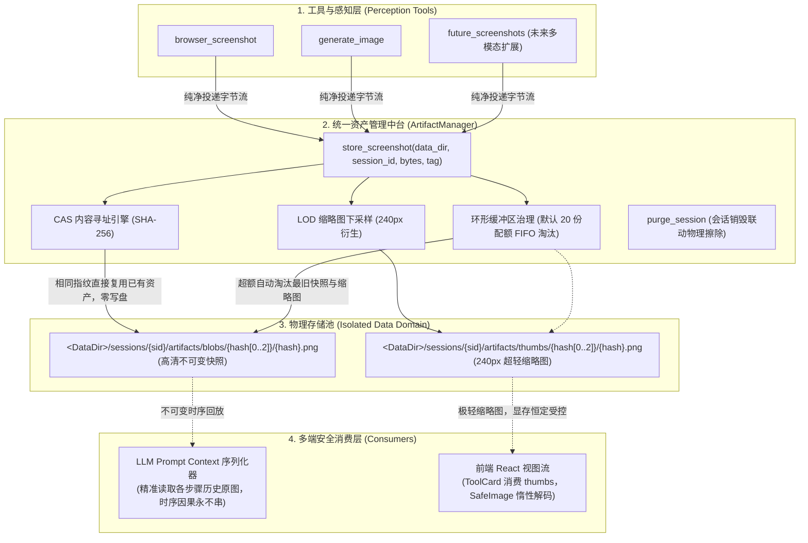

# AI Agent 多模态视觉资产治理、CAS内容寻址与时序因果记忆防护知识文档
(SESSION_ARTIFACT_CAS_AND_VISION_MEMORY_KNOWLEDGE)

| 属性 | 说明 |
| :--- | :--- |
| **文档代号** | `SESSION_ARTIFACT_CAS_AND_VISION_MEMORY_KNOWLEDGE` |
| **所属模块** | [`src-tauri/src/artifacts/*`](file:///f:/WorkSpace/Other/harness_mini/src-tauri/src/artifacts/), [`src-tauri/src/browser/mod.rs`](file:///f:/WorkSpace/Other/harness_mini/src-tauri/src/browser/mod.rs), [`src-tauri/src/agent.rs`](file:///f:/WorkSpace/Other/harness_mini/src-tauri/src/agent.rs), [`src/components/ToolCard.tsx`](file:///f:/WorkSpace/Other/harness_mini/src/components/ToolCard.tsx), [`src/components/SafeImage.tsx`](file:///f:/WorkSpace/Other/harness_mini/src/components/SafeImage.tsx) |
| **技术体系** | Content-Addressable Storage (CAS) · SHA-256 · Ring Buffer · Multi-modal Context · React 18 · Tauri 2 |
| **创建时间** | 2026-10-20 |
| **核心机制** | CAS 内容寻址去重 · 环形缓冲区滚动配额 · 多模态时序因果记忆防护 · 前端 LOD 缩略图显存免疫 |

---

## 一、 现场故障复盘与隐蔽致命痛点

在基于桌面 AI Agent（`harness_mini`）执行复杂的 Web 端自动化排查（如医疗管理系统 UI 检查）时，现场复盘了一起极其典型的多模态串图与因果记忆崩塌故障：

### 1.1 前端表象：缩略图旧、详情大图新、历史全毁
- **现象一（缩略图停留旧版本）**：在长对话流中，Agent 连续执行了 6 轮截图与识图。后续步骤的工具卡片中，缩略图依然停留在先前的画面上；
- **现象二（详情大图被篡改）**：当用户点击任意历史卡片的缩略图试图放大排查时，弹出的详情 Lightbox 却全部变成了最后一步（第 6 步保存表单校验报错）的画面；
- **现象三（诊断过程不可回溯）**：历史各阶段的真实页面状态在磁盘上荡然无存，多模态辅助排查的留痕机制彻底失效。

### 1.2 数据链路根因与 WebView 强缓存机制
通过审查底层 SQLite 数据库（会话 `e58e2876...`）与源代码：
- **硬编码单文件覆写**：旧版 [`browser_screenshot`](file:///f:/WorkSpace/Other/harness_mini/src-tauri/src/browser/mod.rs) 将截图一律覆写到固定文件路径 `.harness/tmp/browser_screenshot.png`；
- **WebView 内存强缓存**：前端 [`SafeImage`](file:///f:/WorkSpace/Other/harness_mini/src/components/SafeImage.tsx) 将文件路径转化为 Tauri 资产协议（`asset://localhost/...`）。由于路径字符串始终未变，WebView 命中已解码位图强缓存，后续卡片渲染依旧显示旧图；
- **物理覆盖**：当用户点击任意卡片缩略图查看大图时，弹窗组件穿透缓存重新读取物理磁盘，但此时磁盘文件已被最后一步覆写，因此所有历史卡片打开的详情大图全都是最新图。

### 1.3 隐蔽致命缺陷：大模型历史时序因果记忆被物理篡改
更严重的深层缺陷发生在 [`src-tauri/src/agent.rs`](file:///f:/WorkSpace/Other/harness_mini/src-tauri/src/agent.rs) 的多模态构建阶段：
```rust
// 旧版 agent.rs: 遍历历史 tool 消息为多模态 LLM 构造 Prompt
if let Some(ref att_list) = atts {
    for att in att_list {
        if att.is_image {
            // 重新从磁盘读取 att.path 并转为 Base64 传入上下文
            if let Ok(bytes) = std::fs::read(&att.path) {
                ...
            }
        }
    }
}
```
当 Agent 推进到第 6 步向大模型发起后续提示词时，系统会重新读取历史上所有 tool 消息绑定的图片附件路径。
由于所有历史附件的 `att.path` 都指向同一个被反复覆盖的文件，**大模型在第 6 轮思考时，读取到的历史步骤 1、3、5 的图片全部被物理篡改成了第 6 步的画面**！
模型的视觉时序因果记忆被彻底破坏，因果推理逻辑完全断裂。

---

## 二、 拒绝堆叠式修补：架构思考与原则确立

面对上述问题，最直接的“打补丁”做法是在 `browser` 模块里生成带时间戳的文件，并在该模块内部维护一个 15 张图的文件删除循环。但我们**坚决拒绝了这种局部堆叠式的修改**，原因在于：

1. **违背单一职责（SRP）**：`browser` 模块的职责是驱动 CDP 浏览器，不应承担“会话级二进制资产存储”、“磁盘目录扫描”与“LRU 淘汰”的职责；
2. **工作区污染（Workspace Pollution）**：把大量高频调试的临时截图塞在工程工作区 `.harness/tmp/` 下，污染用户代码树并干扰文件监听与 Git 状态；
3. **缺乏通用性**：未来若新增桌面截图（`desktop_screenshot`）或录屏切片，打补丁代码必须到处复制粘贴。

### 顶层架构四大设计原则
* **原则一：工作区零污染（Zero Workspace Pollution）**：所有临时视觉产物收敛到系统数据目录 `<DataDir>/sessions/{session_id}/artifacts/`；
* **原则二：内容寻址去重（Content-Addressable Storage, CAS）**：以 SHA-256 内容哈希作为物理存储与寻址凭证。连续截图若画面未变，物理写入为 0，磁盘与内存增量为 0；
* **原则三：不可变值语义（Immutable Value Semantics）**：生成后物理不可变，数学级保证缓存一致与时序准确；
* **原则四：分级渲染与显存免疫（LOD & Viewport Decoupling）**：列表卡片仅消费 240px 超轻缩略图，详情按需加载原图，彻底解耦长列表与 WebView 显存消耗。

---

## 三、 系统级 CAS 资产中台拓扑与设计



---

## 四、 核心落地实现与代码解析

### 4.1 统一资产管理器（[`src-tauri/src/artifacts/mod.rs`](file:///f:/WorkSpace/Other/harness_mini/src-tauri/src/artifacts/mod.rs)）
```rust
pub struct ArtifactManager;

impl ArtifactManager {
    pub const DEFAULT_MAX_SNAPSHOTS: usize = 20;

    pub async fn store_screenshot(
        data_dir: &Path,
        session_id: &str,
        bytes: &[u8],
        step_tag: Option<&str>,
    ) -> Result<SessionArtifact, String> {
        let hash_hex = format!("{:x}", Sha256::digest(bytes));
        let short_hash = &hash_hex[..12];

        // 会话隔离拓扑结构
        let artifacts_root = data_dir.join("sessions").join(session_id).join("artifacts");
        let sub_dir_name = &hash_hex[..2];
        let blob_dir = artifacts_root.join("blobs").join(sub_dir_name);
        let thumb_dir = artifacts_root.join("thumbs").join(sub_dir_name);

        tokio::fs::create_dir_all(&blob_dir).await.map_err(|e| e.to_string())?;
        tokio::fs::create_dir_all(&thumb_dir).await.map_err(|e| e.to_string())?;

        let blob_path = blob_dir.join(format!("{hash_hex}.png"));
        let thumb_path = thumb_dir.join(format!("{hash_hex}.png"));

        // CAS 去重写入：画面未变时直接跳过写盘，实现物理零冗余
        let mut thumb_created = thumb_path.exists();
        if !blob_path.exists() {
            tokio::fs::write(&blob_path, bytes).await.map_err(|e| e.to_string())?;
            if let Ok(()) = Self::generate_thumbnail(bytes, &thumb_path).await {
                thumb_created = true;
            }
        }

        // 环形缓冲区配额治理：超额自动剔除最早的快照
        let _ = Self::apply_retention_policy(&artifacts_root, Self::DEFAULT_MAX_SNAPSHOTS).await;

        Ok(SessionArtifact {
            id: uuid::Uuid::new_v4().to_string(),
            session_id: session_id.to_string(),
            hash: hash_hex,
            file_name: format!("{}_{short_hash}.png", step_tag.unwrap_or("shot")),
            original_path: blob_path,
            thumbnail_path: if thumb_created { Some(thumb_path) } else { None },
            mime_type: "image/png".to_string(),
            byte_size: bytes.len() as u64,
            is_ephemeral: true,
            created_at: chrono::Utc::now().timestamp_millis(),
        })
    }
}
```

### 4.2 工具层解耦收敛（[`src-tauri/src/browser/mod.rs`](file:///f:/WorkSpace/Other/harness_mini/src-tauri/src/browser/mod.rs)）
```rust
pub async fn browser_screenshot(ctx: &ToolCtx) -> Result<String, String> {
    ...
    // 模块职责回归纯粹：一键委托给资产中台
    let artifact = crate::artifacts::ArtifactManager::store_screenshot(
        &data_dir,
        &session_id,
        &bytes,
        Some("browser"),
    ).await?;

    let original_str = artifact.original_path.to_string_lossy().replace('\\', "/");
    let thumb_str = artifact.thumbnail_path.as_ref()
        .map(|p| p.to_string_lossy().replace('\\', "/"))
        .unwrap_or_else(|| original_str.clone());

    // 维持工作区最新快照快捷指针，保持向下兼容
    ...
    Ok(format!(
        "### 浏览器页面屏幕快照已成功捕获\n\
         - **资产快照路径**: `{original_str}`\n\
         - **缩略图路径**: `{thumb_str}`\n\
         - **内容指纹 (CAS)**: `{}`\n\
         - **图像体积**: ~{} KB\n\n\
         > **注意**：确需排查排版时，请直接调用 `recognize_image(path=\"{original_str}\")`。",
        artifact.hash, bytes.len() / 1024
    ))
}
```

### 4.3 前端分级渲染与显存防护（[`src/components/ToolCard.tsx`](file:///f:/WorkSpace/Other/harness_mini/src/components/ToolCard.tsx)）
```tsx
// 自动推导对应的轻量缩略图路径
const thumbnailPath = useMemo(() => {
  if (!displayImagePath) return "";
  if (/[\\/]artifacts[\\/]blobs[\\/]/.test(displayImagePath)) {
    return displayImagePath.replace(/([\\/])artifacts([\\/])blobs([\\/])/, "$1artifacts$2thumbs$3");
  }
  return "";
}, [displayImagePath]);

// 卡片只挂载 240px 轻量缩略图，异步惰性解码；点击放大镜时按需加载高清原图
<SafeImage
  src={thumbnailPath || displayImagePath}
  alt="目标图片"
  loading="lazy"
  decoding="async"
  className="w-full h-full object-cover group-hover:scale-105 transition-transform duration-200"
/>
```

---

## 五、 收益对照与工业级指标对比

| 衡量维度 | 历史现状（单文件固定覆写） | 局部堆叠补丁 | 系统级 CAS 资产中台（现行方案） |
| :--- | :--- | :--- | :--- |
| **缩略图与详情一致性** | ❌ 严重错乱（缩略图旧、详情新） | ⚠️ 依赖 URL Query 破坏缓存 | ✅ **数学级保证一致，不可变语义** |
| **模型多模态时序因果** | ❌ 严重破坏（历史被最新篡改） | ⚠️ 手动拼路径易漏 | ✅ **绝对精准还原时序上下文** |
| **磁盘占用增长** | 恒定约 100KB（但数据全失） | ❌ 堆叠在工作区，无限膨胀 | ✅ **CAS 零冗余去重 + 20 份滚动淘汰** |
| **前端 WebView 显存** | 易因缓存错乱引起卡顿 | ❌ 1080p 大图常驻，易 OOM | ✅ **LOD 缩略图下采样 + 视口惰性加载** |
| **工作区清洁度** | ⚠️ 临时图片散落工作区 | ❌ 污染工作区 `.harness/tmp/` | ✅ **工作区零污染，集中于数据域** |
| **代码可维护性** | 耦合在 `browser/mod.rs` | ❌ 职责蔓延，多工具重复造轮子 | ✅ **高内聚中台抽象，即插即用** |

---

## 六、 开发者与维护者操作指南

1. **新增多模态视觉工具**：
   未来新增任何屏幕截屏、画布绘制或录屏切片工具，严禁自行在工作区创建文件，直接调用统一接口：
   ```rust
   let artifact = crate::artifacts::ArtifactManager::store_screenshot(
       &data_dir,
       &session_id,
       &image_bytes,
       Some("tool_name"),
   ).await?;
   ```
2. **快照保留阈值调整**：
   在 [`ArtifactManager::DEFAULT_MAX_SNAPSHOTS`](file:///f:/WorkSpace/Other/harness_mini/src-tauri/src/artifacts/mod.rs#L12) 中统一调整单个会话的最大保留快照数量（默认 20 份，约 10MB~20MB 磁盘占用）。
3. **单元测试回归验证**：
   可随时运行针对资产中台的自动化测试套件：
   ```bash
   cargo test --manifest-path src-tauri/Cargo.toml artifacts
   ```
