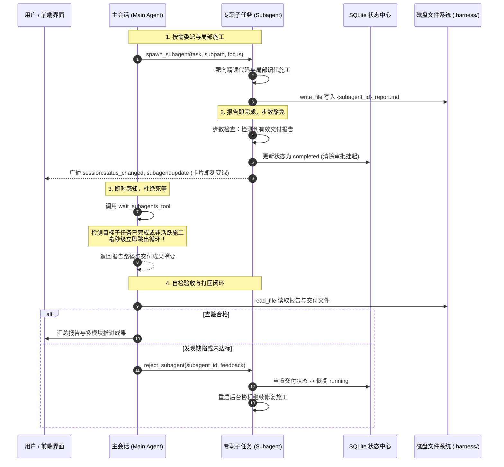

# 子任务协同死等修复、生命周期闭环与前后端 SOP 字典治理知识文档 (SUBAGENT_COORDINATION_HANG_FIX_AND_SOP_DICTIONARY_KNOWLEDGE)

| 项目 | 内容 |
| :--- | :--- |
| **文档名称** | 子任务协同死等修复、生命周期闭环与前后端 SOP 字典治理知识文档 |
| **版本** | v1.0 (生产落地与验证版) |
| **状态** | 生产已落地已验证 (Production Verified) |
| **关联模块** | `src-tauri/src/sop_catalog.rs` (新增), `src-tauri/src/agent.rs`, `src-tauri/src/tools/subagent.rs`, `src-tauri/src/context/static_system.rs`, `src-tauri/src/commands.rs`, `src-tauri/src/lib.rs`, `src/types.ts`, `src/ipc.ts`, `src/components/SettingsModal.tsx` |
| **核心定位** | 系统性记录主会话与子任务协同中 `wait_subagents_tool` 死等假死、子任务写完交付报告仍被步数限制挂起、会话状态反转（终止->完成）、主架构师推诿编码，以及前后端 SOP 硬编码脱节的根本原因与全链路解决方案。 |

---

## 目录
- [一、背景与核心痛点复盘](#一背景与核心痛点复盘)
  - [1. 痛点 1：`wait_subagents_tool` 死等 900 秒假死 Bug](#1-痛点-1wait_subagents_tool-死等-900-秒假死-bug)
  - [2. 痛点 2：子任务状态颠簸反转与步数审批卡死](#2-痛点-2子任务状态颠簸反转与步数审批卡死)
  - [3. 痛点 3：主任务被强加“总架构师”角色并强制推诿编码](#3-痛点-3主任务被强加总架构师角色并强制推诿编码)
  - [4. 痛点 4：主会话验收打回机制与纪律规范不明确](#4-痛点-4主会话验收打回机制与纪律规范不明确)
  - [5. 痛点 5：前后端 SOP 规范两套硬编码严重对不齐](#5-痛点-5前后端-sop-规范两套硬编码严重对不齐)
- [二、总体架构设计 (Before vs After)](#二总体架构设计-before-vs-after)
  - [1. 重构架构全景拓扑](#1-重构架构全景拓扑)
  - [2. 协同闭环时序流 (Sequence Diagram)](#2-协同闭环时序流-sequence-diagram)
- [三、四大治理机制与工程实现](#三四大治理机制与工程实现)
  - [机制 1：`wait_subagents` 多维活跃感知与毫秒级即时跳出](#机制-1wait_subagents-多维活跃感知与毫秒级即时跳出)
  - [机制 2：报告落盘即正常结案 & 步数耗尽豁免机制](#机制-2报告落盘即正常结案--步数耗尽豁免机制)
  - [机制 3：主任务能力解绑与自检验收打回闭环](#机制-3主任务能力解绑与自检验收打回闭环)
  - [机制 4：单一真实源（SSOT）SOP 数据字典系统](#机制-4单一真实源ssotsop-数据字典系统)
- [四、核心工程源码映射与改动清单](#四核心工程源码映射与改动清单)
- [五、验证结果与质量验收](#五验证结果与质量验收)

---

## 一、背景与核心痛点复盘

在 AI Agent 框架的多任务并发与协同场景中，主会话（Main Session）通常按需派生多个专职子任务（Subagents）并行执行局部代码重构与施工。然而在实际使用中，暴露出五大严重阻碍体验的系统性问题：

### 1. 痛点 1：`wait_subagents_tool` 死等 900 秒假死 Bug
- **现象**：当两个子任务都已经完成（或已写入交付报告）时，主任务调用 `wait_subagents` 工具却长时间无反应，陷入死等，直到等待超时（900 秒）才被迫醒来。
- **根因分析**：
  - `wait_subagents_tool` 在等待循环中判断子任务是否结束，唯一依赖的是 `crate::agent::is_run_active(sub_session_id)`；
  - 当子任务用完初始分配的步数（例如 30 步或 80 步），且正在请求步数追加审批（`request_step_approval.await`）时，后台协程处于挂起阻塞状态（并未真正退出）；
  - 此时 `is_run_active` 恒为 `true`，导致 `wait_subagents` 误认为子任务仍在活跃推进，一直在 `tokio::time::sleep` 循环中死等满 900 秒。

### 2. 痛点 2：子任务状态颠簸反转与步数审批卡死
- **现象**：
  - 子任务即便调大到 80 步依然“不够用”；
  - 子任务完成后状态并未立即变为“已完成”，而是先闪变为“已终止”（`cancelled`），在等待一段时间或用户再次干预后才变为“已完成”；
- **根因分析**：
  - 子任务在第 80 步成功通过 `write_file` 输出了交付报告 `.harness/subtasks/{id}_report.md`；
  - 但随后在下一步准备向用户输出文本汇报时，循环计数撞上了 `_step >= current_max_steps`；
  - 系统机械地将其挂起在 `pending_step_approvals` 中等待用户在前端界面审批；
  - 由于用户在主任务界面并未感知到子任务需要提步，主任务随后超时或中止，子任务被状态巡检判定为异常退出，状态被级联改写为 `cancelled`（前端渲染为“已终止”）；
  - 随后其它逻辑检测到报告存在，又后置改回 `completed`，产生令人困惑的状态颠簸。

### 3. 痛点 3：主任务被强加“总架构师”角色并强制推诿编码
- **现象**：用户未创建协作者，但主会话在没有任何子任务需要处理时也拒绝直接修改代码，言必称“作为总架构师，具体编码与模块落地按需委派给专职子 Agent”；甚至主任务对话被注入伪造的系统提示拦截。
- **根因分析**：
  - 系统静态提示词 `subagent_orchestration` 中写死了角色剥夺约束：  
    *“角色定位：你作为总架构师与统筹协调者，把控全局契约设计与最终汇总验收；具体编码与模块落地按需委派给专职子 Agent。”*
  - `agent.rs` 中甚至注入了硬编码伪造拦截消息：  
    *“关联的专职子任务已在后台拉起继续推进...请立即调用 wait_subagents 工具等待其交付最新成果，切勿自行并发修改业务代码！”*  
    该消息直接剥夺了主 Agent 直接修改代码的意愿与权利。

### 4. 痛点 4：主会话验收打回机制与纪律规范不明确
- **现象**：主任务在读取子任务报告后，若发现代码存在问题，旧提示词机械建议调用不存在的 `resume_subprocess`；或者旧规范走向极端——“绝对严禁总架构师亲自动手编码修改”，缺乏平衡实用的打回与自检标准。

### 5. 痛点 5：前后端 SOP 规范两套硬编码严重对不齐
- **现象**：前端设置弹窗（`SettingsModal.tsx`）中的 SOP 开关与后端提示词装配（`static_system.rs`）是两套独立手写的列表：
  - 前端展示的开关（如 `subagent_deliver`），后端根本没有 `is_sop_enabled("subagent_deliver")` 的联动判断，开关形同虚设；
  - 后端实际生效的核心底线规则（如 `process_safety_boundary` 进程生命周期红线、`visual_artifact` 双轨工件交互规范），前端界面完全没有展示，用户无法感知与全局掌控。

---

## 二、总体架构设计 (Before vs After)

### 1. 重构架构全景拓扑

```mermaid
graph TD
    subgraph 治理前（状态脱节与死锁循环）
        A1[子任务写完报告<br/>准备输出总结] -->|撞上步数上限| A2[挂入 pending_step_approvals]
        A2 --> A3[协程挂起未释放 is_run_active=true]
        A3 -->|主任务 wait_subagents| A4[死等 900 秒超时假死]
        A4 --> A5[级联中止将子任务置为 cancelled]
        A6[前端硬编码 SOP] -.->|无法对齐| A7[后端硬编码 SOP]
    end

    subgraph 治理后（SSOT 字典与即时响应）
        B1[子任务写入交付报告] -->|检测到有效报告| B2[豁免步数审批直接 Done]
        B2 -->|即时广播事件| B3[前端立即变绿已完成]
        B4[主任务 wait_subagents] -->|检测到有效报告或待审批| B5[毫秒级立即跳出等待]
        B5 --> B6[主架构师自检验收]
        B6 -->|发现缺陷| B7[reject_subagent 打回返工]
        B8[后端 sop_catalog 字典] -->|Tauri IPC list_agent_sops| B9[前端动态加载与分类渲染]
    end
```

### 2. 协同闭环时序流 (Sequence Diagram)



---

## 三、四大治理机制与工程实现

### 机制 1：`wait_subagents` 多维活跃感知与毫秒级即时跳出

在 [`src-tauri/src/tools/subagent.rs`](file:///d:/WorkSpace/Project/harness_mini/src-tauri/src/tools/subagent.rs) 中重构循环等待逻辑：
- 废弃单纯依赖 `is_run_active` 的粗暴判断；
- 引入 `any_effectively_running` 综合检测指标：
  ```rust
  let mut any_effectively_running = false;
  for sub_id in &target_ids {
      let is_active = crate::agent::is_run_active(sub_id);
      let is_pending_approval = crate::approval::has_pending_approval(sub_id);
      let has_report = subtask_has_valid_report(&app_handle, &session, sub_id);
      let is_terminal = matches!(sub_status.as_str(), "completed" | "cancelled" | "failed" | "interrupted");

      // 只有在协程存活、且未完成报告、未处于审批等待、非终态时，才视为正在有效施工
      if is_active && !is_pending_approval && !has_report && !is_terminal {
          any_effectively_running = true;
          break;
      }
  }
  if !any_effectively_running {
      // 目标子任务均已交付报告或处于非推进状态，毫秒级跳出等待循环！
      break;
  }
  ```
- 汇总信息清晰输出报告路径，并将错误指引更正为 `reject_subagent(subagent_id, feedback)`。

### 机制 2：报告落盘即正常结案 & 步数耗尽豁免机制

在 [`src-tauri/src/agent.rs`](file:///d:/WorkSpace/Project/harness_mini/src-tauri/src/agent.rs) 中确立以“有效交付报告”作为终极衡量标准：
- **步数检查豁免**：在 `if _step >= current_max_steps` 步数检查处：
  ```rust
  if is_sub && !ws_path_str.is_empty() {
      let report_path = std::path::PathBuf::from(&ws_path_str)
          .join(".harness")
          .join("subtasks")
          .join(format!("{}_report.md", session_id));
      if report_path.is_file() {
          if let Ok(meta) = std::fs::metadata(&report_path) {
              if meta.len() > 100 {
                  // 子任务已写入有效交付报告，认定任务已圆满完成！
                  // 豁免步数审批，直接以 Done 正常结案跳出循环
                  outcome = RunOutcome::Done;
                  break;
              }
          }
      }
  }
  ```
- **即时广播与终态确立**：在会话退出处理中，确保 `has_valid_report` 为 true 时状态坚决写入 `completed`，并清理 `pending_step_approvals`，同时发射 `session:status_changed`、`subagent:update` 和 `subprocess:update`，保证前端状态毫秒级变绿。

### 机制 3：主任务能力解绑与自检验收打回闭环

- **角色松绑**：彻底删除“你作为总架构师，把控全局契约设计，具体编码按需委派给专职子 Agent”的角色剥夺设定。明确主 Agent 具备全栈代码读写能力，面对一般任务就地修改、快速闭环；面对多模块并行任务时才按需委派。
- **清理伪造消息**：移除 `agent.rs` 中向主会话注入的拦截性硬编码语句（*“切勿自行并发修改业务代码！”*），消除了系统行为推诿的根源。
- **纪律平衡确立**：统一将自检与打回纪律更新为：
  > **【自检验收与打回纪律】：自检验收发现子任务交付的代码有缺陷时，主架构师调用 `reject_subagent` 打回返工，非必要情况禁止私自编码。**

### 机制 4：单一真实源（SSOT）SOP 数据字典系统

为了彻底解决前后端脱节，构建统一字典架构：

1. **后端数据字典中心 [`src-tauri/src/sop_catalog.rs`](file:///d:/WorkSpace/Project/harness_mini/src-tauri/src/sop_catalog.rs)**：
   - 定义 `SopItem`、`SopDefinition`；
   - 完整收录 11 项 SOP 规则，严格限定作用域（`universal` / `main_only` / `sub_only`），并标记核心安全底线（`is_hard_rule`）；
   - 提供 `build_sop_rules` 方法，根据当前已启用规则集合与当前会话角色（主会话 vs 子任务）动态组装提示词。
2. **后端提示词重构 [`src-tauri/src/context/static_system.rs`](file:///d:/WorkSpace/Project/harness_mini/src-tauri/src/context/static_system.rs)**：
   - 彻底废除散落的上百行 `if is_sop_enabled(...)`，所有系统规则统一由 `sop_catalog::build_sop_rules` 集中组装。
3. **IPC 通道打通**：
   - [`src-tauri/src/commands.rs`](file:///d:/WorkSpace/Project/harness_mini/src-tauri/src/commands.rs) 暴露 `list_agent_sops`；
   - [`src/ipc.ts`](file:///d:/WorkSpace/Project/harness_mini/src/ipc.ts) 暴露 `listAgentSops()`。
4. **前端动态渲染 [`src/components/SettingsModal.tsx`](file:///d:/WorkSpace/Project/harness_mini/src/components/SettingsModal.tsx)**：
   - 弹窗打开时调用 `ipc.listAgentSops()` 拉取字典；
   - 按照 Phase 1（前置意图门禁）、Phase 2（工程规划与落地执行）、Phase 3（系统交互与安全底线红线）分层分组展示；
   - 对 `isHardRule: true` 规则展示“核心底线 / 常驻生效”标识，并锁定不可误关；
   - 完整保留分类颜色、作用域徽标（`universal`/`main_only`/`sub_only`）等所有视觉标签。

---

## 四、核心工程源码映射与改动清单

| 文件路径 | 改动类型 | 核心改动内容说明 |
| :--- | :--- | :--- |
| [`src-tauri/src/sop_catalog.rs`](file:///d:/WorkSpace/Project/harness_mini/src-tauri/src/sop_catalog.rs) | **新增** | 定义统一 SOP 数据字典（11项规则），实现提示词构建器与元数据输出。 |
| [`src-tauri/src/lib.rs`](file:///d:/WorkSpace/Project/harness_mini/src-tauri/src/lib.rs) | 修改 | 声明 `pub mod sop_catalog;` 并在 Tauri `invoke_handler!` 注册 `list_agent_sops`。 |
| [`src-tauri/src/commands.rs`](file:///d:/WorkSpace/Project/harness_mini/src-tauri/src/commands.rs) | 修改 | 新增 `list_agent_sops` 命令，将字典元数据序列化返回前端。 |
| [`src-tauri/src/context/static_system.rs`](file:///d:/WorkSpace/Project/harness_mini/src-tauri/src/context/static_system.rs) | 修改 | 重构系统提示词生成逻辑，调用 `sop_catalog::build_sop_rules` 动态组装；更新 `reject_subagent` 工具提示。 |
| [`src-tauri/src/tools/subagent.rs`](file:///d:/WorkSpace/Project/harness_mini/src-tauri/src/tools/subagent.rs) | 修改 | `wait_subagents_tool` 增加 `any_effectively_running` 检测，消除死等 900 秒；修正打回指引为 `reject_subagent`。 |
| [`src-tauri/src/agent.rs`](file:///d:/WorkSpace/Project/harness_mini/src-tauri/src/agent.rs) | 修改 | 步数检查处增加子任务有效报告豁免（避免卡入步数审批）；强化退出终态判定；即时广播状态事件；移除伪造拦截消息。 |
| [`src/types.ts`](file:///d:/WorkSpace/Project/harness_mini/src/types.ts) | 修改 | `AgentSopInfo` 增加 `isHardRule?: boolean`；静态常量 `AGENT_SOPS` 补齐 11 项规则作为降级兜底。 |
| [`src/ipc.ts`](file:///d:/WorkSpace/Project/harness_mini/src/ipc.ts) | 修改 | 增加 `listAgentSops` IPC 契约调用。 |
| [`src/components/SettingsModal.tsx`](file:///d:/WorkSpace/Project/harness_mini/src/components/SettingsModal.tsx) | 修改 | 动态拉取后端 SOP 字典；支持 Phase 1/2/3 分层渲染；`isHardRule` 锁定常驻生效；保持所有标签与样式不变。 |

---

## 五、验证结果与质量验收

1. **Rust 后端编译**：
   - 运行命令：`cargo check --manifest-path src-tauri/Cargo.toml`
   - 结果：**0 errors**，顺利通过。
2. **前端 TypeScript 类型检查**：
   - 运行命令：`npx tsc --noEmit`
   - 结果：**0 errors**，类型全链路畅通。
3. **协同闭环验收指标**：
   - 子任务在输出有效交付报告后，**无条件豁免步数审批，状态直接置为 `completed` 并即时刷新前端**；
   - 主任务调用 `wait_subagents` 时，目标子任务一旦完成或挂起，**毫秒级即时跳出循环并输出报告查验指引，死等 900 秒现象彻底消除**；
   - 主会话解除了强制架构师身份绑定，优先就地修改代码，仅在确需并行时委派；
   - 前后端 SOP 规范统一为单一数据源，前端可全面查看和管理 11 项 SOP 规则，核心底线清晰展示。
