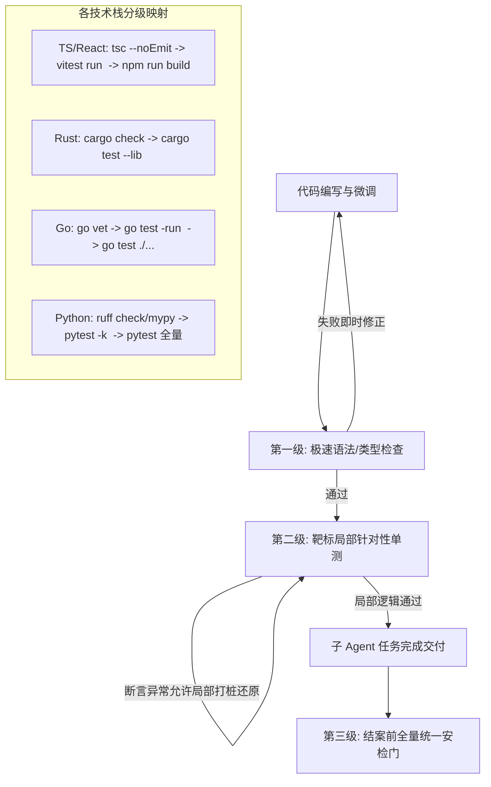

# 子 Agent 协同编排与执行效能治理规范 (SUBAGENT_ORCHESTRATION_AND_EXECUTION_GOVERNANCE_SPEC)

| 项目 | 内容 |
| --- | --- |
| 文档名称 | 子 Agent 协同编排与执行效能治理规范 (SUBAGENT_ORCHESTRATION_AND_EXECUTION_GOVERNANCE_SPEC) |
| 版本 | v1.0 |
| 状态 | 已落地实施 (Implemented) |
| 关联模块 | `src-tauri/src/agent.rs`（系统提示词/协同编排 SOP）, `src-tauri/src/tools.rs`（终端运行时/子任务协作工具链） |

---

## 1. 背景与核心问题溯源

在桌面级 AI Agent 架构重构任务（左侧看板单一投影与归属落库）中，主会话的一轮执行耗时达到了 **26 分 18 秒**，累计产生 **1300 万 Token**。该轮对话呈现出“4 轮（实为 3 批 6 实例）`spawn_subagent` 协同派发”的特征。

深入排查底层数据库日志（`harness_mini.db`）与执行轨迹，发现系统在长耗时与多 Agent 协同层面暴露出了数个深层次的架构摩擦：

1. **子任务陷入微观自测死循环**：单个后端子 Agent 耗时高达 **12.10 分钟**，在生产源码测试中打桩插入临时单测，反复添加 `println!` 并触发了 **7 次重型 `cargo test` 编译**；
2. **“假并行、真人为串行”的木桶效应累加**：中枢将可以并行的重构任务强行拆成 3 批串行推进，甚至单独派发了一个纯“调研评估”的子任务，导致总耗时为各批次最慢短板的直接累加（$6.16\text{m} + 2.69\text{m} + 12.10\text{m} \approx 20.95\text{m}$）；
3. **协作工具协议错位与模型幻觉**：SOP 提示词与底层工具名不一致，导致主 Agent 首步误调不存在的 `create_collaborator` 工具报错；
4. **等待上限截断导致的假报警与重入轮询**：`wait_subagents` 硬编码 300 秒超时上限，重型构建直接触发伪超时，迫使中枢多次唤醒重试；
5. **Windows 终端环境与退出码假报警**：PowerShell 重定向默认生成 UTF-16 导致文本工具读出乱码；PowerShell 将 stderr 编译器警告视为 ErrorRecord，即使单测全绿也向外部返回退出码 1，引发主 Agent 陷入排错恐慌。

本规范确立了“**非堆叠、重结构、语言无关、单波宽并发**”的工业级治理方案。

---

## 2. 根因剖析与架构认知澄清

### 2.1 子 Agent 的 7 轮自测：是无意义动作还是手段失当？
* **真实动机**：子 Agent 在实现历史方案回填（`backfill_plan_sources`）后，为了验证面对真实工作区和真实 SQLite 历史数据时的边界表现（防误归因、防数据写坏），在本地进行了 dry-run 验证。
* **业务价值**：证实了老方案 Frontmatter 缺失 `session_id` 时的保守安全性（安全判定为 `unattributable`），算法是幂等且安全的，并在完成后主动清理了临时代码。
* **低效根因**：**混淆了“探查环境”与“代码调试”的边界**。查看真实数据本可用轻量只读脚本（5秒内出结果），子 Agent 却选择了在核心源码中写单测打桩 + 反复触发 Rust 增量编译与链接，付出了数分钟的等待与高昂的复原成本。

### 2.2 `taskSubtaskMaxSteps` 的作用域澄清
经核验代码，`taskSubtaskMaxSteps`（默认 30）在架构上专门服务于**长任务系统（LongTask）**，用于防范长周期任务的子阶段失控；而 `spawn_subagent` 派生的是独立子会话，继承主会话的轮次预算完全符合最初设计。子 Agent 的行为收敛应依赖**提示词预算意识**与**分级验证准则**，而非暴力掐断。

---

## 3. 核心治理规范与架构设计

### 3.1 跨语言通用「代码调试与分级验证准则」

彻底消除针对特定语言（如 `cargo check`）的硬编码误解，抽离出跨技术栈的通用验证哲学：



#### 规则要点：
1. **环境探查优先用只读命令**：严禁通过在业务源码或单测中硬编码 SQL 或临时文件操作来打印数据；
2. **逻辑调试允许局部打印并要求原子复原**：单测断言失败难以排查时，允许在测试函数内输出状态（如 `dbg!` / `console.log` / `print`），验证完毕必须随手清理；
3. **分级验证**：高频改动使用快速类型检查（如 TS `tsc --noEmit`、Rust `cargo check`）；逻辑验证只跑目标单测；全量构建集中在最后一道门禁。

---

### 3.2 弹性多子 Agent 并行与单波宽并发流水线

打破“只能派发一前一后”的刻板限制，支持面对大任务时横向扩展（多个前端 + 多个后端并发开发）：

```
                ┌──────────────────────────────────────────────┐
                │          中枢总架构师 (Lead Orchestrator)      │
                │   1. 计划期完成契约 (TS类型 / Rust结构体 / 路由)  │
                │   2. 划定正交文件靶标 (subpath / relevant_files)   │
                └──────┬────────────┬─────────────┬────────────┘
                       │            │             │
        ┌──────────────┴───┐ ┌──────┴─────┐ ┌─────┴────────┐
        │  前端 Worker 1   │ │ 前端 Worker 2│ │ 后端 Worker 1│ ... (单波宽并发)
        │ 负责: 页面组件视图 │ │ 负责: 数据Store│ │ 负责: 存储与回填│
        │ 靶标: src/ui/... │ │ 靶标: src/store│ │ 靶标: store.rs │
        └──────────────┬───┘ └──────┬─────┘ └─────┬────────┘
                       │            │             │
                       └────────────┼─────────────┘
                                    ▼
                ┌──────────────────────────────────────────────┐
                │    统一等待汇聚: wait_subagents([...All])     │
                │     总等待时间 = max(T1, T2, T3, T4) (消除串行)│
                │     单一结案门禁: 中枢跑一次全量验证即结案      │
                └──────────────────────────────────────────────┘
```

#### 协同三红线：
1. **文件/模块边界正交隔离**：并发派发的子 Agent 必须被明确限定负责互不正交的文件集，严禁两个子 Agent 并发修改同一文件的同一逻辑段；
2. **契约先行（Contract-First）**：公共接口与数据结构在计划文档中提前定义完毕，各端对照契约独立开发，消除跨端等待；
3. **单波宽并发与单一结案门禁**：同波次一次性派发全部工人，用 **1 次 `wait_subagents`** 汇聚；中间过程免全量重构，结案前统一执行一次全局安检门（Gatekeeper）。

---

### 3.3 Windows 终端底座环境与原生退出码保真

参考 Claude Code 与 VS Code 终端引擎架构，彻底解决 Windows PowerShell 的编码与假退出码问题。

```rust
// 核心设计模式：Preamble -> User Script -> Epilogue 退出码提取
$OutputEncoding = [Console]::OutputEncoding = [System.Text.Encoding]::UTF8;
$PSDefaultParameterValues['Out-File:Encoding'] = 'utf8';
$PSDefaultParameterValues['*:Encoding'] = 'utf8';
<User Script>
if ($LASTEXITCODE -ne $null) { exit $LASTEXITCODE }
```

* **UTF-8 锁死**：将 `$PSDefaultParameterValues` 全局注册，所有 `>`、`>>`、`Out-File` 输出强制为 UTF-8 无 BOM，消灭 UTF-16 乱码文件；
* **Native Exit Code 提取**：提取原生进程真正的 `$LASTEXITCODE`，彻底阻断 PowerShell 将 stderr 警告转化为 `exit code 1` 的假报错机制。

---

## 4. 实施代码落地与比对

### 4.1 终端底座加固 (`src-tauri/src/tools.rs`)
* **修改位置**：`run_command`（Windows 构建块）
* **代码比对**：
```diff
@@ -1838,7 +1838,11 @@ async fn run_command(
         let mut c = tokio::process::Command::new("powershell");
         c.args(["-NoProfile", "-NonInteractive", "-ExecutionPolicy", "Bypass", "-Command"]);
         c.arg(format!(
-            "[Console]::OutputEncoding = [System.Text.Encoding]::UTF8; $OutputEncoding = [System.Text.Encoding]::UTF8; {command}"
+            "$OutputEncoding = [Console]::OutputEncoding = [System.Text.Encoding]::UTF8;\n\
+             $PSDefaultParameterValues['Out-File:Encoding'] = 'utf8';\n\
+             $PSDefaultParameterValues['*:Encoding'] = 'utf8';\n\
+             {command}\n\
+             if ($LASTEXITCODE -ne $null) {{ exit $LASTEXITCODE }}"
         ));
         c.creation_flags(CREATE_NO_WINDOW);
         c
```

### 4.2 `wait_subagents` 等待上限放宽 (`src-tauri/src/tools.rs`)
* **修改位置**：ToolSpec 描述与 `wait_subagents_tool` 执行逻辑
* **代码比对**：
```diff
@@ -480,7 +480,7 @@ pub fn tool_specs() -> Vec<ToolSpec> {
                     "timeout_seconds": {
                         "type": "integer",
-                        "description": "最大等待超时秒数（默认 60 秒，最大 300 秒）"
+                        "description": "最大等待超时秒数（默认 60 秒，最大 900 秒）"
                     }
                 }
@@ -2726,7 +2726,7 @@ async fn wait_subagents_tool(args: &Value, ctx: &ToolCtx) -> Result<String, St
     let host = ctx.host.as_ref().ok_or("内部错误：缺少宿主上下文")?;
-    let timeout_secs = get_u64_arg(args, "timeout_seconds", 60).clamp(5, 300);
+    let timeout_secs = get_u64_arg(args, "timeout_seconds", 60).clamp(5, 900);
```

### 4.3 提示词 SOP 协同规范重构 (`src-tauri/src/agent.rs`)
* **修改位置**：`subagent_orchestration` 规则注入段
* **核心内容**：
  * 消除 `create_collaborator` 幻觉，统一定义动态派生工具为 `spawn_subagent` + `wait_subagents`；
  * 明确大任务支持多前端 + 多后端高并发开发；
  * 确立“正交领域隔离”、“单波宽并发”与“过程免全量构建、单一结案门禁”三大原则。

---

## 5. 预期工程收益

| 指标 | 治理前 | 治理后 | 收益价值 |
|---|---|---|---|
| **端到端执行延迟** | 26 分 18 秒 | 预估 **8 ~ 10 分钟以内** | 耗时缩短 **60% 以上** |
| **Token 资源消耗** | 1303 万 Token | 预估 **400 ~ 600 万 Token** | 减少无谓探索与重复重跑，Token 节约 **50%+** |
| **Windows 环境稳定性** | 文件写出 UTF-16 乱码、stderr 假报错退出 1 | 原生退出码精准保真、强制 UTF-8 重定向 | 彻底消除 Windows 终端环境摩擦 |
| **子任务健康度** | 频繁 300s 超时唤醒重试、生产打桩单测 | 900s 稳定窗口、分级快速校验、原子复原 | 保证交付代码整洁、无调试残余 |
