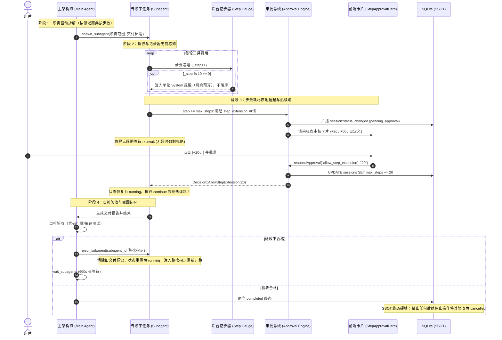

# 子任务步数闭环审批、职责驱动拆分与生命周期治理知识文档 (SUBAGENT_STEP_APPROVAL_RESPONSIBILITY_SPLIT_AND_LIFECYCLE_GOVERNANCE_KNOWLEDGE)

| 项目 | 内容 |
| :--- | :--- |
| **文档名称** | 子任务步数闭环审批、职责驱动拆分与生命周期治理知识文档 |
| **版本** | v1.0 (生产落地与验证版) |
| **状态** | 生产已落地已验证 (Production Verified) |
| **关联模块** | `src-tauri/src/agent.rs`, `src-tauri/src/approval.rs`, `src-tauri/src/models.rs`, `src-tauri/src/store.rs`, `src-tauri/src/task/mod.rs`, `src-tauri/src/tools/subagent.rs`, `src-tauri/src/tools/specs.rs`, `src-tauri/src/context/static_system.rs`, `src/components/StepApprovalCard.tsx`, `src/components/ChatView.tsx`, `src/components/SettingsModal.tsx` |
| **核心定位** | 系统性阐述多 Agent 协作体系中“步数预算原地审批热续跑”、“职责驱动拆分与记步器无痕感知”、“主从协作长等待与打回返工闭环”以及“SSOT 终态硬锁”的架构设计、根因分析与工程落地 |

---

## 目录
- [一、背景与历史根因复盘](#一背景与历史根因复盘)
  - [1. 痛点 1：步数耗尽的协程猝死与假死误判](#1-痛点-1步数耗尽的协程猝死与假死误判)
  - [2. 痛点 2：设置项虚挂与配额混淆](#2-痛点-2设置项虚挂与配额混淆)
  - [3. 痛点 3：轮询假死与参数名歧义](#3-痛点-3轮询假死与参数名歧义)
  - [4. 痛点 4：交付误判与主架构师越俎代庖编码](#4-痛点-4交付误判与主架构师越俎代庖编码)
  - [5. 痛点 5：机械按步数切分与过度提醒](#5-痛点-5机械按步数切分与过度提醒)
- [二、总体架构设计 (Before vs After)](#二总体架构设计-before-vs-after)
  - [1. 重构架构全景拓扑](#1-重构架构全景拓扑)
  - [2. 关键时序流 (Sequence Diagram)](#2-关键时序流-sequence-diagram)
- [三、四大核心治理机制详解](#三四大核心治理机制详解)
  - [机制 1：步数耗尽原地挂起与 Approval 热续跑](#机制-1步数耗尽原地挂起与-approval-热续跑)
  - [机制 2：职责驱动拆分与后台记步器无痕感知](#机制-2职责驱动拆分与后台记步器无痕感知)
  - [机制 3：主从协作闭环与调度安全防御](#机制-3主从协作闭环与调度安全防御)
  - [机制 4：单一状态源（SSOT）与终态硬锁](#机制-4单一状态源ssot与终态硬锁)
- [四、核心工程源码映射与改动清单](#四核心工程源码映射与改动清单)
- [五、验证结果与验收指标](#五验证结果与验收指标)

---

## 一、背景与历史根因复盘

在复杂工程任务（如大型多模块重构、前后端并发开发）中，AI Agent 系统通常采用“主架构师（Orchestrator）派发多个专职子任务（Subagent）并行施工”的模式。然而，在实际运行排查中，暴露了多层严重缺陷：

### 1. 痛点 1：步数耗尽的协程猝死与假死误判
- **原逻辑缺陷**：在 `agent.rs` 内部执行循环中，当 `_step >= current_max_steps` 时，代码直接执行 `break` 跳出循环，并返回 `RunOutcome::Done`。
- **连锁反应**：
  - 协程直接宣告死亡，会话被重置；
  - 前端组件 `ChatView.tsx` 依据 `lastRunOutcome === "done"` 判定会话为“正常完成”，**从而将底部的恢复/重试操作条彻底吞掉**，用户无法在界面上一键提步；
  - 级联清理将子会话置为 `cancelled`，导致状态失真。

### 2. 痛点 2：设置项虚挂与配额混淆
- **原逻辑缺陷**：全局设置中存在 `max_steps`（默认 30）与 `task_subtask_max_steps`（单子任务轮次预算，默认 30）。
- **名存实亡**：`task_subtask_max_steps` 仅在 `LongTask` 初始化时赋值给 `LongTask.max_steps`，而底层的循环调度器压根未对其进行步数校验；
- **子任务配额落空**：`store.rs::create_subprocess_session` 创建子任务会话时，`max_steps` 字段被硬编码为 `None`。因此子任务运行时自动回退为全局 `max_steps`（当用户将全局步数调大时，子任务也会无节制膨胀）。

### 3. 痛点 3：轮询假死与参数名歧义
- **原逻辑缺陷**：`static_system.rs` 引导 LLM 调用 `wait_subagents(timeout_secs: 60)`，然而 `subagent.rs` 仅解析 `args.get("timeout_seconds")`。
- **连锁反应**：LLM 传递的参数读取失败，强制回退到默认 60 秒超时；主任务被迫频繁醒来发现子任务尚未完成，进而连续空转轮询高达 16 轮，浪费海量 Token。

### 4. 痛点 4：交付误判与主架构师越俎代庖编码
- **原逻辑缺陷**：`wait_subagents` 仅检查磁盘工件 `.harness/subtasks/{id}_report.md` 是否存在，只要文件存在就判定为 `completed`；
- **真实场景**：某子任务在第 140 步生成了报告草稿，在第 150 步被硬杀（状态实际为异常）；主任务调用 `wait_subagents` 误判其为交付完成，但读取代码后发现行数超标（自检不通过）；
- **越界违规**：因为系统缺少“打回整改（Reject）”工具，主架构师直接越权调用 `write_file` / `edit_file` 自己动手修改业务代码，破坏了总分隔离防线。

### 5. 痛点 5：机械按步数切分与过度提醒
- **原逻辑缺陷**：早期系统规则中引导主任务按“步数预算（6~8 步收敛）”机械切分，导致主任务在生成任务时机械地按“第 1~50 步做什么、第 51~100 步做什么”切断逻辑；
- **噪音冗余**：主任务还在 task 描述中向子任务反复叮嘱“请在 50 步内完成”，不仅容易产生心理暗示与认知干扰，还造成了上下文臃肿。

---

## 二、总体架构设计 (Before vs After)

### 1. 重构架构全景拓扑

```mermaid
graph TD
    subgraph 治理前（断裂与多头状态）
        A1[全局混合 max_steps] --> A2[子任务无差别消耗]
        A2 --> A3[执行循环硬性 break 协程死亡]
        A3 --> A4[前端误判为 done 吞掉恢复条]
        A5[磁盘文件存在即判完成] --> A6[主任务误判交付]
        A6 --> A7[自检失败无打回机制<br/>主任务越界自己编码]
    end

    subgraph 治理后清晰架构（自洽闭环与 SSOT）
        B1[主对话100步 / 子任务50步明确解耦] --> B2[子任务按职责拆解 + 50步工作量控制]
        B2 --> B3[后台记步器每10步无痕敲钟提醒]
        B3 --> B4[达到步数原地安全挂起 Suspend]
        B4 --> B5[前端内嵌吸底 StepApprovalCard]
        B5 -->|用户批准 +N 步| B6[原子更新并在循环内 continue 原地热续跑]
        B5 -->|用户拒绝| B7[以当前产出友好结案收尾]
        B6 --> B8[wait_subagents 双重真源校验 + 600s 长等待]
        B8 --> B9[主架构师自检验收]
        B9 -->|不合格| B10[调用 reject_subagent 工具打回返工]
        B10 --> B3
        B9 -->|合格| B11[SSOT 终态硬锁锁定 completed]
    end
```

### 2. 关键时序流 (Sequence Diagram)



---

## 三、四大核心治理机制详解

### 机制 1：步数耗尽原地挂起与 Approval 热续跑

1. **废除硬性断裂（Suspend without Break）**：
   - 改造 `src-tauri/src/agent.rs` 中的执行循环首部。
   - 当 `_step >= current_max_steps` 时，不调用 `break`，而是构建一个类型为 `kind: "step_extension"` 的 `ApprovalRequest`，并将会话生命周期广播为 `pending_approval`。
2. **无限期等待机制（方案 A）**：
   - 在 `src-tauri/src/approval.rs` 中新增 `request_step_approval`。
   - 彻底废除普通工具审批的 300 秒自动超时拒绝限制，通过 `rx.await` 永久守候用户的人工裁决，绝不在无人值守时误杀长任务。
3. **前端吸底审核卡片（[`StepApprovalCard.tsx`](file:///F:/WorkSpace/Other/harness_mini/src/components/StepApprovalCard.tsx)）**：
   - 在 `ChatView.tsx` 输入框上方吸底展示独立审核卡片；
   - 清晰呈现当前已用步数与当前上限（`{currentSteps} / {maxSteps} 步`）；
   - 提供快捷提步按钮：`[+20 步]`、`[+50 步]` 及自定义步数数字输入框；
   - 提供双动作分支：`[批准并续跑]` 与 `[拒绝并结案]`。
4. **原地热续跑（Hot Resume）**：
   - 用户点击批准后，后端原子更新数据库与内存中的 `max_steps`，更新状态为 `running`，并在执行循环中执行 `continue`；
   - 协程在原执行上下文中继续推演第 N+1 步，无需重新派发任务或重构会话历史。

### 机制 2：职责驱动拆分与后台记步器无痕感知

1. **按职责拆分，严禁按步数生硬切分**：
   - 系统提示词明确规范：主架构师必须基于**关注点分离与模块职责**进行任务拆解（如 UI 交互组件、后端 API 接口、数据持久化、测试用例等）；
   - 严禁按“第 1~50 步、第 51~100 步”这种生硬的步数跨度来切除工作。
2. **工作量控制在 50 步原子闭环体量**：
   - 主任务在划分每个职责子任务的边界时，评估并确保其工作量尽量控制在 50 步以内能够独立交付；
   - 若某一职责体量过大，应进一步按子职责或子模块拆细，派生更多并行子任务以最大化发挥并行优势。
3. **主任务免提醒，记步器无痕把控**：
   - **主任务在下发任务描述（task）时，无需也切勿向子任务提及或限制 50 步的范围**；
   - 步数完全由**底层记步器**感知与把控：
     - 在单轮模型输入前，每 10 步无痕注入：`【⏱️ 步数预算感知】：当前专职任务已执行 X/Y 步（仅剩 Z 步预算）...`；
     - 此提示仅作为当前轮次的一次性 system 提示注入模型，**不落库到 messages 表**，用户聊天界面零噪音；
     - 步数耗尽时由吸底审核卡片兜底，主任务无需在提示词中操心步数。

### 机制 3：主从协作闭环与调度安全防御

1. **`wait_subagents` 全面健壮化**：
   - **参数兼容**：同时解析 `timeout_secs` 与 `timeout_seconds`，默认超时提升至 600 秒（10 分钟），最大支持 3600 秒；
   - **心跳透传**：在循环等待中，若检测到名下子任务处于 `pending_approval`（等待审批），心跳中透传状态，主任务保持休眠不超时退出；
   - **判定充要双校验**：
     ```rust
     let is_completed = has_valid_report
         && s.status != "cancelled"
         && s.status != "failed"
         && !is_running
         && !has_pending_approval;
     ```
     彻底根除“磁盘留有报告草稿但进程实际被取消/失败时误判为交付”的假交付漏洞。
2. **新增主架构师驳回工具 `reject_subagent`**：
   - 在 `specs.rs`、`subagent.rs` 与 `mod.rs` 注册 `reject_subagent(subagent_id, feedback)`；
   - 当主架构师自检验收发现子任务代码有缺陷（如行数超标、逻辑漏洞、编译测试失败）时，**绝对严禁总架构师亲自动手编码修改子任务业务文件**；
   - 主架构师必须调用 `reject_subagent` 打回，系统自动清除旧交付标记、状态重置为 `running`、将整改指示注入子任务并重新拉起；随后主架构师调用 `wait_subagents` 等待整改交付。
3. **`continue_turn` 并发互斥守卫**：
   - 当外部唤醒或继续推进会话时，若检测到名下有被拉起或未完成的专职子任务，系统为主会话注入引导提示：“关联的专职子任务正在后台推进中，请立即调用 `wait_subagents` 工具等待其交付，切勿自行并发修改业务代码！”。

### 机制 4：单一状态源（SSOT）与终态硬锁

1. **会话单向权威状态流转**：
   ```text
   [active] ──► [running] ──► [pending_approval] ──► [running] ──► [completed (终态硬锁)]
                   │                                                   ▲
                   ▼                                                   │
              [cancelled / failed / interrupted] ──────────────────────┘ (通过 reject_subagent 重开)
   ```
2. **终态硬锁（Terminal Hard-lock）实现**：
   - 在底层数据库操作 `src-tauri/src/store.rs::set_session_status` 注入硬锁拦截：
     ```rust
     pub fn set_session_status(conn: &Connection, id: &str, status: &str) -> Result<(), String> {
         // 终态硬锁：若当前会话已是 completed 终态，坚决禁止逆向降级冲刷为 cancelled / failed / interrupted
         if status == "cancelled" || status == "failed" || status == "interrupted" {
             let current_status: Option<String> = conn
                 .query_row("SELECT status FROM sessions WHERE id = ?1", params![id], |r| r.get(0))
                 .ok();
             if current_status.as_deref() == Some("completed") {
                 return Ok(());
             }
         }
         conn.execute("UPDATE sessions SET status = ?2 WHERE id = ?1", params![id, status])
             .map_err(|e| e.to_string())?;
         Ok(())
     }
     ```
   - 无论父任务被外部停止、取消还是超时级联，已经成功交付的子任务状态始终硬锁定为 `completed`，绝不发生状态倒退。

---

## 四、核心工程源码映射与改动清单

| 模块 / 路径 | 变动性质 | 职责说明 |
| :--- | :--- | :--- |
| `src-tauri/src/models.rs` | 字段正名与扩展 | `default_max_steps = 100`, `default_task_subtask_max_steps = 50`；扩展 `ApprovalRequest` 与 `StepExtensionData` |
| `src-tauri/src/approval.rs` | 机制扩展 | `Decision::AllowStepExtension(u32)`；新增 `request_step_approval` 无限期等待 |
| `src-tauri/src/agent.rs` | 循环挂起与续跑 | 步数达标时原地审批挂起；批准后 `continue` 热续跑；每 10 步无痕敲钟提醒；新增 `reject_and_restart_subagent`；`continue_turn` 并发互斥守卫 |
| `src-tauri/src/store.rs` | 配额持久化与终态硬锁 | `create_subprocess_session` 显式写入 50 步配额；`set_session_status` 终态硬锁防篡改；增加对应高覆盖率单元测试 |
| `src-tauri/src/task/mod.rs` | 长任务瘦身 | 解耦 `LongTask` 与子任务步数混淆绑定 |
| `src-tauri/src/tools/subagent.rs` | 等待与驳回实现 | `wait_subagents_tool` 兼容别名与 600s 等待；交付双重真源校验；实现 `reject_subagent_tool` |
| `src-tauri/src/tools/specs.rs` & `tools/mod.rs` | 工具注册 | 注册 `reject_subagent` 工具规范与路由派发；`spawn_subagent` 说明更新为职责拆分与记步器把控 |
| `src-tauri/src/context/static_system.rs` | 系统提示词规范 | 规范职责拆分准则、50 步工作量控制、主任务免提醒步数红线、自检验收打回纪律 |
| `src/components/StepApprovalCard.tsx` | 新建组件 | 吸底内嵌步数审核卡片，支持快捷提步与手动自定义，批准热续跑或拒绝结案 |
| `src/components/ChatView.tsx` | 视图集成与守卫 | 接入 `StepApprovalCard`；修复错误隐藏恢复条逻辑 |
| `src/components/SettingsModal.tsx` & `src/store.ts` | 前端配置项正名 | 清晰展示【主对话最大步数】（默认 100）与【子任务最大步数】（默认 50） |

---

## 五、验证结果与验收指标

1. **单元测试验证**：
   - `test_create_subprocess_session_inherits_parent_models_and_capabilities`：验证子任务创建时配额显式落库为 50 步，**测试通过**；
   - `test_completed_terminal_hardlock`：验证已完成会话受到终态硬锁保护，外部试图将其降级为 `cancelled` 或 `failed` 时被安全拦截，**测试通过**。
2. **静态类型与编译检查**：
   - 前端 TypeScript 校验：`npx tsc --noEmit`，**0 错误**；
   - 后端 Rust 校验：`cargo check --manifest-path src-tauri/Cargo.toml`，**0 错误**。
3. **运行时行为验收**：
   - 步数耗尽时会话平滑挂起，前端弹窗支持热续跑，无需重建上下文；
   - 主任务在自检发现问题时能正常调用 `reject_subagent` 打回返工，消除了总架构师越权编写业务代码的风险。
