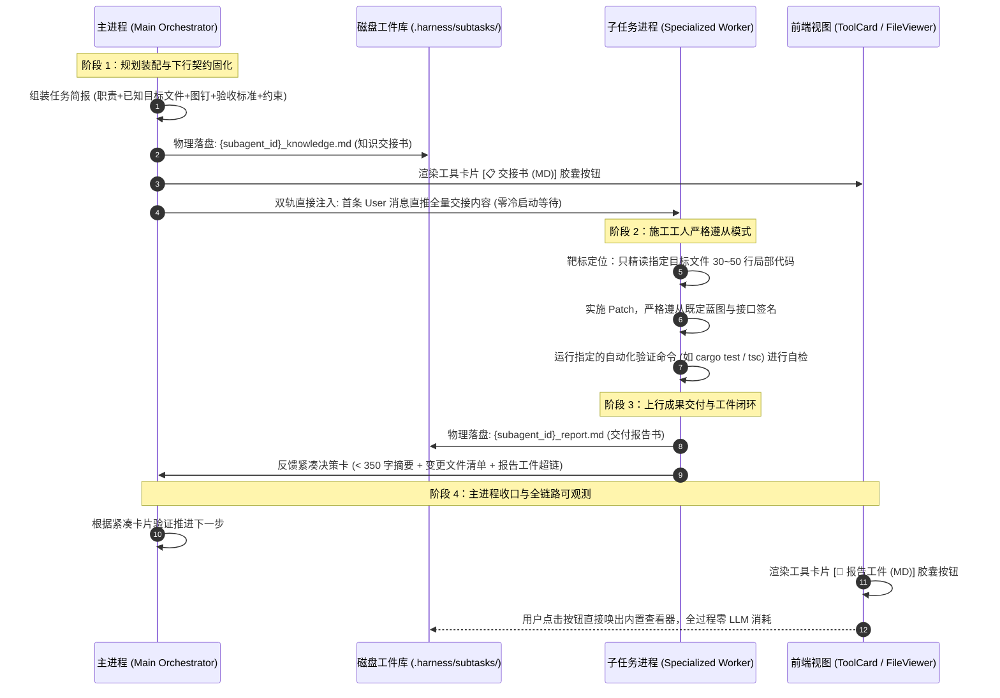

# 子任务知识交接书与双工件闭环交付架构知识文档 (SUBTASK_KNOWLEDGE_HANDOFF_AND_DUAL_ARTIFACT_CLOSED_LOOP_KNOWLEDGE)

| 项目 | 内容 |
| :--- | :--- |
| **文档名称** | 子任务知识交接书与双工件闭环交付架构知识文档 |
| **版本** | v1.2 (极简单行工件卡片与生命周期阶段彻底解耦版) |
| **状态** | 生产已落地已验证 (Production Verified) |
| **关联模块** | `src-tauri/src/agent.rs`, `src-tauri/src/tools/subagent.rs`, `src-tauri/src/context/static_system.rs`, `src/components/SubprocessBranchTree.tsx`, `src/components/ToolCard.tsx` |
| **核心定位** | 系统性阐述多 Agent 协作中“下行知识工单实体化”与“上行交付报告工件”双轨闭环的架构设计、理论权衡与工程实现 |

---

## 目录
- [一、背景与架构权衡：全量会话分支 vs 契约化交接](#一背景与架构权衡全量会话分支-vs-契约化交接)
  - [1. 为什么“直接复制主进程上下文”不可取？](#1-为什么直接复制主进程上下文不可取)
  - [2. 契约化交接模式（Contract-Based Handoff）的兴起](#2-契约化交接模式contract-based-handoff的兴起)
- [二、总体架构设计与时序流](#二总体架构设计与时序流)
  - [1. 数据流拓扑 (Sequence Diagram)](#1-数据流拓扑-sequence-diagram)
  - [2. 双工件对称镜像模型 (Dual-Artifact Symmetry)](#2-双工件对称镜像模型-dual-artifact-symmetry)
- [三、四层堆叠式实现细节 (Layered Implementation)](#三四层堆叠式实现细节-layered-implementation)
  - [Layer 1: 契约数据层与工件引擎](#layer-1-契约数据层与工件引擎)
  - [Layer 2: 调度双轨分发层（零冷启动注入）](#layer-2-调度双轨分发层零冷启动注入)
  - [Layer 3: 施工工人准则与交付验收闭环](#layer-3-施工工人准则与交付验收闭环)
  - [Layer 4: 前端卡片交互与可观测性升级](#layer-4-前端卡片交互与可观测性升级)
- [四、标准工件契约规范 (Artifact Specification)](#四标准工件契约规范-artifact-specification)
  - [1. 下行知识交接书模板 (`_knowledge.md`)](#1-下行知识交接书模板-_knowledgemd)
  - [2. 上行交付报告书模板 (`_report.md`)](#2-上行交付报告书模板-_reportmd)
- [五、核心工程源码改动清单](#五核心工程源码改动清单)
- [六、架构验证与量化收益评估](#六架构验证与量化收益评估)

---

## 一、 背景与架构权衡：全量会话分支 vs 契约化交接

在 AI Agent 架构演进中，当主进程需要创建子进程处理并发或专业化任务时，通常面临两种截然不同的架构路线抉择：**“全量会话分支（Forking Session Context）”** 与 **“契约化交接模式（Contract-Based Handoff）”**。

### 1. 为什么“直接复制主进程上下文”不可取？

直觉上，许多开发者认为将主进程的完整对话上下文直接 Fork 到子进程中，能最大程度复用大模型的 Prompt Cache（前缀缓存）并避免子进程信息缺失。然而，深入分析主流大模型（DeepSeek、Claude、OpenAI）的底层机制与 Agent 心流特征，该方案存在致命陷阱：

1. **Prompt Cache 归零陷阱（Prefix Divergence）**：
   - 大模型的 Prefix Caching 遵循**严格的最长公共前缀匹配**：`[System Prompt] -> [Tool Definitions] -> [Messages...]`。
   - 在专业化 Multi-Agent 架构中，主进程的职责是“架构统筹者”，配备协作调度工具；而子进程是“施工工人”，禁闭漫游工具且配置严格的局部工人提示词。
   - **一旦 System Prompt 或 Tool Schemas 存在一个字符差异，前缀从第 0 个 Token 即发生分叉，后续复制进来的数万 Token 缓存命中率直接归零（0% Cache Hit）！**
2. **上下文膨胀与成本悖论（Context Bloat）**：
   - 即使强行同构前缀，若主进程已有 60k Tokens，子进程单次推演每步都必须带着 60k Tokens 累加计算。若子进程执行 10 步，累计消耗高达数十万 Tokens，总开销与显存负载远超轻量级会话。
3. **注意力漂移与角色迷失（Lost in the Middle）**：
   - 主进程前序可能包含数十轮试错、架构辩论或无关文件探索日志。将海量噪音直接倾倒给子进程，会导致模型的注意力涣散，极易被主进程的历史推论带偏，丧失局部的专注力。
4. **工具调用未闭环的协议风险**：
   - 主进程通常在发起 `spawn_subagent` 工具调用时派生子进程。直接截断或复制消息树，会在消息尾部残留悬空的 `tool_calls`，破坏各大 LLM 提供商严格的 `assistant(tool_calls) -> tool(result)` 成对校验。

### 2. 契约化交接模式（Contract-Based Handoff）的兴起

相比之下，“契约化交接模式”将主子进程解耦：
- **下行**：主进程只向子进程交付清晰明确的**《任务知识交接书》**（限定职责范围、给足已知代码图钉、列出严格负向约束、提供验证命令）；
- **执行**：子进程降权为施工工人，无需全工程漫游，直接进行手术级局部精读与精准 Patch；
- **上行**：子进程完成验证后，将长篇调试推演与改动清单固化为**《交付报告书》**落盘，主进程仅接收 300 字以内的紧凑决策卡与工件链接。

该模式既阻断了上下文污染与 Token 爆炸，又彻底消除了子进程的盲目探索税。

---

## 二、 总体架构设计与时序流

### 1. 数据流拓扑 (Sequence Diagram)



### 2. 双工件对称镜像模型 (Dual-Artifact Symmetry)

在工作区目录 `.harness/subtasks/` 下，每个子任务生命周期均沉淀一对对称的物理文档资产：

```text
.harness/subtasks/
├── {subagent_id}_knowledge.md   # [输入工件] 需求与知识交接书 (工单)
└── {subagent_id}_report.md      # [输出工件] 执行总结与交付报告书 (验收单)
```

- **可解释性与可回溯性**：当子任务执行不及预期时，开发者或主进程无需翻阅底层 SQLite 数据库，直接对比这对工件，即可快速判定责任边界（是需求提偏还是代码写挂）。
- **生命周期持久化**：即使子任务意外超时或因网络异常中断，初始下达的 `_knowledge.md` 依然完好保留，为自愈恢复（`resume_subagent`）提供了稳定的事实锚点。

---

## 三、 四层堆叠式实现细节 (Layered Implementation)

架构改造严格遵循“分层堆叠（Layered Stacking）”工程哲学，确保每一层改动均为独立可测试的稳态闭环：

### Layer 1: 契约数据层与工件引擎
- **核心函数**：[`save_subtask_knowledge_artifact`](file:///d:/WorkSpace/Project/harness_mini/src-tauri/src/tools/subagent.rs)
- **职责规范**：
  1. 接收工作区路径、子任务 ID、任务标题、指派角色、全量简报文本与父会话 ID；
  2. 自动检查并递归创建 `<workspace>/.harness/subtasks/` 目录；
  3. 将下行契约格式化为标准 Markdown，并原子落盘至 `{subagent_id.replace('-', '_')}_knowledge.md`。

### Layer 2: 调度双轨分发层（零冷启动注入）
- **痛点规避**：若仅将任务落盘为文件，让子进程在第一步执行 `read_file`，会凭空消耗一个交互轮次与冷启动延迟。
- **双轨分发机制（Dual-Track Injection）**：
  1. **磁盘端**：调用 `save_subtask_knowledge_artifact` 完成物理固化，生成规范文件；
  2. **内存端**：将生成的全量交接内容**直接作为第一条 User Message** 写入子会话数据库，子进程唤醒后第 1 步无需调读文件工具，直入实施；
  3. **结果回填**：在 `spawn_subagent_tool` 与 `dispatch_collaborator_tool` 的返回文本中，显式注入 `- 📋 任务知识交接书: [查看交接文档](file:///.harness/subtasks/{subagent_id}_knowledge.md)`。

### Layer 3: 施工工人准则与交付验收闭环
- **施工工人提示词契约**：在 [`static_system.rs`](file:///d:/WorkSpace/Project/harness_mini/src-tauri/src/context/static_system.rs) 中硬性降权：
  - 【靶标定位】：严禁在全工程范围无目的地使用 `glob`/`grep`/`list_dir` 漫游；
  - 【手术精读】：直接对已知目标文件局部 30~50 行进行精读，杜绝篡改方法签名；
  - 【验证门禁】：子任务完成前必须运行简报中指定的测试命令；
- **双向锚点汇聚**：在 `wait_subagents_tool` 与 `wait_collaborators_tool` 中，汇总文本同时输出原始交接工件超链与交付报告工件超链，主模型可一眼比对指标对齐情况。

### Layer 4: 前端卡片交互与可观测性升级
- **路径解析器**：在 [`src/components/ToolCard.tsx`](file:///d:/WorkSpace/Project/harness_mini/src/components/ToolCard.tsx) 中引入正则捕获：
  - `resolvedSubtaskKnowledgePath`：匹配 `(?:\.harness\/subtasks\/)([^`\s\n"'<>]*_knowledge\.md)`；
  - `resolvedSubtaskReportPath`：匹配 `(?:\.harness\/subtasks\/)([^`\s\n"'<>]*_report\.md)`；
- **一键抽屉交互**：在工具卡片右上角渲染：
  - 派发阶段展示 **`[📋 交接书 (MD)]`** 胶囊按钮；
  - 交付阶段展示 **`[📄 报告工件 (MD)]`** 胶囊按钮；
  - 点击直接唤出 Tauri 内置的文件查看器抽屉（`ipc.openFileViewer`），实现零 LLM 消耗的高亮渲染与透明审计。

---

## 四、 标准工件契约规范 (Artifact Specification)

### 1. 下行知识交接书模板 (`_knowledge.md`)

```markdown
# 协同子任务知识交接书: 实现 Token 刷新逻辑

- **子任务 ID**: `sub_4a91b2c3`
- **角色定位**: 后端开发专家
- **所属父会话**: `sess_main_001`
- **生成时间**: 2026-10-31T17:25:00Z

---

【任务协同委派简报】
- 角色定位：后端开发专家
- 任务标题：实现 Token 刷新逻辑
- 详细需求描述：
在现有 jwt 模块中追加 refresh_token 方法并补充自动化单元测试

【项目权威计划与全局约束】
- 计划文档路径：`.harness/plans/plan.md` (版本: v1)
- 计划全局总目标：系统重构与鉴权加固
- 全局推进状态：执行中 (2/5)
- 当前主线阶段：第 2 步: 强化鉴权机制

【主进程已知重点文件（请直接定位切入，免去盲目探索）】
- `src-tauri/src/auth/jwt.rs`
- `src-tauri/src/models/user.rs`

【精确上下文图钉与行号锚点】
- 文件 `src-tauri/src/auth/jwt.rs` (关注行: 120-150): 在 verify_token 函数末尾追加 refresh_token

【交付验收标准与验证命令】
cargo test test_refresh_token

【严格禁止项与负向约束】
严禁修改已有公开接口入参签名，严禁引入第三方未经安全审计的外部 crate

【施工工人准则】：你作为实施工人，请优先对已知目标文件进行手术级精读（read_file 局部 30~50 行）并完成代码修改或验证；严禁脱离蓝图全库漫游！
【分级验证提示】：查验数据请直接用只读命令；代码检查优先用轻量静态检查；单测需指定精准目标；严禁修改生产源码当作临时探针。
```

### 2. 上行交付报告书模板 (`_report.md`)

```markdown
# 协同任务交付报告: 实现 Token 刷新逻辑

- **子任务 ID**: `sub_4a91b2c3`
- **角色定位**: 后端开发专家
- **生成时间**: 2026-10-31T17:28:30Z
- **涉及改动文件**:
- `src-tauri/src/auth/jwt.rs`
- `src-tauri/src/tests/jwt_test.rs`

---

## 详细报告与产出内容

### 1. 实施总结
在 `jwt.rs` 的 135 行位置成功补充了 `refresh_token` 函数，使用原有密钥轮换机制实现了双 Token 自动刷新。

### 2. 验证结果
执行交付自检命令 `cargo test test_refresh_token`：
- `test auth::jwt::tests::test_refresh_token_valid ... ok`
- `test auth::jwt::tests::test_refresh_token_expired ... ok`
所有用例均 100% 通过。
```

---

## 五、 核心工程源码改动清单

| 文件路径 | 改动性质 | 核心改动说明 |
| :--- | :--- | :--- |
| [`src-tauri/src/agent.rs`](file:///d:/WorkSpace/Project/harness_mini/src-tauri/src/agent.rs) | **核心实现** | 子会话终态收尾自动固化 `_report.md` 交付报告工件。 |
| [`src-tauri/src/tools/subagent.rs`](file:///d:/WorkSpace/Project/harness_mini/src-tauri/src/tools/subagent.rs) | **核心实现** | 1. `save_subtask_knowledge_artifact` 实现知识交接书落盘；<br>2. 注入负向边界与预算规则；<br>3. `wait_subagents_tool` / `wait_collaborators_tool` 双轨汇聚输出。 |
| [`src-tauri/src/context/static_system.rs`](file:///d:/WorkSpace/Project/harness_mini/src-tauri/src/context/static_system.rs) | **系统提示词** | 注入主进程 $O(1)$ 局部雷达勘探法则与子进程 6~8 步收敛定界负向清单。 |
| [`src/components/SubprocessBranchTree.tsx`](file:///d:/WorkSpace/Project/harness_mini/src/components/SubprocessBranchTree.tsx) | **前端交互** | 1. 移除右上角冗余操作按钮，恢复纯净状态指示；<br>2. 卡片主体末尾内嵌**极简单行高**《任务知识交接文档》卡片，支持 $1 \sim N$ 并行子任务遍历展示与 `[查看交接书]` 独立查看。 |
| [`src/components/ToolCard.tsx`](file:///d:/WorkSpace/Project/harness_mini/src/components/ToolCard.tsx) | **前端交互** | 1. 移除右上角 `[交接文档]` 与 `[报告工件]` 按钮；<br>2. 实现 `resolvedSubtaskReports` 全局/多片段报告解析器；<br>3. 在 `wait_*` 汇聚工具主体中内嵌**极简单行高**《协同任务交付报告》卡片，**严格仅在任务完成且报告生成后才外化**；<br>4. 为 `dispatch_collaborator` 提供专属单行交接书卡片。 |

---

## 六、 架构验证与量化收益评估

### 1. 工程门禁自动化验证
- **Rust 后端单元测试**：
  ```bash
  cargo test --manifest-path src-tauri/Cargo.toml --lib -- test_briefing_packet
  # 结果: test tools::tests::test_briefing_packet_and_artifact_summary ... ok (0.06s)
  ```
- **前端 TypeScript 构建**：
  ```bash
  npm run build
  # 结果: tsc && vite build 零告警通过，输出 dist/ 资源包。
  ```

### 2. 关键工程指标收益矩阵

| 指标维度 | 全量会话分支方案 (Fork Session) | 传统单薄简报方案 (旧架构) | 本契约化双工件闭环架构 (当前方案) |
| :--- | :--- | :--- | :--- |
| **Prompt Cache 命中率** | **0%** (因 System/Tools 分歧击穿) | 无关 (每次重新单薄交互) | **稳定** (主子会话各自前缀冻结，且避免大上下文) |
| **子进程启动 Token 负担** | 30,000 ~ 80,000 Tokens (极度沉重) | 800 ~ 1,200 Tokens (较薄，易信息缺失) | **1,500 ~ 2,500 Tokens** (结构化饱和注入，极度精准) |
| **首轮冷启动额外 I/O 轮次** | 0 轮 (全量注入) | 3 ~ 8 轮 (因信息缺失导致盲目探库) | **0 轮** (双轨直推，开箱即开工，零等待) |
| **主进程汇报接收 Token 消耗** | 3,000 ~ 6,000 Tokens (整屏代码回灌) | 500 ~ 2,000 Tokens (易丢关键细节) | **100 ~ 300 Tokens** (高密度摘要卡，完整报告落盘) |
| **调试与审计透明度** | 差 (混杂在数万字历史中) | 较差 (子任务结果易成黑盒) | **极佳** (`_knowledge.md` 与 `_report.md` 双向镜像留痕) |

---

## 七、 演进升级：显式工件卡片外化与主子分工临界点治理 (v1.1)

### 1. 工件卡片显式外化（纯查看功能）
针对用户“交互过程无感”的问题，系统引入了两张独立的第一类（First-Class）UI 实体卡片组件：
1. **`SubtaskKnowledgeCard`（任务知识交接卡）**：
   - **视觉设计**：沉稳深邃的墨蓝/蓝紫色质感背景，带有 `📋 任务知识交接书` 徽标、角色胶囊与只读工件标识；
   - **内容映射**：呈现任务目标、分配角色、负向边界提示，以及磁盘物理相对路径 `.harness/subtasks/{subagent_id}_knowledge.md`；
   - **交互行为**：提供纯查看（View-Only）模式的 `[ 📄 查看交接文档 ]` 按钮，一键触发 `ipc.openFileViewer` 在右侧文件抽屉优雅呈现，不支持修改，杜绝误触。
2. **`SubtaskReportCard`（任务交付报告卡）**：
   - **视觉设计**：翡翠绿/青碧色质感背景，带有 `📑 协同任务交付报告` 徽标、完成状态标识（执行中 / 已交付结题 / 已终止）；
   - **内容映射**：异步读取物理报告文件提取 2~3 行核心摘要，展示涉及改动文件标签列表；
   - **交互行为**：提供纯查看模式的 `[ 🔍 查看交付报告 ]` 按钮，一键在右侧抽屉滑出展示完整的架构分析与交付报告。

### 2. 挂载位置与无感问题消除
- **`SubprocessBranchTree` 拓扑树**：在派生子任务卡片（`SubprocessTaskTab`）中直接内置 `[ 📋 交接书 ]` 与 `[ 📑 交付报告 ]` 快捷胶囊，并在拓扑图下方显式挂载双轨工件卡片展板，主进程派生子任务后即时可见可查；
- **`ToolCard` 通用卡片**：对 `dispatch_collaborator` 自动默认展开并挂载 `SubtaskKnowledgeCard`，对 `wait_collaborators` 自动默认展开并挂载 `SubtaskReportCard`。

### 3. 主子进程分工的黄金“临界点”（Scoping Tipping Point）
借鉴 Devin、Cursor Composer 与 OpenHands 的工程实践，彻底解决“交接太宽泛导致子进程脱缰盲目扫描”与“主进程做太细导致子进程失去意义”的平衡问题：
- **$O(1)$ 宏观雷达探针**：主进程仅用 1~2 次只读工具（读取 `package.json`/`Cargo.toml`）识别技术栈和入口代码，绝不替子任务做完整分析；
- **结构化交接三要素**：下发任务时强制限定：
  1. `target_anchors`：指定 2~3 个入口文件切入；
  2. `negative_scope`：严禁全盘通配扫描（严禁 `dir /s /b`，严禁 `find .`，严禁遍历无关业务组件）；
  3. `step_budget`：设定 6~8 步收敛预算，并附带 2~3 个架构问卷问题；
- **子任务定向攻坚**：子任务严格按照锚点精读，达到预算前主动收敛并输出 Mermaid 架构图与终态报告；
- **自动终态持久化闭环**：在 `agent::run_loop` 退出时，底层自动捕获最新产出并持久化到 `_report.md`，即使用户中途手动终止或未调用 wait，交付报告也永远不会丢失。
