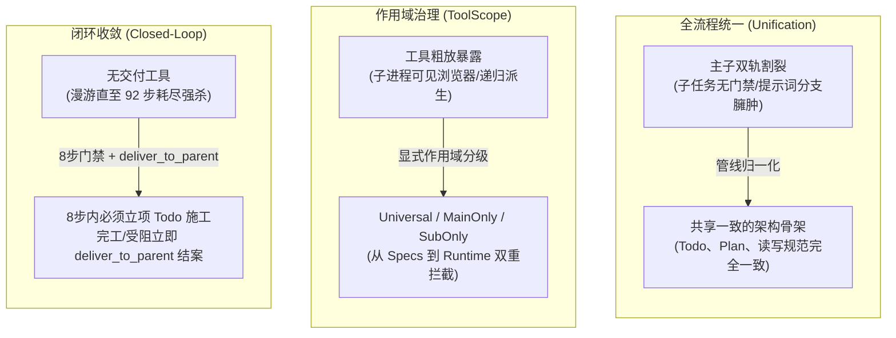
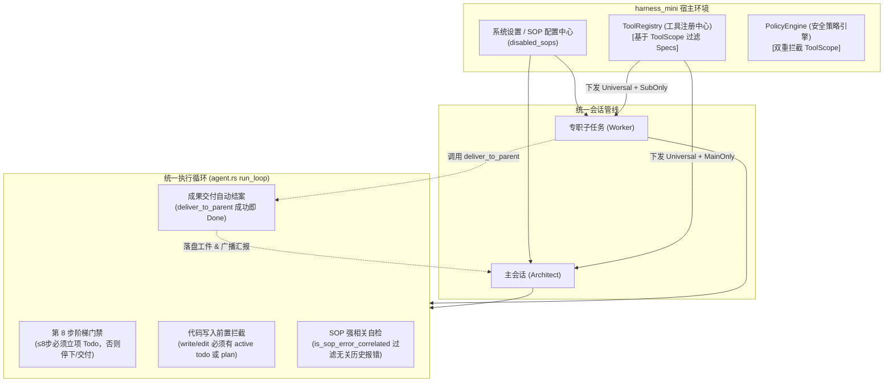
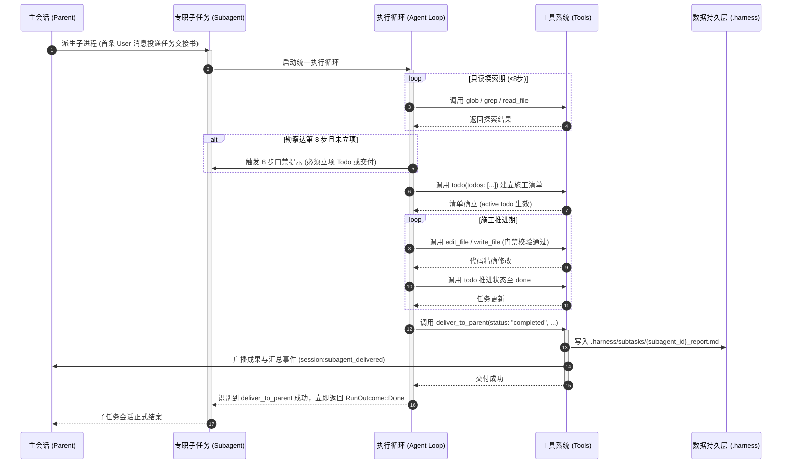
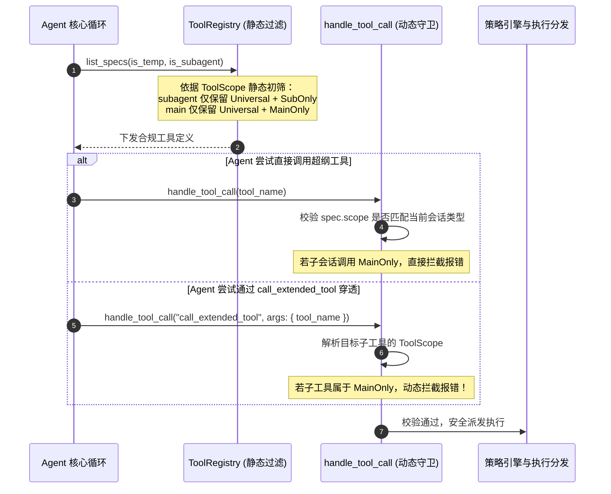

# 子任务流程统一、工具与 SOP 作用域划分及闭环交付治理知识库
# Subtask Pipeline Unification, Tool & SOP Scope Division and Closed-Loop Delivery Governance Knowledge

本文档系统记录 `harness_mini` 在子任务（Subagent / Subprocess / Collaborator）执行管线统一、工具与 SOP 三级作用域划分（`Universal` / `MainOnly` / `SubOnly`）、8 步勘察阶梯门禁统一、消除 System Prompt 简报重复注入（保护前缀缓存）、以及专职交付闭环（`deliver_to_parent`）的重构方案、技术实现与治理规范。

---

## 目录
- [一、背景与痛点诊断](#一背景与痛点诊断)
  - [1. 真实案例复盘：子会话 92 轮空转失控剖析](#1-真实案例复盘子会话-92-轮空转失控剖析)
  - [2. 机制割裂与规则虚设：提示词有约束而运行时无门禁](#2-机制割裂与规则虚设提示词有约束而运行时无门禁)
  - [3. 简报重复注入与 System Prompt 前缀缓存失效](#3-简报重复注入与-system-prompt-前缀缓存失效)
  - [4. 工具无差别暴露与职责越界风险](#4-工具无差别暴露与职责越界风险)
  - [5. 缺乏专职交付机制导致无法自主收敛](#5-缺乏专职交付机制导致无法自主收敛)
- [二、设计范式演进与架构决策](#二设计范式演进与架构决策)
  - [1. 核心准则：“拒绝堆叠补丁，追求结构清晰与稳定性”](#1-核心准则拒绝堆叠补丁追求结构清晰与稳定性)
  - [2. 决策一：主子会话生命周期与规则管线全量统一](#2-决策一主子会话生命周期与规则管线全量统一)
  - [3. 决策二：三级工具作用域系统（`ToolScope`）](#3-决策二三级工具作用域系统toolscope)
  - [4. 决策三：消除 System Prompt 简报重复拼接，保全前缀缓存](#4-决策三消除-system-prompt-简报重复拼接保全前缀缓存)
  - [5. 决策四：8 步门禁统一贯通与施工/探索双轨收敛](#5-决策四8-步门禁统一贯通与施工探索双轨收敛)
  - [6. 决策五：专职交付工具（`deliver_to_parent`）闭环退出](#6-决策五专职交付工具deliver_to_parent闭环退出)
  - [7. 决策六：记忆大盘容量防御上限与 `/init` 快捷勘察](#7-决策六记忆大盘容量防御上限与-init-快捷勘察)
- [三、架构全景与流程时序](#三架构全景与流程时序)
  - [1. 主子会话统一治理架构图](#1-主子会话统一治理架构图)
  - [2. 子任务全生命周期流转时序](#2-子任务全生命周期流转时序)
  - [3. 双重作用域校验拦截时序](#3-双重作用域校验拦截时序)
- [四、核心代码落地与实现细节](#四核心代码落地与实现细节)
  - [1. 领域模型与全工具作用域标记（`tools/types.rs` & `tools/specs.rs`）](#1-领域模型与全工具作用域标记toolstypesrs--toolsspecsrs)
  - [2. 专职交付工具实现（`tools/subagent.rs`）](#2-专职交付工具实现toolssubagentrs)
  - [3. 工具注册表与执行双重拦截（`tools/registry.rs` & `agent.rs`）](#3-工具注册表与执行双重拦截toolsregistryrs--agentrs)
  - [4. System Prompt 单骨架统一重构（`context/static_system.rs`）](#4-system-prompt-单骨架统一重构contextstatic_systemrs)
  - [5. 执行循环 8 步门禁与交付终止（`agent.rs`）](#5-执行循环-8-步门禁与交付终止agentrs)
  - [6. 项目记忆大盘上限与 `/init` 命令（`memory.rs` & `Composer.tsx`）](#6-项目记忆大盘上限与-init-命令memoryrs--composertsx)
  - [7. 前端 SOP 与工具作用域标签可视化（`types.ts` & `SettingsModal.tsx`）](#7-前端-sop-与工具作用域标签可视化typests--settingsmodaltsx)
- [五、工程验证与测试结论](#五工程验证与测试结论)
- [六、总结与后续演进建议](#六总结与后续演进建议)

---

## 一、背景与痛点诊断

在 `harness_mini` 的协作开发架构中，主进程作为总架构师，支持通过 `spawn_subagent` 或长任务派生独立的专职子 Agent（Subprocess / Subagent）来并行处理特定的业务模块。然而在实际运行中，子任务经常出现超长思考、只读漫游不断、数十轮不进入实际施工等失控现象。

通过对生产数据库 `data/harness_mini.db` 中失控子会话（如会话 `af487171-ddb5-47bc-a54d-6d472066524d`）进行深度溯源分析，发现以下五大深层次结构性病灶：

### 1. 真实案例复盘：子会话 92 轮空转失控剖析
* **现象**：主会话制定了非常详尽的三阶段计划与代码签名蓝图，派生出子任务进行具体模块实现。然而该子会话持续运行了整整 **92 轮**，调用工具多达数十次，却始终在重复调用 `read_file`、`grep`、`file_outline`，迟迟没有调用 `write_file` 或 `edit_file` 动工。
* **数据排查结果**：
  1. 第 1 步到第 25 步：子 Agent 逐行分页（`offset_line`）通读代码；
  2. 第 26 步到第 60 步：不断在思考链中推演已经确定的逻辑，但因没有 Todo 约束，行动无法收敛；
  3. 第 61 步到第 92 步：接近 `maxSteps`，模型开始出现注意力泛散，最终达到步数硬上限强行中断，产物交付为 0。

### 2. 机制割裂与规则虚设：提示词有约束而运行时无门禁
* **割裂现状**：在主会话中，系统拥有完善的阶梯门禁：
  * **门禁 ①（写入前置拦截）**：动代码前必须有 active todo 或 active plan，否则拦截 `write_file`/`edit_file`；
  * **门禁 ②（8 步勘察上限）**：只读工具调用累计达 8 步时强制拦截，要求立项 Todo 或向用户汇报事实；
  * **门禁 ③（已有计划与子进程豁免）**：`!is_subagent` 与 `!is_sub`！
* **致命缺陷**：代码中通过 `!is_subagent` 和 `!is_sub` 将子进程**完全豁免**出了 8 步门禁和写入拦截！本意是“子任务已经持有了主任务的方案，不需要向人类重复确认”，但实际上**主进程给子任务的是《交接任务书》（包含任务目标），而不是子任务内部具体的施工清单（Checklist）**。没有了 8 步硬门禁约束，子进程直接蜕变成了无休止漫游的脱缰野马。

### 3. 简报重复注入与 System Prompt 前缀缓存失效
* **重复注入**：在原先的 `subagent.rs` 启动逻辑中，主进程生成的交接书（通常包含目标、契约、行号锚点，长达 3,500 ~ 4,000 字符）被**重复拼接了两次**：
  1. 第一次拼接到 `session.subagent_task` 中，被 `build_static_system_prompt` 作为 System Prompt 的一段强行注入；
  2. 第二次又作为首条 User 消息投递给子会话。
* **代价**：
  * 每一轮交互白白浪费 4,000 字符上下文；
  * System Prompt 随每个子会话的任务不同而完全改变，彻底破坏了 Radix Tree 前缀缓存（Prefix Caching）机制。

### 4. 工具无差别暴露与职责越界风险
* 原先虽然在 `types.rs` 中定义了 `SUBAGENT_TOOL_NAMES`，但实际在工具规格列表 `list_specs` 与动态网关 `call_extended_tool` 中，并未作严格的单向作用域隔离。
* 子任务能够看到甚至调用主进程的专属工具（例如浏览器自动化 `browser_*`、再次派生子进程 `spawn_subagent`、调度协作者等），极易诱发子任务跨界反查、递归派生甚至主客颠倒。

### 5. 缺乏专职交付机制导致无法自主收敛
* 主对话的终点是“向人类用户回复”，而子任务的终点是“向父进程交付工件并返回状态”。
* 原先子任务缺乏专职的交付工具，只能依赖纯文本回复，执行循环无法判断何时真正收敛结束，往往由于“还能多做点什么”而继续死磕细节，无法在目标达成时刻立即优雅结案。

---

## 二、设计范式演进与架构决策

为了彻底治愈上述病灶，本次改造严格贯彻**“拒绝补丁堆叠，追求结构清晰与稳定性”**的核心理念，确立了六项全链路重构决策：



### 1. 核心准则：“拒绝堆叠补丁，追求结构清晰与稳定性”
坚决不采取“在原有的子进程分支里随便加个 `if` 判断”的脆弱补丁模式，而是对 `static_system.rs`、`specs.rs`、`registry.rs`、`agent.rs` 进行系统级重构，将主会话、协作者会话与专职子进程融合成一套统一的领域模型。

### 2. 决策一：主子会话生命周期与规则管线全量统一
* 子会话不再是一套“简陋且异构的孤岛”，而是继承主会话全部成熟工程实践的专业执行者：
  * **相同的漏斗式探索**（`surgical_code_reading`）；
  * **相同的最小精确修改与构建自检**（`safe_code_edit`）；
  * **相同的边读边记与长期认知沉淀**（`memory_distill`）；
  * **相同的任务清单全生命周期管理**（`todo_lifecycle`）。

### 3. 决策二：三级工具作用域系统（`ToolScope`）
定义三态枚举 `ToolScope`，彻底取代分散的常量硬编码：
- **`ToolScope::Universal`**：主子会话通用核心工具（文件读写、搜索检索、终端命令、Todo、计划、记忆知识库、生图识别等）；
- **`ToolScope::MainOnly`**：仅主会话可用（长任务拆解、子 Agent 派发、常驻协作者编排、浏览器 CDP 自动化交互等）；
- **`ToolScope::SubOnly`**：仅子任务会话可用（`deliver_to_parent`，向父会话正式提交结构化成果）。

### 4. 决策三：消除 System Prompt 简报重复拼接，保全前缀缓存
- **职责剥离**：System Prompt 仅包含纯静态的角色定位声明与恒定规则；
- **简报专职归宿**：主进程下发的详细交接书仅作为首条 User 消息投递。消除约 4,000 字符的冗余，使子会话同样具备 100% 字节级恒定的 System Prompt，最大化激发大模型前缀缓存优势。

### 5. 决策四：8 步门禁统一贯通与施工/探索双轨收敛
- 取消子任务在 8 步门禁上的豁免；
- 当子任务只读探索达到第 8 步且尚未创建 Todo 时，强制触发阶梯门禁拦截：
  1. **施工类任务**：若目标明确且需要动代码，**必须在下一步立即调用 `todo` 工具立项**，明确具体的施工步骤，随后方可动工；
  2. **探索/调研类任务**：若无需修改代码且事实已查明，严禁盲目漫游，直接调用 `deliver_to_parent(status: "completed")` 结案；
  3. **受阻情况**：若发现前置条件严重缺失或蓝图冲突无法继续，必须立即调用 `deliver_to_parent(status: "blocked")` 汇报遇到的阻碍并交回决策权，坚决杜绝盲目重试。

### 6. 决策五：专职交付工具（`deliver_to_parent`）闭环退出
- 为子任务单独引入专职交付工具 `deliver_to_parent(status, summary, modified_files, tests_passed, suggestions)`；
- 在执行循环 `run_loop` 中，一旦 `deliver_to_parent` 执行成功，Agent 立即返回 `RunOutcome::Done`，优雅跳出循环并完成会话归档。

### 7. 决策六：记忆大盘容量防御上限与 `/init` 快捷勘察
- **上限防御**：在 `memory.rs` 中为 `profile.md` 增加 8,000 字符安全读取截断保护（与 `conventions.md` 的 3,000 字符协同），彻底防止大盘文档无限制扩张拖垮上下文；
- **快捷指令**：在前端增加 `/init` 斜杠指令，支持一键规范化勘察当前工作区技术栈、核心端点与工程规约，并写入 `.harness/memory/` 静态大盘。

---

## 三、架构全景与流程时序

### 1. 主子会话统一治理架构图



### 2. 子任务全生命周期流转时序



### 3. 双重作用域校验拦截时序



---

## 四、核心代码落地与实现细节

### 1. 领域模型与全工具作用域标记（`tools/types.rs` & `tools/specs.rs`）

在 `src-tauri/src/tools/types.rs` 中确立核心作用域枚举及文字映射方法：

```rust
#[derive(Clone, Copy, PartialEq, Eq, Debug)]
pub enum ToolScope {
    /// 主子会话通用核心工具（文件读写、检索、命令、Todo、计划、记忆等）
    Universal,
    /// 仅主会话可用（子任务派发、协作者编排、浏览器自动化等）
    MainOnly,
    /// 仅子任务会话可用（向父会话正式交付）
    SubOnly,
}

impl ToolScope {
    pub fn as_str(&self) -> &'static str {
        match self {
            ToolScope::Universal => "universal",
            ToolScope::MainOnly => "main_only",
            ToolScope::SubOnly => "sub_only",
        }
    }

    pub fn label(&self) -> &'static str {
        match self {
            ToolScope::Universal => "主/子对话可用",
            ToolScope::MainOnly => "仅主对话",
            ToolScope::SubOnly => "子对话可用",
        }
    }
}
```

在 `src-tauri/src/tools/specs.rs` 中为全量 52 个工具定义显式 `scope`，并引入 `deliver_to_parent`：

```rust
ToolSpec {
    name: "deliver_to_parent",
    description: "专职子任务向主进程（父会话）正式交付成果并申请结案。任务全部完成、部分完成或遇到阻碍时调用此工具。",
    schema: json!({
        "type": "object",
        "properties": {
            "status": {
                "type": "string",
                "enum": ["completed", "partial", "blocked"],
                "description": "交付状态：completed（全部完成）、partial（部分完成）、blocked（遇到阻碍无法继续）"
            },
            "summary": {
                "type": "string",
                "description": "成果核心技术总结与结论（控制在 250 字以内，以便父会话决策）"
            },
            "modified_files": {
                "type": "array",
                "items": { "type": "string" },
                "description": "本次子任务实际改动的文件相对路径清单"
            },
            "tests_passed": {
                "type": "boolean",
                "description": "本地构建或单测是否已验证通过"
            },
            "suggestions": {
                "type": "string",
                "description": "给主进程的后续计划调整或集成建议（可选）"
            }
        },
        "required": ["status", "summary"]
    }),
    risk: Risk::Write,
    scope: ToolScope::SubOnly,
}
```

### 2. 专职交付工具实现（`tools/subagent.rs`）

在 `src-tauri/src/tools/subagent.rs` 中实现落地逻辑，完成数据库更新、工件持久化与前端事件广播：

```rust
pub async fn deliver_to_parent_tool(args: &Value, ctx: &ToolCtx) -> Result<String, String> {
    let status_str = args.get("status").and_then(|v| v.as_str()).unwrap_or("completed");
    let summary = args.get("summary").and_then(|v| v.as_str()).unwrap_or("").trim();
    if summary.is_empty() {
        return Err("缺少交付总结 (summary) 参数".to_string());
    }
    let modified_files: Vec<String> = args.get("modified_files")
        .and_then(|v| v.as_array())
        .map(|arr| arr.iter().filter_map(|x| x.as_str().map(|s| s.to_string())).collect())
        .unwrap_or_default();
    let tests_passed = args.get("tests_passed").and_then(|v| v.as_bool()).unwrap_or(false);
    let suggestions = args.get("suggestions").and_then(|v| v.as_str()).unwrap_or("");

    let Some(ref host) = ctx.host else {
        return Err("宿主环境未就绪，无法交付成果".to_string());
    };

    // 1. 生成并落盘子任务结构化交付报告
    let report_content = format!(
        "# 子任务交付报告\n\n- **交付状态**: `{status_str}`\n- **单测/自检验**: {}\n- **改动文件**: {}\n\n## 成果核心总结\n{}\n\n{}",
        if tests_passed { "✅ 已通过" } else { "⚠️ 未运行或失败" },
        if modified_files.is_empty() { "无".to_string() } else { modified_files.join(", ") },
        summary,
        if !suggestions.is_empty() { format!("## 后续集成建议\n{suggestions}\n") } else { String::new() }
    );
    let subtasks_dir = ctx.workspace.join(".harness").join("subtasks");
    let _ = fs::create_dir_all(&subtasks_dir);
    let report_path = subtasks_dir.join(format!("{}_report.md", host.session_id));
    let _ = fs::write(&report_path, report_content);

    // 2. 广播并更新当前会话状态为交付完成
    let app = &host.app;
    let _ = app.emit("session:subagent_delivered", json!({
        "sessionId": host.session_id,
        "status": status_str,
        "summary": summary,
        "modifiedFiles": modified_files,
        "testsPassed": tests_passed,
        "reportPath": report_path.to_string_lossy().to_string(),
    }));

    Ok(format!("【专职子任务交付成功】状态: `{status_str}`。成果已落盘并提交给主进程，会话即将结案。"))
}
```

### 3. 工具注册表与执行双重拦截（`tools/registry.rs` & `agent.rs`）

在 `src-tauri/src/tools/registry.rs` 中实施初筛：

```rust
pub async fn list_specs(&self, is_temp: bool, is_subagent: bool) -> Vec<ToolSpec> {
    let mut specs = super::specs::tool_specs();
    specs.retain(|s| {
        let scope_allowed = if is_subagent {
            s.scope == ToolScope::Universal || s.scope == ToolScope::SubOnly
        } else {
            s.scope == ToolScope::Universal || s.scope == ToolScope::MainOnly
        };
        if !scope_allowed {
            return false;
        }
        if !is_temp && TEMP_TOOL_NAMES.contains(&s.name) {
            return false;
        }
        CORE_TOOL_NAMES.contains(&s.name) || s.name == "deliver_to_parent" || (is_temp && TEMP_TOOL_NAMES.contains(&s.name))
    });
    // ...
}
```

在 `src-tauri/src/agent.rs` 的 `handle_tool_call` 中建立动态防穿透守卫（无论直接调用还是通过 `call_extended_tool`）：

```rust
let (eval_name, eval_args, risk, eval_scope) = if tool_name == "call_extended_tool" {
    let t_name = args.get("tool_name").and_then(|v| v.as_str()).unwrap_or("unknown");
    let t_args = args.get("arguments").unwrap_or(args);
    let all_specs = tools::specs::tool_specs();
    let target_spec = all_specs.into_iter().find(|s| s.name == t_name);
    let t_risk = target_spec.as_ref().map(|s| s.risk).unwrap_or(spec.risk);
    let t_scope = target_spec.as_ref().map(|s| s.scope).unwrap_or(tools::ToolScope::Universal);
    (t_name, t_args, t_risk, t_scope)
} else {
    (tool_name, args, spec.risk, spec.scope)
};

let is_subagent_session = {
    let db = state.db.lock().unwrap();
    store::get_session(&db, session_id).ok().flatten().map(|s| {
        s.session_type == "subagent"
            || s.session_type == "subprocess"
            || s.session_type == "collaborator"
            || s.parent_session_id.is_some()
    }).unwrap_or(false)
};

// 双向作用域硬拦截
if is_subagent_session && eval_scope == tools::ToolScope::MainOnly {
    let reason = format!("【工具作用域拦截】：当前子任务会话不支持调用主会话专属工具 `{eval_name}`");
    // 写入事件并失败返回
    return ("failed".into(), reason);
}
if !is_subagent_session && eval_scope == tools::ToolScope::SubOnly {
    let reason = format!("【工具作用域拦截】：主会话不支持调用子任务专属工具 `{eval_name}`");
    return ("failed".into(), reason);
}
```

### 4. System Prompt 单骨架统一重构（`context/static_system.rs`）

彻底移除分裂的 `else if is_sub` 分支，统一在同一个代码骨架中按 Session 类型配置头部声明，共用规则矩阵：

```rust
// 统一架构：主对话、协作者、专职子 Agent 共享完全一致的规则骨架与运行门禁
let header = if is_collab {
    let role = session.subagent_role.as_deref().unwrap_or("常驻专业协作者");
    let task = session.subagent_task.as_deref().unwrap_or("负责该领域专职工作");
    format!(
        "你是 harness_mini 项目中由用户配置的专业常驻协作者 (Collaborator)。\n角色定位：{role}\n职责设定：{task}\n工作区根目录：{path}\n操作系统：{os}",
        role = role, task = task, path = session.workspace_path, os = os
    )
} else if is_sub {
    let role = session.subagent_role.as_deref().unwrap_or("专职子任务协作 Agent");
    format!(
        "你是 harness_mini 派生出的专业协作子 Agent 进程。\n角色定位：{role}\n专属任务目标已由主进程在首条任务简报中详述。请依据简报与已知重点切入，通过 todo 明确步骤推进落实。\n工作区根目录：{path}\n操作系统：{os}",
        role = role, path = session.workspace_path, os = os
    )
} else {
    format!(
        "你是 harness_mini，一个谨慎、专业的编码 Agent，运行在用户的本地工作区中。\n工作区根目录：{path}\n操作系统：{os}",
        path = session.workspace_path, os = os
    )
};
```

### 5. 执行循环 8 步门禁与交付终止（`agent.rs`）

在 `agent.rs` 中移除 `!is_subagent` 豁免，当 `_step == 8` 时：

```rust
let todo_first_enabled = !settings.disabled_sops.iter().any(|s| s == "todo_first_gate");
if todo_first_enabled && _step == 8 {
    let has_active_plan_or_todo = { ... };
    if !has_active_plan_or_todo {
        let gate_msg = if is_subagent {
            "【🛑 第 8 步门禁拦截（子任务施工/探索门禁）】：只读勘察已达 8 步上限且当前未创建 Todo 任务！\n\
            1. 若本任务需要修改代码且施工目标明确，必须在下一步立即调用 todo 工具声明施工步骤清单（哪怕只有 1 个任务），方可开始调用 write_file / edit_file 施工；\n\
            2. 若为纯探索/调研类任务且事实已查明，严禁盲目漫游，直接整理结论并调用 deliver_to_parent(status: \"completed\", summary: \"...\") 结案交付；\n\
            3. 若在 8 步内探索受阻、无法梳理出可行方案或缺少前置条件，严禁继续漫游或盲目重试，必须立即调用 deliver_to_parent(status: \"blocked\", summary: \"...\") 汇报遇到的具体阻碍并交回主会话！"
        } else {
            "【🛑 第 8 步门禁拦截】：只读勘察已达 8 步上限且当前未创建 Todo 任务！\n\
            1. 若已查明事实且无需修改代码（如咨询答疑），必须立即在正式回复（Content）中输出完整答复并直接结案；\n\
            2. 若需要修改代码且方向明确，必须在下一步先调用 todo 工具声明任务清单（哪怕只有 1 个任务），方可进行代码修改；\n\
            3. 若依然方向模糊、无法梳理出清晰的 todo 计划，严禁盲目漫游或脑补计划，必须立即停止调用工具，在正式回复中向用户汇报当前事实并对齐目标！"
        };
        messages.push(json!({ "role": "user", "content": gate_msg }));
    }
}
```

在执行完工具后，检测到 `deliver_to_parent` 成功立即跳出循环结案：

```rust
if (tc.name == "deliver_to_parent"
    || (tc.name == "call_extended_tool"
        && args.get("tool_name").and_then(|v| v.as_str()) == Some("deliver_to_parent")))
    && status == "success"
{
    // 子任务向父进程完成正式结构化交付，优雅结案并直接退出执行循环
    return (RunOutcome::Done, last_assistant_id, run_tokens);
}
```

### 6. 项目记忆大盘上限与 `/init` 命令（`memory.rs` & `Composer.tsx`）

在 `memory.rs` 的 `load_static_project_memory` 中加入 8,000 字符上限截断：

```rust
// 读取 profile.md（设置 8,000 字符上限，防止超大型项目档案无限膨胀）
let profile_path = mem.join("profile.md");
if let Ok(c) = fs::read_to_string(&profile_path) {
    let trimmed = c.trim();
    if !trimmed.is_empty() && !trimmed.contains("（待提炼沉淀：") {
        let max_profile_chars = 8000;
        let profile_content = if trimmed.len() > max_profile_chars {
            let safe_slice = trimmed.char_indices().nth(max_profile_chars).map(|(i, _)| &trimmed[..i]).unwrap_or(&trimmed[..max_profile_chars]);
            format!("{safe_slice}\n\n*(注：profile.md 超过 8,000 字符，已展示前部核心大盘，完整内容见 .harness/memory/profile.md)*")
        } else {
            trimmed.to_string()
        };
        parts.push(format!("### 项目技术大盘与架构档案 (profile.md)\n{profile_content}"));
    }
}
```

在 `src/components/Composer.tsx` 中注册 `/init` 指令，驱动 Agent 自动勘察项目技术栈并沉淀认知至 `.harness/memory/`：

```typescript
{
  cmd: "/init",
  label: "/init [可选重点指引]",
  desc: "初始化项目基线记忆：深度研读技术栈、核心端点与工程规范，并落盘至 .harness/memory/ 档案",
  placeholder: "可选输入需重点梳理的业务模块或端点，Enter 执行初始化，Backspace 删除标签取消…",
  requireBody: false,
  emptyHint: "",
  buildMessage: (body) =>
    body
      ? `【项目认知记忆初始化 /init】\n\n请全面深入勘察当前工作区的核心配置文件与代码架构骨架，沉淀初始化认知：\n1. 研读核心技术栈与依赖清单（如 package.json、Cargo.toml、pom.xml 等）；\n2. 梳理主要分层架构、API 与核心端点入口；\n3. 重点关注：${body}\n4. 动工前先通过 todo 立项，探查后调用 record_memory 工具将项目架构画像与工程规范更新至 .harness/memory/profile.md 及 conventions.md 中。`
      : `【项目认知记忆初始化 /init】\n\n请全面深入勘察当前工作区的核心配置文件与代码架构骨架，沉淀初始化认知：\n1. 研读核心技术栈与依赖清单（如 package.json、Cargo.toml、pom.xml 等）；\n2. 梳理主要分层架构、API 与核心端点入口；\n3. 动工前先通过 todo 立项，探查后调用 record_memory 工具将项目架构画像与工程规范更新至 .harness/memory/profile.md 及 conventions.md 中。`,
  badgeClass: "bg-teal-500/15 border-teal-500/35 text-teal-300",
  iconClass: "text-teal-400",
  closeClass: "hover:bg-teal-500/25 text-teal-400 hover:text-teal-100",
  badgeTitle: "删除标签以取消初始化 (Backspace)",
  Icon: Sparkles,
}
```

### 7. 前端 SOP 与工具作用域标签可视化（`types.ts` & `SettingsModal.tsx`）

在 `src/types.ts` 中丰富 `AgentSopInfo` 与 `ToolInfo`：

```typescript
export interface AgentSopInfo {
  // ...
  scope: "universal" | "main_only" | "sub_only";
  scopeLabel: string;
}

export interface ToolInfo {
  // ...
  scope?: "universal" | "main_only" | "sub_only";
  scopeLabel?: string;
}
```

在 `src/components/SettingsModal.tsx` 中为工具列表和 SOP 规范统一渲染语义徽标：

```tsx
{s.scopeLabel && (
  <span
    className={`text-[11px] px-1.5 py-0.5 rounded font-medium border ${
      s.scope === "sub_only"
        ? "bg-amber-500/15 text-amber-300 border-amber-500/30"
        : s.scope === "main_only"
        ? "bg-sky-500/15 text-sky-300 border-sky-500/30"
        : "bg-emerald-500/15 text-emerald-300 border-emerald-500/30"
    }`}
  >
    {s.scopeLabel}
  </span>
)}
```

---

## 五、工程验证与测试结论

本次改造完成全量代码编写后，经过了多层次的严苛测试验证：

1. **Rust 工具测试套件（`tools::tests`）**：
   - 验证核心工具下发收敛与 `deliver_to_parent` 规格匹配；
   - 验证 `call_extended_tool` 帮助查询与作用域约束；
   - 结果：**15 项测试全部通过（15 passed; 0 failed）**。

2. **System Prompt 恒定性测试（`context::static_system::tests`）**：
   - 验证重构后的 `build_static_system_prompt` 在多次调用间保持 100% 字节级一致，杜绝任何瞬态状态渗漏；
   - 结果：**2 项测试全部通过（2 passed; 0 failed）**。

3. **Agent 执行循环门禁测试（`agent::tests`）**：
   - 验证 `todo_first_gate` 拦截有效性、轮次级原子截断防护、长任务与子任务模式继承层级；
   - 验证项目约束链接与 SOP 自检相关度判定；
   - 结果：**28 项测试全部通过（28 passed; 0 failed）**。

4. **记忆系统衰减与截断测试（`memory::tests`）**：
   - 验证记忆目录初始化、`profile.md` 截断与 Frontmatter 解析；
   - 结果：**9 项测试全部通过（9 passed; 0 failed）**。

5. **前端静态类型与生产打包验证（`npm run build`）**：
   - 执行 `tsc && vite build`，耗时 22.59s，**0 编译警告与类型错误，全部资产打包成功**。

---

## 六、总结与最佳实践准则

本次调整彻底扫清了子进程在设计和执行层面的“二等公民”弊端，使其与主进程在架构、规则、安全与门禁层面完全平起平坐，同时通过专职作用域（`ToolScope`）和交付工具（`deliver_to_parent`）确立了优雅收敛边界：

1. **统一管线，拒绝特例**：不要为子任务单独硬编码一套“简陋版”的提示词或执行逻辑；凡是主进程验证成熟的工程规范（Todo 驱动、漏斗式阅读、安全编辑、记忆沉淀），子任务应一视同仁全部继承。
2. **简报与提示词分离**：将业务交接书留在 User 消息首轮投递，严禁与 System Prompt 强行混杂，最大化保护大模型 KV 前缀缓存。
3. **8 步门禁是防漫游的生命线**：任何子任务在探索 8 步内必须二选一（创建 Todo 开始施工，或整理结论调用 `deliver_to_parent` 结案/汇报阻碍），严禁无 Todo 状态下擅自修改业务文件。
4. **结构化交付胜过千言万语**：子任务通过 `deliver_to_parent` 给出结构化产物并落盘 MD 工件，父进程即可精准汇聚决策，形成坚不可摧的多 Agent 协同闭环。
