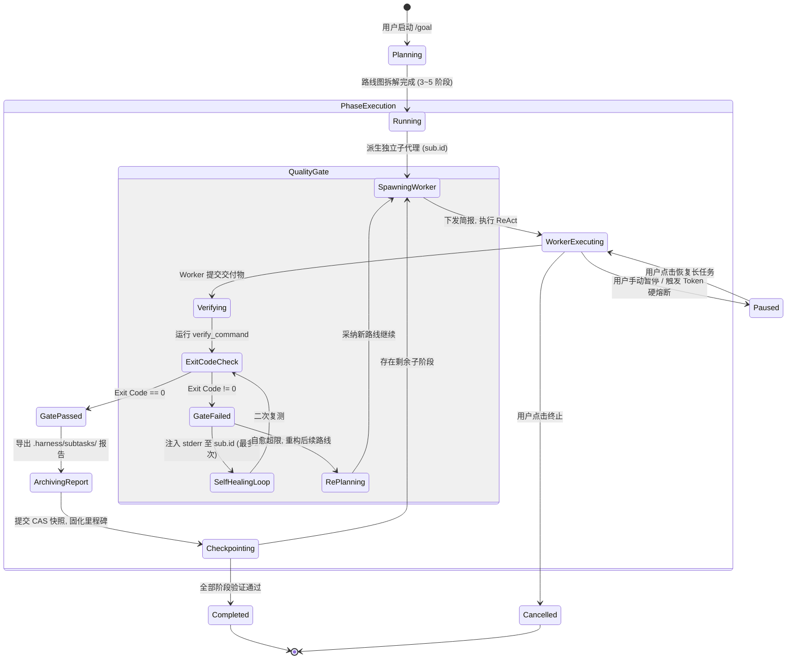

# AI Agent 长任务架构演进：从单轮中断到 Supervisor-Worker 无状态沙箱与树状透明可观测体系
# Supervisor-Worker Long Task Architecture, Stateless Context Isolation & Transparent Tree Observability Knowledge

本文档系统性复盘并沉淀 `harness_mini` 项目中长任务（Long-Running Task / `/goal` 指令）从**失效诊断、第一性原理架构重构、到 Supervisor-Worker 双层代理体系、确定性客观门禁与树状透明可观测界面**的完整落地演进脉络，供后续长期维护与功能扩展参考。

---

## 目录
- [一、 初始背景与核心痛点（本次遇到的问题深剖）](#一-初始背景与核心痛点本次遇到的问题深剖)
  - [1.1 现象：用户输入 `/goal` 长任务“完全没有效果”](#11-现象用户输入-goal-长任务完全没有效果)
  - [1.2 根本原因一：前端指令与核心引擎代码级断连](#12-根本原因一前端指令与核心引擎代码级断连)
  - [1.3 根本原因二：底层 ReAct 循环的单轮文本即停机制](#13-根本原因二底层-react-循环的单轮文本即停机制)
  - [1.4 根本原因三：看板组件从全局布局中遗漏](#14-根本原因三看板组件从全局布局中遗漏)
  - [1.5 架构隐患：双轨规划分裂与线性追加导致的上下文爆炸](#15-架构隐患双轨规划分裂与线性追加导致的上下文爆炸)
- [二、 业内主流长任务实现模式对比与第一性原理审视](#二-业内主流长任务实现模式对比与第一性原理审视)
  - [2.1 业内顶尖系统落地范式调研](#21-业内顶尖系统落地范式调研)
  - [2.2 反对“堆叠式修改”的架构哲学](#22-反对堆叠式修改的架构哲学)
  - [2.3 对“守护进程判定目标继续推进”构想的评估与避坑](#23-对守护进程判定目标继续推进构想的评估与避坑)
- [三、 最终最优架构：Supervisor-Worker 与树状透明拓扑](#三-最终最优架构supervisor-worker-与树状透明拓扑)
  - [3.1 总体架构蓝图与分层职责](#31-总体架构蓝图与分层职责)
  - [3.2 有限状态机（FSM）与生命周期闭环](#32-有限状态机fsm与生命周期闭环)
  - [3.3 “无状态沙箱”与“全量可审计（Auditable）”的辩证统一](#33-无状态沙箱与全量可审计auditable的辩证统一)
  - [3.4 双屏抽屉交互与因果流水线树（Pipeline Tree）](#34-双屏抽屉交互与因果流水线树pipeline-tree)
- [四、 落地改造实施全景（Implementation Details）](#四-落地改造实施全景implementation-details)
  - [4.1 前端触发闭环重构 (`Composer.tsx`)](#41-前端触发闭环重构-composertsx)
  - [4.2 顶栏进度看板挂载 (`App.tsx` & `TaskBar.tsx`)](#42-顶栏进度看板挂载-apptsx--taskbartsx)
  - [4.3 后端沙箱子会话派生与简报下发 (`task.rs`)](#43-后端沙箱子会话派生与简报下发-taskrs)
  - [4.4 主会话轻量里程碑投影与子会话隔离推进](#44-主会话轻量里程碑投影与子会话隔离推进)
  - [4.5 确定性物理门禁与定向自愈自纠闭环](#45-确定性物理门禁与定向自愈自纠闭环)
  - [4.6 树状透明可观测与一键直达 (`TaskDetailModal.tsx`)](#46-树状透明可观测与一键直达-taskdetailmodaltsx)
- [五、 验证、非退化保障与工程沉淀](#五-验证非退化保障与工程沉淀)
  - [5.1 编译与类型安全验证](#51-编译与类型安全验证)
  - [5.2 状态持久化与断点续传（Crash Recovery）](#52-状态持久化与断点续传crash-recovery)
  - [5.3 生产级防坑指南总结](#53-生产级防坑指南总结)
  - [5.4 真实长任务停滞卡死根因（Windows 下验证门禁挂死）与终极解决方案](#54-真实长任务停滞卡死根因windows-下验证门禁挂死与终极解决方案)
- [六、 复杂长任务全生命周期治理与边界缺陷深度复盘（本次调优实录）](#六-复杂长任务全生命周期治理与边界缺陷深度复盘本次调优实录)
  - [6.1 顶栏任务看板精简化与目标拆解流式思考呈现（Live Thinking Stream）](#61-顶栏任务看板精简化与目标拆解流式思考呈现live-thinking-stream)
  - [6.2 阶段子任务执行外泄至主会话（并发双重触发与缺乏 Early Return 阻断）](#62-阶段子任务执行外泄至主会话并发双重触发与缺乏-early-return-阻断)
  - [6.3 阶段子会话生命周期单例化与幂等接续机制（Idempotent Subagent Resumption）](#63-阶段子会话生命周期单例化与幂等接续机制idempotent-subagent-resumption)
  - [6.4 协作者顶栏有效状态收敛与僵尸子任务剔除（Zombie Subprocess Eviction）](#64-协作者顶栏有效状态收敛与僵尸子任务剔除zombie-subprocess-eviction)
  - [6.5 长任务全量达成态穿透与误报中断消除（False Failure Banner Prevention）](#65-长任务全量达成态穿透与误报中断消除false-failure-banner-prevention)

---

## 一、 初始背景与核心痛点（本次遇到的问题深剖）

### 1.1 现象：用户输入 `/goal` 长任务“完全没有效果”
在初始实现中，用户在输入框中使用 `/goal <长任务总目标>` 指令发送后：
1. 界面上未出现任何长任务相关的进度看板或子步骤指示；
2. 模型输出一段宏观规划文本（或仅执行了一步工具调用）后就停止了运行；
3. 后续没有任何自动向后推进的动作，系统彻底停滞等待用户下一次手动打字。

### 1.2 根本原因一：前端指令与核心引擎代码级断连
经深度比对前后端调用链路，发现核心引擎在前端入口处被**彻底架空**：
* 后端 [`src-tauri/src/task.rs`](file:///f:/WorkSpace/Other/harness_mini/src-tauri/src/task.rs) 实现了完整的后台异步调度循环 `run_task_loop`，并通过 Tauri Command 导出了 `start_long_task`，前端 [`src/store.ts`](file:///f:/WorkSpace/Other/harness_mini/src/store.ts) 也封装了 `startLongTask`。
* 但在 [`src/components/Composer.tsx`](file:///f:/WorkSpace/Other/harness_mini/src/components/Composer.tsx) 中：
  ```typescript
  // 缺陷代码（改造前）：
  buildMessage: (body) =>
    `【长任务目标模式】${body}\n\n请分析并拆解该长任务目标，制定明确的阶段方案，并立即按步骤推进落实。`,
  ```
  用户点击发送时，前端**直接将 `/goal` 包装成了一条普通自然语言消息，走普通单轮对话 `ipc.sendMessage` 发出**，根本没有调用 `startLongTask`！

### 1.3 根本原因二：底层 ReAct 循环的单轮文本即停机制
在 [`src-tauri/src/agent.rs`](file:///f:/WorkSpace/Other/harness_mini/src-tauri/src/agent.rs) 的核心 ReAct 循环中：
```rust
// agent.rs: 只要大模型没有调用工具，就立刻终止当前轮次！
if result.tool_calls.is_empty() {
    return (RunOutcome::Done, last_assistant_id, run_tokens);
}
```
当大模型收到长任务 prompt 后，通常第一步是“输出规划方案”或者“调用一次工具并输出阶段成果”。只要大模型在答复中**输出了没有附带工具调用的总结性文字**，`run_loop` 就会直接判定轮次完成并彻底退出线程。因为没有外部调度者，Agent 自然停在原地。

### 1.4 根本原因三：看板组件从全局布局中遗漏
前端其实已经编写好了专用的长任务顶栏组件 [`src/components/TaskBar.tsx`](file:///f:/WorkSpace/Other/harness_mini/src/components/TaskBar.tsx)，包含进度百分比、当前阶段徽标、秒表计时、Token 消耗与暂停/恢复按钮。
但在查看全局主界面布局 [`src/App.tsx`](file:///f:/WorkSpace/Other/harness_mini/src/App.tsx) 时发现：**该组件在开发过程中被遗漏，根本没有被 import 和 mount 进 DOM 树**！

### 1.5 架构隐患：双轨规划分裂与线性追加导致的上下文爆炸
即便强行把旧版 `task.rs` 启动起来，旧架构也存在两个致命的结构性缺陷：
1. **两套规划系统割裂**：代码库中既存在文件驱动的 `.harness/plans/*.md`（`plan.rs`），又存在 SQLite 驱动的 `long_tasks`（`task.rs`），二者互不感知，数据源分裂。
2. **单会话线性追加造成 Token 爆炸**：旧版 `run_task_loop` 是通过向同一个 `session_id` 不断插入 `user` 角色消息（`【长任务自主推进阶段 2/3】...`）来驱动下一步的。所有阶段的工具调用、文件全文读取和报错日志全部倾倒在同一个会话中，跑 3~5 步就会发生上下文溢出（Context Explosion），触发强制摘要压缩，导致模型遗忘最初总目标，发生严重的**目标漂移（Goal Drift）**。

---

## 二、 业内主流长任务实现模式对比与第一性原理审视

### 2.1 业内顶尖系统落地范式调研

| 系统 / 框架 | 核心长任务实现范式 | 终止与推进机制 | 上下文管理方案 |
| :--- | :--- | :--- | :--- |
| **Claude Code / SWE-agent** | 单 Agent 紧密循环 + **显式终止协议** | 必须由模型调用 `finish_task` 工具才允许退出；输出普通文本会被系统追加环境提示推着继续跑 | 单会话滚动窗口 + 依赖项精准剪枝 |
| **Devin / OpenHands** | **Supervisor-Worker 双层代理** | Supervisor 维护目标图；Worker 在独立沙箱中执行局部任务 | **上下文物理隔离**：Worker 执行过程不回流主干，仅回传 Checkpoint 摘要 |
| **LangGraph / AutoGen** | **基于图的状态机与 Checkpoint 持久化** | 节点根据 Edge 条件自循环，直到满足 Evaluator 退出条件 | 状态账本显式存储在图状态中 |

### 2.2 反对“堆叠式修改”的架构哲学
在评估用户提出的“守护进程在轮次结束时判断并追加指令”构想时，我们坚持以**系统第一性原理**审视：
* 如果只是在现有的 `agent.rs` 和 `task.rs` 之间加一个 `sleep(300ms)` 轮询线程，并不断往主会话硬插“请继续下一步”，这属于典型的**堆叠式打补丁（Stacking Patches）**；
* 它虽然能在演示时把任务推下去，但会进一步加剧神仙文件 `agent.rs`（近 4000 行）的混乱度，加剧上下文膨胀与假消息对聊天记录的污染。
* **最优解必须是收敛与内聚**：消除重复轮子，将长任务升级为**单一调度内核（Supervisor）+ 无状态子代理沙箱（Worker）**的标准化模型。

### 2.3 对“守护进程判定目标继续推进”构想的评估与避坑
用户提出的构想在方向上完全正确，本质即业内的 **Evaluator-Optimizer / Supervisor 模式**。但长期运行必须规避 3 大陷阱：
1. **判官模型幻觉（LLM Judge Hallucination）**：不能只用 Prompt 让大模型判断“是否完成”，大模型很容易被 Worker 的欺骗性文本（“我已经修好了”）误导而提前放行。必须基于**客观物理事实**（`cargo check`、`npm test` 的 Exit Code == 0，以及 CAS 快照确有代码变动）。
2. **上下文无限膨胀**：不能在单会话内死循环追问，必须做会话级物理隔离。
3. **死循环与 Token 熔断**：必须建立单阶段步数上限、总 Token 预算硬熔断与工具报错计数器。

---

## 三、 最终最优架构：Supervisor-Worker 与树状透明拓扑

### 3.1 总体架构蓝图与分层职责

```mermaid
graph TD
    User([用户发起 /goal <总目标>]) -->|Composer 拦截| Dispatcher[Supervisor 主控守护进程 (task.rs)]

    subgraph Supervisor Layer [Supervisor 主控层 (全局大脑 / 调度器)]
        Dispatcher -->|1. 拆解阶段图| Decompose[decompose_goal 动态路线图]
        Decompose -->|写入持久化| TaskDB[(SQLite: long_tasks & checkpoints)]
        Dispatcher -->|2. 调度执行阶段 K| SandboxSpawner[Subagent 沙箱派发器]
        Dispatcher -->|3. 主会话播报| MainCard[主会话注入轻量里程碑卡片]
    end

    subgraph Worker Layer [Worker 执行层 (无状态独立沙箱)]
        SandboxSpawner -->|创建专属独立会话 parent_id = 主会话| SubSession[Subagent Session 无状态环境]
        SubSession -->|下发施工简报 Packet| WorkerAgent[Worker 实施工人 (agent.rs)]
        WorkerAgent -->|工具调用: read_file / edit_file / bash| FS[(工作区代码库)]
        WorkerAgent -->|阶段交付| WorkerDone[提交阶段交付申请]
    end

    subgraph Gatekeeper Layer [客观物理门禁与自愈闭环]
        WorkerDone --> QualityGate[Deterministic Quality Gate]
        QualityGate -->|在工作区异步执行 verify_command| TestExec[npm test / cargo check]
        TestExec -->|Pass: Exit Code == 0| Snapshot[提交 CAS 影子快照与 Checkpoint]
        TestExec -->|Fail: 捕获 stderr| SelfHeal[向 Subagent 注入定向报错修复 <=2次]
        SelfHeal -->|重试超限| Replan[replan_subtasks 自适应重规划]
    end

    Snapshot -->|推进阶段 K+1| Dispatcher
    Snapshot -->|广播 task:update / task:checkpoint| FrontendUI[全透明树状界面]
```

### 3.2 有限状态机（FSM）与生命周期闭环



### 3.3 “无状态沙箱”与“全量可审计（Auditable）”的辩证统一
这是本系统架构最具竞争力的设计理念：
* **对大模型而言（无状态）**：
  * 每个子阶段使用一个全新的会话上下文（`subagent_session_id`），完全不受前序子阶段细碎排错日志的干扰；
  * 模型注意力高度集中在当前阶段的微观目标上，单次 Prompt 消耗极小，彻底杜绝上下文爆炸。
* **对人类用户而言（全透明可溯源）**：
  * 无状态不代表数据丢弃。Worker 产生的所有消息流、思考链、工具调用与 Diff，均作为规范化的 Session 实体持久化在 SQLite 中；
  * 用户不仅随时可以在主界面看板中查看高层进度，还可以随时点进任何一个子阶段，审查其完整的执行细节。

### 3.4 双屏抽屉交互与因果流水线树（Pipeline Tree）
* **左屏（主线时间线）**：
  * 仅显示宏观里程碑卡片（`🚀 开始推进阶段 [1/3]` ➔ `✅ 阶段 [1/3] 顺利达成`）；
  * 顶栏常驻 [`TaskBar`](file:///f:/WorkSpace/Other/harness_mini/src/components/TaskBar.tsx)，提供全局百分比与控制按钮；
  * 顶栏协作者条 [`CollaboratorBar`](file:///f:/WorkSpace/Other/harness_mini/src/components/CollaboratorBar.tsx) 自动展示当前正在跑的阶段角色徽标与呼吸灯。
* **右屏（透明抽屉）**：
  * 用户点击任意子阶段，右侧平滑滑出 [`CollaboratorView`](file:///f:/WorkSpace/Other/harness_mini/src/components/CollaboratorView.tsx) 分屏，展示该 Worker 的所有终端日志、局部文件编辑 Diff 与思考过程。

---

## 四、 落地改造实施全景（Implementation Details）

### 4.1 前端触发闭环重构 (`Composer.tsx`)
在 [`src/components/Composer.tsx`](file:///f:/WorkSpace/Other/harness_mini/src/components/Composer.tsx) 的 `doSend` 函数中，对 `/goal` 指令进行显式拦截，彻底废除“普通文本拼装后发 chat”的旧逻辑：
```typescript
// Composer.tsx: 拦截 /goal 并直连长任务内核
if (cfg?.cmd === "/goal") {
  const goalBody = (body || "").trim();
  if (!goalBody) {
    setActiveCmd(cfg.cmd);
    pushToast(cfg.emptyHint, "info");
    return;
  }
  setActiveCmd(null);
  setSessionDraft(targetId, "");

  const st = useStore.getState();
  const isDraftLike = !currentId || currentId === DRAFT_ID;
  let targetSessionId = currentId;

  // 草稿态自动创建物理会话并无缝切换
  if (isDraftLike || !targetSessionId) {
    const s = await ipc.createSession({
      workspacePath: draft?.workspacePath,
      title: `长任务: ${goalBody.slice(0, 20)}`,
      accessMode: draft?.accessMode,
      // ... 继承模型与环境配置
    });
    targetSessionId = s.id;
    st.onSessionUpdate(s);
    await st.selectSession(s.id);
  }

  // 直连长任务引擎，激活顶栏与调度线程
  await st.startLongTask(targetSessionId, goalBody);
  return;
}
```

### 4.2 顶栏进度看板挂载 (`App.tsx` & `TaskBar.tsx`)
在全局根布局 [`src/App.tsx`](file:///f:/WorkSpace/Other/harness_mini/src/App.tsx) 中正确挂载 `<TaskBar />`：
```tsx
// App.tsx
<div style={{ minWidth: `${MAIN_PANEL_MIN_WIDTH}px` }} className="flex-1 flex flex-col relative overflow-hidden">
  <TopBar />
  <CollaboratorBar />
  <TaskBar />   {/* 挂载长任务专有看板，无长任务时自动 return null 零占位 */}
  <ChatView />
  <PendingQueue />
  ...
</div>
```

### 4.3 后端沙箱子会话派生与简报下发 (`task.rs`)
在 [`src-tauri/src/task.rs`](file:///f:/WorkSpace/Other/harness_mini/src-tauri/src/task.rs) 的 `run_task_loop` 中，重构阶段推进逻辑，不再污染主会话：
```rust
// task.rs: 派生独立子代理会话 (Worker)
let (sub, user_msg) = {
    let db = state.db.lock().unwrap();
    let s = store::create_subagent_session(
        &db,
        &task.session_id,
        role,
        &subtask.title,
        subtask.description.as_deref().unwrap_or(&subtask.title),
        &task.workspace_path,
        parent_session.access_mode.as_deref(),
        parent_session.project_id.as_deref(),
        None,
    )?;
    let m = store::new_message(&db, &s.id, "user", Some(prompt), false)?;
    (s, m)
};

// 固化子会话 ID 到子任务中，支持树状反查
task.subtasks[cur_idx].id = sub.id.clone();
store::update_long_task(&db, &task)?;

// 广播事件，通知前端 CollaboratorBar 与树状组件实时挂载
let _ = app.emit("subprocess:created", json!({ "parentId": &task.session_id, "subprocess": &sub }));
let _ = app.emit("subprocesses:changed", json!({ "parentId": &task.session_id }));

// 启动独立沙箱子会话执行
agent::spawn_session_task(app.clone(), sub.id.clone(), Some(user_msg.id));
```

### 4.4 主会话轻量里程碑投影与子会话隔离推进
主会话中只写入高层卡片，保证时间线清爽：
1. **阶段启动时**：在主会话写入 `🚀 **开始推进阶段 [{}/{}]**：【{}】`，并带上子会话 ID 提示；
2. **阶段完成时**：在主会话写入 `✅ **阶段 [{}/{}] 顺利达成**：【{}】`，展示摘要并声明门禁已通过；
3. **所有的代码探索、编译报错与中间对话**：严格收敛在 `sub.id` 内部。

### 4.5 确定性物理门禁与定向自愈自纠闭环
```rust
// task.rs: 客观门禁校验
if let Some(ref v_cmd) = subtask.verify_command {
    task.subtasks[cur_idx].status = "verifying".to_string();
    let _ = app.emit("task:update", &task);

    let (passed, out) = execute_verify_command(&ws_path, v_cmd).await;
    if !passed {
        // 门禁失败：捕获 stderr，定向注入回 sub.id 触发局部自愈
        let fix_prompt = format!("【🚨 自动化质量门禁校验未通过】\n命令 `{v_cmd}` 报错：\n```\n{out}\n```\n请立即排查修复代码！");
        if let Some(fm) = store::new_message(&db, &sub.id, "user", Some(fix_prompt), false).ok() {
            agent::spawn_session_task(app.clone(), sub.id.clone(), Some(fm.id));
            // 二次复测逻辑...
        }
    }
}
```

### 4.6 树状透明可观测与一键直达 (`TaskDetailModal.tsx`)
在 [`src/components/TaskDetailModal.tsx`](file:///f:/WorkSpace/Other/harness_mini/src/components/TaskDetailModal.tsx) 的阶段子任务卡片中，新增了专属的 **`查看流程`** 入口：
```tsx
// TaskDetailModal.tsx
{sub.id.startsWith("sub-") && (
  <button
    onClick={() => {
      setActiveCollaboratorId(sub.id); // 激活右侧抽屉
      setShow(false);                  // 关闭模态框
    }}
    title="在右侧分屏查看该子任务的详细执行与工具卡片"
    className="flex items-center gap-1 px-1.5 py-0.5 rounded text-[10px] text-indigo-400 hover:text-indigo-300 hover:bg-indigo-500/15 border border-indigo-500/30 transition-colors cursor-pointer"
  >
    <Eye size={11} />
    <span>查看流程</span>
  </button>
)}
```

### 4.7 对话流内联树状任务挂载 (`spawn_subagent` 与 `SubprocessBranchTree`)
为了让用户在主对话时间线中直观感受阶段任务的派生与拓扑状态，在 `task.rs` 启动子任务时，不再仅发送纯文本消息，而是向主会话助理消息绑定一个结构化的合成工具调用事件：
1. **工具事件规格**：`tool_name = "spawn_subagent"`，`subprocess_id = Some(sub.id.clone())`，`status = "running"`；
2. **前端自动捕获**：[`MessageItem.tsx`](file:///f:/WorkSpace/Other/harness_mini/src/components/MessageItem.tsx) 自动通过 `groupToolEvents` 识别 `spawn_subagent`，自动挂载并内联渲染 [`SubprocessBranchTree.tsx`](file:///f:/WorkSpace/Other/harness_mini/src/components/SubprocessBranchTree.tsx)；
3. **交互与生命周期闭环**：
   * 运行中显示蓝色动态连线与旋转加载徽标；
   * 阶段完成后后端更新 `tool_events` 状态为 `success` 并广播 `tool:update`，树状图自动变为绿色对勾；
   * 用户直接点击内联树中的子任务卡片，即可一键打开右侧分屏透明查看执行过程。

### 4.8 右侧悬浮面板长任务阶段看板协同 (`FloatingTaskPanel.tsx`)
借鉴轻量 Todo 清单的便捷浮窗交互，在右侧可折叠的浮窗组件 [`FloatingTaskPanel.tsx`](file:///f:/WorkSpace/Other/harness_mini/src/components/FloatingTaskPanel.tsx) 中新增 `LongTaskSection`：
1. **抽屉收起态适配**：当存在活跃长任务时，折叠标签自动展示紫色长任务徽章与阶段完成比（如 `1/4 阶段`）；
2. **看板展开态全量呈现**：
   * 顶部展示长任务总目标、推进状态（推进中/已达成/已暂停/遇阻）与渐变进度条；
   * 下方以 Checklist 形式呈现各子任务：带有阶段序号、标题、描述与验证门禁标识；
   * 每个阶段行带有状态图标（绿勾/蓝旋转/红叉/灰圈）及查看按钮（`Eye` 图标），支持直接点击在分屏中透明查看对应沙箱子进程。

### 4.9 顶栏进度条自适应分屏排版优化 (`TaskBar.tsx`)
在用户展开右侧分屏协作者视图（`CollaboratorView`）时，主视口宽度大幅压缩（可由 1200px 骤降至 500px）。旧版 `TaskBar` 因内部元素采用固定宽度和无收缩限制导致整行溢出换行。优化措施：
1. **容器流式限制**：设置 `overflow-hidden`，移除绝对定宽；
2. **目标与当前阶段弹性截断**：`min-w-0 shrink max-w-[120px] sm:max-w-[180px] md:max-w-[240px]`，在超窄视口下仅保留当前阶段序号，隐藏冗余文本；
3. **进度条自适应收缩**：进度条弹性缩小（`min-w-[60px] max-w-[220px] shrink`），窄屏下仅显示百分比数值，宽屏下显示完整 `x/y (xx%)`；
4. **统计项智能让位**：耗时秒表与 Token 计数在窄视口下自动隐藏（`hidden md:flex`），将珍贵的视口空间让位给核心进度与控制按钮；
5. **紧凑按钮文案**：使用响应式文案（如 `恢复<span className="hidden sm:inline">长任务</span>`），确保分屏打开时顶栏依然严整美观。

---

## 五、 验证、非退化保障与工程沉淀

### 5.1 编译与类型安全验证
整个改造严格确保了零破坏性变更与零类型退化：
* **前端类型检查**：`npx tsc --noEmit` 0 错误通过；
* **Rust 后端检查**：`cargo check --manifest-path src-tauri/Cargo.toml` 0 错误（`Finished dev profile`）编译通过。

### 5.2 状态持久化与断点续传（Crash Recovery）
* **SQLite 事务原子性**：长任务及其每一个子步骤、每个 Checkpoint 快照均有独立的表结构支持；
* **意外崩溃自愈**：应用启动时自动触发 `recover_orphaned_tasks`，将异常关机遗留的 `running` / `planning` 任务安全置为 `interrupted`；
* **一键 Resume**：用户重启软件后，顶栏 TaskBar 自动探测到中断任务，点击 **恢复长任务** 即可从最后一个成功的 Checkpoint 无缝继续推进。

### 5.3 生产级防坑指南总结
1. **不要盲信大模型的“自我结项”声明**：必须将自动化测试或编译器 Exit Code 作为阶段通过的充要条件。
2. **长任务必须采用独立沙箱上下文**：绝不可在一个会话里“一条路走到黑”，无状态子会话 + 简报下发是避免 Token 爆炸的唯一出路。
3. **全透明与可干预是 Agent 可靠性的压舱石**：当且仅当人类能够随意切换叶节点、看清 Agent 调用的每一个工具、必要时随时介入纠偏，无人值守长任务才具备工程落地的真正可用性。

### 5.4 真实长任务停滞卡死根因（Windows 下验证门禁挂死）与终极解决方案
在真实运行测试中，用户反馈“长任务在第一阶段完成后突然卡住不动，点击阶段发现子任务实际已经执行完毕”。深入 SQLite 审计日志与进程表诊断发现：
1. **根本原因**：
   * 大模型拆解目标时默认生成了类 Unix 风格的自动化验证命令（例如 `bash -lc 'test -f docs/... && grep -q ...'`）；
   * 在 Windows 平台的 GUI 进程中，`tokio::process::Command::new("cmd").args(["/C", v_cmd]).output().await` 缺少标准输入断开（`stdin(Stdio::null())`）与执行超时控制（`timeout`）；
   * `cmd /C bash ...` 在无控制台挂载环境下尝试等待输入或句柄握手，导致 `output().await` 发生**无限期永久挂死（Deadlock）**，整个长任务调度循环完全停滞。
2. **终极解决方案**：
   * **复用工程级门禁执行器**：全面接入 [`src-tauri/src/sop.rs`](file:///f:/WorkSpace/Other/harness_mini/src-tauri/src/sop.rs) 的 `run_verify_cmd`，配置严格的 `tokio::time::timeout(Duration::from_secs(35))`，设置 `kill_on_drop(true)`，显式配置 `.stdin(std::process::Stdio::null())`；
   * **平台原生提示约束**：在目标拆解 Prompt 中注入当前宿主平台标识，明确要求 Windows 环境下必须推断 Windows 兼容命令（如 `npm test`、`cargo check`、PowerShell 等），严禁生成交互式输入命令与非原生 `bash -lc`；
   * **即使超时也绝不挂死**：门禁超时后自动判定为失败并输出明确的超时诊断信息，驱动 Worker 尝试自愈修复或触发动态重规划，彻底消除调度器僵死隐患。

---

## 六、 复杂长任务全生命周期治理与边界缺陷深度复盘（本次调优实录）

在长任务多轮实机推进与交互压力测试中，系统遭遇了一系列高度隐蔽、交织在前端状态管理与后端生命周期调度之间的典型并发与边界缺陷。本章将对这些问题进行深度复盘、根因还原与方案沉淀。

### 6.1 顶栏任务看板精简化与目标拆解流式思考呈现（Live Thinking Stream）

#### 1. 问题与诉求
1. **顶栏空间挤压**：用户反馈长任务顶栏信息过于冗余（原包含目标描述文本、阶段名称、任务看板大按钮等），在分屏查看子任务时容易溢出换行；
2. **拆解阶段黑盒等待**：长任务启动之初，大模型需要基于全局代码库与目标做 3~5 阶段的严密拆解并推断门禁。拆解过程需耗时 15~30 秒，此前没有任何中间状态回传，前端仅显示一个转圈的占位符，用户无法感知模型是否在思考、规划还是死锁卡死。

#### 2. 改造方案
1. **顶栏极简收敛（[`TaskBar.tsx`](file:///f:/WorkSpace/Other/harness_mini/src/components/TaskBar.tsx)）**：
   - 彻底移除“任务看板”按钮，右侧看板能力统一度量至右侧悬浮面板 [`FloatingTaskPanel.tsx`](file:///f:/WorkSpace/Other/harness_mini/src/components/FloatingTaskPanel.tsx)；
   - 顶栏精简为单行 5 个关键元素，严格保持单行弹性不换行：
     - **进度条**：包含 Target 靶心图标、高亮进度条、完成百分比；
     - **消耗时间**：带 Clock 图标与等宽数字的运行耗时；
     - **Tokens**：实时 Token 消耗徽标（如 `524.8k tokens`）；
     - **暂停 / 恢复**：清晰的琥珀色暂停与绿色恢复按钮；
     - **终止**：安全红色终止按钮。
2. **目标拆解流式思考呈现（[`task.rs::decompose_goal`](file:///f:/WorkSpace/Other/harness_mini/src-tauri/src/task.rs)）**：
   - 在启动长任务时预先生成阶段规划占位消息（`plan_msg_id`），直接向主会话广播创建；
   - 调用 LLM 时配置 `reasoning_effort` 并监听 `on_reasoning` 回调，实时解析模型的思考过程与 `<think>` 标签；
   - 思考 Token 产生时实时通过 `message:reasoning:delta` 事件推流至主会话气泡中；
   - 最终规划生成后直接以结构化执行路线图置换文本内容。用户在前端能实时看到模型的架构决策思路，彻底告别静候盲盒。

---

### 6.2 阶段子任务执行外泄至主会话（并发双重触发与缺乏 Early Return 阻断）

#### 1. 现象与危害
用户在长任务执行到阶段 3 时点击“暂停”，随后点击“恢复”，发现**子任务的工具执行全部泄漏到了主对话中**：
主会话突然连续产生了 22 条 `read_file`、`git` 等后端工具调用，污染了主对话历史，破坏了主子会话上下文物理隔离铁律。

#### 2. 根因深度剖析（多点并发交织）
经审查 SQLite 数据库与调用链路，定位出**三层叠加故障**：
1. **前端双重触发（TaskBar 并发调用）**：
   在 [`src/components/TaskBar.tsx`](file:///f:/WorkSpace/Other/harness_mini/src/components/TaskBar.tsx) 的“恢复”按钮点击事件中：
   ```tsx
   // 致命 Bug：currentId 是主会话 ID！
   await resumeLongTask(task.id);
   if (currentId && runStatus[currentId] !== "running") {
     void continueTurn(currentId); // 同时触发了主会话的普通轮次！
   }
   ```
2. **后端 `continue_turn` 缺乏提前返回（Early Return）**：
   在 [`src-tauri/src/agent.rs`](file:///f:/WorkSpace/Other/harness_mini/src-tauri/src/agent.rs#L488) 中，虽然感知并唤醒了 `resume_long_task(app, &lt.id)`，**但未执行 `return Ok(())`**！
   代码继续向下执行：向主会话数据库强行插入一条“接续提示词”：
   `"请承接前文未完成的内容与思路，直接继续往下执行，无需重复前文已输出的内容。"`
   并调用 `spawn_session_task(app, 主会话ID)` 启动了主会话的 ReAct Agent！
3. **主会话 LLM 角色认知混淆（执行越界）**：
   主会话 Agent 醒来后，看到上下文末尾长任务 Supervisor 刚打印的阶段推进看板 `🚀 开始推进阶段 [3/5]：后端技术栈与架构`，紧接着看到接续提示词，误以为这是自己需要完成的工作，直接在主会话中展开全量工具调用。

#### 3. 架构级防御与修复
1. **顶栏移除任何对主会话的调用**：[`TaskBar.tsx`](file:///f:/WorkSpace/Other/harness_mini/src/components/TaskBar.tsx) 恢复按钮仅调用 `resumeLongTask(task.id)`，全权交由 Supervisor 自治管理；
2. **`continue_turn` 与 `retry_turn` 增加长任务排他阻断**：
   在 [`src-tauri/src/agent.rs`](file:///f:/WorkSpace/Other/harness_mini/src-tauri/src/agent.rs) 入口处首先探测活跃长任务：
   ```rust
   // 0. 若当前会话关联未完成的长任务，全权委托给长任务调度引擎恢复，坚决不启动主会话 Agent 轮次
   {
       let db = state.db.lock().unwrap();
       if let Ok(Some(lt)) = store::get_active_long_task(&db, session_id) {
           if lt.status == "interrupted" || lt.status == "failed" || lt.status == "paused" {
               drop(db);
               crate::task::resume_long_task(app, &lt.id)?;
               return Ok(()); // 关键修复：立即提前返回，坚决不触碰主会话
           } else if lt.status == "running" {
               return Ok(());
           }
       }
   }
   ```
3. **异常横幅互斥收敛**：[`ChatView.tsx`](file:///f:/WorkSpace/Other/harness_mini/src/components/ChatView.tsx) 在长任务处于非取消状态时，隐藏底部单轮异常条，所有控制收拢至 TaskBar。

---

### 6.3 阶段子会话生命周期单例化与幂等接续机制（Idempotent Subagent Resumption）

#### 1. 现象
在长任务处于某个阶段时，用户点击暂停后再次恢复，系统没有接着上一次已暂停的子任务继续执行，而是**重新开启了另外一个子任务**；且聊天记录中每恢复一次就会新增一张 `🚀 开始推进阶段` 卡片；在历史聊天卡片中点击“查看流程”，打开的依然是之前已停滞的旧子任务。

#### 2. 根因剖析
在 [`src-tauri/src/task.rs`](file:///f:/WorkSpace/Other/harness_mini/src-tauri/src/task.rs) 的 `run_task_loop` 中：
每次执行循环时，无论该阶段是首次进入还是从暂停中恢复，代码都无条件执行了：
```rust
let s = store::create_subagent_session(...); // 每次 resume 都会生成全新的 UUID
task.subtasks[cur_idx].id = s.id.clone();
store::new_message(&db, &task.session_id, "assistant", Some(phase_start_msg), false); // 插入新卡片
```
这导致：
- 原有子会话被直接抛弃，遗留在数据库中变成孤儿会话；
- 新会话丢失了此前已经探查的代码上下文，需要从零重新开始；
- 主会话堆积多张相同阶段的卡片，早期卡片绑定的 `subprocess_id` 是死任务，点击跳转出现错乱。

#### 3. 幂等接续（Idempotent Resumption）方案落地
在 `run_task_loop` 阶段分派前，增加**已存会话探测**：
```rust
// 检查该阶段是否已有绑定的子会话实体（例如恢复推进已暂停或中断的阶段）
let existing_sub = {
    let db = state.db.lock().unwrap();
    if subtask.id.len() >= 30 && !subtask.id.starts_with("sub-") {
        store::get_session(&db, &subtask.id).ok().flatten()
    } else {
        None
    }
};

let (sub, created_phase_ev) = if let Some(sub) = existing_sub {
    // 【复用接续分支】
    // 1. 查找已关联的原 spawn_subagent 工具事件，状态更新为 running 并广播
    // 2. 调用 agent::restart_subagent(&app, &sub.id) 激活子会话执行
    // 3. 坚决不创建新会话、不向主会话注入重复卡片！
    (sub, ev_opt)
} else {
    // 【初次派生分支】创建全新沙箱子会话、记录 subtask.id、发送阶段卡片
    (sub, ev)
};
```
该机制实现了**单阶段会话单例化**：一个阶段从派生、暂停、恢复到完成，自始至终使用唯一的会话 UUID，上下文完美接续，对话卡片始终唯一。

---

### 6.4 协作者顶栏有效状态收敛与僵尸子任务剔除（Zombie Subprocess Eviction）

#### 1. 现象
多次暂停-恢复后，上方协作者顶栏（`CollaboratorBar`）中之前的旧子任务全部都在，排成一长串同名徽章。

#### 2. 根因剖析
在 [`src/components/CollaboratorBar.tsx`](file:///f:/WorkSpace/Other/harness_mini/src/components/CollaboratorBar.tsx) 中：
```tsx
const activeSubprocesses = useMemo(() => {
  return rawSubprocesses.filter((sub) => {
    if (sub.status !== "completed") return true; // 缺陷：cancelled/failed 会被永久当成活跃任务展示！
    return exitingSubtaskIds.has(sub.id);
  });
}, [rawSubprocesses, exitingSubtaskIds]);
```
当子任务被暂停或废弃时，其在数据库的状态为 `cancelled`。由于 `status !== "completed"` 成立，所有废弃会话被永久展示在顶栏。

#### 3. 修复方案
增加对废弃/取消状态的判定：
```tsx
const activeSubprocesses = useMemo(() => {
  return rawSubprocesses.filter((sub) => {
    // 1. 已完成的，仅在 2.5 秒退场倒计时内保留展示
    if (sub.status === "completed") {
      return exitingSubtaskIds.has(sub.id);
    }
    // 2. 如果已被明确中止/取消 (cancelled)，且没有正在运行，则从顶栏立即剔除
    if (sub.status === "cancelled" && runStatus[sub.id] !== "running") {
      return false;
    }
    return true;
  });
}, [rawSubprocesses, exitingSubtaskIds, runStatus]);
```

---

### 6.5 长任务全量达成态穿透与误报中断消除（False Failure Banner Prevention）

#### 1. 现象
长任务全部 5 个阶段顺利执行通过，主对话最后输出了 `🎉 长任务全部子任务已顺利达成！`，但在最底部却同时弹出了黄色警告横幅：
> `对话执行中断或遇到异常`
> `您可以选择重试本轮，或让 Agent 基于当前已有上下文继续向下推进。`

#### 2. 根因剖析
在 [`src/components/ChatView.tsx`](file:///f:/WorkSpace/Other/harness_mini/src/components/ChatView.tsx) 中：
```tsx
const isInterruptedOrFailed = useMemo(() => {
  if (running || !currentId || msgs.length === 0) return false;
  const activeTask = activeTasks[currentId];
  // 缺陷代码：
  if (activeTask && activeTask.status !== "completed" && activeTask.status !== "cancelled") {
    return false;
  }
  // 只要 activeTask.status === "completed"，上述条件为 false，逻辑直接向下穿透！
  if (lastRunOutcome === "interrupted" || lastRunOutcome === "failed") {
    return true; // 因执行过程中曾发生过暂停，主会话历史 run 状态残留为 interrupted，命中此分支！
  }
  ...
```
长任务达成后，`activeTask.status` 变为 `"completed"`，条件穿透；而此前暂停操作导致主会话 `runs` 表最后一条状态为 `interrupted`，调度器未向主会话发射 `run:status = "done"`，引发误报。

#### 3. 修复方案
1. **前端多重守卫（[`ChatView.tsx`](file:///f:/WorkSpace/Other/harness_mini/src/components/ChatView.tsx)）**：
   - 当 `activeTask.status === "completed"` 时，强制返回 `false`；
   - 增加内容级特征兜底：若末尾消息包含 `长任务全部子任务已顺利达成`，强制返回 `false`。
2. **后端终态事务与广播闭环（[`task.rs`](file:///f:/WorkSpace/Other/harness_mini/src-tauri/src/task.rs)）**：
   长任务全部完成时，后端主动在 SQLite 中将主会话关联的残留 runs 状态置为 `'done'`，并向前端派发 `run:status`（`status: "done"`），使全局状态彻底闭环。
