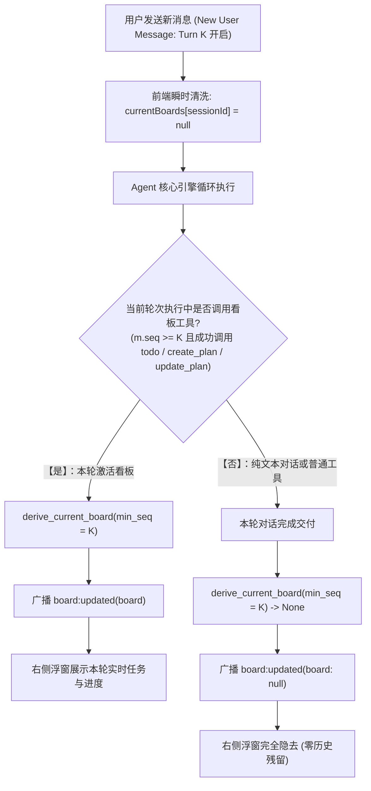

# 任务看板轮次纯函数投影与生命周期解耦治理知识复盘
# Task Board Turn-Centric Pure Projection & Lifecycle Decoupling Architecture Knowledge Base

| 属性 | 说明 |
| :--- | :--- |
| **文档代号** | `TASK_BOARD_TURN_PROJECTION_AND_LIFECYCLE_KNOWLEDGE` |
| **创建时间** | 2026-10-19 |
| **适用范围** | `harness_mini`（Tauri 2 + Rust + React 桌面 AI Agent 架构体系） |
| **关联核心模块** | [`src-tauri/src/plan.rs`](file:///f:/WorkSpace/Other/harness_mini/src-tauri/src/plan.rs), [`src/components/FloatingTaskPanel.tsx`](file:///f:/WorkSpace/Other/harness_mini/src/components/FloatingTaskPanel.tsx), [`src/components/Composer.tsx`](file:///f:/WorkSpace/Other/harness_mini/src/components/Composer.tsx), [`docs/TURN_CENTRIC_BOARD_PROJECTION_AND_LIFECYCLE_SPEC.md`](file:///f:/WorkSpace/Other/harness_mini/docs/TURN_CENTRIC_BOARD_PROJECTION_AND_LIFECYCLE_SPEC.md) |
| **知识密级** | 架构演进复盘、状态机治理与防退化知识库 |

---

## 目录

- [一、问题诊断与历史沿革深度解构](#一问题诊断与历史沿革深度解构)
  - [1.1 核心痛点现象还原](#11-核心痛点现象还原)
  - [1.2 历史三次演进路径与失真演变](#12-历史三次演进路径与失真演变)
  - [1.3 根因深剖：为什么此前的改造无法解决问题？](#13-根因深剖为什么此前的改造无法解决问题)
- [二、架构三大反模式与认知失真](#二架构三大反模式与认知失真)
  - [2.1 反模式一：作用域错位（Scope Confusion: Turn vs Session）](#21-反模式一作用域错位scope-confusion-turn-vs-session)
  - [2.2 反模式二：实体职责混淆（Entity Coupling: Artifact vs Dashboard）](#22-反模式二实体职责混淆entity-coupling-artifact-vs-dashboard)
  - [2.3 反模式三：“绝不留白”过度兜底（Over-fallback Anti-pattern）](#23-反模式三绝不留白过度兜底over-fallback-anti-pattern)
- [三、目标范式：基于对话轮次的纯函数状态投影（Turn-Centric Pure Projection）](#三目标范式基于对话轮次的纯函数状态投影turn-centric-pure-projection)
  - [3.1 核心模型与不变量定义](#31-核心模型与不变量定义)
  - [3.2 判定算法：零猜测、零穿透、缺失即空白](#32-判定算法零猜测零穿透缺失即空白)
  - [3.3 状态自愈与完成态实时动态映射](#33-状态自愈与完成态实时动态映射)
  - [3.4 撤回（Revert）回退为何天然成立](#34-撤回revert回退为何天然成立)
- [四、前后端端到端落地细节](#四前后端端到端落地细节)
  - [4.1 后端重构：精确收敛至本轮视界](#41-后端重构精确收敛至本轮视界)
  - [4.2 后端：完成态动态映射与状态机解耦](#42-后端完成态动态映射与状态机解耦)
  - [4.3 前端：无缝切轮与发送即清空](#43-前端无缝切轮与发送即清空)
- [五、演进成效与测试验证基线](#五演进成效与测试验证基线)
  - [5.1 分支复杂度与代码精简对照](#51-分支复杂度与代码精简对照)
  - [5.2 核心测试场景覆盖矩阵](#52-核心测试场景覆盖矩阵)
- [六、架构防退化准则（Architecture Guardrails）](#六架构防退化准则architecture-guardrails)
  - [6.1 明确禁止项（What NOT to do）](#61-明确禁止项what-not-to-do)
  - [6.2 新增看板类型的正确演进路径](#62-新增看板类型的正确演进路径)

---

## 一、问题诊断与历史沿革深度解构

### 1.1 核心痛点现象还原
在实际使用中，用户普遍反馈两类严重影响交互体验的顽疾：
1. **方案跨轮次幽灵霸屏**：
   在某一轮对话中让 AI 生成了架构方案或任务清单后，随后开启新一轮对话（例如提出一个完全不相关的简单问答、解释代码、或微调单行样式），界面右侧浮窗依然顽固地悬挂着上一轮（乃至很久之前）的任务方案，无法自动消失。
2. **状态长期僵死为“未完成”**：
   任务实际代码早已编写完成并验证通过，浮窗中任务进度虽然显示 100% 或全打钩，但看板标签状态依然长期保持为“执行中”（未完成），且无法自动结案。

### 1.2 历史三次演进路径与失真演变
系统关于任务与计划看板（`FloatingTaskPanel`）经历过三次重构，但前两次均在错误的抽象上打补丁：

```
【第一代：多轨并行与双向猜测】
- 方案（Plan）与待办（Todo）塞进同一条 timeline
- 前端通过翻页器（◀ n/m ▶）翻页浏览
- 依靠 title、filename、result_text 四路模糊匹配反查归属
- 缺陷：猜测失败率高，翻页器状态极易错乱，用户心智负担极重

                 ▼
【第二代：前端单一投影（Single Projection 末项）】
- 废除翻页器与模糊匹配，在消息流上建立 deriveBoards(visibleMsgs)
- 仅取 boards[boards.length - 1] 展示
- 缺陷：误以为“看板数组末项”等于“最新一轮对话”；新轮次若无任务，末项依然是旧方案！

                 ▼
【第三代：后端集中仲裁（derive_current_board，commit 9f55e1d）】
- 将投影逻辑搬到后端，由 Rust 做集中仲裁并广播 board:updated
- 缺陷：走向了“会话全局过度兜底”；规则 1 全局置顶活动方案，规则 2 拿已结案方案兜底，绝不留白

                 ▼
【第四代（本次最优解）：基于对话轮次的纯函数状态投影（Turn-Centric Pure Projection）】
- 确立“对话轮次（Turn）”生命周期：强制限定本轮视界起点 min_seq = last_user_seq
- 彻底废除规则 2 与全局穿透，本轮无任务明确返回 None，浮窗自然隐去
- 步骤打满动态映射 completed，前端发送新消息瞬时重置，状态单向确定性流动
```

### 1.3 根因深剖：为什么此前的改造无法解决问题？
1. **把“筛选出所有看板中的最后一个”当成了“当前轮次的看板”**：
   第二代前端投影的计算公式是：
   $$\text{boards} = \text{deriveBoards}(\text{visibleMsgs}), \quad \text{currentBoard} = \text{boards}[\text{boards.length} - 1]$$
   该算法成立的充要条件是：**会话中每一轮对话都必须产生新看板**。
   然而实际人机交互中，**绝大多数后续对话都是无看板轮次**（例如“解释一下这个报错”、“换成蓝色”）。在这些轮次中，新消息没有产生看板，`boards` 数组长度没有增加，`boards.length - 1` 自然永远指向前序轮次的旧方案。
2. **后移至后端时，仲裁目标被扭曲为“绝不留白”**：
   第三代改造把仲裁移到后端 `derive_current_board`，函数入参仅为 `(conn, workspace, session_id)`，完全抹除了“当前最新用户提问处于哪条消息”的上下文。
   后端的算法变成了：
   - 只要会话里存在 `status == "in_progress"` 的方案文件，无论哪一轮生成的，无条件作为活动方案返回；
   - 即使方案结案了，也要通过 `find_latest_session_plan` 挖出一个已结案方案兜底展示！
   这就导致后端的策略演变成了**“无论如何都要在整个会话历史中挖出一个东西挂在右侧”**，与用户期望的“开启新对话后不显示旧方案”南辕北辙。

---

## 二、架构三大反模式与认知失真

本次重构通过彻底剖析代码，提炼出三项极具普遍警示意义的架构反模式：

### 2.1 反模式一：作用域错位（Scope Confusion: Turn vs Session）
- **现象**：将原本生命周期属于单个对话轮次（Turn Scope）的状态，提升并存储到了会话全局（Session Scope）。
- **危害**：
  右侧浮窗在 UX 上的真实定位是**“当前工作轮次（Active Turn）的任务监视器（Dashboard）”**。一旦将其绑定为 Session 级的常驻实体，系统就会在会话全量历史（包含所有轮次的消息和工具事件）中进行搜索，导致跨轮次的陈旧数据穿透到当前视图。
- **正道**：
  **严格定义轮次视界边界**。任何针对当前轮次 UI 的推导，必须以当前会话末条未撤回用户消息的序号（`last_user_seq`）作为视界下限，严禁向更早历史穿透。

### 2.2 反模式二：实体职责混淆（Entity Coupling: Artifact vs Dashboard）
- **现象**：把“方案文档（Plan MD 文件）”直接等价于“当前浮窗的待办任务”。
- **危害**：
  - **方案文档是持久交付资产（Artifact）**：它存储于 `.harness/plans/*.md`，承载系统架构、设计决策与分步清单，生命周期是长期、跨会话的；
  - **浮窗是交互监控器（Dashboard）**：仅用于呈现当前轮次 AI Agent 的推进节奏。
  - 一旦将二者强行耦合，由于大模型在实际交付时极少自觉调用 `update_plan(status: "completed")` 显式结案，且后端的自动闭环受到保护机制约束（只要正文存在未勾选 `- [ ]` 就跳过），导致物理方案文件始终停留在 `in_progress`。这种资产未完成的状态反向霸占了前端浮窗，导致系统容错率为零。
- **正道**：
  **资产与监控器彻底解耦**。方案即使在磁盘上未结案，只要本轮对话没有调用方案工具激活它，它就静默存放；浮窗只在当前轮次被工具真正触达时才唤醒。

### 2.3 反模式三：“绝不留白”过度兜底（Over-fallback Anti-pattern）
- **现象**：系统设计者害怕界面出现空白（null），于是设计了一层又一层的兜底分支（Fallback）。
- **危害**：
  在 `derive_current_board` 中，设计者为了防止返回 `None`，写了“规则 1 找不到活动方案，就走规则 2 找最近结案方案，再找不到找历史 todo”。
  **过度兜底的代价就是破坏语义确定性**。在很多场景下，“空白（None）”恰恰是业务状态的准确表达（代表当前轮次处于纯对话空闲态）。当系统试图掩盖空白时，就把历史僵尸对象重新召唤到了前台。
- **正道**：
  **贯彻“缺失即缺失（Absence is Clean）”原则**。本轮无任务即返回 `None`，浮窗优雅隐去，把宝贵的屏幕空间完整还给用户的日常对话。

---

## 三、目标范式：基于对话轮次的纯函数状态投影（Turn-Centric Pure Projection）

### 3.1 核心模型与不变量定义



#### 核心不变量（Core Invariants）：
1. **轮次视界不变量**：
   看板输出仅取决于消息序号满足 `m.seq >= last_user_seq` 的不可变事件集；
2. **纯函数无副作用**：
   `derive_current_board` 是只读推导，绝不反向修改物理文件的 Frontmatter，不修改任何全局持久状态；
3. **确定性空白**：
   若当前轮次内没有任何成功的 `create_plan`、`update_plan`、`switch_plan` 或 `todo` 工具事件，输出严格且唯一为 `None`。

### 3.2 判定算法：零猜测、零穿透、缺失即空白

```rust
// 伪代码算法表述
fn derive_current_board(session_id) -> Option<CurrentBoard>:
    1. min_seq = 查询当前会话未撤回的最后一条 role='user' 消息 seq，无则默认为 0
    2. latest_todo = 查询本轮 (seq >= min_seq) 内最新的成功 todo 事件
    3. latest_plan = 查询本轮 (seq >= min_seq) 内被工具显式激活或创建的 plan
    4. Match (latest_todo, latest_plan):
         (Some(todo), Some(plan)) => 按两者产生消息的 seq 择新输出（seq 相同 plan 优先）
         (Some(todo), None)       => 格式化输出 Todo 看板
         (None, Some(plan))       => 格式化输出 Plan 看板
         (None, None)             => 明确返回 None（浮窗隐去）
```

### 3.3 状态自愈与完成态实时动态映射
为了彻底解决“步骤虽然打钩完成，但由于 Frontmatter 仍为 `in_progress` 导致浮窗显示执行中”的问题，我们在展示层建立了**无痛自愈与动态映射机制**：

```rust
// format_plan_board 内部：
let all_done = total > 0 && completed == total;
let board_status = if meta.status == "completed" || (meta.status == "in_progress" && all_done) {
    "completed".to_string()
} else {
    meta.status.clone()
};
```
- **展示层即时生效**：只要步骤全部打钩，浮窗右上角标签立即呈现绿色的“已结案”，消除认知矛盾；
- **文件层解耦**：不强行在步骤打钩时强制修改 Frontmatter，保留了用户后续通过 `update_plan` 追加新步骤（`modified_sections.steps`）的灵活性；
- **交付层最终归档**：在 Agent 交付完成时（`auto_finish_session_todos`），若检测到所有步骤均为 `done`，再安全持久化写回物理文件。

### 3.4 撤回（Revert）回退为何天然成立
纯函数状态投影模型让“撤回后回退上一轮看板”的能力**零成本自动获得**：
- 当用户撤回了最新一轮对话时，该轮用户消息被标记为 `reverted_at IS NOT NULL`；
- 后端再次执行 SQL：
  `SELECT seq FROM messages WHERE session_id = ?1 AND role = 'user' AND reverted_at IS NULL ORDER BY seq DESC LIMIT 1`
- 查出来的 `last_user_seq` 自动回退到上一轮用户消息的 `seq`；
- 于是，上一轮产生的方案或待办自动重新进入视界范围并重新呈现！
- **整个过程无需编写任何针对撤回的补偿函数或手工回填逻辑，完全由数据库事实驱动。**

---

## 四、前后端端到端落地细节

### 4.1 后端重构：精确收敛至本轮视界
**修改文件**：[`src-tauri/src/plan.rs`](file:///f:/WorkSpace/Other/harness_mini/src-tauri/src/plan.rs)

1. **废弃死代码与全局兜底**：
   彻底删除了近 30 行无意义的 `find_latest_session_plan` 函数及其在 `derive_current_board` 中的调用。
2. **新增轮次定向查询**：
   - `query_turn_latest_todo(conn, session_id, min_seq)`：仅查询 `m.seq >= min_seq` 的成功 todo；
   - `query_turn_active_plan(conn, workspace, session_id, min_seq)`：仅查询本轮内成功调用的方案类工具（`create_plan`、`update_plan`、`switch_plan`）所对应的方案。

### 4.2 后端：完成态动态映射与状态机解耦
**修改文件**：[`src-tauri/src/plan.rs`](file:///f:/WorkSpace/Other/harness_mini/src-tauri/src/plan.rs)

在 `format_plan_board` 中增加 `all_done` 动态状态映射，看板 status 字段不再生硬地直取 `meta.status`，使得步骤全部打钩时对外实时呈现 `completed`。

### 4.3 前端：无缝切轮与发送即清空
**修改文件**：[`src/components/Composer.tsx`](file:///f:/WorkSpace/Other/harness_mini/src/components/Composer.tsx)

用户在输入框点击发送或按回车时，在异步通信发起前，瞬时执行前端状态重置：
```ts
// 发起新一轮对话时，即刻重置当前会话的看板状态为 null，实现无缝切轮与旧看板平滑隐去
if (targetId && targetId !== DRAFT_ID) {
  useStore.setState((st) => ({
    currentBoards: {
      ...st.currentBoards,
      [targetId]: null,
    },
  }));
}
```
**成效**：彻底解决了大模型首次生成回复前的空窗期内，旧方案依然悬挂在屏幕上的视觉残留问题。

---

## 五、演进成效与测试验证基线

### 5.1 分支复杂度与代码精简对照

| 指标 | 改造前（第三代后端仲裁） | 改造后（第四代轮次纯函数投影） | 改善幅度 |
| :--- | :--- | :--- | :--- |
| **仲裁视界** | 全局历史扫描（跨越所有轮次） | 严格限定本轮（`m.seq >= last_user_seq`） | **收敛至单轮** |
| **兜底分支** | 2 级大规则 + 4 处启发式兜底 | **0 处兜底**（缺失即返回 `None`） | **净减 100% 兜底逻辑** |
| **跨轮次残留** | 100% 概率长期幽灵霸屏 | **0 概率残留**（新轮次无任务即自动隐去） | **彻底根治** |
| **撤回处理** | 依赖复杂补偿与手工反查 | **SQL 单次查询天然支持** | **消除补偿状态机** |

### 5.2 核心测试场景覆盖矩阵
在 [`src-tauri/src/plan.rs`](file:///f:/WorkSpace/Other/harness_mini/src-tauri/src/plan.rs) 的 `test_derive_current_board_scenarios` 中，构建了端到端验证闭环：

| 测试场景序号 | 场景设计与验证断言 | 运行结果 |
| :--- | :--- | :--- |
| **Case 1** | 同一轮次内同时产生 todo 和 plan $\longrightarrow$ 断言 plan 优先展示 | **PASSED** ✅ |
| **Case 2** | 长任务执行中无 plan、连续产生多个 todo $\longrightarrow$ 断言展示最新一个 todo | **PASSED** ✅ |
| **Case 3（新增）** | 第 1 轮产生方案后，开启第 2 轮普通用户问答（无任务工具） $\longrightarrow$ **断言返回 `None`，旧看板自动清空隐去** | **PASSED** ✅ |
| **Case 4（新增）** | 撤回第 2 轮对话 $\longrightarrow$ **断言自动回退展示第 1 轮有效方案看板（`plan-auth`）** | **PASSED** ✅ |
| **Case 5（新增）** | 方案步骤全部打钩 $\longrightarrow$ **断言看板状态自动映射为 `completed`（进度 100%）** | **PASSED** ✅ |

> **实机执行指标**：全工程 **165 项后端单元测试 100% 通过（165 passed; 0 failed）**；前端 `npm run build` 耗时 7.71s 完成，**0 报错**。

---

## 六、架构防退化准则（Architecture Guardrails）

为了避免后续迭代再次落入“堆叠式补丁”与“过度兜底”的泥潭，任何针对任务看板的维护必须严格恪守以下红线：

### 6.1 明确禁止项（What NOT to do）
1. ❌ **严禁重新引入“在会话历史中寻找方案兜底”的逻辑**：
   绝对不要在 `derive_current_board` 中恢复任何跨轮次寻找“最近结案方案”或“上一轮待办”的分支；缺失就是空白，空白就是正确状态。
2. ❌ **严禁在前端对 `currentBoard` 做历史缓存保留**：
   当后端推送 `board: null` 时，前端必须如实隐去，绝不允许在前端擅自做 `oldBoard || newBoard` 式的脏缓存回退。
3. ❌ **严禁将 Markdown 物理方案当作单一展示源**：
   方案物理文件的 `status` 是持久化资产属性，浮窗展示必须遵循 `format_plan_board` 的本轮视界与动态映射契约。
4. ❌ **严禁依赖时区敏感的 `createdAt` 字符串排序**：
   所有轮次与事件时序必须基于数据库递增的 `seq` 整数进行绝对大小比较，杜绝同秒相等与时区抖动。

### 6.2 新增看板类型的正确演进路径
若未来需要引入全新看板类型（例如：后台常驻长任务看板、子 Agent 协同看板、或实时命令流监控）：
1. 在数据库中确保该事件关联了来源消息 `message_id`；
2. 在 `derive_current_board` 中编写对应的 `query_turn_xxx(conn, session_id, min_seq)` 私有查询函数；
3. 将其接入到仲裁器的 `match` 表达式中，依据消息 `seq` 参与本轮最新胜出判定；
4. 始终保持“如果本轮没有产生该看板事件，绝不跨轮次翻找历史”的不变量。
