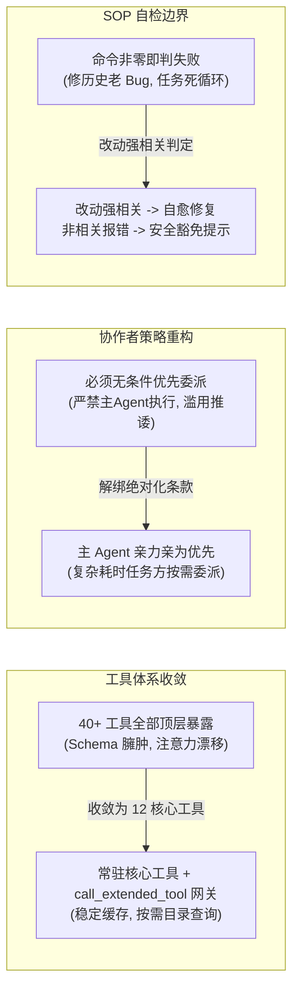
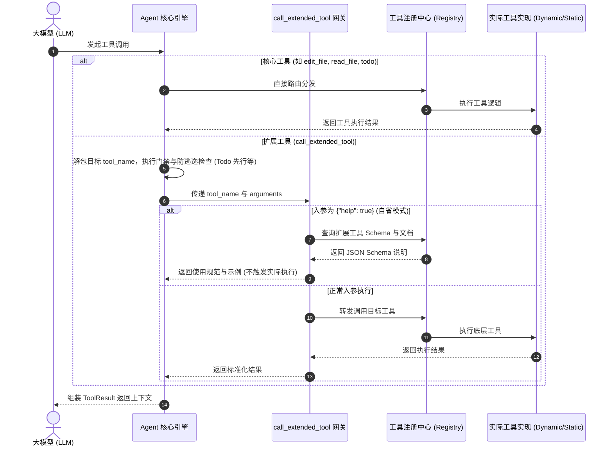
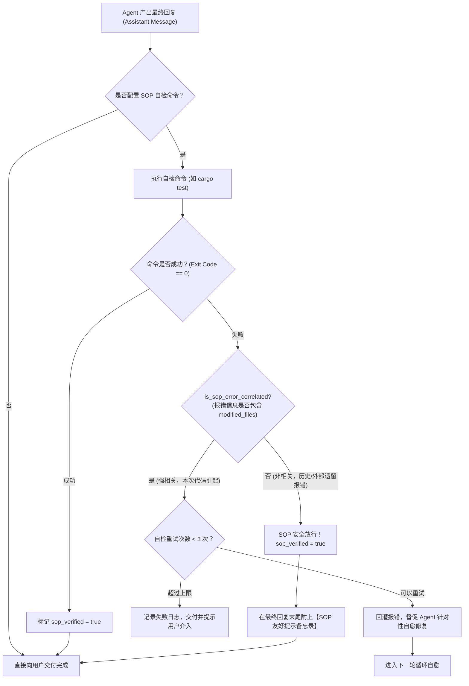

# 工具目录按需加载、协作者自主权与 SOP 自检防御边界治理知识库
# Tool Catalog On-Demand Loading, Collaborator Autonomy & SOP Defense Boundary Knowledge

本文档系统记录 `harness_mini` 在 Agent 工具注意力收敛、工具目录按需加载（`call_extended_tool`）、协作者委派机制解绑（取消强制委派）、以及 SOP 交付自检防御边界（改动文件强相关自愈判定）的重构方案、技术实现与治理规范。

---

## 目录
- [一、背景与痛点诊断](#一背景与痛点诊断)
  - [1. 工具集过度膨胀与注意力漂移](#1-工具集过度膨胀与注意力漂移)
  - [2. 协作者强制委派条款导致的推诿与失控](#2-协作者强制委派条款导致的推诿与失控)
  - [3. SOP 交付自检劫持与无休止“修旧代码”死循环](#3-sop-交付自检劫持与无休止修旧代码死循环)
  - [4. 前缀缓存（Prefix Cache）的硬性约束](#4-前缀缓存prefix-cache的硬性约束)
- [二、设计范式演进与架构决策](#二设计范式演进与架构决策)
  - [1. 决策一：工具目录按需加载与前缀缓存 100% 恒定保证](#1-决策一工具目录按需加载与前缀缓存-100-恒定保证)
  - [2. 决策二：协作者治理从“强制委派”转向“按需委派与亲力亲为”](#2-决策二协作者治理从强制委派转向按需委派与亲力亲为)
  - [3. 决策三：SOP 交付自检防御边界（方案 B：强相关判定与豁免提示）](#3-决策三sop-交付自检防御边界方案-b强相关判定与豁免提示)
- [三、架构全景与模块交互](#三架构全景与模块交互)
  - [1. 工具路由与执行流程时序](#1-工具路由与执行流程时序)
  - [2. SOP 交付自检防御边界判定流程](#2-sop-交付自检防御边界判定流程)
- [四、核心代码落地与实现细节](#四核心代码落地与实现细节)
  - [1. 核心工具集与目录规格收敛（`tools/types.rs` & `tools/registry.rs`）](#1-核心工具集与目录规格收敛toolstypesrs--toolsregistryrs)
  - [2. 扩展工具网关与自省机制（`tools/specs.rs` & `tools/mod.rs`）](#2-扩展工具网关与自省机制toolsspecsrs--toolsmodrs)
  - [3. 门禁与安全贯通防逃逸（`agent.rs`）](#3-门禁与安全贯通防逃逸agentrs)
  - [4. SOP 改动关联度分析算法（`sop.rs`）](#4-sop-改动关联度分析算法soprs)
  - [5. 系统提示词规则精炼（`context/static_system.rs`）](#5-系统提示词规则精炼contextstatic_systemrs)
- [五、工程验证与单元测试](#五工程验证与单元测试)
- [六、总结与后续演进建议](#六总结与后续演进建议)

---

## 一、背景与痛点诊断

在 `harness_mini` 的持续迭代中，Agent 核心循环引入了大量专业工具、协作子 Agent 以及交付前 SOP 自动化验收能力。然而，功能堆叠导致了三大严重影响 Agent 任务专注度与执行稳定性的次生问题：

### 1. 工具集过度膨胀与注意力漂移
* **现象**：系统直接暴露给模型的顶级工具规格（Tool Specs）多达 40+ 个（涵盖基础文件、搜索、命令、浏览器 CDP 系列、长短记忆、子进程、协作者委派、空间快照等）。
* **代价**：
  1. 单轮工具 Schema 定义就消耗 4,000~6,000+ tokens；
  2. 大模型面临庞大的工具选项矩阵，经常在仅需读取一个文件的简单场景下，误选或者犹豫使用高级/不相干工具；
  3. 参数冗余干扰上下文焦点，造成严重的注意力漂移。

### 2. 协作者强制委派条款导致的推诿与失控
* **原提示词极端条款**：在提示词中曾写有：`“如果任务能够委派给协作者，必须无条件优先委派”` 以及 `“严禁自行直接执行”`。
* **弊端**：
  1. 主 Agent 丧失自主决策权与就地解决问题的能力；
  2. 哪怕是改动几行代码、查询单一依赖的简单指令，Agent 也会强行启动子 Agent（协作者）；
  3. 子 Agent 启动后不仅耗费数倍的 Token，还会因上下文割裂、产物交接失真引发执行脱节，主 Agent 变成被动“监工”。

### 3. SOP 交付自检劫持与无休止“修旧代码”死循环
* **现象**：当配置了交付自检 SOP（如 `cargo test` 或 `npm test`）且 Agent 完成了代码修改后，系统会在最终交付前自动运行自检命令。
* **致命陷阱**：
  * 若目标仓库本身存在**历史遗留的、早已失败的测试用例**（与本次用户提出的需求或修改的文件毫不相关）；
  * 原先的逻辑只要命令退出码非 0，便无条件判定“自检失败”，并将错误回灌给 Agent 强行要求自愈；
  * Agent 被劫持，误以为是自己的改动破坏了系统，转而花费数十轮甚至百轮去修复与当前任务毫不相干的历史祖传代码，甚至大面积改动无关业务逻辑，引发系统灾难。

### 4. 前缀缓存（Prefix Cache）的硬性约束
现代大模型 API（如 Anthropic Prompt Caching、OpenAI Prefix Cache、Gemini Context Caching）要求：**System Prompt 与 Tools 定义的前缀必须保持 100% 字节级一致**，才能稳定享受 80%~90% 的缓存命中与超低首字延迟。若根据用户意图在每一轮动态增删 Tool Schema，前缀缓存将彻底击穿失效。

---

## 二、设计范式演进与架构决策

为了彻底解决上述痛点，同时杜绝“堆叠式补丁”，系统确立了以下三大架构决策：



### 1. 决策一：工具目录按需加载与前缀缓存 100% 恒定保证

* **常驻核心工具（Core Tools）**：
  精简收敛为仅 **12 个必要工具**，随请求直接以原生顶级 Function 形式下发给大模型：
  * 勘察检索类：`read_file`, `list_dir`, `file_outline`, `glob`, `grep`
  * 编码执行类：`write_file`, `edit_file`, `run_command`
  * 规划管理类：`todo`, `create_plan`, `update_plan`（保留计划工具，强化步骤规划与纪律）
  * 扩展工具调用网关：`call_extended_tool`
* **扩展工具目录机制**：
  其余 30+ 扩展工具（浏览器 CDP 操作、长期记忆存取、协作者调度、子空间管理等）收归为提示词中的《扩展工具目录》。
* **按需自省与调用（Introspection）**：
  * 模型调用扩展工具统一使用：`call_extended_tool(tool_name: "xxx", arguments: {...})`。
  * 若模型不确定入参结构，可传入 `arguments: {"help": true}`，网关会直接返回该工具的完整 JSON Schema、字段说明与示例，不调用实际工具；模型在下一轮即可精确填参调用。
* **缓存不变性**：
  顶层下发的 Tool Specs 完全固定为这 12 个核心工具，无论用户提出何种需求，Schema 字节级完全恒定，**前缀缓存命中率 100%**。

### 2. 决策二：协作者治理从“强制委派”转向“按需委派与亲力亲为”

* **废除极端教条**：
  彻底移除 Prompt 中所有 `“必须无条件优先委派”`、`“严禁自行直接执行”` 等绝对化禁令。
* **确立“亲力亲为为主，复杂任务按需委派”原则**：
  * 凡能通过主 Agent 自身工具链（如 `read_file`, `edit_file`, `run_command`）在当前轮次内直接、清晰解决的编码、排查、脚本运行任务，主 Agent 应当亲自执行，不制造额外的会话碎片与交接损耗。
  * 仅在满足以下场景时才通过 `call_extended_tool` 调度协作者（`dispatch_collaborator`）：
    1. 具有清晰独立子边界且非常耗时的并行调研；
    2. 需要完全隔离的环境或长期后台监控服务；
    3. 专精领域的大型独立模块重构。

### 3. 决策三：SOP 交付自检防御边界（方案 B：强相关判定与豁免提示）

* **改动文件追踪**：在会话运行循环（`run_once`）中，精确记录当前会话所有成功执行 `write_file` 或 `edit_file` 的文件路径列表（`modified_files`）。
* **强相关自愈判定（Correlated Self-Healing）**：
  * 当 SOP 命令失败（Exit Code != 0）时，分析其标准输出与错误输出（`out`）。
  * 提取输出中的文件名与路径，与 `modified_files` 及其文件名（Base Name）进行交叉比对：
    * **命中（强相关）**：说明自检报错确实是由本次 Agent 修改的代码引起的（如编译报错、相关单元测试挂掉）。触发自愈修复（进入最多 3 轮的重试修复流程）。
    * **未命中（非相关）**：说明报错属于仓库历史遗留缺陷或外部不可控环境因素（如未改动模块的陈旧测试失败、缺少第三方依赖等）。
* **方案 B：安全放行与友好提示（Delivery Note）**：
  * 未命中时，**不阻断交付，不强制 Agent 修复无关代码**，直接标记 `sop_verified = true`。
  * 将自检发现的外部异常格式化为提示备忘录，附加在 Agent 最终交付答复末尾：
    ```markdown
    > 💡 **交付前 SOP 自检提示**：
    > 自检命令 `cargo test` 执行未全绿，但报错与本次改动的文件无直接关联（可能为历史遗留问题或外部环境所致）。
    > 为防止破坏无关代码，本次改动已按既定目标安全交付。
    ```

---

## 三、架构全景与模块交互

### 1. 工具路由与执行流程时序



### 2. SOP 交付自检防御边界判定流程



---

## 四、核心代码落地与实现细节

### 1. 核心工具集与目录规格收敛（`tools/types.rs` & `tools/registry.rs`）

在 `src-tauri/src/tools/types.rs` 中定义固定且唯一的常驻核心工具集合：

```rust
/// 常驻核心工具集（直接以原生顶级 Function 下发给大模型，保持前缀缓存 100% 恒定）
pub const CORE_TOOL_NAMES: &[&str] = &[
    "read_file",
    "list_dir",
    "file_outline",
    "glob",
    "grep",
    "write_file",
    "edit_file",
    "run_command",
    "todo",
    "create_plan",
    "update_plan",
    "call_extended_tool",
];
```

在 `src-tauri/src/tools/registry.rs` 的 `list_specs` 中过滤仅下发核心工具（若为临时空间则追加 `TEMP_TOOL_NAMES`）：

```rust
pub async fn list_specs(&self, is_temp: bool, is_subagent: bool) -> Vec<ToolSpec> {
    let mut specs = tool_specs();
    // 过滤保留核心工具，扩展工具统一通过目录按需调用
    specs.retain(|s| {
        CORE_TOOL_NAMES.contains(&s.name) || (is_temp && TEMP_TOOL_NAMES.contains(&s.name))
    });
    specs.retain(|s| !is_subagent || !SUBAGENT_TOOL_NAMES.contains(&s.name));
    // ...
}
```

### 2. 扩展工具网关与自省机制（`tools/specs.rs` & `tools/mod.rs`）

在 `specs.rs` 注册 `call_extended_tool` 规格：
```rust
ToolSpec {
    name: "call_extended_tool",
    description: "按需调用扩展工具目录中的专业工具（如浏览器操作 browser_*、协作者委派 dispatch_collaborator、长期记忆 record_memory、网页抓取 fetch_web_page 等）。若不确定入参，可传 arguments: {\"help\": true} 查看该工具的完整参数规范与使用说明。",
    risk: Risk::Execute,
    schema: json!({
        "type": "object",
        "properties": {
            "tool_name": {
                "type": "string",
                "description": "要调用的扩展工具名称"
            },
            "arguments": {
                "type": "object",
                "description": "传递给扩展工具的入参对象。若传 {\"help\": true} 则直接返回该工具的入参规范与使用说明。"
            }
        },
        "required": ["tool_name", "arguments"]
    }),
}
```

在 `tools/mod.rs` 中分发处理：支持 `{"help": true}` 自省机制：
```rust
"call_extended_tool" => {
    let target_tool = args.get("tool_name").and_then(|v| v.as_str()).unwrap_or_default();
    let target_args = args.get("arguments").cloned().unwrap_or(json!({}));
    
    // 自省能力：若参数为 {"help": true}，直接返回该工具的 Schema 与使用文档
    if target_args.get("help").and_then(|v| v.as_bool()).unwrap_or(false) {
        if let Some(spec) = tool_specs().into_iter().find(|s| s.name == target_tool) {
            return Ok(format!(
                "【扩展工具 `{}` 使用说明】\n- 描述：{}\n- 风险等级：{:?}\n- 参数 Schema：\n```json\n{}\n```",
                spec.name,
                spec.description,
                spec.risk,
                serde_json::to_string_pretty(&spec.schema).unwrap_or_default()
            ));
        }
    }
    // 递归转发实际工具执行
    Box::pin(execute(target_tool, &target_args, ctx, on_partial)).await
}
```

### 3. 门禁与安全贯通防逃逸（`agent.rs`）

当模型通过 `call_extended_tool` 调用工具时，绝不能绕过系统已有的 Todo 先行拦截、高危命令分类以及修改行为追踪。

在 `agent.rs` 中统一解包目标工具名：
```rust
// 统一解包 target_tool_name 与 target_args
let (effective_tool_name, effective_args) = if name == "call_extended_tool" {
    let t_name = args.get("tool_name").and_then(|v| v.as_str()).unwrap_or("");
    let t_args = args.get("arguments").unwrap_or(args);
    (t_name, t_args)
} else {
    (name, args)
};

// 1. Todo 先行门禁判定防逃逸
let is_modifying = matches!(effective_tool_name, "write_file" | "edit_file") 
    || (effective_tool_name == "run_command" && ...);

// 2. 改动文件列表追踪（供 SOP 自检强相关比对）
if matches!(effective_tool_name, "write_file" | "edit_file") {
    if let Some(path_str) = effective_args.get("path").and_then(|p| p.as_str()) {
        if !modified_files.iter().any(|p| p == path_str) {
            modified_files.push(path_str.to_string());
        }
    }
}
```

### 4. SOP 改动关联度分析算法（`sop.rs`）

在 `src-tauri/src/sop.rs` 中实现纯函数匹配：
```rust
pub fn is_sop_error_correlated(out: &str, modified_files: &[String]) -> bool {
    if modified_files.is_empty() {
        return false;
    }
    let out_lower = out.to_lowercase();
    for file in modified_files {
        // 1. 完整路径匹配（规范化斜杠）
        let norm_file = file.replace('\\', "/").to_lowercase();
        if out_lower.contains(&norm_file) {
            return true;
        }
        // 2. 文件名（Base Name）匹配
        let base_name = std::path::Path::new(file)
            .file_name()
            .and_then(|n| n.to_str())
            .unwrap_or("")
            .to_lowercase();
        if !base_name.is_empty() && out_lower.contains(&base_name) {
            return true;
        }
    }
    false
}
```

### 5. 系统提示词规则精炼（`context/static_system.rs`）

在 `src-tauri/src/context/static_system.rs` 中：
1. **注入扩展工具目录规则**：
   明确告知模型常驻核心工具与扩展工具目录的区别，指导其使用 `call_extended_tool` 及 `{"help": true}`。
2. **重塑协作者原则**：
   ```markdown
   【协作者委派与调度机制】
   - 优先亲力亲为：对于可以通过你自身核心工具（read_file, edit_file, run_command 等）在当前会话内清晰直接完成的任务，应当亲力亲为直接执行，不应随意将简单任务委派给协作者。
   - 按需委派协作：仅当遇到真正具有明确独立上下文、需要独立背景调查、耗时漫长的探索，或特定领域的重构任务时，才按需通过 `call_extended_tool(tool_name: "dispatch_collaborator", ...)` 委派协作者。
   ```

---

## 五、工程验证与单元测试

为确保改动稳健可靠且无逻辑死角，编写并跑通了以下自动化单元测试：

1. **核心工具收敛与扩展工具隔离测试**（`tools/tests.rs`）：
   * 测试用例：`test_core_tools_contain_call_extended_tool_and_catalog_filtering`
   * 结果：核心工具规格列表长度严格收敛为 12 个，包含 `call_extended_tool`, `todo`, `create_plan`，所有 `browser_*` 等扩展工具均未出现在顶级规格中。
2. **`call_extended_tool` 自省 Schema 机制测试**（`tools/tests.rs`）：
   * 测试用例：`test_call_extended_tool_help`
   * 结果：当传入 `arguments: {"help": true}` 时，网关返回该工具的结构说明与参数 Schema，验证了自省路径畅通。
3. **SOP 报错关联度判定测试**（`sop.rs`）：
   * 测试用例：`test_is_sop_error_correlated`
   * 结果：正确识别强相关报错（如 `src/tools/registry.rs` 报错命中改动文件）以及无关历史报错（如无关路径报错安全放行）。
4. **编译与类型安全验证**：
   * `cargo check --manifest-path src-tauri/Cargo.toml` 编译零 Error；
   * `npx tsc --noEmit` 前端代码全量类型检查通过。

---

## 六、总结与后续演进建议

通过本次重构，`harness_mini` 在以下三方面取得了决定性提升：
1. **注意力高度聚焦**：顶级工具集从 40+ 精简至 12 个，消除了大模型在工具选择时的犹豫与漂移；
2. **缓存与性能兼得**：维持 100% 确定性的前缀缓存，不仅节省上百万元 Token 开销，更将单轮回复首字延迟显著降低；
3. **主 Agent 执行力解放**：解除了“无条件委派协作者”的紧箍咒，主 Agent 具备就地解决问题的强大行动力；
4. **SOP 交付安全闭环**：通过改动文件强相关自愈机制与安全豁免提示，彻底终结了“因历史遗留测试报错导致 Agent 无休止修复旧代码”的灾难。

**未来演进方向**：
* 随着工具生态进一步扩大，可以在提示词的目录说明中为各扩展工具标注紧凑的一句话功能概括，配合动态参数自省，实现扩展工具集近乎无限的扩展能力。
