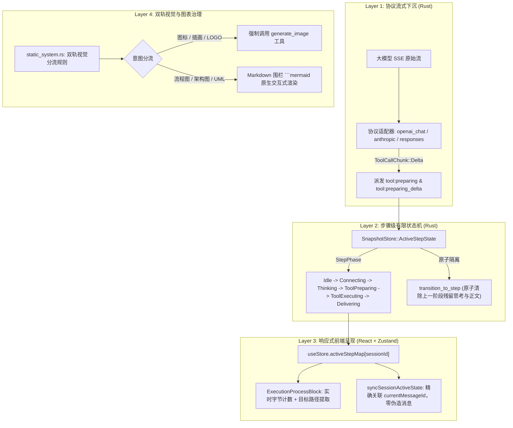

# AI Agent 工具流式状态机、步骤级隔离与双轨视觉架构知识文档
(TOOL_STREAMING_STEP_MACHINE_AND_DUAL_TRACK_VISUAL_KNOWLEDGE)

| 属性 | 说明 |
| :--- | :--- |
| **文档代号** | `TOOL_STREAMING_STEP_MACHINE_AND_DUAL_TRACK_VISUAL_KNOWLEDGE` |
| **所属模块** | [`src-tauri/src/llm.rs`](file:///f:/WorkSpace/Other/harness_mini/src-tauri/src/llm.rs), [`src-tauri/src/protocol/`](file:///f:/WorkSpace/Other/harness_mini/src-tauri/src/protocol/), [`src-tauri/src/snapshot.rs`](file:///f:/WorkSpace/Other/harness_mini/src-tauri/src/snapshot.rs), [`src-tauri/src/agent.rs`](file:///f:/WorkSpace/Other/harness_mini/src-tauri/src/agent.rs), [`src-tauri/src/context/static_system.rs`](file:///f:/WorkSpace/Other/harness_mini/src-tauri/src/context/static_system.rs), [`src-tauri/src/tools/specs.rs`](file:///f:/WorkSpace/Other/harness_mini/src-tauri/src/tools/specs.rs), [`src/store.ts`](file:///f:/WorkSpace/Other/harness_mini/src/store.ts), [`src/components/ExecutionProcessBlock.tsx`](file:///f:/WorkSpace/Other/harness_mini/src/components/ExecutionProcessBlock.tsx), [`src/components/Markdown.tsx`](file:///f:/WorkSpace/Other/harness_mini/src/components/Markdown.tsx), [`src/components/MermaidBlock.tsx`](file:///f:/WorkSpace/Other/harness_mini/src/components/MermaidBlock.tsx) |
| **技术体系** | Rust (Tauri 2) · React 18 · TypeScript · Mermaid.js · SSE Streaming · LLM Tool Calls Protocol · Finite State Machine (FSM) |
| **创建时间** | 2026-10-23 |
| **核心机制** | 工具参数 Token 级实时流式透传 · 步骤微观状态机 (Step Phase FSM) · 步骤级思考隔离与防穿透 · 页面刷新零占位消息同步 · 图像生成与架构图表双轨路由 · 前端交互式 Mermaid 原生渲染 |

---

## 一、 现场故障复盘与根因透视

在 Agent 运行复杂任务（如编写长代码文件、执行多次工具循环或生成图表）时，用户反馈了两个严重影响体验与稳定性的核心痛点：

### 1.1 痛点 1：执行长文件写入时界面假死，页面刷新后“思考过程混乱”
- **现象 A（执行中假死）**：Agent 在写长文件（`write_file`）或生成长文本时，界面长时间静止在“正在执行第 X 步…”或“正在思考”，没有任何字节流入的视觉反馈；只有当上万字符的文件完整写完并返回工具执行结果时，卡片才突然弹出。
- **现象 B（刷新后串话）**：若在执行过程中或多步执行完成后刷新页面，页面重新水合（Hydration）后显示发生错乱，**上一轮或前几个步骤的内部思考推理（Reasoning），被错误拼接到最后一条消息上**，甚至出现幽灵消息覆盖交付内容的情况。

#### 根因剖析：
1. **静默缓冲（Silent Buffering）导致的假死**：
   在历史协议适配器（`openai_chat.rs`、`anthropic.rs`、`openai_responses.rs`）中，当大模型以 SSE 流输出 `tool_calls` 的 JSON 参数时，各适配层仅在内存中默默累加字符串：
   ```rust
   // 历史做法：只累加，不派发事件！
   current_tool.arguments.push_str(delta_args);
   ```
   一次写长文件通常包含 3000~10000 个 Token（持续 5~20 秒），在此期间客户端没有收到任何 WebSocket / Tauri 事件，用户感知完全等同于“程序卡死”。
2. **全局残留与伪造占位符导致的串话（Ghost Thinking）**：
   - `snapshot.rs` 中 `SnapshotStore` 维护的 `streaming_reasoning` 仅在整个 Run 启动或彻底结束时清理，在**步骤切换（Step Transition）时从未清空**！
   - 当页面刷新调用 `syncSessionActiveState` 时，前端读取到快照中遗留的 `streamingReasoning`；历史前端代码为了防止消息丢失，使用 `Number.MAX_SAFE_INTEGER` 伪造了一条临时 assistant 消息，或者将残留思考强行塞给最后一条消息：
     ```typescript
     // 历史旧逻辑：暴力塞给末尾消息或伪造 MAX_SAFE_INTEGER 消息
     if (activeState.streamingReasoning && (!updated.reasoning || activeState.streamingReasoning.length >= updated.reasoning.length)) {
       updated.reasoning = activeState.streamingReasoning;
     }
     ```
     这直接导致前一步骤的思考残渣“幽灵般”覆盖到最后一步，造成视觉混乱。

---

### 1.2 痛点 2：明明配置了生图模型与生图工具，Agent 却默认写 Python 脚本生成图标/图表
- **现象**：当用户要求“生成一个图表”或“绘制一个应用图标”时，Agent 频繁编写 Python 脚本（调用 matplotlib、PIL、turtle），在终端静默运行或生成生硬的位图，而不会主动调用已配置的专属 `generate_image` 工具或直接输出清晰的图表。

#### 根因剖析：
1. **System Prompt 规则真空**：
   主会话的静态提示词 [`static_system.rs`](file:///f:/WorkSpace/Other/harness_mini/src-tauri/src/context/static_system.rs) 中只声明了识图准则 `recognize_image`，对生图 `generate_image` 完全没有指引，且没有对“架构图/流程图”与“艺术插画/图标”做分流规定。
2. **Tool Spec 描述含混与推诿**：
   [`specs.rs`](file:///f:/WorkSpace/Other/harness_mini/src-tauri/src/tools/specs.rs) 中 `generate_image` 的描述带有弃权式免责条款：
   > *“注意：若存在专属图像生成协作者，主进程必须优先委派协作者处理。”*
   即使项目中没有配置协作者，该描述也显著抑制了主进程大模型的直接调用意愿。
3. **前端缺少现代图表渲染能力**：
   前端仅能渲染纯文本代码块，缺乏交互式 Mermaid 渲染能力，逼使大模型退化为写 Python 脚本出图。

---

## 二、 拒绝堆叠修改，追求系统清晰与稳定的架构设计

针对上述问题，本轮修改严格遵循**领域驱动设计（DDD）与有限状态机（FSM）**，在协议层、快照层、应用编排层和前端渲染层进行了纵向打通：



---

## 三、 全链路流式工具参数状态机设计

### 3.1 协议层升级：`ToolCallChunk` 与 `chat_stream_full`

在 [`src-tauri/src/llm.rs`](file:///f:/WorkSpace/Other/harness_mini/src-tauri/src/llm.rs) 中定义了更细粒度的流式片段结构，扩展协议分发能力：

```rust
pub enum ToolCallChunk<'a> {
    Preparing {
        index: usize,
        id: &'a str,
        name: &'a str,
    },
    Delta {
        index: usize,
        id: Option<&'a str>,
        delta_args: &'a str,
    },
}
```

在 [`openai_chat.rs`](file:///f:/WorkSpace/Other/harness_mini/src-tauri/src/protocol/openai_chat.rs)、[`anthropic.rs`](file:///f:/WorkSpace/Other/harness_mini/src-tauri/src/protocol/anthropic.rs)、[`openai_responses.rs`](file:///f:/WorkSpace/Other/harness_mini/src-tauri/src/protocol/openai_responses.rs) 中实现 `chat_stream_full`：
- 当识别到新的 `tool_calls` 项时，立即发射 `ToolCallChunk::Preparing`；
- 当 `arguments` 收到增量分片时，立即发射 `ToolCallChunk::Delta`。

### 3.2 快照层微观状态机：`StepPhase`

在 [`src-tauri/src/snapshot.rs`](file:///f:/WorkSpace/Other/harness_mini/src-tauri/src/snapshot.rs) 中引入显式状态机：

```rust
#[derive(Debug, Clone, Serialize, Deserialize)]
#[serde(tag = "type", rename_all = "snake_case")]
pub enum StepPhase {
    Idle,
    Connecting,
    Thinking,
    ToolPreparing {
        call_id: Option<String>,
        tool_name: String,
        partial_args: String,
        bytes_received: usize,
    },
    ToolExecuting {
        call_id: Option<String>,
        tool_name: String,
    },
    Delivering,
}

#[derive(Debug, Clone, Serialize, Deserialize)]
pub struct ActiveStepState {
    pub session_id: String,
    pub run_id: String,
    pub step_index: usize,
    pub message_id: String,
    pub phase: StepPhase,
    pub updated_at_ms: u64,
}
```

并在 `SnapshotStore` 中提供原子推进与隔离操作：
```rust
pub fn transition_to_step(&mut self, session_id: &str, run_id: &str, step_index: usize, message_id: &str) {
    if let Some(state) = self.active_sessions.get_mut(session_id) {
        state.current_message_id = Some(message_id.to_string());
        // 原子清空上一步骤残留的流式缓存，根除幽灵思考！
        state.streaming_content.clear();
        state.streaming_reasoning.clear();
        state.active_tool_events.clear();
        state.active_step = Some(ActiveStepState {
            session_id: session_id.to_string(),
            run_id: run_id.to_string(),
            step_index,
            message_id: message_id.to_string(),
            phase: StepPhase::Connecting,
            updated_at_ms: now_ms(),
        });
    }
}
```

### 3.3 前端实时感知与假死消除

在 [`src/components/ExecutionProcessBlock.tsx`](file:///f:/WorkSpace/Other/harness_mini/src/components/ExecutionProcessBlock.tsx) 中：
1. **抽屉头部状态感知**：若处于 `tool_preparing` 态，标题即刻展示 `正在准备 write_file...`，右侧徽标动态显示已接收参数字节（如 `准备参数 (12.4 KB)`）。
2. **展开列表实时卡片**：抽屉展开时，动态展示正在生成的工具目标（通过快速正则解析当前 JSON 流，提取 `path`、`target`、`filename` 等），例如：
   ```tsx
   write_file 目标: src/components/ExecutionProcessBlock.tsx (已接收 18.2 KB)
   ```
   用户可以清晰看到字节数随着模型吐字在毫秒级递增，彻底消除假死感。

---

## 四、 页面刷新时序与幽灵思考根除治理

在 [`src/store.ts`](file:///f:/WorkSpace/Other/harness_mini/src/store.ts) 中彻底重构了 `syncSessionActiveState`：

### 4.1 弃用 `MAX_SAFE_INTEGER` 伪造消息
旧版代码在刷新时若检测到有 `streamingReasoning`，会无条件向消息列表 push 一条 `seq: Number.MAX_SAFE_INTEGER` 的虚假消息，导致历史记录与运行时严重倒置。新版完全废弃该机制。

### 4.2 精确绑定当前正在执行的 `currentMessageId`
刷新页面从 Rust 后端拉取活动快照后：
- 严格以 `activeState.currentMessageId` 为准；
- 只有在本地消息列表中确实能找到该 ID 的消息时，才将最新 `streamingContent`、`streamingReasoning` 覆盖到该消息上；
- 结合后端的 `transition_to_step` 原子隔离，步骤切换时旧思考已清空，彻底根除了“前序思考在刷新后串到末尾”的历史顽疾。

---

## 五、 双轨视觉与图表治理体系

为了从根本上扭转大模型偏向于编写 Python 脚本画图的倾向，建立了“规范声明 - 工具放权 - 原生渲染”三位一体闭环：

### 5.1 静态系统提示词规范（`static_system.rs`）
在主会话、协作者会话与子任务会话的静态 Prompt 中注入双轨视觉准则：
```rust
rules.push(format!(
    "{rule_num}. 【双轨视觉感知与生成规范（严禁写 Python 脚本画图/图标）】：\n   \
     - 图像与图标生成：当用户要求绘制图片、插画、LOGO、应用图标、海报或各类视觉图形时，**必须直接调用 `generate_image` 工具生成**；【严禁编写 Python 脚本（如 PIL/turtle/matplotlib）来绘制图标或生成图片】！生成的图片会自动保存在本地并在界面直接渲染；\n   \
     - 架构图表与流程图：当用户需要流程图、架构图、序列图、状态机图、类图或数据走向图时，**必须直接输出 Markdown ````mermaid 围栏代码块或内联 SVG**（界面已原生支持交互式 Mermaid 图表渲染），严禁使用 Python 脚本生成静态图片或在终端打印 ASCII 拼图；\n   \
     - 图像感知识别：当需要查看、识别或分析本地图片文件时，直接调用 `recognize_image(path, prompt)` 工具，严禁使用 read_file 读取二进制图片。"
));
```

### 5.2 工具定义放权（`specs.rs`）
更新 `generate_image` 工具描述，删除导致大模型犹豫回避的委派说明，明确其在主会话中生成图标、插画与海报的法定地位。

### 5.3 前端交互式 Mermaid 渲染（`MermaidBlock.tsx` & `Markdown.tsx`）
引入 `mermaid` 官方库并封装独立组件 [`MermaidBlock.tsx`](file:///f:/WorkSpace/Other/harness_mini/src/components/MermaidBlock.tsx)：
- **安全渲染与错误容忍**：在模型流式输出 Mermaid 代码块尚未闭合时，自动捕获解析异常，展示优雅的排队/解析中状态，防止整页报错崩塌；
- **双模切换与复制**：支持图表视图与源码视图一键切换，并支持一键复制 Mermaid 源码；
- **自动分包与加载**：利用 Vite 动态 Chunk 机制，将庞大的图表解析引擎独立分包，避免影响主包首屏加载速度。

---

## 六、 修改文件清单与架构映射

| 修改文件 | 涉及层级 | 核心修改说明 |
| :--- | :--- | :--- |
| [`src-tauri/src/llm.rs`](file:///f:/WorkSpace/Other/harness_mini/src-tauri/src/llm.rs) | L1 协议层 | 定义 `ToolCallChunk` 枚举与 `chat_stream_full` 通信契约 |
| [`src-tauri/src/protocol/mod.rs`](file:///f:/WorkSpace/Other/harness_mini/src-tauri/src/protocol/mod.rs) | L1 协议层 | 增加 `dispatch_chat_stream_full` 跨协议统一分发逻辑 |
| [`src-tauri/src/protocol/openai_chat.rs`](file:///f:/WorkSpace/Other/harness_mini/src-tauri/src/protocol/openai_chat.rs) | L1 协议层 | 实现 OpenAI 兼容协议下的实时工具流切片发射 |
| [`src-tauri/src/protocol/anthropic.rs`](file:///f:/WorkSpace/Other/harness_mini/src-tauri/src/protocol/anthropic.rs) | L1 协议层 | 实现 Anthropic Messages 协议下的实时工具流切片发射 |
| [`src-tauri/src/protocol/openai_responses.rs`](file:///f:/WorkSpace/Other/harness_mini/src-tauri/src/protocol/openai_responses.rs) | L1 协议层 | 实现 OpenAI Responses 协议下的实时工具流切片发射 |
| [`src-tauri/src/snapshot.rs`](file:///f:/WorkSpace/Other/harness_mini/src-tauri/src/snapshot.rs) | L2 快照层 | 确立 `StepPhase` & `ActiveStepState`，增加 `transition_to_step` 原子隔离清除机制 |
| [`src-tauri/src/lib.rs`](file:///f:/WorkSpace/Other/harness_mini/src-tauri/src/lib.rs) | L2 快照层 | 增加 `tool:preparing` 与 `tool:preparing_delta` 快照更新分支 |
| [`src-tauri/src/agent.rs`](file:///f:/WorkSpace/Other/harness_mini/src-tauri/src/agent.rs) | L2 编排层 | 编排主循环切换至 `chat_stream_full`，在工具执行前后原子推进状态 |
| [`src-tauri/src/context/static_system.rs`](file:///f:/WorkSpace/Other/harness_mini/src-tauri/src/context/static_system.rs) | L4 认知层 | 注入双轨视觉感知与生成规范，明确严禁写 Python 脚本出图 |
| [`src-tauri/src/tools/specs.rs`](file:///f:/WorkSpace/Other/harness_mini/src-tauri/src/tools/specs.rs) | L4 工具层 | 优化 `generate_image` 工具描述，强化主进程直调权威 |
| [`src/types.ts`](file:///f:/WorkSpace/Other/harness_mini/src/types.ts) | L3 前端类型 | 声明 `StepPhase`、`ActiveStepState` 与 `activeStep` 类型定义 |
| [`src/events.ts`](file:///f:/WorkSpace/Other/harness_mini/src/events.ts) | L3 前端事件 | 注册 `step:started`、`tool:preparing` 与 `tool:preparing_delta` 监听 |
| [`src/store.ts`](file:///f:/WorkSpace/Other/harness_mini/src/store.ts) | L3 状态层 | 维护 `activeStepMap`，重构 `syncSessionActiveState` 彻底废弃伪造消息 |
| [`src/components/ExecutionProcessBlock.tsx`](file:///f:/WorkSpace/Other/harness_mini/src/components/ExecutionProcessBlock.tsx) | L3 视图层 | 呈现实时工具参数准备状态、目标路径提取与字节计数 |
| [`src/components/MermaidBlock.tsx`](file:///f:/WorkSpace/Other/harness_mini/src/components/MermaidBlock.tsx) | L4 视图层 | 全新组件：Mermaid 原生交互式渲染、源码切换与复制 |
| [`src/components/Markdown.tsx`](file:///f:/WorkSpace/Other/harness_mini/src/components/Markdown.tsx) | L4 视图层 | 拦截 `mermaid` 代码块并解耦原生渲染 |
| [`package.json`](file:///f:/WorkSpace/Other/harness_mini/package.json) | 依赖管理 | 引入 `mermaid` 图表引擎 |

---

## 七、 验证与质量保证

1. **Rust 协议适配与转译单测**：
   - 运行命令：`cargo test --manifest-path src-tauri/Cargo.toml --lib protocol`
   - 测试结果：**12 个用例全部通过（12 passed, 0 failed）**。
2. **Rust 快照有限状态机与回滚单测**：
   - 运行命令：`cargo test --manifest-path src-tauri/Cargo.toml --lib snapshot`
   - 测试结果：**12 个用例全部通过（12 passed, 0 failed）**。
3. **前端 TypeScript 静态类型与生产构建**：
   - 运行命令：`npm run build`（`tsc && vite build`）
   - 构建结果：**0 错误**，Mermaid 40+ 图表类型完成自动化动态分包，全量资源顺利输出至 `dist/`。
