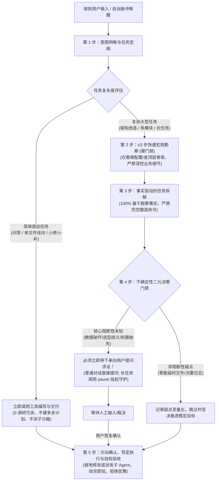

# 全场景通用认知公理、长任务优雅覆盖与防空转门禁治理知识库
# Universal Cognitive Protocol, Long Task Superseding & Confirmation Gate Knowledge

本文档系统记录 `harness_mini` 中 **全场景通用 Agent 认知与行动五步公理（Cognitive & Action Protocol）**、**长任务守护自愈与智能确认门禁（Confirmation Gate）**、**长任务优雅覆盖归档机制（Superseding & Overwriting）**、**步数预算体验统一治理** 以及 **前端右侧任务看板固定浮窗（`FloatingTaskPanel`）** 的架构根因分析、重构方案设计与工程落地规范。

---

## 目录
- [一、背景与核心痛点剖析（现场还原）](#一背景与核心痛点剖析现场还原)
  - [1. 痛点 1：大模型陷入“只读死循环与分析瘫痪”](#1-痛点-1大模型陷入只读死循环与分析瘫痪)
  - [2. 痛点 2：右侧任务看板浮窗消失，长任务无法停止/暂停](#2-痛点-2右侧任务看板浮窗消失长任务无法停止暂停)
  - [3. 痛点 3：长任务 30 步特异化限制与报错割裂](#3-痛点-3长任务-30-步特异化限制与报错割裂)
  - [4. 痛点 4：启动长任务报“严禁递归启动”，无法覆盖复用](#4-痛点-4启动长任务报严禁递归启动无法覆盖复用)
  - [5. 痛点 5：长任务中调用 create_plan 被底层硬编码恐吓，被迫汇报方案并意外挂起](#5-痛点-5长任务中调用-create_plan-被底层硬编码恐吓被迫汇报方案并意外挂起)
- [二、设计哲学与第一性原理](#二设计哲学与第一性原理)
  - [1. 拒绝堆叠式打补丁，坚持架构第一性原理](#1-拒绝堆叠式打补丁坚持架构第一性原理)
  - [2. 主会话单轨推进 + 后台守护驱动 + 子沙箱重度施工](#2-主会话单轨推进--后台守护驱动--子沙箱重度施工)
- [三、全场景认知与行动五步公理架构全景](#三全场景认知与行动五步公理架构全景)
  - [1. 认知与决策全景流转图](#1-认知与决策全景流转图)
  - [2. 五步公理详细定义](#2-五步公理详细定义)
  - [3. 全场景统一适配矩阵](#3-全场景统一适配矩阵)
- [四、核心模块重构与工程落地实现](#四核心模块重构与工程落地实现)
  - [1. 静态 System Prompt 认知总纲注入（`static_system.rs`）](#1-静态-system-prompt-认知总纲注入static_systemrs)
  - [2. 守护进程防空转与智能等待门禁（`loop_runner.rs`）](#2-守护进程防空转与智能等待门禁loop_runnerrs)
  - [3. 长任务优雅覆盖与平滑归档（`task/mod.rs` & `skills_memory_plan.rs`）](#3-长任务优雅覆盖与平滑归档taskmodrs--skills_memory_planrs)
  - [4. 会话步数限制与报错体验归一（`agent.rs`）](#4-会话步数限制与报错体验归一agentrs)
  - [5. 前端右侧固定浮窗与控制按钮恢复（`FloatingTaskPanel.tsx`）](#5-前端右侧固定浮窗与控制按钮恢复floatingtaskpaneltsx)
  - [6. 运行时动态尾部锚点协同（`tail_anchor.rs`）](#6-运行时动态尾部锚点协同tail_anchorrs)
  - [7. 模式一等公民契约与工具中立原则落地（`plan.rs` & `agent.rs`）](#7-模式一等公民契约与工具中立原则落地planrs--agentrs)
- [五、边界场景与防御矩阵](#五边界场景与防御矩阵)
- [六、工程验证与回归体系](#六工程验证与回归体系)

---

## 一、背景与核心痛点剖析（现场还原）

### 1. 痛点 1：大模型陷入“只读死循环与分析瘫痪”
- **真实场景复现**：
  在针对本地工程进行长任务推进时（Task ID: `task-2bfa1f39a73d45da950ccefc6b262aee`），Agent 在第 1 轮中通过只读工具探查到了 22 个未提交文件（其中包含 14 个测试脚本、3 个前端 Mock 文件等）。在随后的连续执行中：
  - Agent 累计执行了 **62 次只读工具调用**（反复调用 `cmd /c git status`、`read_file dev/_st.txt`、`read_file .gitignore`、`grep dist`）；
  - 累计消耗了 **329 万 Tokens**，却未调用任何文件写入或 `git commit` 工具；
  - 既不敢提交，也不敢跳过，更未停下向用户求证，最终在原地打转消耗直至耗尽轮次。
- **根因诊断**：
  1. **赏罚不对称**：原有 System Prompt 严惩“写错代码/误改文件”，但对“无节制只读探测”缺少止步门禁；
  2. **缺少不确定性二元决策准则**：面对未预期状态（如多出来的测试文件），模型缺乏“这是阻断项还是非阻断项”的判定指导，导致避错心理驱动下的无限次“再读一遍确认”；
  3. **职责边界模糊**：未向模型明确“简单任务就地直达，复杂任务事实驱动，大改动派发子 Agent”。

### 2. 痛点 2：右侧任务看板浮窗消失，长任务无法停止/暂停
- **真实场景复现**：
  用户在对话中启动长任务后，界面右侧原有的任务阶段看板固定浮窗完全消失，用户无法观察长任务当前处于哪一轮推进，也找不到任何【暂停】或【终止】长任务的操作入口。
- **根因诊断**：
  `FloatingTaskPanel.tsx` 中判定浮窗显示的条件写死为：
  ```tsx
  const hasLongTask = !!activeTask && !!activeTask.subtasks && activeTask.subtasks.length > 0 && activeTask.status !== "cancelled";
  ```
  在长任务新架构下（单轨主会话自治推进，取消了启动前由外部 Planner 暴力粗拆出的伪子任务数组），`activeTask.subtasks` 为空数组 `[]`，直接导致 `hasLongTask` 为 `false`，组件直接 `return null`，将整个浮窗及其内部的控制按钮全部隐藏。

### 3. 痛点 3：长任务 30 步特异化限制与报错割裂
- **真实场景复现**：
  普通对话由会话设置中的最大步数（默认 50 步）统一管辖；而长任务却被强制绑定了 30 步的人为硬顶，且达到时抛出的提示信息为特异化的：`单子任务已达到最大轮次预算上限（30 轮）...`，与正常会话完全脱节，造成认知混乱。
- **根因诊断**：
  `agent.rs` 中使用 `if is_long_task` 单独读取 `task.max_steps`（硬编码默认 30），在达到上限时强行将结果标记为 `Failed` 并下发特定报错，破坏了体验一致性。

### 4. 痛点 4：启动长任务报“严禁递归启动”，无法覆盖复用
- **真实场景复现**：
  当会话内已有一个处于运行中或中断的长任务时，用户通过指令或工具发起新目标的长任务，系统直接报错崩溃：
  ```text
  工具执行失败：当前会话已处于运行中的长任务守护模式（ID: task-2bfa1f39a73d45da950ccefc6b262aee），严禁递归重复启动守护进程。
  ```
- **根因诊断**：
  底层为了防止递归套娃，采用了强硬的拦截报错策略，而没有提供“覆盖并平滑归档旧长任务（Superseding）”的自愈逻辑，导致用户必须手动清理旧任务否则陷入永久阻塞。

---

## 二、设计哲学与第一性原理

### 1. 拒绝堆叠式打补丁，坚持架构第一性原理
面对上述问题，若采取“哪里报错就在哪里加一个特判”的补丁式做法，只会让代码更加臃肿脆弱。我们坚持以下原则：
- **代码做减法**：删除特化分支，统一数据流；
- **认知立规矩**：将思考与决策规范提升为 Prompt 总纲公理；
- **控制显式化**：人机边界通过确定性门禁（Confirmation Gate）自然衔接。

### 2. 主会话单轨推进 + 后台守护驱动 + 子沙箱重度施工
- **主会话大脑唯一性**：主会话享有 100% 完整上下文，是唯一的架构设计与决策中枢；
- **后台守护驱动极简化**：守护器（`loop_runner.rs`）不侵入业务决策，仅负责在空闲时注入自治推进脉冲；
- **Worker 沙箱隔离化**：重度代码修改或深挖调研，由主会话在当轮调用 `spawn_subagent` 委派给独立进程，避免上下文膨胀。

---

## 三、全场景认知与行动五步公理架构全景

### 1. 认知与决策全景流转图



### 2. 五步公理详细定义

1. **第 1 步【意图定性与任务分级】**：
   - 区分【简单直达任务】与【复杂任务】；
   - 简单任务严禁过度规划、严禁创建子任务、严禁启动漫游，直接调用工具就地完成交付。
2. **第 2 步【复杂任务 ≤3 步宏观勘察（硬门禁）】**：
   - 只读工具调用严格限制在 ≤3 步以内；
   - 仅探查根配置（如 `package.json`、`Cargo.toml`、`go.mod`）与顶层骨架，地貌锚定即止；严禁切片深挖细节，杜绝分析瘫痪。
3. **第 3 步【事实驱动的任务拆解（严禁脑补）】**：
   - 任务清单 100% 来源于勘察获知的客观事实；
   - 严禁凭空猜测构建/测试工具（如对 Go 工程运行 `npm test`）。
4. **第 4 步【不确定性二元决策门禁（知难而退，非阻断跳过）】**：
   - **阻断性前置未知**：立即停下向用户提问求证（长任务守护下联动挂起 `pause`），禁止闭门造车；
   - **非阻断性疑点**：记录为 Notes 并跳过，绝不在原地打转。
5. **第 5 步【方向确认，笃定执行与自检验收】**：
   - 路径确认后具备高度行动偏好（Action Bias），坚决推进编码与验证，严禁推翻既定方案做同义重复探查。

### 3. 全场景统一适配矩阵

| 行为阶段 | 普通对话 (Normal Turn) | 长任务推进 (Long Task) | 子沙箱任务 (Subagent) |
| :--- | :--- | :--- | :--- |
| **任务定级** | 单文件就地修改，秒级直达 | 阶段目标明确，分步自治 | 严格锚定父会话分工范围 |
| **勘探预算** | ≤3 步只读探针 | ≤3 步只读探针 | 仅精读指定的入口文件行号锚点 |
| **事实拆解** | 列出已知改动点 | 更新 Plan Checklist | 严格遵从施工蓝图 |
| **阻断门禁** | 文本直接输出提问，自然结束 | **调用 `pause` 安全挂起守护进程并提问** | 最终总结标记【遇到阻碍】并交付 |
| **非阻断处理** | 告知用户跳过，继续推进 | Todo 记录为待定，推进下一步 | 总结中作为备注文档说明 |
| **执行偏好** | 动作果断，自检后交付 | 大施工委派子沙箱，自验后推进 | 6~8 步硬预算收敛，严禁徘徊 |

---

## 四、核心模块重构与工程落地实现

### 1. 静态 System Prompt 认知总纲注入（`static_system.rs`）
在 `src-tauri/src/context/static_system.rs` 中，将【全场景认知与行动五步公理】作为 Rule 1 注入主会话；同时为子 Agent 注入【子任务不确定性门禁准则】：

```rust
rules.push(format!(
    "{rule_num}. 【全场景认知与行动五步公理（所有交互与任务必须严格遵守）】：\n   \
     - 第 1 步【意图定性与任务分级】：收到用户需求后，首步先明晰用户真实意图与交付边界；简单任务严禁过度规划、严禁无谓漫游，直接就地编写交付；复杂任务有序推进。\n   \
     - 第 2 步【复杂任务 3 步内宏观勘察（硬门禁）】：只读工具调用严格限制在 ≤3 步以内；重点探查根配置与顶层目录骨架，锚定即止；严禁无休止深挖代码细节，杜绝分析瘫痪；\n   \
     - 第 3 步【事实驱动的任务拆解（严禁脑补）】：任务拆解必须 100% 建立在勘察明确的客观事实之上，严禁凭空猜测验证命令或未探查文件；\n   \
     - 第 4 步【不确定性二元决策门禁（知难而退，非阻断跳过）】：核心阻断性未知必须立即停下来向用户提问求证（长任务同时调用 control_long_task 挂起），严禁原地打转；非阻断性疑点记录后跳过并坚决继续推进；\n   \
     - 第 5 步【方向确认，笃定执行与自检验收】：既定方向一旦确认，坚决推进实施，修改完毕后快速分级验证，严禁反复犹豫徘徊。"
));
```

### 2. 守护进程防空转与智能等待门禁（`loop_runner.rs`）
在 `src-tauri/src/task/loop_runner.rs` 中，增加了智能等待人机确认识别。当助手停下向用户提问求证时，守护进程**自动将长任务挂起为 `paused`**，防止在后台下发脉冲导致自言自语：

```rust
// 智能判定助手是否停下请求用户裁决或审阅确认
pub fn is_waiting_for_user_confirmation(content: &str) -> bool {
    let lower = content.to_lowercase();
    content.contains("请确认")
        || content.contains("等待确认")
        || content.contains("等待您的确认")
        || content.contains("请审阅确认")
        || content.contains("请您确认")
        || content.contains("需要您的裁决")
        || content.contains("请指示")
        || content.contains("请问是否")
        || content.contains("等待人工")
        || lower.contains("<user_confirmation_needed>")
}

// 在 run_task_loop 循环空闲时检测：
if let Some((role, content)) = last_message_info {
    if role == "assistant" && is_waiting_for_user_confirmation(&content) {
        task.status = "paused".to_string();
        task.updated_at = store::now();
        {
            let db = state.db.lock().unwrap();
            let _ = store::update_long_task(&db, &task);
        }
        let _ = app.emit("task:update", &task);
        return; // 守护进程安全退出，静候人工确认
    }
}
```

### 3. 长任务优雅覆盖与平滑归档（`task/mod.rs` & `skills_memory_plan.rs`）
在 `src-tauri/src/task/mod.rs` 中，将以往粗暴的“报错拦截”重构为“平滑覆盖归档（Supersede）”：

```rust
pub fn start_long_task(
    app: AppHandle,
    session_id: String,
    goal: String,
    max_budget_tokens: Option<u64>,
) -> Result<LongTask, String> {
    // 若当前会话已有正在运行或规划中的长任务，自动覆盖并平滑归档旧任务
    let _ = cancel_long_task_by_session(&app, &session_id, Some("被新发起的长任务覆盖替代"));
    
    // 继续创建并启动全新长任务...
}
```
工具层 `control_long_task(start)` 随之彻底免除恐慌性报错，实现 100% 顺畅启动。

### 4. 会话步数限制与报错体验归一（`agent.rs`）
在 `src-tauri/src/agent.rs` 中，取消了 `is_long_task` 对单轮最大步数的硬编码截断，统一走会话正常步数配置：

```rust
// 移除长任务特化硬编码，完全统一
let current_max_steps = {
    let db = state.db.lock().unwrap();
    store::get_session(&db, session_id)
        .ok()
        .flatten()
        .and_then(|s| s.max_steps)
        .map(|v| v as usize)
        .unwrap_or(settings.max_steps.max(1) as usize)
};

// 达到步数上限时输出一致的标准文案
let err_msg = format!("已达到最大步数（{reached_max_steps}），任务中止。可在会话设置或下方快捷操作中调整「最大步数」并继续推进。");
emit_error(app, session_id, "max_steps", err_msg);
let outcome = RunOutcome::Done;
```

### 5. 前端右侧固定浮窗与控制按钮恢复（`FloatingTaskPanel.tsx`）
在 `src/components/FloatingTaskPanel.tsx` 中：
1. 修改判断条件：`const hasLongTask = !!activeTask && activeTask.status !== "cancelled";`，使长任务在单轨推进中始终在右侧稳定常驻；
2. 完美适配空 `subtasks` 状态：当未拆解静态子任务时，清晰展示推进轮次与 Token 消耗；
3. 控制栏三按钮始终就绪：
   - `isRunning` -> 渲染【暂停调度】；
   - `isPaused || isFailed` -> 渲染【启动/继续推进】；
   - `!isCompleted` -> 渲染【终止任务】。

### 6. 运行时动态尾部锚点协同（`tail_anchor.rs`）
在 `src-tauri/src/context/tail_anchor.rs` 中，当会话处于运行中长任务时，在最新 User 消息尾部动态注入五步公理执行约束，时刻约束 LLM 拒绝犹豫打转。

### 7. 模式一等公民契约与工具中立原则落地（`plan.rs` & `agent.rs`）
坚决拒绝“为了修一个 Bug 再堆一层补丁”的做法，从第一性原理确立模式与工具的权责边界：
1. **工具操作中立性**：
   - 彻底删除 `plan.rs` 中一切指导性/恐吓性对话补丁；
   - 工具仅中立返回物理操作结果：`已成功在 .harness/plans/{filename} 创建专属任务计划【{title}】（版本 v1），已同步至待办池。`
2. **三层模式路由矩阵**：
   - **子任务（工人沙箱）**：强制走 `always_proceed`（落盘即开工，严禁停顿审批）；
   - **长任务（后台自治）**：推进期间强制走 `always_proceed`（落盘即蓝图，连贯施工）；
   - **普通前台会话**：完全由用户选择的 `plan_mode` 决定（支持 `standard` / `always_plan` / `always_proceed`）。
3. **闭环自洽**：
   - `agent.rs` 模式守卫统一根据 `effective_plan_mode` 放行或拦截；
   - 模型在 `always_proceed` 下不再被工具逼着说“请确认开工”，后台 `loop_runner` 顺畅流转直至全部达成。

---

## 五、边界场景与防御矩阵

| 场景 | 触发条件 | 架构应对策略 | 最终表现 |
| :--- | :--- | :--- | :--- |
| **简单小改动** | 用户提出修改某个函数或变量名 | 命中五步公理第 1 步，禁止生成计划与只读循环 | 1 步内直接 `edit_file` 并交付，耗时秒级 |
| **复杂工程调研** | 用户要求排查大型多模块仓库 | 命中五步公理第 2 步，宏观只读探针强制 ≤3 步 | 快速探明架构根文件后收敛出蓝图，拒绝分析瘫痪 |
| **遇到未预期冲突** | 工作区扫出历史遗留的冲突文件 | 命中五步公理第 4 步，二元决策分流 | 非阻断则记 Notes 跳过；阻断则调用 pause 停下提问 |
| **等待人工答复** | Agent 在正文中发出“请确认是否提交” | 智能等待门禁识别，守护器自动挂起 | 任务状态转为 paused，绝不后台催促或自言自语 |
| **重复发起长任务** | 在运行中再次点击或调用 start | 底层自动触发优雅覆盖归档 | 旧任务归档为 cancelled，新任务无缝接管启动 |
| **长任务步数达到上限** | 复杂长任务单轮执行步骤较多 | 取消特异化截断，统一走会话步数机制 | 输出标准中止文案，用户可直接点击“继续推进” |

---

## 六、工程验证与回归体系

1. **Rust 全量单元测试**：
   - 执行：`cargo test --manifest-path src-tauri\Cargo.toml`
   - 结果：**208 项测试全部通过（0 failures, 0 errors）**。
   - 包含新增核心单测：
     - `test_static_system_prompt_identity`: 静态 Prompt 100% 比特级恒等保证。
     - `test_is_waiting_for_user_confirmation`: 智能确认门禁语义判定验证。
     - `test_tail_anchor_includes_running_long_task`: 运行时长任务动态感知验证。
2. **前端静态类型校验**：
   - 执行：`npx tsc -b`
   - 结果：**0 errors**，所有 TypeScript 类型与驼峰命名（`currentStep`, `totalTokensUsed`）完全一致。
3. **代码变更指标**：
   - 严格遵循精简设计原则，仅涉及 8 个核心文件，代码逻辑清晰、职责单一，零外部冗余依赖。
